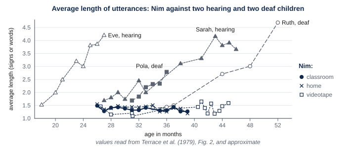
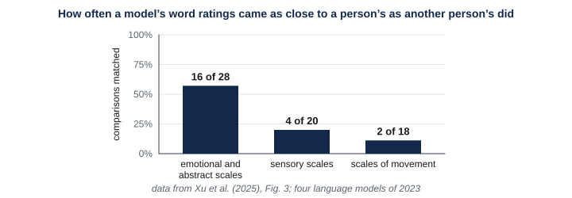
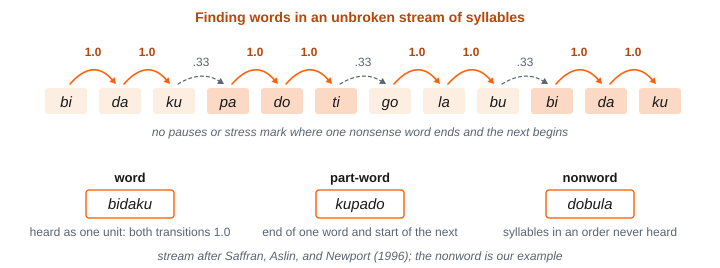
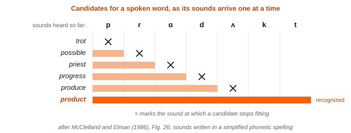
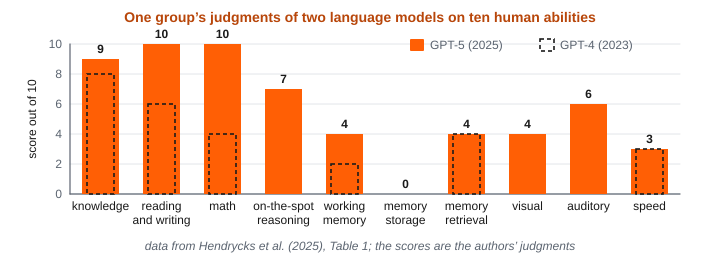

# 13. Language

This module is about language: what it lets one mind do for another, how people and machines come to use it, and what in the brain makes it possible. While reading, look for the beginnings of answers to these questions:

- What is language for, and how do the signals of other animals, and of apes taught by people, compare with it?
- When did *Homo sapiens* come to use language, and what does a child need in order to learn one?
- How do listeners find words in a stream of speech, and how do learners work out what the words refer to?
- Do children learn rules or statistics, and how much of language must be built in from birth?
- How are language models built, what do they learn about form and meaning, and where do they fall short?
- What in the brain makes language possible, and how separate is it from the rest of thought?

By the end, we should be able to say what using a language requires, which procedures could produce it, and what the evidence from brains and from machines does and does not show.

<!-- pin: t-levels-language -->

: Marr’s three levels, the question each asks, the discipline that asks it, and this module’s example. {#t-levels-language}

| Level | The question it asks | Discipline | This module’s example: a sentence never heard before |
|---|---|---|---|
| Computational | What problem is being solved, and why does solving it matter? | Evolution and ecology | A reader understands at once a sentence that no one has written before. What does language let one mind do for another, or for itself, and who has it? |
| Algorithmic | What is represented, and by what procedure? | Cognitive psychology and AI | How people, and machines, hear, learn, and understand language |
| Implementational | By what physical means, and at what cost? | Neuroscience | The brain systems for language |

---

People understand sentences they have never read or heard before, at once and without effort. Consider this one: “The goat that ate the mail carrier’s gloves last winter has started following her along her route.” Almost certainly, no one has written or said that sentence before. Yet anyone who knows English can understand it, whether it arrives as vibrations in the air, as signs made with hands, or as marks on a page. For anyone who speaks, signs, or reads a language, understanding a new sentence is so ordinary that it is easy to overlook.

Every typically developing child comes to do the same within a few years, from the speech or signing of the people nearby. Many other animals signal to one another, about food, danger, or rivals. But no other animal is known to produce and understand new messages about anything and everything. Machines can also produce new sentences that read as though a person wrote them. These facts raise three questions. First, what does language let its users do? Second, how do language learners come to have it? And third, in order to be a language user, what are the capacities an entity must have, and what are the things they must do?

Each question leads to narrower ones. What is language for, and how does it differ from other animals’ signals? When did *Homo sapiens* come to use it? How do children learn it, and how do people hear and understand it as it unfolds? How are language models built, and how do they compare with people? And what in the brain makes language possible ?

---

## §13.1 — Computational: What Language Does and Is For

### §13.1.1 — What Language Is For

People use language in two ways that can be observed. One is to change what someone else knows, believes, or does, as when a person tells a friend where the keys are, in speech or in a sign language. The other is to work something out with no one else listening, such as talking through a problem under one’s breath. Both uses rely on **language**: a learned, shared system that combines a finite set of signals into an unbounded number of messages. Researchers disagree about which of the two uses language is mainly for.

Each use poses a problem that would be hard however it was solved. One problem is using signals to shape what other people do, and responding appropriately to the signals that others send. What a listener should do in response to a signal depends on the combination and order of its parts, and often on things the listener cannot see, such as an event that is over or a place far away. Sound or gesture delivers only one signal at a time. And the signals work only if both people use them the same way. So every child has to learn them from what they happen to hear or see.

The other problem is building a complex thought and working with it. A thought about what is absent, past, possible, or false has parts that stand in relations to one another. These include who did what to whom, when, and why. A solution to one problem need not solve the other. So the question of what language is for has two possible, and non-mutually exclusive answers.

On one view, language is primarily a tool for communication. The view goes back at least to Aristotle, who argued that speech lets people share their judgments of what is beneficial and harmful, and what is just and unjust. On this view, what language does, it does between people rather than within one person. 

More recently, the cognitive scientist Evelina Fedorenko and her colleagues have argued for the communication view, from evidence about people and languages today, rather than about how language evolved. Their evidence is of two kinds. People who lose language after brain damage can still do arithmetic, reason about causes, and understand what other people believe. Languages also have regularities that make communication efficient. Frequent words tend to be short, and words for relatives or for colors balance simplicity against precision. The researchers concede that efficiency alone is not proof that communication is the main function. On their view, people form thoughts without language, and use language to share them.

On the other view, language is mainly an instrument of thought, and communication is a secondary use of it. This view goes back at least to Plato, who described thinking as the soul’s silent conversation with itself. On this view, language is first a means of forming thoughts, and only then a means of sharing them.

The modern version of the thought view, from the linguist Noam Chomsky and others, is more specific. They argue that the crucial change in human evolution was the ability to build complex thoughts whose parts stand in relations to one another, and that expressing such thoughts in speech or sign came later. They also assert, without reporting measurements, that most use of language is in thinking rather than talking. They also make an argument from how sentences are built, which we take up in §13.2.8. Another defense of the thought view is that tests of people who have lost language measure how they use it, not what they know of it. So the two views disagree about what can be concluded from the loss of language.

### §13.1.2 — Signals in Other Animals

Many animals send signals that change what other animals do, and some signals concern things that the receiver cannot see. Defined broadly, as a trait that changes what another organism does and that evolved because it has that effect, signaling is nearly universal among living things, from bacteria to flowering plants. A honeybee that has found flowers dances on its return to the hive. The angle and duration of the dance correspond to the direction and distance of the flowers, and bees that see the dance can fly to them. Signaling, and even signaling about something out of sight, is not unique to human beings.

Signals come a step closer to language when an animal has several distinct signals, each given in response to a different kind of thing, and each making listeners act as that thing would. Vervet monkeys give acoustically different alarm calls in the presence of leopards, eagles, and snakes, and hearing the sound leads other vervets to respond in predator-specific ways. In Kenya, Dorothy Cheney and her colleagues played recorded alarms from a hidden loudspeaker with no predator present, so the listeners could not have seen a predator themselves. Monkeys on the ground tended to run into trees after leopard alarm calls, look up after eagle alarm calls, and look down after snake alarm calls . So each call goes with one kind of danger, and the call alone, with no predator in sight, is enough to produce the response to that danger.

{#f-vervet-playback alt="A grouped bar chart with three groups, labeled leopard alarm, eagle alarm, and snake alarm, and three bars in each group, for running into a tree, looking up, and looking down. After leopard alarms, running into a tree is the tallest bar, at 42 percent of 19 trials, with looking up at 21 percent and looking down at 5 percent. After eagle alarms, looking up is the tallest, at 50 percent of 14 trials, with looking down at 29 percent and running into a tree at 14 percent. After snake alarms, looking down is the tallest by far, at 74 percent of 19 trials, with the other two bars at 11 percent each."}

Young vervets do not have to learn how to make their calls, but they do learn which things to give each call to. Infant vervets give eagle alarm calls to many kinds of birds, and even to a falling leaf. With age, they give them mainly to martial eagles. Monkeys and apes are not known to learn new calls by imitation, beyond small changes to calls they already have. So a vervet cannot add a call for a new kind of danger.

Another step from communication to full-fledged language is that language also combines signals, and the order in which they are combined changes what they mean. In at least one songbird, listeners respond to the order of two calls. Japanese great tits scan their surroundings when they hear one call, and approach the caller when they hear another. When researchers played the two calls in the order the birds usually use, listeners did both, and when the order was reversed, they did much less of either. The researchers called this a kind of syntax, a label that is contested. So combining signals to change their effect is found in animals other than human beings, at least for two calls, and whether human language differs from other signals in kind or only in degree is left open.

### §13.1.3 — Animals That Learn Their Sounds

A further step toward language is being able to add new signals, and for sounds, that means learning to make new ones by imitating what one hears. Only a few groups of animals can do so. This ability is **vocal learning**: learning to produce new sounds, or to change sounds, by imitating sounds that are heard. Among birds, songbirds, parrots, and hummingbirds have this ability. Among mammals, human beings have it, as do whales and dolphins, bats, seals and sea lions, and elephants. No other primates do, and most other mammals and birds do not . Most species that have the vocal learning ability have close relatives that lack it. So the ability arose separately in distant branches, a case of **convergent evolution**, in which separate lineages arrive at the same solution from different starting points. Learning sounds by ear has therefore been achieved many times.

{#f-vocal-learners-tree alt="Two simplified trees side by side, one for birds and one for mammals, drawn without branch lengths. On the bird tree, songbirds, parrots, and hummingbirds are marked with filled circles for vocal learning, and the suboscine birds, chickens, and doves, on nearby branches, are marked with open circles. On the mammal tree, human beings, whales and dolphins, bats, seals and sea lions, and elephants are marked with filled circles, and the other primates with an open circle. On both trees, the filled circles are scattered, separated by branches with open circles." width=80%}

Vocal learning, learning to make a new sound, is separate from learning when and how to use a sound. An animal can have one ability without the other. A dog learns to sit at the sound *sit*, but cannot learn to say it. And responding to a sound in this way is not the same as learning that the sound refers to or means something, which we take up in §13.2.4. The closest parallel to a child learning to speak is a young songbird learning its song. A young zebra finch must hear an adult’s song to learn to sing its own. Like a human infant, it listens for weeks or months before it practices. Its practice then moves from rough versions, much like an infant’s babbling, toward the adult form. But the parallel holds for sounds, not for messages. Vocal learning lets an animal add new sounds, which a vervet cannot do, but by itself it gives no way of combining sounds into new messages. And among primates, only human beings learn to make new sounds.

### §13.1.4 — What Human Language Does

Evaluating if and how human language is different from other animals’ signals leads to a list of what language lets its users do that simple signalers cannot. In 1960, the linguist Charles Hockett listed thirteen features of human language, and asked which of them other animals’ signals share . Four of them are especially useful for comparing species. **Productivity** is the ability to say things that have never been said before, and to be understood. **Displacement** is the ability to talk about things that are far away in space or time. **Arbitrariness** means that a signal need not resemble what it is about, so a language can have a signal for anything. **Duality of patterning** is the combining of a small stock of sounds that mean nothing on their own into a great many signals that do have meanings, as the same three sounds make *tack*, *cat*, and *act*. With such features, whether a system is a language becomes a set of questions about what it lets its users do.

{#f-hockett-features alt="A grid with thirteen rows, one per feature, and five columns: bee dancing, gibbon calls, western meadowlark song, human language, and a sign language. The rows, from top to bottom, are vocal-auditory channel, broadcast transmission and directional reception, rapid fading, interchangeability, total feedback, specialization, semanticity, arbitrariness, discreteness, displacement, productivity, traditional transmission, and duality of patterning. The human language column is filled in every row. The sign language column is open in the row for the vocal-auditory channel, and filled in the rows for features that do not depend on the voice. The bee dancing column is filled for semanticity, displacement, and productivity, and open for the vocal-auditory channel, arbitrariness, discreteness, and duality of patterning. The gibbon column is filled in the first nine rows, and open for displacement, productivity, and duality of patterning. The meadowlark column is mostly open or marked with question marks in the lower rows."}

On Hockett’s comparison, only human language has all thirteen features, but no single feature is unique to it. He judged that the bee dance has productivity and displacement, since a bee can perform a new dance about flowers that are out of sight. But a bee can signal only one kind of absent thing, where food is, while people can talk about anything. So the difference lies in the combination of features, and in their scope.

Hockett’s list was built around speech, and sign languages show its limits. Sign languages are full human languages, neither mime nor a code for a spoken language. Each sign of American Sign Language combines a handshape, a location, and a movement, much as a spoken word combines sounds. So several of Hockett’s features describe the channel of speech rather than language, and what a child acquires is a language in whatever channel their community uses.

Whether human language differs from other animals’ signals in kind, or only in degree, is disputed. But there are some language behaviors that other animals do not, and some argue cannot, do. For example, people put one message inside another. The sentence *The goat ate the gloves* can go in *Sam thinks that the goat ate the gloves*, which can go inside another message in turn. No other animal has been shown to put one message inside another (though an absence of evidence is not evidence of absence). In 2002, Chomsky and two coauthors tentatively proposed that embedding chunks of language inside others, without limit, is the one part of language unique to human beings. Many others deny any difference in kind. Whether people can do it without limit is a separate question. The dispute turns on what is happening inside a speaker or a listener, and we take up the proposal in §13.2.8.

Recent recordings of sperm whales may be the strongest challenge yet to the claim that only human language builds signals from parts that mean nothing on their own. One Caribbean clan uses at least 143 kinds of click burst, called codas, built by combining rhythm, speed, and timing, and some codas differ in sound quality much as the vowels *a* and *i* do. But no playback experiment has yet tested how whales respond to the codas, so these studies show structure in the signals, not what the signals mean.

### §13.1.5 — Apes and Other Animals Taught Language

Another way to ask whether other animals differ from human beings in kind or in degree is to teach them a language and see how far they get. Beginning in the 1960s, researchers taught apes signs or keyboard symbols, and some raised apes among people . Two chimpanzees, Washoe and Nim Chimpsky (named jokingly after Noam Chomsky), were taught signs taken from American Sign Language . What each project found depended on how the animal’s behavior was recorded and judged.

{#f-nim-kanzi alt="Two photographs side by side. The left one is itself two black-and-white photographs taken outdoors, on a forest floor covered in dead leaves. In each, a young man with shoulder-length hair sits with a young chimpanzee in his lap. In the first, the man tickles the chimpanzee, which covers its face with its hands and grins. In the second, the chimpanzee leans back against the man’s chest with its mouth wide open, and the man is laughing. The right photograph, in color, shows a large adult bonobo with black hair sitting indoors, leaning forward on one arm and looking toward a woman with white hair at the right edge of the picture, with its mouth slightly open. The woman holds a sheet printed with a grid of many small colored symbols, each on a dark square." width=85%}

: Animals taught a language: what each used, how it learned, what was measured, and how cues from people were controlled (after Terrace et al., 1979; Savage-Rumbaugh et al., 1986 and 1993; Herman, Richards, and Wolz, 1984; and Pepperberg, 1990). {#t-ape-projects}

| Animal | Medium | How it learned | What was measured | Control for cues from people |
|---|---|---|---|---|
| Washoe, a common chimpanzee | Signs taken from American Sign Language | Taught, by molding her hands | Signs and combinations she produced, recorded by caretakers | Understanding not tested; films later analyzed by other researchers |
| Nim, a common chimpanzee | Signs taken from American Sign Language | Taught, by molding and guidance | About 19,000 combinations recorded by teachers, and 3½ hours of videotape | Understanding not tested |
| Kanzi, a bonobo | Lexigrams on a keyboard, and spoken English | Untrained, by watching | Responses to about 660 new spoken requests | Speaker out of sight on most trials |
| Phoenix and Akeakamai, bottlenose dolphins | Computer-made whistles, or a trainer’s arm and hand gestures | Trained, with fish as rewards | Responses to new instructions | Trainer unaware of the instruction or unable to see; an observer unaware of it judged each response |
| Alex, a gray parrot | Spoken English | Trained, by watching two people question and reward each other | Answers to spoken questions | Tester knew the answers |

Nim learned around 125 signs, and produced many combinations of signs. But over his last 19 months in the project, his utterances averaged only 1.1 to 1.6 signs per utterance, and had stopped growing longer. Children’s utterances, in contrast, grow steadily longer . Most of Nim’s utterances followed something a teacher had just signed, and about 40% repeated all or part of it. Under **Morgan’s Canon**, a behavior should not be explained by a higher mental process if a simpler one accounts for it. Imitation and prompting account for Nim’s combinations, so they are not evidence that he combined signs by any principle of his own.

{#f-nim-mlu alt="A line chart with age in months on the horizontal axis and average utterance length on the vertical axis. A line for Nim runs nearly flat from 26 to 45 months, rising and falling between 1.1 and 1.6. Lines for hearing and deaf children start near Nim’s level and climb well above it as the children grow older."}

Tests of understanding, rather than producing, gave a different picture. Kanzi, a bonobo, learned keyboard symbols without training, by watching researchers try to teach them to his mother . When he was about 8, Sue Savage-Rumbaugh and her colleagues tested him on about 660 spoken requests he had never heard. He carried out about three quarters correctly, a little better than a girl of 1½ to 2 tested the same way, though his caretakers scored the trials. So in understanding new requests, an 8-year-old bonobo came close to a human child of 18 to 24 months.

Kanzi understood far more than he produced, and his own utterances stayed near one symbol each. Apes in the same laboratory first exposed to the symbols after about 2½ years did not learn them without training. So the ape that understood most was the one exposed youngest, an age effect of the kind we described in Module 5. Dolphins and a gray parrot , taught by other methods, did much the same, so the results are not about apes alone. But none of these animals, apes included, produced combinations that grew in length and structure as a child’s do.

{#f-dolphin-parrot alt="Two color photographs side by side. On the left, a gray bottlenose dolphin raises its head and upper body out of clear turquoise water, resting its beak near the white edge of a pool, beside a dark wooden rail. On the right, a gray parrot stands on a pale wooden deck in sunlight, with its head turned toward the camera. Its gray feathers have a scalloped pattern, its beak is black, its eye is pale, and its short tail is bright red." width=65%}

### §13.1.6 — A Body for Language

If apes can learn many symbols, but none has learned to speak, the limit might lie in a difference in the body rather than in what an ape can learn. For decades, textbooks blamed the shape of the primate vocal tract, the passages of the throat and mouth that shape the sound of the voice, on the strength of a 1969 estimate made from a cast of a dead monkey’s vocal tract. But when researchers filmed a living macaque with x-rays, its vocal tract could make a far wider range of vowels, enough for five vowels that listeners could easily tell apart . A lowered larynx, long taken to be an adaptation for speech, is no better a sign, since many mammals lower the larynx when they call, and lions and koalas have one that is permanently lowered. So neither the vocal tract nor the larynx marks the difference between apes and people. A remaining possibility is control of the voice, a question we take up in §13.3.1.

{#f-monkey-vowels alt="A plot with the first resonance of the vocal tract on one axis and the second resonance on the other, the standard way of mapping vowels. A large outline marks the vowels of a human speaker, with its corners labeled with the vowels of see, who, and father. A small outline near the middle marks the 1969 estimate for the monkey. A much larger outline marks the living monkey’s range. It overlaps the middle of the human outline and extends beyond it on one side, but does not reach the corners labeled see and who."}

A separate question about the body is whether language began with spoken sounds at all. Ape gestures differ from ape calls, which is one reason some researchers think language began with gestures and facial expressions, rather than spoken sounds. Unlike calls, ape gestures are learned, they vary between groups and even between individuals, and most are directed at one particular partner. Most of them, though, are play signals or requests for food. Other researchers think language *did* begin with spoken sounds. Whether language began with gesture or with voice is an open question. But since sign languages are full languages, language does not need a voice, and need not have begun that way.

### §13.1.7 — When Language Arose

When human beings came to have language is hard to answer. Language leaves no fossils, and so it has to be inferred from bodies, artifacts, and genes, none of which records speech . From artifacts, we can learn that people made marks deliberately, and repeated a practice for thousands of years, but not what the marks meant, or whether their makers spoke a language. The engraved pieces of ochre from Blombos Cave, in South Africa, are an example: people there engraved geometric patterns for at least 25,000 years, from about 100,000 to 75,000 years ago, and what the patterns meant is unknown . From a lack of artifacts, we learn even less, since many recent foraging peoples left little that would survive. So every date for the origin of language is an argument, not a measurement.

: Kinds of evidence about when language arose, what can be learned from each, and what cannot. {#t-language-evidence}

| Kind of evidence | What can be learned from it | What cannot |
|---|---|---|
| Artifacts, such as engravings, ornaments, and tools | That people made marks deliberately, and repeated a practice over long periods | What the marks meant, or whether their makers spoke a language |
| An absence of artifacts | Very little | That a capacity was absent, since many recent foraging peoples left little that would survive |
| Fossil bodies, such as the bones of the ear and throat | Whether a body could hear and produce the sounds of speech | Whether a language was spoken |
| Genes | Which genetic differences separate human beings from their relatives | What a difference did, or when language arose |
| Dates older than about 50,000 years | Approximate ages | Exact ages, since the methods rest on assumptions about how objects were buried |

When did people begin to behave as people do now? For a long time, many researchers answered that they began suddenly, about 50,000 to 40,000 years ago. This corresponds to a time when a set of behaviors appeared close together in the European archaeological record. That set, called *behavioral modernity*, includes standardized tools, ornaments, images, and the exchange of materials over long distances. One archaeologist proposed that a genetic change at about that time produced the modern capacity for culture. Others have read the proposal as an account of the origin of language. But the checklist was drawn only from evidence from Europe. So a sudden change in Europe may be a fact about Europe, not about the species.

The African record does not fit the sudden picture. Many of the behaviors on the checklist appear in Africa long before 50,000 years ago, at sites far apart in place and time . In Kenya, people made stone blades and ground red ochre, a mineral pigment, more than 200,000 years ago. In central Africa, people made barbed bone points and fished seasonally by at least 75,000 years ago. A later review found that innovations appeared, disappeared, and reappeared in different regions, rather than building up steadily. So the modern behaviors did not appear together, and a sudden origin about 50,000 years ago is hard to square with the African record.

{#f-msa-first-appearances alt="A horizontal time axis from 280,000 years ago at the left to the present at the right. About a dozen horizontal bars, each labeled with a behavior, such as blades, grinding of pigment, points, bone tools, fishing, long-distance exchange of stone, beads, and engraved objects. Each bar begins at a different point and runs to the present. Several begin more than 200,000 years ago, and most begin well before a dashed vertical line at 50,000 years ago. A shaded vertical band from 100,000 to 75,000 years ago is labeled engraved ochre at Blombos Cave."}

Because all of this evidence is indirect, estimates of when language arose vary widely. Published estimates of when language arose run from about half a million years ago, in the common ancestor of Neanderthals and *Homo sapiens*, to between 200,000 and 60,000 years ago, in *H. sapiens* alone. Even the defenders of the more recent estimate concede that they cannot say whether *H. sapiens* had language 80,000 years ago. Some researchers also propose that earlier hominins used a *protolanguage*, simpler than language, on the way to it. Others reject the idea. The estimates differ several-fold because each rests on a different reading of the same limited evidence.

Whether Neanderthals had language is open. Some researchers infer from Neanderthal tools, hunting, and use of fire that they must have had language. The case that they lacked it was built on the same checklist drawn from Europe. Both answers are inferred from artifacts, so on the same standard, neither the presence nor the absence of Neanderthal language has been shown.

### §13.1.8 — The Problem of Language Acquisition 

*Whenever* language arose, every child since has had to learn it from the people around them. A child who learns a language comes to do two things, and possibly a third. First, they must learn to respond appropriately to the signals others send, by acting, looking, answering, or expecting appropriately to the signal. What counts as an appropriate response can depend on the order of the signal’s parts, on parts far apart, and on things not in view. Second, they must learn to produce signals that get other people to act, expect, or reply in particular ways, following the conventions of their community. And third, many come to use the same signals with themselves as the audience, to guide their own behavior through a problem with many steps. All of this must extend to signals the child has never encountered, since no child hears more than a tiny fraction of the messages a language allows. So the learner’s problem is to get from a limited sample of other people’s signals, to an unbounded ability to produce and respond to new signals.

People also come to judge the form of a signal apart from what it means. English speakers judge *Colorless green ideas sleep furiously* to be a possible English sentence, and *Furiously sleep ideas green colorless* not to be. This is true even though both are nonsense, and neither had been said before Noam Chomsky made them up in 1957. So whatever a child learns has to support judgments about new combinations of familiar parts, even combinations that mean nothing.

Learning a language has many steps, and each one comes at a wide range of ages. In a large study based on parents’ reports, children begin to understand words at 8 to 10 months, and say their first words at 11 to 13 months. Half could say 50 words by about 17 months, and began combining words between 18 and 22 months. But there is large variability across children. At 16 months, the bottom tenth of children said fewer than 10 words, and the top tenth nearly 180. The “average child” is in fact quite unrepresentative of the variation.

Children learn from the speech or signing of the people around them, together with whatever is happening at the time. That input leaves much of the problem unsolved. Fluent language has no reliable pauses between words. A word perceived while a scene is in view could refer to many things in it: to an object, one of its parts, its color, what it is doing, or a whole category of things like it. And parents rarely correct the form of what a child says. In one classic study, parents approved of children’s statements about as often when they were badly formed as when they were well formed. Their approval followed whether a statement was true, not whether it was said correctly. So the input does not come divided into words, labeled with what the words refer to, or consistently corrected when the child gets the form wrong.

Above all, the sample of input that children receive is small. By about age 12, a child has perceived between about 14 million and 140 million words, depending on how much the people nearby talk or sign. The language models of 2020 to 2023 were trained on hundreds of billions to a few trillion words and parts of words, thousands to hundreds of thousands of times more than what children receive. Any account of how children learn language has to explain that gap.

Learning also seems to have a time limit, at least for a second language. People who begin learning a second language later in life end up less like native speakers. Within their first year, infants become less able to tell apart speech sounds that the language around them does not use, which makes those sounds harder to hear in a language learned later, as we described in Module 5. The later people begin a second language, the more likely they are to speak it with an accent. The chance rises steadily from early childhood, with no sharp cutoff, and almost no one who begins after about age 15 ends up sounding like a native speaker. People who begin a second language after about age 10 to 12 usually end up less like native speakers in judging which of its sentences are well formed, and the ability to learn seems to decline from about age 17. A period like this, during which experience with a language has an outsized and lasting effect on what a learner ends up able to do with it, is called a **critical period for language**. Any account of how children learn language has to explain why such periods exist. Elissa Newport proposed one answer, called *less is more*: children’s limited memory and attention help them learn. Because children take in only small pieces of what they hear, they may more easily find the small units a language is built from.

Finally, a child can learn whatever language their community uses, spoken or signed. Some languages are only decades old. This means that the fine-grained details of a language cannot be built in via evolution. To the extent that humans are shaped by evolution to learn and use language, that shaping must work in a way that does not depend on the details of any particular language. So children must reach an unbounded ability to respond to and produce signals, in whatever language the community happens to use. And they must do this from a small sample that is not divided into words, labeled, or frequently corrected, and within a limited window of time.

### §13.1.9 — Children Who Build a Language

The strongest test of how much of a language must come from what a child hears is a child who hears no usable language at all. Some deaf children of hearing parents, with no usable spoken or signed language around them, invent gesture systems called *home sign*. These systems have some of the properties of language. In one study of ten deaf American children, every child combined gestures into strings in consistent orders, and some strings combined two or more ideas. Their mothers did not teach them the system. The children rarely imitated their mothers’ gestures, and the mothers’ gestures did not follow the children’s orders. So unless the children took more from the speech around them than anyone measured, some of the structure in their gestures came from the children themselves.

When children who have invented home sign come together, they can build more than any one of them builds alone. In 1977, a school for deaf children opened in Nicaragua, and the children there built a new sign language from their home signs and the gestures of hearing people. Ann Senghas and her colleagues compared how signers who had joined at different times described something rolling downhill. Hearing Nicaraguans gesturing while speaking Spanish always showed the rolling and the descent in one movement. Signers who joined before 1984 split them into separate signs in about a quarter of their descriptions, and those who joined later in about three quarters. The first signers, by then teenagers, did not take up the change. So some of the structure of a language can come from the children who learn it, and from younger learners more than older ones.

### §13.1.10 — The Machine’s Problem

A machine that learns language from text alone faces a version of the child’s problem, with a different input. No one points at things for it. No world is in view, only the text. In Module 5, we described how the next word can serve as a target for learning. A system that learns by predicting what comes next then sees what actually comes, and can use the difference between the two as a teaching signal. So a learner given only text has a potentially unlimited supply of targets, but lacks many other things a child gets from the world around the words.

How much a learner given only text can recover about the world can be measured. In one study, four language models of 2023, two of them trained on text alone, rated thousands of English words on scales such as how pleasant a word is, or how much people experience it through touch or with their hands. A model’s ratings came as close to a person’s as another person’s did in 16 of 28 comparisons on emotional and abstract scales, 4 of 20 on sensory scales, and 2 of 18 on scales of movement . So what a learner can recover about the world from text alone is partial, and why it is partial in this way is an unanswered question.

{#f-text-gap alt="Three bars that fall from left to right. For emotional and abstract scales, the models matched people in 16 of 28 comparisons. For sensory scales, they matched in 4 of 20. For scales of movement, they matched in 2 of 18."}

Current large language models are not usually trained on text alone, since images and feedback from people are also part of their training. But the problem is clearest for a learner given only text, and that is the case a comparison with children needs.

---

## §13.2 — Algorithmic: Hearing, Learning, and Understanding Language

### §13.2.1 — Levels of Description

What does a listener, or a learner, actually have to work with when a sentence arrives? Linguists traditionally describe language at several levels, each with its own units.

A **phoneme** is one of the smallest units of sound that can change one word into another. The word *cat* has three phonemes, /k/, /æ/, and /t/. The word *chat* also has three, /tʃ/, /æ/, and /t/, even though it is spelled with four letters, because *ch* is a single sound. Phonemes are written between slashes, in the symbols of the *International Phonetic Alphabet*, or IPA. The IPA was designed so that the sounds of every language can be written with it. The IPA chart has 28 symbols for *vowels* (sounds made by unobstructed air flow) and 78 for *consonants* (sounds made in part by obstructing air flow as it exits the body). The chart also has more than 30 marks that change what a symbol stands for, such as a mark showing that a vowel is nasal.

Each language uses only some of these sounds, and languages differ widely in how many they use . English has 24 consonants, and counted by the same rules as the other languages in the figure, 11 vowels. The median language in the figure has 20 consonants and 7 vowels. At the extremes, Rotokas, a language of Papua New Guinea, has 6 consonants and 5 vowels, and !Xu, a language of southern Africa, has 94 consonants and 46 vowels. !Xu is a language that makes use of a large number of distinct “click” sounds, which is how it has so many different consonants.

![Numbers of consonants and vowels in 451 languages, one dot per language, with six languages labeled. Linguists count vowels in different ways, for example in whether a long vowel, a nasal vowel, or a diphthong like the vowel in *buy* counts as a vowel of its own. This figure follows one survey’s rules for every language. English, which the survey does not include, is counted from one description of American English by the same rules (data from the UCLA Phonological Segment Inventory Database, after Maddieson, 1984, as distributed by Moran and McCloy, 2019; English after Ladefoged, 1999).](reading_images/fig-sound-inventories.svg){#f-sound-inventories alt="A scatter plot with the number of consonants, from 0 to 100, on the horizontal axis and the number of vowels, from 0 to 50, on the vertical axis. Most of the 451 dots crowd into the lower left: about 87 percent lie between 10 and 40 consonants and between 3 and 15 vowels. Dashed lines mark the median language, at 20 consonants and 7 vowels. Six dots are labeled: Rotokas, 6 consonants and 5 vowels; Spanish, 20 and 5; Mandarin Chinese, 25 and 5; English, 24 and 11; Hindi-Urdu, 31 and 20; and !Xu, alone at the upper right, 94 and 46." width=90%}

A **morpheme** is the smallest unit that has a meaning. Morphemes are not quite the same thing as words. Some morphemes are not words, and some words contain multiple morphemes. For example, *glove* is a word and a morpheme. But *gloves* is one word with two morphemes, *glove* and *-s*. The *-s* is a morpheme because it has a meaning of its own: it makes the word it is attached to plural.

**Syntax** is the way words combine into phrases and sentences. In *The goat ate the gloves*, for example, *the goat* is the subject of *ate*, and *the gloves* is the direct object of *ate*. Some languages, like English and Chinese, primarily organize syntax around *word order*: subject and object are defined by their position relative to the verb. Other languages, like Latin and Russian, organize syntax using *inflectional morphology*, morphemes added to a word to mark its role in the sentence. For example, in Latin, *puell-a puer-um vide-t* means “the girl sees the boy”. The ending *-a* marks *puella*, “girl”, as the subject, and the ending *-um* marks *puer*, “boy”, as the object. The ending *-t* on *vide-*, “see”, marks a subject that is one person or thing, other than the speaker or the listener. Because the endings mark the roles, the words can come in other orders. *Puer-um puell-a vide-t* also means “the girl sees the boy”.

**Semantics** is what words and sentences mean. Meaning is a separate level from syntax, because sentences with different structures can have the same meaning. *The goat ate the gloves* and *The gloves were eaten by the goat* have different subjects, but both describe the same event, in which the goat did the eating. Words have meanings too, and many words have more than one. *Bat* can mean a flying mammal or a stick for hitting a ball, so a listener must choose between them. In *The bat flew out of the cave*, the rest of the sentence shows which meaning is intended.

**Pragmatics** is how a sentence is used in a situation, and how context of all kinds alters the meaning of a sentence. Three examples show how much context can add. First, some words refer to different things each time they are used. In *I will meet you here tomorrow*, the words *I*, *you*, *here*, and *tomorrow* refer to different people, places, and days, depending on who says the sentence, to whom, where, and when. Second, a sentence can take something for granted. *Sam stopped smoking* tells a listener that Sam used to smoke, though no word in the sentence says so. Third, the same words can do different things depending on who says them. When the chair of a meeting says *The meeting is adjourned*, the meeting ends. When anyone else says it, nothing happens. In each case, a listener needs to know about the situation, not just the words, to understand what was meant.

The levels are connected, since the meaning of a sentence is usually built from the meanings of its words and the way they are combined. This property is called **compositionality**. *The dog bit the man* and *The man bit the dog* have the same words, but different meanings. There are exceptions, such as idioms like *kick the bucket*. But where compositionality holds, a finite stock of words can make an unbounded number of meanings. That is the productivity we described in §13.1.4, the ability to say new things and be understood.

### §13.2.2 — Hearing Speech

The first problem for a listener is to hear which speech sounds, like phonemes, were said. This is harder than it seems. No acoustic property marks a speech sound in every context. The same consonant sounds a little different before different vowels, and different talkers and speaking rates change the signal too. So a listener cannot recognize speech sounds by matching them to fixed patterns. Instead, sounds that vary have to be sorted into a small set of categories. As we noted in Module 8, a property of a language is the set of sounds it has.

Listeners sort speech sounds into categories sharply. In 1957, researchers made an audio recording of 14 synthetic syllables that differed in even steps along one acoustic dimension. Listeners were asked to label each syllable as *b*, *d*, or *g*. The researchers found that listeners switched abruptly between neighboring labels with small changes in the acoustic signal. Listeners were also far better at telling two syllables apart if they were syllables that tended to be given distinct labels .

This pattern is called **categorical perception**. Listeners still heard some differences within a category, but differences across a category boundary were heard much more readily than differences within a category. Categorical perception is a clear-cut place where language experience influences perception. What humans perceive is influenced by the language to which we are exposed. Whether a language shapes thought more broadly is a question we take up in Module 15. Interestingly, categorical perception is a general ability not limited to language or to humans. Chinchillas and macaques divide some speech sounds where languages place boundaries. In one study, Patricia Kuhl and James Miller trained chinchillas for months to respond differently to clear examples of *da* and *ta*. When they then heard syllables between the two, they divided them at nearly the same point as English speakers, a point they had never been trained on. So some of the boundaries that languages use may lie where the hearing of mammals already divides sounds.

{#f-categorical-perception alt="Two panels side by side, each with a horizontal axis numbered 1 to 14, one number for each synthetic syllable. In the left panel, three curves show how often each syllable was labeled b, d, or g. The b curve is near 100 percent for syllables 1 to 3 and then drops steeply. The d curve rises steeply, stays near 100 percent for syllables 5 to 9, and drops. The g curve rises steeply and stays near 100 percent for syllables 11 to 14. In the right panel, two lines show discrimination of pairs two steps apart, one obtained and one predicted, with a dashed line at chance. Both lines peak where the labels change, near the boundary between b and d and near the boundary between d and g. Both dip close to chance among the d syllables. The obtained line lies above the predicted line in most places, by the most among the g syllables."}

Categorical boundaries are not in the same place in every language. For example, English has *r* and *l* as distinct sounds, distinguished by a small acoustic difference in the third resonance of the vocal tract, which is lower for *r*. Japanese has only a single sound in this region, and Japanese listeners hear both English *r* and English *l* as that one sound. This is what makes it hard for Japanese speakers to perceive the *r*–*l* distinction in English. English speakers have the same difficulty with other languages. Hindi has two *d* sounds, one made with the tongue against the upper teeth and one made with the tip of the tongue curled back toward the roof of the mouth. English has a single *d*, made at a place between those two. English-speaking adults hear both Hindi sounds as their one *d*, so they have trouble telling the two apart.

In Module 5, we described how infants, within their first year, become better at recognizing the sounds in their language, and less able to hear distinctions that their language does not use. How could an infant learn where its language puts these boundaries? One possibility is that it uses how often each sound occurs. In one study, 6- and 8-month-old infants heard about 2 minutes of syllables from a series running from *da* to *ta*. For one group, the most frequent sounds formed two peaks, near the ends of the series. For another group, they formed one peak, in the middle . Afterward, only the infants who had heard two peaks told the two ends of the series apart. So the frequencies of the sounds infants hear may set the categories they come to hear.

{#f-two-peaks alt="A line chart with the eight steps of the series on the horizontal axis, from da at step 1 to ta at step 8, and the number of times each step was played on the vertical axis. One line, for the two-peak group, rises to 16 at step 2, falls to 4 at steps 4 and 5, and rises again to 16 at step 7. The other line, for the one-peak group, stays at 4 at the ends and rises to 16 at steps 4 and 5, in the middle."}

### §13.2.3 — Finding Words in the Stream

Once a listener can hear the sounds of a language, the next problem is to find its words. As we noted in §13.1.8, fluent speech has no reliable pauses between words. An infant who does not yet know any words has to find them in some other way, before it can learn what they mean.

One way to find words is to track which syllables tend to follow which. Within a word, syllables tend to follow one another reliably. In the phrase *pretty baby*, for example, *pre* is more likely to be followed by *ty* than *ty* is to be followed by *ba*. At a boundary between words, the next syllable is much less predictable. Many syllables follow *ty*, because many different words follow *pretty*, and many syllables precede *ba*, because many words precede *baby*.

The probability that one item follows another has been called a **transitional probability**. Transitions with relatively low transitional probabilities are a good learning cue for finding word boundaries. In 1996, Jenny Saffran and colleagues showed that infants can use this cue to find words. After 2 minutes of a stream of nonsense words with reliable transitional probability cues to word boundaries, but with no pauses between them, 8-month-olds told the words apart from sequences that spanned a boundary between words . Learning regularities like these from exposure alone, without instruction or reward, is called **statistical learning**.

{#f-syllable-stream alt="A row of syllables, bi da ku pa do ti go la bu bi da ku, each in its own box, with nothing to mark where one word ends. Above each neighboring pair is its transitional probability: 1.0 for pairs inside a nonsense word, such as bi to da and da to ku, and 0.33 for pairs that span the boundary between two words, such as ku to pa. Below the row are three test items: a word, bidaku; a part-word, kupado, made from the end of one word and the start of the next; and a nonword, dobula, made from syllables of the stream in an order the infants never heard." width=90%}

Transitional probabilities are not the only cue to where words begin and end, and infants use several others. One cue is stress. In English conversation, about 90% of content words, such as nouns and verbs, begin with a strong or stressed syllable, as in *baby* and *doggie*. So a stressed syllable is likely to be the start of a word. At 7½ months, English-learning infants already treat a strong syllable as the start of a word, and they can find words like *doggie* in fluent speech. The same strategy misleads them with words stressed on a later syllable. Hearing *guitar is*, they think there is a word like *tar-is*. By 10½ months, they find the correct words, because they have learned to combine stress with other cues.

Another cue is *phonotactics*, the patterns of which sounds can occur together, and where in a word they can occur. In English, for example, no word begins with the *ng* sound at the end of *sing*. Other patterns are a matter of probability. An *f* followed by an *h* is rare inside an English word but common across a boundary between words, as in *if he*. By 9 months, infants treat a pair of sounds that usually spans a boundary as a sign that one word has ended and another has begun. These patterns differ from language to language, so infants are not born knowing them. English-learning infants become sensitive to the stress pattern of English words between 6 and 9 months. Infants who have learned a pattern are also better at finding new words that fit it. So these cues are learned by statistical learning too, and finding words draws on many kinds of regularities at once.

### §13.2.4 — What a Word Refers To

In §13.1, we described the learner’s problem in terms of behavior: learning to respond appropriately to other people’s signals, and to produce signals that change what others do. We did not say what a learner represents in order to do this. Most algorithmic accounts, including those in the rest of this section, take a further step. They assume that a learner links each word to a mental representation of what the word is about, and that this link is what lets the learner respond appropriately to a word in new combinations. Not everyone accepts this step. On another view, which goes back to Skinner’s account of verbal behavior (§13.2.7), knowing a word is nothing more than knowing how to use it and respond to it. We use the terms **reference** and **meaning** because the research does. A word’s reference is what it picks out in the world, such as the things or events it is used to talk about. Its meaning is, on most accounts, the mental representation linked to it. But each experiment below measures behavior: whether a learner looks at, points to, or picks out the right thing on hearing a word.

Finding word forms is only the start of learning a language. A learner also has to work out what the word refers to. As we noted in §13.1.8, a word heard while a scene is in view could refer to many things in it. In one study, adults watched silent video of parents with their children, and guessed which word a parent had just said. They guessed only about 17% of common nouns correctly, and 6% of common verbs. So the moment of hearing a word rarely settles its meaning, especially for a verb.

A learner can narrow the possibilities by combining many moments. In one study, Linda Smith and Chen Yu showed 12- and 14-month-old infants pairs of new objects while the infants heard pairs of new words. Across the trials, each word occurred consistently with only one object . In less than 4 minutes, the infants learned several of the pairings. On one account of how, the learner tallies which words occur with which things across all the scenes. On another, the learner forms one guess for each word, and checks it the next time the word occurs. Adults and young children seem to learn this way in some tasks. The infants’ results fit both accounts. So learners can work out reference across scenes, but the procedure they use is still argued.

{#f-cross-situational alt="Two panels, labeled trial 1 and trial 2. In trial 1, a bat and a ball are shown, and the words bat and ball are heard, with lines from each word to both objects. In trial 2, a ball and a dog are shown, and the words ball and dog are heard, again with lines from each word to both objects. The line from the word ball to the ball is drawn thicker in both panels, since it is the only pairing present on both trials."}

Learners also narrow the possibilities with biases, and at least one of these biases can be learned. Young children extend a new name for an object to other objects of the same shape, rather than of the same size or texture. This shape bias grows stronger with age. In one study, 17-month-olds were taught names for categories of objects that shared a shape. They showed the bias early, and learned more names for objects at home, though each group had only eight children. So a bias that narrows reference can be learned, at least in part, against the view that such biases must be built in.

For verbs, the sentence around a word is evidence about what the word means. A scene in which one animal chases another is also a scene in which the other animal flees. In one study, 3- and 4-year-olds watched such a scene and heard a new verb. With no sentence, most children said that the verb meant *chase*, and none said *flee*. But when a sentence made the fleeing animal its subject, about 40% chose *flee*. This use of a sentence’s structure, called *syntactic bootstrapping*, narrows who does what to whom, not the whole meaning of a verb. So the words around a word are evidence about it, an idea we develop in §13.2.10.

### §13.2.5 — Recognizing Words

Once a person knows thousands of words, a further problem arises: recognizing which word is being heard, while it is still arriving. A person’s knowledge of the words of their language, each with its sound and its meaning, is called their **mental lexicon**. In Module 7, we described pattern recognition, and a spoken word is a pattern that arrives a little at a time.

Listeners often recognize a spoken word before it ends, once the sounds heard so far rule out every other word. As a word begins, all the known words that start with the same sounds are candidates, a set called the word’s *cohort*. Each new sound rules out the candidates that do not fit it . Heard on its own, *trespass* can be recognized at its *p*, where it stops matching *tress* and *trestle*. So recognizing a word is a narrowing of candidates as the word unfolds.

{#f-cohort alt="A grid with the sounds of the word product across the top, one column per sound, in the order they are heard. Below are six rows, one each for trot, possible, priest, progress, produce, and product. In each row, a bar runs from the left edge up to the column where that word stops matching, and an × marks that column. The × for trot falls at the first sound, for possible at the second, for priest at the third, for progress at the fourth, and for produce at the fifth. Only the bar for product runs to the end."}

The candidates do not simply drop out, though. They compete, and every current theory of spoken word recognition includes competition. When people hear *cat*, words that begin the same way, such as *castle*, are briefly active. Words that rhyme with it, such as *bat*, are active too, less strongly and a little later. As people follow spoken instructions, their eyes go briefly to pictures of such competitors, with this time course. So recognizing a word involves competition among candidates, not only ruling them out.

A network built on competition among candidates reproduces this time course. In the network, called TRACE, there is one unit for each speech feature, each sound, and each word, at each moment of the input. Units for rival words inhibit one another, like the mutual inhibition we described in Module 4. TRACE’s connections were set by hand, so it does not learn. In the terms we used in Module 7, its representation is localist, with no learned hidden layer. So competition among candidates is a procedure that can run in a network as well as in a listener.

### §13.2.6 — Rules or Statistics

A language also has regular patterns for changing words, and children generalize them. Children sometimes say *goed* for *went*, a form they have not heard from adults. Applying a regular pattern to an exception is called **overregularization**. So what has a child learned: a rule, or statistics over the words the child has heard?

Overregularization is rarer than is often said. In the everyday speech of 25 children, a median of 2.5% of irregular past-tense forms were overregularized. Correct and incorrect forms of the same verb occurred side by side for years. So any account has to explain a small rate of errors that lasts a long time, not a stage in which *goed* replaces *went*.

Two accounts make different claims about what a child represents . On one account, a rule adds *-ed* to any verb, and irregular forms such as *went* are remembered one by one. A remembered irregular form blocks the rule, and *goed* comes out when *went* is not retrieved in time. On the other account, one network learns regular and irregular verbs from examples, in a single set of connections. In 1986, a network of this kind learned both kinds of verb, and made errors like children’s.

{#f-two-routes alt="Two panels. In the left panel, a verb enters at the top and takes two paths. One path goes to a box labeled memory of irregular forms, containing went and held. The other goes to a box labeled rule: add ed. An arrow from the memory box to the rule box is labeled blocks. Outputs below read went, from memory, and walked, from the rule. In the right panel, the sound of a verb enters a single box, drawn as two layers of units with many connections, and outputs below read went, walked, and goed, all from the same box."}

The 1986 network’s errors, though, began with a sudden switch in its training, from mostly irregular verbs to mostly regular ones. The share of regular verbs in what children hear does not change this way. Later networks, whose vocabularies grew one verb at a time, made occasional errors with no such switch, though only with carefully chosen input. So the debate is unsettled. We return to it in Module 14, as one case of a broader dispute about symbols and networks.

The same question, rules or statistics, arises for whole sentences. In §13.1.8, we described how English speakers judge *Colorless green ideas sleep furiously* to be a possible sentence, and its reversal not. Chomsky argued that neither sentence, nor any part of either, had ever occurred. So, he argued, any statistical model would rate the two as equally unlikely, and the judgment must come from knowledge of grammar.

That argument assumes that a statistical model gives every combination it has never encountered a probability of zero. Models that group words into classes do not. In one such model, trained on newspaper text, each word predicted the next only through 16 classes of words that the model found for itself. It rated the colorless-green sentence about 200,000 times more probable than its reversal. In another study, people learned a small artificial language, and a network learned to predict its next word. Both accepted new sequences made entirely of word pairs they had never encountered. The network did so because it had grouped the words into categories. So a statistical learner can tell new combinations of familiar parts apart, by generalizing over classes of words.

With these results, one argument against statistics fails, but how people make such judgments is a separate question. The judgments are reliable, since people with no training in linguistics agree with almost all of those in a textbook of English syntax. But a judgment need not come from a grammar. One network judged a sentence by working out its meaning, producing the sentence again from that meaning, and comparing the two. It accepted its own version of the colorless-green sentence. So two possibilities are still open. People’s judgments could come from a grammar that sorts sentences into acceptable and unacceptable, or from a learned sense of how likely each sentence is.

### §13.2.7 — Skinner, Chomsky, and the Poverty of the Stimulus

How much of a language does a child bring to learning it, and how much comes from what the child hears? In 1957, the behaviorist B. F. Skinner proposed that verbal behavior is learned like other behavior, through reinforcement. In a 1959 review, Chomsky argued that Skinner’s terms either explain nothing about language or are ordinary talk about the mind in new words. Behavior analysts say that Chomsky misread Skinner’s purpose, and Skinner never replied. After the review, many researchers turned from learning by reinforcement to the question of what a child brings to the task.

The best-known answer is the **poverty of the stimulus**. On this argument, children come to know things about their language for which the speech they hear contains no adequate evidence. So some of that knowledge must be innate. Those who make this argument usually hold that children are born with **universal grammar**. Universal grammar is a set of principles, shared by all human languages, that limits the grammars a child will consider. It is a nativist answer, in the sense we defined in Module 2, though modern versions also give experience a large role. Whether the argument is sound depends on its premise, that the crucial evidence is missing from what children hear.

The most discussed test of that premise is how children form questions that can be answered yes or no. English speakers turn *The dog that is in the corner is hungry* into *Is the dog that is in the corner hungry?* They move the *is* of the main clause to the front. Moving the first *is* would give *Is the dog that in the corner is hungry?* . Most questions children hear fit both rules. Only questions about sentences with a clause inside the subject tell the rules apart. And children overwhelmingly use the main-clause rule.

{#f-two-question-rules alt="Two examples. In the first, the simple sentence The dog is hungry becomes Is the dog hungry, with a blank where is used to be, and a note says that both rules give this question. In the second, the sentence The dog that is in the corner is hungry has its subject, the dog that is in the corner, in brackets. Below it are the results of the two rules. Fronting the first is gives Is the dog that, blank, in the corner is hungry, starred and marked not English. Fronting the main clause’s is, the one after the brackets, gives Is the dog that is in the corner, blank, hungry, marked English." width=80%}

Whether children hear enough of the crucial questions to learn the rule is disputed. One team found such questions in every collection of speech they searched, and estimated them at no less than 1% of questions. Another team counted 14 among 20,651 questions addressed to one child, and 4 among 8,889 addressed to another. By our estimate from these counts, the dispute is over whether a child hears hundreds or thousands of crucial examples by age 3. It is not over whether the child hears any.

Learners with no built-in grammar have been tested on this case directly. Two kinds of network used in language models were trained to predict the next word in 8.5 million words of speech to children. Neither kind has a built-in bias toward the structure of phrases. Asked to choose among versions of a question, both preferred versions formed by the first-*is* rule. The authors note that learners they did not test might succeed. So at least two general-purpose learners did not find the main-clause rule in about a child’s amount of input. That is evidence for the argument’s premise, but not proof of it.

Other researchers argue that children learn grammar from experience, by routes the argument does not consider. On one view, a child is not identifying a grammar at all. The child is learning to understand and produce sentences, from the probabilities in what they hear. Its authors do not deny that anything is innate, but argue that what is innate cannot be known until we know what can be learned. This is a constructivist answer, in the sense we defined in Module 2: a modest built-in bias combined with a powerful general capacity to learn.

A usage-based view makes a narrower prediction, which has been tested: that early grammar is learned one verb at a time. But children of 21 and 25 months understood which of two characters was acting on the other, even with verbs they had never heard. The effects were modest, though. So the debate over the poverty of the stimulus is open, with evidence on both sides. We return in §13.2.14 to what language models add to it.

### §13.2.8 — Recursion

In §13.1.4, we described how people put one message inside another. *The goat ate the gloves*, for example, goes inside *Sam thinks that the goat ate the gloves*. What procedure could produce structures like these? One proposal is **recursion**: building a structure with an operation that can apply to its own output. A structure of one kind can then contain another of the same kind. On one version, the operation, called *Merge*, joins two items into one. *The* and *book* make *the book*, which can then join *read* to make *read the book*. Because Merge applies to its own output, it could in principle nest structures without end.

Some researchers base larger claims on recursion. In 2002, Chomsky and two coauthors tentatively proposed that recursion is the one part of the capacity for language that is unique to human beings. And those who hold that language is mainly for thought, a view we described in §13.1.1, add an argument from how sentences are built. In *Guess what John is eating*, *what* is understood as the thing being eaten, but it is said only once, at the front. That makes the speaker’s task easier, and leaves the listener to work out where *what* belongs. On this argument, languages consistently favor the speaker over the listener, which would be unexpected if their main use were communication. Both claims are about a procedure inside the speaker, not about what speakers can be observed to do.

From what people can be observed to do, it seems that they cannot nest structures without limit. A clause inside a clause is easy at the end of a sentence. In the middle, two levels are very hard, and three nearly impossible, as in *The rat the cat the dog chased killed ate the malt*. The classic reply attributes this limit to memory, not to knowledge of language. Alternatively, the procedure itself may be limited. A network trained to predict the next word handled some nesting, but its representation of the nesting degraded after about three levels. Some researchers propose that handling nested structures is a skill learned from experience. That would explain why two clauses nested in the middle of a sentence almost never occur in speech. So unbounded recursion is an idealization of what people do, not an observation of it. Whether a bounded, learned procedure produces what people do is an open question.

### §13.2.9 — Understanding as It Unfolds

How do listeners get from a string of recognized words to the meaning of a sentence? They do not wait for the sentence to end. Listeners and readers interpret each word as it arrives, and so they are sometimes misled. *The horse raced past the barn fell* seems ungrammatical to most English speakers, until they see that it means *The horse that was raced past the barn fell*. Such sentences are called *garden-path sentences*. So understanding a sentence is a series of commitments, made before all the evidence has arrived.

What information do those early commitments use? On one theory, a first stage uses only the grammatical categories of the words, such as noun and verb. Meaning and context are used later, to repair mistakes. On the alternative, every kind of information is used at once, each weighted by experience. For example, readers slow down at *by the lawyer* in *The witness examined by the lawyer was useless*. They slow down much less in *The evidence examined by the lawyer was useless*, since evidence cannot examine anything. Results like this are inconsistent with the strict two-stage theory, though how much weight structure gets early on is still argued. So understanding a sentence is partly a matter of weighing probabilities.

Listeners also anticipate words before they hear them. Adults who hear *The boy will eat the* look at the only edible thing in a scene, a cake, before *cake* is said. Children aged 3 to 10 who heard *The pirate hides the* looked to a treasure before it was named. The larger a child’s vocabulary, the more the child did so. So prediction is part of ordinary understanding, and a network trained to predict the next word is a model of something that listeners do.

A **simple recurrent network** predicts the next word from the current word and a copy of its own previous state . In Module 7, we described how Jeffrey Elman’s next-word networks came to group words into nouns and verbs. In these networks, the activity of the hidden layer at each word is copied into a set of context units. The copy is fed back in with the next word, through a recurrent connection of the kind we described in Module 4. So each prediction depends on the current word and on a summary of everything before it. One such network was trained on a small artificial language. It learned that after *boys who Mary chases*, the next verb should be plural, to agree with *boys*. It learned this only when given simple sentences first, a requirement that later work traced to its training settings. So the network compresses everything before the current word into one state, which is the feature we set against the transformer in §13.2.12.

{#f-srn alt="Two diagrams. On the left, four boxes: input word at the bottom left, context units at the bottom right, hidden layer in the middle, and predicted next word at the top. Arrows run from input word and context units up to the hidden layer, and from the hidden layer up to the predicted next word. A dashed arrow labeled copy runs from the hidden layer back down to the context units. On the right, the same network is drawn four times in a row, for the words boys, who, Mary, and chases. A dashed arrow runs from each copy of the hidden layer to the next copy, and each copy predicts the following word, ending with a plural verb after chases."}

Listeners also infer what speakers mean beyond what their words say. Asked *Do you know what time it is?*, a listener gives the time, not a yes or a no. A meaning inferred in this way is called an *implicature*. On one influential proposal, listeners assume that a speaker is cooperative, and infer whatever meaning would make a remark cooperative. Studies of reading times show that listeners often do not first work out a literal meaning and then reject it. So understanding a speaker, like understanding a sentence, depends on fast inferences from context.

### §13.2.10 — Meaning from Co-occurrence

So far, the meaning of a word has come from the world around it. How much of a word’s meaning could be learned from language alone? One proposal is that words that occur in similar contexts tend to have similar meanings. If so, the contexts a word occurs in are evidence about its meaning, as we saw for verbs in §13.2.4. Describing meaning in this way is called **distributional semantics**.

A program that only counts which words occur near which can place words with similar meanings close together. One early program moved a small window through 160 million words of online discussion. It counted how often each word occurred near each other word. Words with similar lists of counts were treated as similar . *Road* and *street* rarely occur together, but they occur near the same other words, so their lists were alike. A list of numbers for a word, learned from its contexts so that words used alike have similar lists, is called an **embedding**. So a program told nothing about meaning can recover some of it from which words occur near which.

{#f-cooccurrence-space alt="Three panels from left to right. The first shows a few short invented sentences about cars driving down a road or a street, and about dogs and cats. The second shows a table whose rows are the words road, street, car, dog, and cat, and whose columns are the words drove, down, parked, chased, and fed, with a count in each cell of how many sentences contain both words. The third shows the five words as points on a plane. Road and street lie close together, near car, and dog and cat lie close together on the other side, although road and street never occurred in the same sentence."}

Programs like this can recover much of a word’s meaning. One model counted the passages of an encyclopedia that each word occurred in. On synonym questions from an English test for foreign applicants to US colleges, it answered 64% correctly, about as many as the applicants did. About three quarters of what it learned about a word came from passages without that word. A later method learned embeddings by predicting the words near each word. Differences between its embeddings could answer some analogies. *Paris* minus *France* plus *Italy* was closest to *Rome*, once the words in the question were excluded as answers. So predicting context, the kind of learning we described in Module 5 and in §13.2.9, produces representations of meaning as a by-product.

The same statistics are present in what children hear. Networks trained only to predict the next word in speech to children grouped many words by category, such as animals and foods, though not cleanly. In another study, children aged 4 to 7 were asked to find a target picture among three. They looked more at a picture whose name often occurs near the target’s name in speech to children. That study was correlational, and words heard together also tend to name things seen together. So the statistics of what children hear could support some of what they learn about meaning, which these studies make plausible but do not establish.

What a learner can recover from text alone is still partial, as the word ratings we described in §13.1.10 showed, and procedures like these make that a question that can be tested.

### §13.2.11 — The Bias Distributional Learning Absorbs

A model that learns meaning from co-occurrence learns whatever associations its text contains. Do those include the stereotypes of the people who wrote the text? In 2017, researchers adapted a test of how readily people pair words with categories, such as female names with *family* and male names with *career*. They measured the distances between embeddings in place of people’s response times. Embeddings trained on hundreds of billions of words of web text showed the same associations as people. The researchers cautioned that these associations are not the same thing as a person’s unconscious bias. So a model that learns from text also learns the stereotypes in it.

The associations in embeddings also track facts about the society that wrote the text. Researchers trained embeddings on text from each decade of the twentieth century. How close each occupation’s name lay to words for women tracked the share of women in that occupation, in the census of the time . But in every decade, occupations with equal numbers of men and women still lay closer to words for men. So the bias in the embeddings reflects the society that wrote the text, with an additional lean toward men.

{#f-occupation-bias alt="A scatter plot. The horizontal axis is the share of women in an occupation, from mostly men at the left to mostly women at the right. The vertical axis is how much closer the occupation’s name lies to words for women than to words for men in the embeddings. The points rise from lower left to upper right, around a fitted line. A vertical dashed line marks equal numbers of men and women, and where it meets the fitted line, the value is on the side of leaning toward men." width=80%}

Removing the bias is harder than it looks. One method finds the direction in which words for men and words for women differ, and removes that direction from every other word. Afterward, *nurse* was no longer close to words like *she*. But it was still close to *receptionist* and *teacher*. Sorted into two groups by their remaining similarities, 86 to 93% of the 1,000 most biased words fell back into their former gender groups. So the stereotype is spread across the distances among many words, not confined to one direction that can be removed.

Chat models tuned to avoid bias can still show it in subtler tests. Eight chat models tested in the spring of 2024 had all been tuned with people’s feedback, and could pass direct tests of bias. But all eight paired words with groups in stereotyped ways, and all eight linked boys with science. Asked to assign two people to two roles, the models chose in ways that disadvantaged marginalized groups more often than chance, most strongly by race. Of the eight, Anthropic’s Claude-3-Sonnet and Claude-3-Opus made the most biased choices. Only those 2024 models were tested, and the researchers caution against equating these results with bias in people. So tuning can change what a model says about groups without changing the associations it learned from text.

### §13.2.12 — How a Transformer Works

The language models of recent years are built on a design called the transformer. How does such a model turn text into a prediction? A **language model** is a model trained to predict the next token in a text from the tokens before it. A **token** is a word or a piece of a word, chosen by how often it occurs in text. Common words are single tokens, and rarer words are built from several. Tokens are not morphemes, since a piece is chosen because it is frequent, not because it has a meaning. Each token begins as an embedding, of the kind we described in §13.2.10, and its position in the text is added to it. So from the start, the model works with numbers learned from text, not with words as a person hears them.

At each layer of the model, each position in the text uses information from earlier positions, through **attention**. Each position compares a query, computed from its own numbers, with a key computed from each earlier position. The better the match, the more weight that earlier position gets. The position’s new numbers are a weighted sum of information from all the earlier positions. Consider a sentence about a restaurant that refused to serve a ham sandwich because *it* only cooks vegetarian food. Attention could give *it* a large weight on *restaurant* . Each layer has several attention computations side by side, which can weigh the context in different ways. Attention in this sense is a weighting computation, and has nothing to do with attention in the psychological sense. So attention lets the model use any earlier word directly, weighted by its relevance to the current one.

{#f-attention alt="The sentence The restaurant refused to serve me a ham sandwich because it only cooks vegetarian food, written on one line. From the word it, curved lines run back to every earlier word. The line to restaurant is much the thickest, the line to sandwich is of medium thickness, and the lines to the other words are thin. A note says that the weights are illustrative."}

Stacking such layers makes a transformer, and all of its layers serve one output: a probability for every possible next token. A **transformer** is a model built from stacked layers of attention, each followed by a small network applied to each position. After the last layer, the numbers at the final position are turned into a score for each token in the vocabulary. The scores are then turned into probabilities . After *So long and thanks for*, for example, one model gave *all* a probability of .44 and *the* a probability of .33. So every part of a transformer serves the prediction of the next token, given the tokens before it.

{#f-transformer-pipeline alt="A diagram read from bottom to top. At the bottom, the tokens So, long, and, thanks, for, each in a box. Above each, a column of small squares stands for its embedding, with a plus sign for its position. Above these are three layers, drawn as rows of boxes, with lines from each box only to boxes at the same or later positions in the row above. At the top, above the last position, a bar chart lists candidate next tokens with their probabilities: all at 0.44, the at 0.33, your at 0.15, and that at 0.08."}

A transformer and a simple recurrent network do the same task, but they use information about earlier words in different ways . A simple recurrent network, as we described in §13.2.9, compresses everything before the current word into one state. A transformer consults every earlier position directly, within a window of fixed length. One widely studied model of 2020 had a window of 2,048 tokens. Anything earlier than that was simply not available to it. So the two designs differ in how earlier words inform the prediction, not in what is predicted.

{#f-recurrence-attention alt="Two panels showing the same row of words. In the left panel, labeled a simple recurrent network, a single arrow runs from each word’s state to the next word’s state, so only one arrow reaches the last word. In the right panel, labeled a transformer, curved arrows run to the last word from every earlier word inside a shaded window. A vertical line marks the window’s edge, and the words to its left are grayed out." width=80%}

### §13.2.13 — Training and Generating

How is such a model trained, and how does it produce text? Each stage of training can be described by what supplies the error signal. The stages match kinds of learning we described in Module 5 . The first stage is **pretraining**: training a model to predict the next token across a very large amount of text. The text itself supplies the target, as in the prediction learning we described in Module 5.

: Stages of training a language model, what supplies the error signal at each stage, and the kind of learning it corresponds to in Module 5 (after Ouyang et al., 2022; DeepSeek-AI, 2025; and Jurafsky and Martin, 2026). {#t-training-stages}

| Stage | What supplies the error signal | Kind of learning in Module 5 |
|---|---|---|
| Pretraining | The next token in the text | Prediction learning: the next input is the target |
| Instruction tuning | An answer written by a person | A teacher that supplies the right answer |
| Preference tuning | A score from a second model, trained on people’s rankings of answers | A verdict on how good an answer was |
| Training on checkable problems | An automatic check of whether the final answer is right | A verdict on how good an answer was |
| Prompting | Nothing, since no weights change | Not learning, in the sense we used in Module 5 |

Later stages shape the model with people’s examples and judgments, and with automatic checks. In instruction tuning, people write good answers to instructions, and each answer supplies the target, as a teacher would. In preference tuning, people rank several of the model’s answers, and a second model learns to predict their rankings. That second model then supplies a single score for each new answer, a verdict on how good it was. Such tuning fits a model to the stated preferences of a particular group of people, not to human values in general. In a further stage, the verdict comes from an automatic check of a final answer, as for a math problem with a known solution. This is the training behind what are called reasoning models. So a chat model is a next-token predictor, trained further with people’s examples and judgments, and with automatic checks.

A model generates text one token at a time. It computes the probability of each possible next token, picks one by sampling from those probabilities, adds it to the text, and repeats. A setting called temperature controls how strongly the sampling favors the most likely tokens, and so how varied the text is. So a generated text is a sample from a model of what text is like. In that sense, a language model is a generative model, as we described in Module 10. It learns what kinds of text occur, and produces new examples of the same kinds.

Language models also produce fluent, confident statements that are false. Such a statement is called a **hallucination**. In November 2025, three chatbots were asked what *PGGB* stands for: OpenAI’s GPT-5, Anthropic’s Claude Sonnet 4.5, and a model from DeepSeek. They gave three different confident answers, all wrong. Newer models may make such errors less often, though this has not been established. So hallucination needs an explanation that applies to current models, not only to early ones.

The authors of one analysis give two separate reasons why language models hallucinate. First, in a simplified setting, pretraining alone makes some errors unavoidable. They are most likely for facts that occur only once in the training text, such as a birthday mentioned in a single obituary. Second, most tests score only whether an answer is right, so a model that guesses scores higher than one that says it does not know . The analysis is by researchers at the company whose models it compared. So hallucination is a property of a generative model, and of how such models are scored. In that way, it resembles the reconstructive errors of human memory that we described in Module 10, a comparison that is ours, not the researchers’.

{#f-guessing-scores alt="Two stacked horizontal bars, one per model. The first, for o4-mini, is 20.6 percent correct, 76.8 percent wrong, and 2.6 percent declined. The second, for GPT-5-mini, is 16.0 percent correct, 20.8 percent wrong, and 63.2 percent declined. The title says that, scored on accuracy alone, the model that guesses more comes out ahead."}

### §13.2.14 — What Language Models Can and Cannot Do

What can language models do with language, and what do their abilities show about human language? Most evidence comes from benchmarks. A **benchmark** is a fixed set of test items used to compare AI systems. A benchmark score is a sample of what a model does on particular items, not a measure of an ability. The items in many benchmarks are chosen for convenience, not from a theory of the ability they are meant to test. Items from a benchmark, or items like them, can also appear in a model’s training text. And as models improve, their best scores can cluster near the highest possible score. On one grammar test, a model trained on 100 million words scored about as well as one trained on 2 trillion tokens. The test no longer told them apart. So what a model can do has to be judged from what each test actually samples.

Models trained on a child’s amount of text have come close to people on a test of grammar, but not on a test of knowledge. On that grammar test, a model is shown pairs of sentences that differ minimally, such as *The truck has clearly tipped over* and *The truck has ever tipped over*. It is scored on whether it gives the grammatical sentence the higher probability. In a 2024 competition, the best model trained on 100 million words did so about 86% of the time. People chose the grammatical sentence about 89% of the time, though they were tested on a different set of items. The best models were also trained on the same text hundreds of times over, which no child is. On a test of everyday knowledge of the world, the best model scored about 58%, where chance was 50% . So in these models, learning the forms of a language did not bring learning about the world with it.

{#f-grammar-world alt="Two vertical bars. The first, for the grammar test, reaches about 86 percent, just below a line at about 89 percent labeled people. The second, for the test of knowledge about the world, reaches about 58 percent, just above a dashed line at 50 percent labeled chance, which also runs across the first bar."}

One group of researchers has named the two kinds of ability that came apart in these models. **Formal competence** is the ability to get the form of language right. **Functional competence** is the ability to use language to accomplish things in the world. It depends on reasoning, and on knowledge of the world and of other people. On their proposal, the models of 2023 had near-human formal competence in English, and patchy functional competence.

From one model’s profile across many abilities, we can see how uneven such a model can be. In 2025, another group judged GPT-5 against a battery of ten human abilities. They credited it with the maximum on reading and writing and on mathematics, and with nothing on storing new information for later use . That fits our description in Module 10 of a language model as a memory system, whose learning is fixed in its weights after training. The group warned that their scores are judgments, and that a single total would mislead. So a model’s profile across abilities can be *jagged*, excellent at one kind of task and failing at another, which a single score hides.

{#f-jagged-profile alt="A bar chart with ten abilities along the horizontal axis and a score from 0 to 10 on the vertical axis. GPT-5’s filled bars are knowledge 9, reading and writing 10, math 10, on-the-spot reasoning 7, working memory 4, memory storage 0, memory retrieval 4, visual 4, auditory 6, and speed 3. GPT-4’s outlined bars are knowledge 8, reading and writing 6, math 4, on-the-spot reasoning 0, working memory 2, memory storage 0, memory retrieval 4, visual 0, auditory 0, and speed 3." width=90%}

Researchers also disagree about whether language models are theories of human language. One cognitive scientist argued in 2024 that models learn grammar without any built-in grammar, and so settle the poverty-of-the-stimulus debate. A linguist replied that models fail to learn generalizations that every English-speaking child learns. One experiment tests the question more directly. A small model learned English more easily than versions of English with rules that no human language uses, such as reversing or shuffling the words of each sentence. That result is evidence against the claim that models learn possible and impossible languages equally well. But it comes from one kind of model, and it has been disputed. So whether models are evidence about how children learn depends on how alike the two kinds of learning are, which is itself disputed.

Whether language models represent other people’s minds is also open. In one set of tests, not yet peer reviewed, reasoning models answered nearly all false-belief questions correctly, but only about a third of matched questions about true beliefs. So, as we described in Module 11, a correct answer does not show the computation behind it.

## §13.3 — Implementational: Language in the Brain

### §13.3.1 — Controlling the Voice

In §13.1.6, we described how a living macaque’s vocal tract can make far more vowels than textbooks had claimed, so the body does not explain why other primates do not speak. What, then, does a speaker’s brain do that a monkey’s brain does not?

Speaking requires timing movements of the larynx against movements of the tongue and lips to within tens of milliseconds. Consider the words *tot* and *dot*. For the *t*, the vocal folds in the larynx open once, in a slow gesture lasting about 100 to 150 milliseconds. The opening starts as the tongue closes against the ridge behind the upper teeth, and the tongue releases about halfway through it . Because the folds are still apart, the voice resumes more than about 30 milliseconds after the release. For the *d*, the folds stay together, and the voice resumes less than about 20 milliseconds after the release. So a speaker must time two parts of the body against each other, many times a second, and whatever stops other primates from speaking lies in the control of these movements, not in the shape of the vocal tract.

{#f-larynx-timing alt="Two diagrams, one for tot and one for dot, each with a line for the vocal folds above a bar for the tongue, against time running to the right. In both, the tongue is closed for a stretch and then releases at a dashed vertical line. For tot, the vocal-fold line rises in one slow hump, labeled folds open once, for 100 to 150 milliseconds, that starts when the tongue closes and ends well after the release; a zigzag for voicing begins only after the hump ends, and an arrow marks the voice-onset time as more than about 30 milliseconds. For dot, the vocal-fold line stays flat, and the voicing zigzag begins just after the release, with a voice-onset time of under about 20 milliseconds."}

One group of researchers argues that animals that learn their sounds share two features of the brain. One is a pathway in the forebrain for learning and producing sounds, which in songbirds includes a loop through the basal ganglia that young birds need in order to imitate song. The other is a direct connection from motor cortex to the neurons in the brainstem that move the larynx, or the syrinx, the organ birds sing with . In vocal learners, motor cortex sends up to hundreds of axons to each of these brainstem neurons. In mice, it sends one to three. Monkeys produce their calls through circuits in the midbrain and brainstem. If the proposal is right, the human difference from other primates is a connection that lets the forebrain control the voice directly. The proposal rests largely on one laboratory’s work, and its human half is a proposed match to the songbird circuit.

{#f-vocal-pathways alt="Two box diagrams side by side, labeled songbird and human, proposed. In the songbird panel, a box labeled HVC has an arrow to a box labeled RA. Below them, a dashed learning loop runs from HVC through boxes labeled Area X, thalamus, and LMAN, and back up to RA. A thick arrow labeled direct connection runs from RA down to a box labeled brainstem vocal neurons, which leads to the syrinx. The human panel has the same layout, with premotor cortex and Broca’s area in place of HVC, laryngeal motor cortex in place of RA, and anterior striatum, thalamus, and frontal cortex in the loop; the brainstem vocal neurons lead to the larynx. A note below says that motor cortex sends up to hundreds of axons to each brainstem vocal neuron in songbirds and people, and one to three in mice."}

The same group found that dozens of genes, out of thousands examined, showed the same specialized activity in the song regions of birds and the speech regions of human beings, but not in species that do not learn their sounds. So the convergent evolution of vocal learning that we described in §13.1.3 may extend to brain pathways and the genes active in them.

### §13.3.2 — FOXP2

If the control of speech differs between people and other primates, genes are part of the explanation. Can the effect of a single gene on speech be found?

In one large family, about half the members across three generations have a severe disorder of speech and language. In 2001, researchers traced it to a mutation in one copy of a gene called *FOXP2*. Every affected member carried the mutation, and no unaffected member did. An unrelated child with a similar disorder had a break in the same gene. The core difficulty, called *childhood apraxia of speech*, is in sequencing the movements of the mouth. Affected members did worse than unaffected ones on many tests, including tests of grammar. But only on repeating words and nonwords, and on imitating movements of the mouth, did the two groups not overlap at all . Whether their difficulties with grammar follow from the difficulty with movement is unresolved.

{#f-ke-family alt="Two panels, each with two bell-shaped curves along a score axis, one for affected members and one, dashed, for unaffected members. In the left panel, labeled most tests, including grammar and nonverbal intelligence, the two curves are shifted apart but overlap in the middle. In the right panel, labeled repeating words and nonwords, and imitating movements of the mouth, the curves are far apart and do not overlap. A note says no values are plotted."}

*FOXP2* is not a gene for language. It regulates the activity of many other genes, in many tissues and in many species. In songbirds, its activity rises in the learning loop while young birds learn their song. In the affected family members, imaging found differences in the basal ganglia and in frontal cortex. So a gene with a large effect on speech in one family need not be a gene for language. And as we described for genes and intelligence in Module 12, a single gene with a large effect in one family explains almost none of the variation among people in general.

The human version of the FOXP2 protein differs from the chimpanzee version at two places, which Neanderthals share. In 2002, one study proposed that the human version had swept through our species by natural selection within the last 200,000 years. But a 2018 reanalysis found the signal of a sweep only when samples from Africa and elsewhere were pooled, mixing populations with different histories, and not within either group. So a signal in the genome can come from how samples are combined, and this gene has not dated the origin of language.

### §13.3.3 — Broca, Wernicke, and Aphasia

Where in the brain is language? The first answers came from people who lost language after damage to the brain. A loss or impairment of language caused by brain damage is called **aphasia**.

In 1861, the French physician Paul Broca examined a patient, Leborgne, who could say only one syllable, *tan*. After Leborgne died, Broca found damage on the surface of the left frontal lobe. In 1874, the German neurologist Carl Wernicke described patients who spoke fluently but understood poorly, with damage further back, in the temporal lobe. These cases became the classic model of language in the brain. On that model, a region of the left frontal lobe, Broca’s area, is for speaking, and a region further back, Wernicke’s area, is for understanding.

The patient on whom the classic model was founded had damage that the model’s region does not describe. Broca kept Leborgne’s brain whole, so he saw mostly its surface, though he noted that the damage went deeper. In 2007, Nina Dronkers and her colleagues scanned the preserved brain with MRI. The damage extended far below the surface, through the insula, parts of the basal ganglia, and a long bundle of fibers. On the surface, it was worst in front of the region now called Broca’s area .

{#f-leborgne alt="Two drawings. On the left, a side view of a left hemisphere, front at the left. A dark patch near the lower front of the frontal lobe is labeled damage on the surface, and a dashed oval just behind it is labeled Broca’s area today. Lighter patches mark smaller damage in the temporal and parietal lobes. On the right, a front-to-back slice shows two hemispheres as ovals, left and right. In the left hemisphere, dark shapes labeled insula, putamen, caudate, and long fiber bundle mark damage deep below the surface; the same structures in the right hemisphere are pale and undamaged."}

Later evidence has led most researchers to treat the classic model as history. Damage confined to the region Broca described usually causes speech problems that pass within weeks, and lasting aphasia of Broca’s kind comes from larger lesions that reach deeper tissue. People with that kind of aphasia also misunderstand sentences whose meaning depends on their structure, and people with other aphasias make similar errors. The places where damage matters also vary from person to person. In a 2016 survey of 159 researchers who chose to respond, half chose one definition of Broca’s area and about a quarter chose another, and 90% judged the classic model outdated. So the regions that Broca and Wernicke described have no agreed boundaries, although a 2018 textbook still teaches the model.

Language in the hands points the same way. Deaf signers become aphasic after damage to the left hemisphere, while damage to the right leaves their signing intact and impairs their spatial skills. One deaf signer with a large lesion in the left frontal lobe signed haltingly and ungrammatically, but understood signing normally. Sign and speech use largely the same regions of the left hemisphere, with some differences. So these regions serve language, not hearing or the voice, as the sign languages we described in §13.1.4 led us to expect.

### §13.3.4 — The Language Network Against the Multiple-Demand Network

If the classic regions have no agreed boundaries, how can the regions that serve language be found, and how can we ask what else they do? In Module 12, we described the **multiple-demand network**: a set of regions in the frontal and parietal lobes of both hemispheres that become more active as many different kinds of task become harder. We said there that nearby regions that respond to language responded weakly or not at all to those tasks.

The regions that serve language can be found in each person. Evelina Fedorenko and her colleagues compared brain responses to sentences with responses to strings of nonwords, read or heard, in a scan of a few minutes. The regions that respond more to sentences make up the **language network**, usually in the left frontal and temporal lobes. These regions lie in slightly different places in different people. In one study, the location where most people’s regions overlapped was active in only 18 of 25 people, and a map averaged over the group captured only about a third of each person’s activity . So finding the regions person by person is what makes it possible to ask whether they do anything besides language.

{#f-individual-localizer alt="Five small side views of a left hemisphere in a row, front at the left. The first four, labeled person 1 to person 4, each show five dark patches in the frontal and temporal lobes, in similar but slightly shifted positions from one person to the next. The fifth, labeled group map, shows the same five places as small dark centers inside larger pale halos. Text below says that each person’s regions lie in slightly different places, that the best-overlapping location was active in only 18 of 25 people, and that the group map captured about a third of each person’s activity."}

In the same people, the language regions were then tested on hard tasks of other kinds: arithmetic, holding several items in mind, and resisting a habitual response. These tasks strongly engaged the neighboring multiple-demand regions, but left the language regions nearly quiet . There were exceptions, since one frontal language region responded when people held words in mind, and music produced weak responses. Each task was tested in only 11 to 15 people. Even so, brain activity separates language from the regions used for hard tasks of many kinds, in the same people and the same scans.

{#f-two-networks alt="A side view of a left hemisphere, front at the left. Five solid dark patches mark the language network: two in the lower frontal lobe, labeled inferior frontal, one higher in the frontal lobe, and two along the temporal lobe, labeled anterior temporal and posterior temporal. Five hatched patches mark the multiple-demand network: along a groove in the frontal lobe, labeled inferior frontal sulcus, at the front tip, in front of the strip that controls movement, near the junction of the frontal and temporal lobes, and in the parietal lobe, labeled intraparietal. The solid and hatched patches sit close together but do not coincide."}

Patients point the same way. People with severe aphasia can still do arithmetic, reason about causes, follow what other people believe, appreciate music, and find their way. In the 80 patients we described in Module 12, damage weighted toward the multiple-demand network predicted a loss in reasoning with new problems, and damage weighted toward the language network did not. The reverse held for verbal fluency, the ability to produce many words of one kind quickly. These correlations were modest. So in adults, several kinds of thinking survive the loss of most language.

These dissociations are evidence that adult reasoning does not depend on the language regions. They are not evidence that language plays no part in thought. They do not show whether language was needed to build these abilities in childhood, or whether some form of thought that these tests did not target depends on language. And defenders of the thought view in §13.1.1 reply that tests of patients measure how they use language, not what they know of it. So the brain evidence narrows the question of what language is for, without settling it.

The language regions also track structure that the sound does not mark. In one study, people listened to syllables spoken at a perfectly regular rate of four per second. Their brain activity also rose and fell twice a second, with the phrases, and once a second, with the sentences, but only if they knew the language. So listeners build structures like those we described in §13.2.8, and their brains track those structures.

### §13.3.5 — Two Streams for Speech

How does a heard word lead both to its meaning and to the ability to say it back? On one influential model, speech is processed along two streams that leave auditory cortex . A ventral stream runs forward and down through the temporal lobe, largely in both hemispheres, and maps sounds onto meanings. A dorsal stream runs back to the end of the deep groove above the temporal lobe and then forward to the frontal lobe, mainly in the left hemisphere, and maps sounds onto the movements of speaking. If the streams are separate, damage can impair understanding speech while sparing repeating it, or the reverse.

{#f-speech-streams alt="A side view of a left hemisphere, front at the left, with a shaded patch on the upper surface of the temporal lobe labeled auditory cortex. A solid arrow runs from it forward and down along the temporal lobe, labeled ventral stream: sound to meaning, in both hemispheres. A dashed arrow runs from it back and up, then curves forward above the groove to the frontal lobe, labeled dorsal stream: sound to the movements of speaking, mainly left." width=75%}

The two streams for speech follow the same organizing idea as the two visual streams. In Modules 7 and 8, we described a ventral visual stream for recognizing objects and a dorsal visual stream for guiding action. The speech streams also separate recognizing from acting, in different pathways. The match is partial, since the dorsal stream for speech matches only the action half of the visual dorsal stream. Other researchers place the decoding of speech sounds further forward, and give the dorsal stream a role in locating sounds as well. So the brain may reuse one arrangement across senses, with details that are still argued.

### §13.3.6 — Two Hemispheres

Does language depend on one side of the brain? In Module 6, we described **lateralization**, a difference between what the left and right sides of a brain do, in animals as different as chicks and schooling fish. In most people, language is lateralized too. It depends more on the left hemisphere than on the right, but not on the left alone.

The clearest evidence about the two hemispheres comes from people whose **corpus callosum**, the great bundle of fibers connecting the hemispheres, was cut to treat severe epilepsy. Michael Gazzaniga and his colleagues tested such patients from the early 1960s. A word or picture flashed for less than about 200 milliseconds to one side of the point a person is looking at reaches only the opposite hemisphere. The patients named a word flashed to the right side, which reached the left hemisphere, but said they had seen nothing on the left side. Yet with the left hand, which the right hemisphere controls, they could pick out the object named on the left . Speech almost always came from the left hemisphere. Clear language in the right hemisphere appeared in only a few of dozens of patients, and those right hemispheres understood some words but not word order. A few patients began to speak single words from the right hemisphere years after surgery, one after about 13 years. So a hemisphere that cannot speak can still understand some language.

{#f-split-brain-test alt="A screen at the top shows the word KEY to the left of a central dot and RING to the right. Below, a head seen from above contains two hemispheres, labeled left and right, separated by a dashed line labeled corpus callosum cut. A line runs from KEY to the right hemisphere and from RING to the left hemisphere, crossing on the way. A box beside the left hemisphere says the person says ring, and saw nothing else, with a note that speech comes from the left hemisphere. A box beside the right hemisphere says the right hemisphere guides the left hand to pick out the key among objects under the screen." width=80%}

The speaking hemisphere also readily explains actions whose cause it did not see. One patient’s left hemisphere was shown a chicken claw, and his right hemisphere a snow scene. His right hand chose a picture of a chicken, and his left hand a picture of a shovel. Asked why, he answered, “Oh, that’s simple. The chicken claw goes with the chicken, and you need a shovel to clean out the chicken shed”. Gazzaniga called this capacity the *interpreter*. The evidence comes from a few patients, who do not report feeling divided. So a fluent explanation of one’s own behavior can be produced without access to its cause.

Handedness shifts the chance that language is on the right, but does not settle it. About one person in ten is left-handed. In one study, about 4% of the most strongly right-handed people had language mainly in the right hemisphere, and about 27% of the most strongly left-handed . The share rose gradually with the strength of left-handedness. So most left-handers also have language mainly on the left, and the old rule that left-handers have language on the right is false.

{#f-handedness-language alt="A dot plot with seven handedness groups along the horizontal axis, from most strongly left-handed at the left to most strongly right-handed at the right, and the percentage with language mainly on the right on the vertical axis, from 0 to 40 percent. The values, from left to right, are 27, 27, 22, 11, 10, 6, and 4 percent, for groups of 37, 26, 50, 18, 40, 48, and 107 people. Each dot has a vertical bar showing one standard error."}

Lateralization is a property of particular functions, not a type of person. In resting brain scans of 1,011 people aged 7 to 29, a person strongly lateralized in one network was not more lateralized in the others, so there are no left-brained and right-brained types. Lateralization for language also develops. In one sentence task, right frontal activity appeared in about 90% of children aged 4 to 6 and about 14% of adults, although maps averaged over each age group showed only left activity at every age. The right hemisphere also contributes to the melody and emotion of speech. So language is left-weighted, not left-only.

### §13.3.7 — Prediction in the Brain, and Brains Compared with Models

In §13.2.9, we described how listeners anticipate words before they hear them. Does the brain register how expected each word is? In 1980, Marta Kutas and Steven Hillyard recorded electrical activity from the scalp while people read sentences. When a sentence ended with a word that did not fit, a negative response peaked about 400 milliseconds after the word. This response, the **N400**, is larger the less expected a word is . Its size tracks how often people complete a sentence with that word, with correlations as high as 0.9. Kara Federmeier has argued that the N400 reflects how prepared the brain was for a word, and that the evidence that it signals a failed prediction is not strong. Either way, the brain registers how expected each word is.

{#f-n400 alt="Three schematic waveforms against time after a word appears, from 0 to 800 milliseconds, with negative voltage plotted upward. All three are flat and nearly identical until about 250 milliseconds. Then each rises to a peak at about 400 milliseconds, marked by a dashed vertical line, and falls again. The peak is smallest for an expected ending, larger for a less expected ending, and largest for an unexpected ending."}

The brain also predicts during natural listening, word by word. When people listened to stories, a language model’s measure of how surprising each word was predicted their brain responses to every word. In patients with electrodes placed on the brain for medical reasons, activity before a word predicted which word was coming. So listeners’ brains predict continuously, not only at the end of a sentence.

Activity inside language models can also be compared with brain activity. Researchers fit the numbers in a model’s layers to brain responses to the same sentences, and score how well the model’s numbers predict the brain’s responses, a *brain score*. Models that predict the next word better have tended to fit the language network better, up to a point. Models trained on far less text than modern systems already fit well. So next-word prediction captures something that the language network’s responses also reflect, on these measures.

Those fits need checking. A 2024 reanalysis, not yet peer reviewed, examined one large model’s brain score on the original sets of sentences. The length of each sentence and its position in the passage alone explained 39% and 61% of the score on two sets. Adding the fixed meanings of words, and simple facts about their senses and grammar, raised that to 90% and 98%. So a model that fits brain data need not compute as the brain does. This is the distinction between the same output and the same computation that we drew for theory of mind in Module 11.

## Close — Language, Minds, and Machines

At the start of this module, a sentence about a goat and a mail carrier was understood at once, although no one had written it before. We can now say some of what understanding it required, and what we still cannot say.

Language solves a problem of communication, and possibly a problem of thought. Other animals’ signals change what others do, but no taught animal produced combinations that grew in length and structure as a child’s do. The body was not the limit, and when language arose is inferred, not observed. A child learns from far less input than a language model does. Learning a language seems to have a critical period. And children with no usable language around them can build some of a language’s structure themselves.

A listener hears speech in categories that a language largely sets, and a learner finds words with statistics and works out what they refer to across scenes. Whether people learn rules or statistics, and how much a child’s input lacks, are still disputed. Recursion is one proposal, set against the limits of what people actually produce. Prediction connects listeners, the simple recurrent network, and the transformer, and models that learn from co-occurrence absorb both meaning and bias. Such models are strong on the form of language and uneven in using it.

In the brain, speech depends on fine control of the voice, *FOXP2* is not a gene for language, and most researchers treat the classic model as history. On one influential model, speech is processed along two streams, one mapping sounds onto meanings and one mapping them onto the movements of speaking. A language network is separate from the regions used for hard tasks of many kinds, language is left-weighted, and comparisons between brains and models need checking.

In Module 14, we take up what language and symbols do for thought, including the thought view of §13.1.1, and the dispute between symbols and networks. In Module 15, we take up language as a cultural technology, including writing and reading.

## Further Reading

Eight books to read next. Several of their authors disagree with one another.

**Dorothy L. Cheney and Robert M. Seyfarth, *How Monkeys See the World: Inside the Mind of Another Species*, University of Chicago Press, 1990.** The playback studies of vervet monkey alarm calls, and what they suggest about what monkeys know of one another and of their world.

**Sue Savage-Rumbaugh and Roger Lewin, *Kanzi: The Ape at the Brink of the Human Mind*, Wiley, 1994.** The story of the bonobo who learned symbols by watching, told by the researcher who raised and tested him.

**Susan Goldin-Meadow, *The Resilience of Language: What Gesture Creation in Deaf Children Can Tell Us About How All Children Learn Language*, Psychology Press, 2003.** What deaf children who invent their own gesture systems reveal about which parts of language a child brings to learning it.

**Robert C. Berwick and Noam Chomsky, *Why Only Us: Language and Evolution*, MIT Press, 2016.** The case that language is mainly an instrument of thought, built on recursion, and that it arose recently and only in our species. Read it beside the next book, whose authors disagree on nearly every point.

**Morten H. Christiansen and Nick Chater, *The Language Game: How Improvisation Created Language and Changed the World*, Basic Books, 2022.** The case that language is learned from experience, as a skill improvised in conversation and passed on, with no built-in grammar.

**Michael S. Gazzaniga, *Tales from Both Sides of the Brain: A Life in Neuroscience*, Ecco, 2015.** A personal history of the split-brain studies, including the interpreter, by the researcher who led them.

**Christopher Summerfield, *These Strange New Minds: How AI Learned to Talk and What It Means*, Viking, 2025.** A neuroscientist and AI researcher’s account of how language models work, and of what they do and do not share with human minds.

**Steven Pinker, *The Language Instinct: How the Mind Creates Language*, William Morrow, 1994.** The classic argument for a built-in capacity for language, written for general readers. Read it as one side of the debate in §13.2.7, with Christiansen and Chater as the other.

## Glossary

**aphasia** — A loss or impairment of language caused by damage to the brain.

**arbitrariness** — The property of a signal that need not resemble what it is about, so that a language can have a signal for anything.

**attention** — In a transformer, the computation by which each position in a text uses information from earlier positions, giving more weight to earlier positions that match it better.

**benchmark** — A fixed set of test items used to compare AI systems. A benchmark score is a sample of what a model does on particular items, not a measure of an ability.

**categorical perception** — Sorting stimuli that vary continuously into categories, so that differences across a category boundary are heard or seen much more readily than equal differences within a category.

**compositionality** — The property of a language in which the meaning of a sentence is built from the meanings of its words and the way they are combined.

**convergent evolution** — The process that produces analogies, in which two lineages converge on the same solution from different starting points. Convergence is also evidence that the problem being solved was a real one rather than one invented after the fact to fit the finding.

**corpus callosum** — The great bundle of fibers connecting the two hemispheres in placental mammals. Other vertebrates connect their hemispheres through smaller commissures.

**critical period for language** — A period during which experience with a language has an outsized and lasting effect on what a learner ends up able to do with it.

**displacement** — The ability to talk about things that are far away in space or time.

**distributional semantics** — Describing the meaning of a word by the contexts it occurs in, on the proposal that words that occur in similar contexts tend to have similar meanings.

**duality of patterning** — The combining of a small stock of sounds that mean nothing on their own into a great many signals that do have meanings.

**embedding** — A list of numbers for a word, learned from its contexts so that words used alike have similar lists.

**formal competence** — The ability to get the form of language right.

**functional competence** — The ability to use language to accomplish things in the world, which depends on reasoning and on knowledge of the world and of other people.

**hallucination** — A fluent, confident statement from a language model that is false.

**language** — A learned, shared system that combines a finite set of signals into an unbounded number of messages.

**language model** — A model trained to predict the next token in a text from the tokens before it.

**language network** — A set of regions, usually in the left frontal and temporal lobes, that respond more to sentences than to strings of nonwords, whether heard or read.

**lateralization** — A difference between what the left and right sides of a brain do.

**meaning** — On most accounts, the mental representation linked to a word. On another view, knowing a word’s meaning is nothing more than knowing how to use the word and respond to it.

**mental lexicon** — A person’s knowledge of the words of their language, each with its sound and its meaning.

**Morgan’s Canon** — C. Lloyd Morgan’s 1894 principle that a behavior should not be explained by a higher mental process if a simpler one accounts for it. A guard against anthropomorphism, though one that has to be applied with care, since refusing a system a capacity it has earned is its own error.

**morpheme** — The smallest unit of a language that has a meaning, such as *glove* or the plural *-s* in *gloves*.

**multiple-demand network** — A set of regions in the frontal and parietal lobes of both hemispheres that become more active as many different kinds of task become harder.

**N400** — A negative brain response, recorded from the scalp, that peaks about 400 milliseconds after a meaningful word and is larger the less expected the word is.

**overregularization** — Applying a regular pattern of a language to an exception, as in *goed* for *went*.

**phoneme** — One of the smallest units of sound that can change one word into another, such as each of the three in *cat*.

**poverty of the stimulus** — The argument that children come to know things about their language for which the speech they hear contains no adequate evidence, so that some of that knowledge must be innate.

**pragmatics** — How a sentence is used in a situation, and how context of all kinds alters the meaning of a sentence.

**pretraining** — The first stage of training a language model: training it to predict the next token across a very large amount of text.

**productivity** — The ability to say things that have never been said before, and to be understood.

**recursion** — Building a structure with an operation that can apply to its own output, so that a structure of one kind can contain another of the same kind.

**reference** — What a word picks out in the world, such as the things or events it is used to talk about.

**semantics** — What words and sentences mean.

**simple recurrent network** — A network that predicts the next word from the current word and a copy of its own previous state.

**statistical learning** — Learning regularities from exposure alone, without instruction or reward.

**syntax** — The way words combine into phrases and sentences.

**token** — A word or a piece of a word, chosen by how often it occurs in text, that a language model takes as its unit.

**transformer** — A model built from stacked layers of attention, each followed by a small network applied to each position.

**transitional probability** — The probability that one item, such as a syllable, follows another.

**universal grammar** — A proposed set of principles, shared by all human languages and present at birth, that limits the grammars a child will consider.

**vocal learning** — Learning to produce new sounds, or to change sounds, by imitating sounds that are heard.

## Image Credits

Most of this chapter’s figures were drawn for the course and carry no separate credit. Two figures combine photographs from elsewhere, each reproduced here under the terms named. Each photograph was reduced in size, and each pair was combined into one figure.

**Nim Chimpsky** (left panel, figure of Nim and Kanzi) — Courtesy of Bob Ingersoll, via [Wikimedia Commons](https://commons.wikimedia.org/wiki/File:Nim%2BIngersoll.jpg), under [CC BY-SA 4.0](https://creativecommons.org/licenses/by-sa/4.0/).

**Kanzi with a board of lexigrams** (right panel, figure of Nim and Kanzi) — William H. Calvin, via [Wikimedia Commons](https://commons.wikimedia.org/wiki/File:Kanzi,_conversing.jpg), under [CC BY-SA 4.0](https://creativecommons.org/licenses/by-sa/4.0/).

**Akeakamai** (left panel, figure of the dolphin and the parrot) — DL Orton, via [Wikimedia Commons](https://commons.wikimedia.org/wiki/File:Akeakamai.jpg), under [CC BY-SA 4.0](https://creativecommons.org/licenses/by-sa/4.0/).

**An African gray parrot** (right panel, figure of the dolphin and the parrot) — OPi@Toumoto, via [Wikimedia Commons](https://commons.wikimedia.org/wiki/File:2007-10-28_AfricanGrayParrot_Meru.jpg), under [CC BY-SA 3.0](https://creativecommons.org/licenses/by-sa/3.0/).
