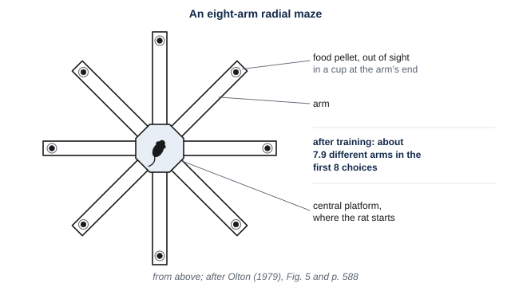
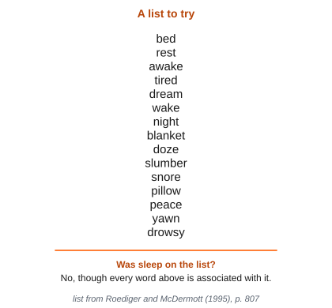
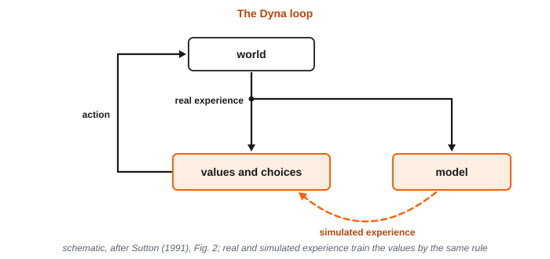

# 10. Memory, Imagination, and Generative Models

This module is about how animals use what happened on one occasion at a later time, for a use they could not foresee, and how remembering what happened is related to imagining what has not. While reading, look for the beginnings of answers to these questions:

- How does learning that changes a tendency to respond differ from learning that leaves information an animal can access later?
- What kinds of memory do researchers distinguish, and can animals other than human beings remember a particular occasion?
- How can a system recall a whole occasion from part of it, and learn new things without losing what it learned before?
- Why do people remember things that never happened, and what do machines that generate pictures have in common with human remembering?
- What did patients such as H.M. lose, what was spared, and what do cells in a rat’s hippocampus do when the rat pauses at a fork?

By the end, we should be able to say what remembering requires, why it reconstructs an occasion rather than reproducing a copy, and what the evidence from the brain can and cannot show about it.

<!-- pin: t-levels-memory -->

: Marr’s three levels, the question each asks, the discipline that asks it, and this module’s example. {#t-levels-memory}

| Level | The question it asks | Discipline | This module’s example: remembering one night |
|---|---|---|---|
| Computational | What problem is being solved, and why does solving it matter? | Evolution and ecology | An animal encounters information before it knows when the information will matter. What must it retain, for how long, and for what later use? |
| Algorithmic | What is represented, and by what procedure? | Cognitive psychology and AI | Storing, reconstructing, and simulating |
| Implementational | By what physical means, and at what cost? | Neuroscience | Memory systems in the brain |

---

A small, warm animal is back in its nest before dawn. It is the same small early mammal we discussed in Module 9. It is an insect-eater, probably active at night. It forages out from its nest, and then comes back home. That description is our best reconstruction, from bones, genes, and living relatives.

On a typical night, it might experience something like the following. Under one fallen log, the animal finds beetles, and eats every one it can reach. Farther on, it finds a second log with beetles still under its bark. But it is nearly dawn, and it heads back to its nest. On the way, something large moves at the edge of a clearing, and the animal freezes.

Some of what happened over the night is relevant to what the animal should do the next night. For example, the animal might infer that at the first log, it would find no beetles, since it already ate them all. But it might infer that there will be beetles at the second log. It might also infer that staying away from the clearing for a while would be safer, since something large was moving there.

None of the facts the animal might infer is about what *usually* happens at logs or clearings. Each is a fact about one night. And how the animal should use each fact depends on other facts that will be true the next night. What the animal should do depends on how hungry it is the next night. It also depends on whether another animal finds the second log first, and on whether the large animal is still nearby.

In Module 5, we described learning that changes the weights of connections, and with them how an animal responds to later events. Learning of that kind changes a tendency to respond. A rat that was sick once after eating a new food avoids that food afterward. But a rat with only that tendency has no information about where or when it ate the food. Experience can also leave information that an animal can access later, and combine with whatever it then needs. Information of this second kind would let the animal on its night use what happened in ways it cannot yet foresee. At the end of Module 9, we noted that a structure in the brain that represents the layout of places also represents which thing was where.

So we have two questions. First, what is required to retain information from one occasion, so that it can be accessed later, for a use not known at the time? And second, what more is required to recall a night that is past, or to imagine one that has not happened? Information that can be accessed is needed for both, but it is not enough .

Most of what is known about memory for particular occasions comes from research with rats and with humans. Machines are a third point of comparison. A computer stores exact copies of what it is given, while some newer machines generate new pictures and text from what they were trained on. By comparing both kinds with animals, we can see where machines and animals resemble each other, and where they diverge.

## §10.1 — Computational: Remembering What Happened, and Acting on What Has Not

### §10.1.1 — What Happened Last Night

Many animals benefit from using information about something that happened in the past. Some food is used up when it is eaten. It is replaced later, at a rate the animal does not control. An animal may encounter a danger at a particular place only once, and must learn from that one encounter. And some animals leave food in a place and come back for it later.

In each case, the animal can make better choices later, if it learned something on the earlier occasion. The animal encounters the information before the circumstances in which it will matter. At the time it can do the learning, the animal may not know when or how it will use what it learned. Take the example we described above, of an early mammal’s night. The animal cannot know, on the night it eats the beetles under a log’s bark, whether it will be hungry when it next passes that log. So it cannot know whether it will need to remember that beetles were there.

The world contains two kinds of facts. Some facts are true night after night. Beetles are usually found under loose bark. Other facts are true for one night only. The beetles under *this* log’s bark were eaten last night. The place where food is usually found may have been emptied the night before. So on a particular night, the usual place may not be the best place to look.

People face the same two kinds of facts when they park a car. A person may usually park in one spot but have parked somewhere else today. Someone who remembers only the usual spot cannot find the car. In the same way, an animal that knows only what is usually true at a log does not know what happened at that log last night.

A wide variety of animals must remember the details of where they have fed recently. Nectar-feeding birds must remember which flowers they have emptied. Hawaiian honeycreepers take all the nectar from a flower, which refills slowly, and do not return to that flower for several hours. And rats are very good at remembering where they have already taken food.

In the laboratory, rats’ foraging memory is tested using a radial maze, which has eight arms that extend outward from a central platform. A food pellet sits out of sight at the end of each arm . A rat placed at the center can collect all eight pellets, and the most efficient way to do it is to enter each arm once. After training on the maze, rats chose on average about 7.9 different arms in their first 8 choices. On a maze with 17 arms, they chose about 15 different arms in their first 17. The rats did not enter the arms in a fixed order, such as each next arm clockwise. So they did not avoid repeats by going around the maze in order. Researchers also found that the rats ignored cues inside the maze, such as the smell of an arm, and chose by landmarks in the room instead. They nonetheless remembered well where they had and had not been.

{#f-radial-maze alt="A top view of a maze with a small octagonal central platform and eight narrow arms extending outward from it at equal angles. A small circle marks a food pellet at the far end of each arm. A rat is drawn on the central platform."}

### §10.1.2 — What Is New in a Mammal’s Life

The line leading to mammals split from the line leading to reptiles and birds about 320 million years ago. True mammals appeared more than 200 million years ago. As we described in Module 9, for well over 100 million years after that, they lived alongside the dinosaurs. They were small animals, mostly insect-eaters, that were probably active at night. Then, about 66 million years ago, the non-bird dinosaurs died out. In the few million years that followed, the number of mammal species rose sharply, and so did their average body size.

The first members of today’s groups of mammals began to appear within a few million years of the dinosaur extinction event. Many of those groups, such as hoofed mammals, primates, and bats, first appear as fossils about 10 million years after it. Those groups now include hoofed grazers and browsers, meat-eating hunters and scavengers, bats, and whales. On the most common account, mammals came to occupy ways of life that dinosaurs had occupied, such as large plant-eater and large predator. Molecular evidence places some of the splits between today’s groups earlier, before the extinction. Researchers still debate how far the spread had begun by then. But the great increase in the number and size of mammals came after the extinction. The early mammals we describe lived before the dinosaurs’ extinction.

In Module 9, we described early mammals’ warm-blooded bodies, which need a lot of food. This constant need for food makes it useful to learn and remember facts from single occasions. So do several other features of mammals’ lives, which we describe below.

Mammal young need a great deal of care from their parents. Some, such as mice and rats, are born hairless, with their eyes closed, and for some time can barely move. Others, such as foals and fawns, can walk within hours of birth. But being able to walk is not the same as being able to find food. No newborn mammal can find enough food on its own to fuel a warm body.

In every mammal species, mothers typically care for their young and feed them milk. Producing that milk is energetically expensive. In humans, exclusive breastfeeding can raise a mother’s daily energy requirements by roughly 15–25%, compared with when she is neither pregnant nor nursing. In some other mammals, the increase is much greater. Laboratory mice may eat about four and a half times as much at peak milk production as they do when not breeding.

These energy demands can reduce a mother’s chance of survival. For example, in a long-studied population of red deer, some mothers lost their calves during the summer, usually shortly after birth. Others nursed calves that survived the summer. The mothers whose calves survived were less likely to themselves survive the following winter. Both groups had endured the costs of pregnancy. But mothers whose calves survived had also nursed for months. So months of nursing appear to reduce a mother’s chance of surviving the winter.

In many mammal species, the young depend on their mothers and other caregivers for a long time. For their body size, some species reach every stage of life, from birth to weaning to maturity, early. Others reach every stage late. Across birds and mammals, species with a long immaturity tend also to give their young a lot of parental care, and to depend on learning.

Mammals stand out from reptiles, amphibians, and fish for their long period of dependence on their mother . Measured as a share of the longest recorded lifespan, that period is about 1 to 4% of life in rats, horses, rhesus macaques, and wolves. It is about 7% in chimpanzees and 12 to 15% in human beings. Green iguanas, African clawed frogs, and zebrafish receive no care at all after their eggs are laid. Human beings depend on their parents for the longest, as we will discuss in Module 11.

{#f-dependence alt="A horizontal chart with nine rows, one per species, and an axis running from 0 to 25 percent of each species’ longest recorded lifespan. The top six rows, bracketed as mammals, are human being, chimpanzee, rhesus macaque, horse, gray wolf, and Norway rat. Each has a dark bar starting at zero for the time the young are fed by a parent: about 12 percent for human beings, with a dashed extension to about 15 percent; about 7 percent for the chimpanzee; about 4 percent for the wolf; and about 1 to 2 percent for the macaque, horse, and rat. A vertical tick marks weaning, near 2 percent for human beings and at or near the end of the bar for the other mammals. A hollow diamond marks sexual maturity, between about 4 and 14 percent. The bottom three rows, bracketed as receiving no care after eggs are laid, are green iguana, African clawed frog, and zebrafish. They have no bar, only a diamond, at about 23, 2, and 3 percent."}

The young of many species also play, and play is part of how young animals learn and explore. In one survey of play across the animal kingdom, animals that play tended to have active lives, moderate-to-high metabolic rates, and plentiful food. In Module 9, we described how children explore more than adults. The young of many other species, from parrots and crows to monkeys, are also more exploratory than adults, or less wary of new things. An animal with a long youth encounters many things early in life that may be useful much later.

A mother whose young stay in a nest has to leave them to find food, and then come back home. The young of many small mammals stay in a nest. Most mammals whose young are born immature nurse them at long intervals. Their milk tends to be more concentrated than the milk of species that nurse often. So the mother can be away between feeds, and she returns to the nest. Each night, an early mammal mother would have foraged out from the nest and back, as we described early mammals doing in Module 9. Her young would have stayed in the nest. The nest is a fixed home, and she returns again and again to the same places around it.

To power their warm bodies and feed their offspring, mammals need to gather a lot of food. Much of what small mammals eat, such as insects, seeds, fruit, and nectar, is used up where it is found. If it is replenished at all, this happens only later. So mammals need to remember where food has run out, and where it has not. Some mammals also carry food away and hide it, a behavior called caching. For example, gray squirrels bury each nut in a separate place and dig the nuts up months later. A caching animal later returns to food it hid on one occasion, which requires remembering where it hid that food.

Mammals also sleep for much of each day, in two states that alternate and look different from outside. In one, the animal is still and quiet. In the other, the animal’s head and limbs go completely slack. The eyes dart around beneath closed eyelids, breathing becomes irregular, and the limbs and face muscles twitch. Horses and many other grazing animals can sleep standing in the quiet state, but they lie down to enter the other one.

Mammals are in the twitching state most early in life. Newborn human beings are in it for about eight hours a day, and adults for about two. Mammals born immature, such as rats and cats, are in it most of all. Birds also show both states, although in birds the twitching state comes in short episodes, and often only the neck goes slack.

An animal with these features faces a particular problem. It forages over a range that has some aspects that stay constant, and others that are constantly changing. And it returns night after night to one home. It starts immature and dependent, and when it matures it *raises* young through a long period of dependence. Such an animal encounters many occasions whose details are useful later.

### §10.1.3 — What Remembering Requires

An animal needs to use some of what it learns for a moment, some for minutes, and some for the rest of its life. We can distinguish three problems by how long the animal must be able to use what it learned, and what it uses it for. The first is using what was just sensed, for the moment it takes to use it. The second is using what is needed for a task while the task is being done, for seconds to minutes. The third is using what was learned days, months, or years earlier. For example, an early mammal might use the rustle it just heard in the leaves for a moment. It might use which side of a log it has already searched, while it is still at that log. And it might use the way back to its nest for its whole life.

Using what was just sensed, or what a task needs while it is being done, may depend only on a temporary state that ends when the task does. Using what was learned days or years earlier requires a change in the animal that outlasts the experience.

Other requirements apply to any system that learns about particular occasions, whether it is an animal or a machine. The system must be able to recall a whole occasion from part of it. For example, the smell of one log should be enough for the animal to recall the rest of one particular night at that log. The system must also distinguish two similar occasions, such as two nights at the same log. It must be able to learn about new occasions and still recall old ones. It must be able to recall some occasions across a lifetime. And it must be able to use what it learned in a situation that could not have been predicted when it learned it.

How well must an animal remember particular occasions? An animal uses what it learned about the past to choose what to do next. So an animal remembers well enough if it chooses well the next night, even if it cannot recall every detail of the night before. A computer is different. It is used where an exact copy is required, as with a bank balance or a document.

### §10.1.4 — What Animals Do After One Occasion

From behavior alone, it can be hard to tell how an animal used an earlier occasion. Suppose an animal avoids a log the night after it emptied that log. It may have information about that night, which it can combine with how hungry it now is. Or it may only have a weaker tendency to go to that log. A choice on the next night does not distinguish the two. Tests that an animal could not have anticipated when the occasion happened are especially useful. A correct choice on such a test is hard to explain as a response the animal prepared in advance. It is not impossible, so such tests need controls, and researchers look for several kinds of evidence together.

Many animals use what happened on one occasion. Scrub jays cache both worms, which rot, and peanuts, which do not. When the worms had been cached four hours earlier, the jays searched first where they had cached worms. When the worms had been cached five days earlier, and would have rotted, the jays searched first where they had cached peanuts.

Rodents that cache also find food they hid on one occasion. Lucia Jacobs and her colleagues tested gray squirrels in an outdoor arena. Each squirrel buried ten nuts, near places where other squirrels had also buried nuts. Before each test, every nut was replaced with a fresh one that no squirrel had handled. So no nut smelled of the squirrel that had buried it.

Two to twelve days later, the squirrels dug up more of their own nuts than of the other squirrels’ nuts. Every squirrel also dug up some nuts that other squirrels had buried. A squirrel had not seen those nuts buried, so it probably found them by smell. As the authors noted, a caching animal must learn where a cache is “in one trial, when the food item is hidden”.

In a second study, Jacobs tested Merriam’s kangaroo rats. The kangaroo rats cached seeds in sand-filled cups, set among many identical cups. Before the test, the odors at the cache sites were removed, and half of the caches were emptied. A day after caching, the kangaroo rats searched 87% of the emptied cache sites and 93% of the refilled ones, but only 14% of the unused cups. They searched emptied sites almost as often as refilled ones, so the smell of the seeds cannot explain where they searched. And kangaroo rats that had not made the caches found fewer of them than the kangaroo rats that had.

In other studies, an animal is tested on an occasion of a kind it was never tested on during training. Pigeons were first trained to choose one color after they had pecked a key and the other color after they had not. Then they were shown something new. It was either a shape, which they pecked although no one had trained them to, or a dark key, which they did not peck. Then, for the first time after one of these new items, the two colors were presented. The pigeons chose the color that matched what they had just done on about 72% of these test trials, where choosing at random would give 50%.

A study with dogs also used a test the animals could not have anticipated. Dogs trained to imitate their owners’ actions on command were then trained to lie down after every demonstration. When an owner unexpectedly gave the command to imitate instead, 11 of 17 dogs reproduced the action after a delay of one minute. After an hour, 6 of 17 did.

In another study, rats were trained to turn one way at a fork after they had just been given food. They were trained to turn the other way after they had been given none. In a separate task, they foraged in a small maze, which contained food on some days and none on others. Then, without warning, the fork appeared right after the rats had foraged. The rats turned the way that matched whether they had just found food, about as accurately as in training.

Rats can also pick out the order in which odors were presented on one occasion. Rats smelled lists of up to twelve odors, each smelled only once. Afterward, given a choice between two odors from the list, they could pick out the one that had come second-to-last, or fourth-to-last. Monkeys can also learn a great deal from one occasion. In one study, monkeys learned which of two objects hid a reward. When each pair of objects appeared in a scene of its own, the monkeys learned about as much from one trial as from about ten trials without the scenes.

In each of these studies, the animal’s behavior depended on one particular occasion after that occasion was over: one caching, one action, one foraging trip, one list, or one scene. In several of them, the test came in a form the animal could not have anticipated when the occasion happened.

### §10.1.5 — Acting on What Has Not Happened

An animal also faces a problem about events that have not happened. To judge an option without taking it, an animal must use what it already knows to predict what would happen if it took that option. And an animal never observes the outcome of an option it did not take. So it can learn from that option only by using what it already knows.

At a fork in a maze, a rat often pauses and turns its head back and forth between the paths before it chooses one. In the 1930s, Muenzinger and Gentry named this pausing and turning **vicarious trial and error**. The behavior is common when rats know the layout of a maze but not yet which way to go in it. It is common when the two options are nearly equally good. And rats show it again after the rules of a task change. As a rat runs the same route over many trials, it pauses at the fork less and less.

Rats also look back toward food sites they skipped. In one task, rats ran laps past four food sites, each with its own flavor. At each site, a tone signaled how long the rat would have to wait for food there, and the rat could wait or move on. Sometimes a rat left a site whose delay it would usually have waited through, and then reached a site with a longer delay. On those occasions, the rat paused and looked back toward the site it had left. It then waited through the long delay more often than usual, and ate the food more quickly. So the rat’s behavior depended on an option it had not taken, whose outcome it never observed.

We take up in Module 12 how animals choose among options once they have predicted the outcomes. In this module, the problem is only that an animal’s choices depend on the predicted outcomes of options it has not taken. In §10.2, we describe how an animal or a machine could do these things.

## §10.2 — Algorithmic: Storing, Reconstructing, and Simulating

### §10.2.1 — Learning and Kinds of Memory

People often use *learning* and *memory* interchangeably. We use them for different things. **Learning** is a change, caused by experience and outlasting it, through which information from the experience can guide later processing or behavior. Fatigue, growth, and injury also change an animal. But they are not learning, because what the animal does afterward can be explained by its changed body alone. A learned change counts even if the occasion to use it never comes. **Memory** is the retention of information, and its influence, after the experience that supplied it.

Experience can guide later behavior in two ways, and the two can coexist. One is a **disposition**, a learned change in a tendency to respond, like those we described in Module 5. The rat that avoids a food after being sick once, which we described at the start of the module, has acquired a disposition. The other is **accessible content**, information that can be accessed later and combined with other information when a situation requires it. A person may learn a door code in order to enter a building the next day. That person can also tell the code to a friend, or notice that it matches a birthday.

In Module 5, we drew the line between dispositions and what we called records, by when the use of what was learned is settled. That criterion does not separate the two. The door code was learned for one known use, and it is still accessible content. And what a disposition does also depends on later circumstances, such as hunger. So we draw the line by whether the information can be accessed and combined with other information. Two other distinctions are separate from this one. A disposition can come from one occasion, as the sick rat’s did, and accessible content can be general. And a learning rule, such as the error-driven rule we described in Module 5, describes how a change is made, not which kind of change results.

In §10.1.3, we separated three problems by how long an animal must be able to use what it learned. Researchers name a kind of memory for each. **Sensory memory** is memory for what was just sensed, and it lasts about a second. **Working memory** is memory for what a task needs while the task is being done. In people, it lasts seconds to minutes. **Long-term memory** is memory for what was learned days, months, or years earlier. The authors of one neuroscience textbook grant that “the details are debated”, but call these three classes “generally accepted”.

Long-term memory is usually divided by what it contains. **Procedural memory** is memory for how to do something, such as running a familiar route, without memory of the occasions of learning. It includes some of the dispositions we described in Module 5, and the calibration of movement we described in Module 8. **Semantic memory** is memory for what is generally true across many occasions, without memory of any one occasion of learning. A person can know that monkeys have tails without remembering when they learned it.

In Module 7, we described generalization, a response that transfers to new members of a class. Generalization can be a disposition, a tendency to respond in the same way to new members of a class. It is part of semantic memory when what is known about the class is accessible content. The authors of a recent consensus glossary write that nonverbal animals, including human infants, “exhibit concepts”.

**Episodic memory** is memory for one particular occasion: what happened, where it happened, and when. Researchers disagree about what else it requires. In §10.1.1, we separated two kinds of fact. Some are true night after night, such as that beetles are usually found under loose bark. Others are true for one night only, such as that the beetles under one log were eaten last night. Semantic memory contains facts of the first kind, and episodic memory contains facts of the second kind . Both are accessible content. They differ in whether the content concerns a general relationship or one particular event.

: Six kinds of memory, how long each lasts, what each lets an animal do, and an example from this module. {#t-kinds}

| Kind of memory | How long | What it lets an animal do | An example from this module |
|---|---|---|---|
| Sensory memory | About a second | Use what was just sensed, for the moment it takes to use it | The rustle an early mammal just heard |
| Working memory | Seconds to minutes in people; in some animal research, the length of one occasion | Use what a task needs while the task is being done | Digits repeated back in order; the arms of a maze a rat has already entered; the logs an early mammal has already searched that night |
| Procedural memory | Days to a lifetime | Do something without recalling the occasions on which it was learned | Running a familiar route through a maze |
| Semantic memory | Days to a lifetime | Use what is generally true across many occasions | Beetles are usually found under loose bark |
| Episodic memory | Days to a lifetime | Recall what happened on one occasion, where, and when | Where a person parked the car on one particular day |
| Episodic-like memory (see §10.2.5) | Up to twelve days, in the tests described in §10.1.4 | Act on what happened on one occasion, as shown by behavior alone | Scrub jays searching first for worms after four hours, and first for peanuts after five days |

### §10.2.2 — A Store That Fades

People shown a brief display, one researcher wrote in 1960, “enigmatically insist that they have seen more than they can remember afterwards”. In the researcher’s study, observers saw up to twelve letters and digits, in up to three rows, for a twentieth of a second. Asked for all of them, they reported about four, on average 4.3.

The researcher then asked for only part of the display. Just after the display ended, a high, middle, or low tone indicated which row to write down. Observers could not know in advance which row would be cued. So the researcher could use their score on that row to estimate how much of the whole display they could have reported. On average, at least nine of the twelve letters and digits were available. When the tone was delayed, the extra letters and digits were lost within about a second.

The researcher proposed, tentatively, that the display leaves a brief visual image. An observer can report whatever part of the image they attend to before it fades. Sensory memory is a store of this kind.

In 1968, two researchers combined such findings into a model with three stores . Input from the senses enters a sensory register, where, on the authors’ estimate, it decays within a fraction of a second. A selected part passes to a short-term store, which the authors called “working memory”. There it is lost within about 30 seconds, unless the person repeats it. Some of it is copied to a long-term store, and can later return to the short-term store.

{#f-three-stores alt="Three boxes in a row, joined by arrows running left to right. On the far left, arrows labeled sight, sound, and touch point into the first box, labeled sensory register, and a dotted arrow leaves its bottom edge, labeled lost within a fraction of a second. A single arrow labeled selected leads to the second box, labeled short-term store. A curved arrow loops from the top of the short-term store back onto itself, labeled repeating. A dotted arrow leaves the bottom of the short-term store, labeled lost within about 30 seconds. A pair of arrows, one pointing each way, joins the short-term store to the third box, labeled long-term store."}

### §10.2.3 — A Few Items at a Time

Working memory has a small capacity. Most people can repeat back seven to nine digits in order. Repeating items to oneself, so that they are not lost, is called **rehearsal**.

When rehearsal and grouping are prevented, young adults recall only three to five meaningful units. In one study, people learned arbitrary pairs of words until each pair was familiar. With rehearsal blocked, they recalled about three units, whether the units were single words or learned pairs. A group of items that a person already knows as one unit is called a **chunk**. With practice, one student raised the number of digits they could repeat back from 7 to 79. The student grouped the digits into running times they already knew, each one a chunk.

Researchers disagree about what working memory is. On one account, working memory has a part that controls attention. It also has two separate stores, one for speech sounds and one for what things look like and where they are. On a rival account, working memory has no separate store at all. It is attention directed to what is already represented, in long-term knowledge or in perception.

A system, animal or machine, can make a state last in two ways. In Module 4, we deferred “the difference between a state held in activity and a state held in a changed connection”. In the first way, units that excite one another continue to fire after their input stops, like the ring attractor we described in Module 9. In the second way, activity changes the connections among units, and the change appears only in how the units respond to the next input. A state in continuing activity ends when the activity stops, while a changed connection remains after the activity has stopped. Both ways have been proposed for working memory.

The name *working memory* is also used in two senses, which differ in how long the task lasts. In the first sense, the task lasts seconds to minutes, as when a person repeats back digits. The digits are lost within about half a minute unless rehearsed. In the second sense, used in research with animals, the task is one occasion. The researcher who developed the radial maze we described in §10.1.1 called the rats’ memory for which arms they had entered working memory. The rats remembered those arms across delays of up to 20 minutes, the longest tested, with no sign of forgetting. At the start of each new test, the rats treated every arm as not yet entered. An early mammal’s list of logs already searched in one night is working memory in this second sense, a list for one occasion.

### §10.2.4 — What Tulving Meant

Endel Tulving named episodic memory in 1972, and set it against semantic memory. He called the two “systems” “primarily for the convenience of communication”, not to claim that they were separate. In his first definition, episodic memory “receives and stores information about temporally dated episodes or events”, always “in terms of its autobiographical reference”. Most episodic claims, he wrote, can be translated into the form “I did such and such, in such and such a place, at such and such a time”. So the self was part of the definition from the start. Semantic memory, in 1972, was “the memory necessary for the use of language”.

By 1985, Tulving’s definition had changed. The defining feature of episodic memory was now the experience of re-living an occasion as part of one’s own past. He called the kind of consciousness involved *autonoetic*, or “self-knowing”, consciousness. Facts about oneself that are known but not re-lived now counted as semantic.

Tulving gave a case of facts about oneself that are known but not re-lived. He described a young man, N.N., who knew the year his family moved into their house and the names of his schools. But N.N. could not recall a single event from his past. Tulving classed N.N.’s knowledge of his own past as semantic memory. So on the later view, a memory is episodic when the one remembering re-lives the occasion as its participant. Being about the rememberer is not enough.

Tulving’s account of semantic memory changed too. By 1985, he described it as “symbolically representable knowledge that organisms possess about the world”, with no tie to language. A standard definition now is knowledge of facts about the world. On strong views of language and thought, language is needed for symbolic thought, or greatly improves it. On those views, some of what is called semantic memory may require symbolic thought. We return to that debate in Module 14.

One research group points out that a video recorder makes a recording of events. And yet, they write, “No one would claim that a video recorder has episodic memory”. What would a recording need, beyond what it contains, to count as remembering? On Tulving’s later view, it would need someone who re-lives the occasion.

### §10.2.5 — Can Animals Remember an Occasion?

In §10.1.4, we described jays, rodents, pigeons, dogs, rats, and monkeys whose behavior depended on one past occasion. The delays in those tests ran up to twelve days. Do these animals have episodic memory? On Tulving’s later definition, the answer depends on whether they re-live the occasion.

Nicola Clayton and Anthony Dickinson, who ran the scrub-jay study in 1998, did not try to test for re-living. They noted that the conscious experience of self that accompanies human recall of an occasion “has no obvious manifestation” in behavior that does not use language. So, they wrote, that experience “is probably undetectable in many species”. They called what the jays showed **episodic-like memory**. The term means memory for what happened, where, and when, on one occasion, as shown by behavior alone. By this definition, an animal can have episodic-like memory whether or not it re-lives the occasion.

Several species now pass behavioral tests of this kind, and no researcher claims to have shown that an animal re-lives an occasion. Researchers disagree about what follows. Tulving wrote that episodic memory is “probably unique to humans”. Two other researchers call re-living the past and imagining the future *mental time travel*. They concluded that there is “as yet no convincing evidence” of it in animals. Others define memory for occasions by separate features, such as what, where, when, and order, and compare species feature by feature. Still others reply that a human-only conclusion follows from a definition that no animal could satisfy. And Robyn Fivush, who studies children’s memory, concludes that memory for what, where, and when “appears to be available across species and across human development”.

Our description of early mammals is a reconstruction, from bones, genes, and living relatives. Even so, early mammals probably remembered particular occasions, such as which logs they had already searched on which night. Researchers would call such memory episodic-like. Whether they re-lived those nights is probably undetectable from their behavior.

### §10.2.6 — Knowing Without Being Able to Say

**Declarative memory**, also called *explicit* memory, is memory that “is available to consciousness and can be expressed by language”. The definition is from the neuroscience textbook we quoted in §10.2.1. In people, semantic and episodic memory are classed as declarative. **Nondeclarative memory**, also called *implicit* memory, is expressed in performance rather than recollection. One leading researcher called declarative memory “representational” and nondeclarative memory “dispositional”. The researcher’s terms are close to the distinction we drew in §10.2.1, between accessible content and dispositions. But declarative memory is defined by consciousness and language, and accessible content need not involve either.

People can act on what they cannot report. In one study, people moved between houses in a virtual environment. They stayed in the house paired with pleasant music 84% of the time. Yet they denied that the music had influenced them.

Whether information is accessible content, explicit or not, is inferred from several kinds of evidence together. Researchers who study explicit memory use similar criteria. One kind of evidence is what a person reports, or other performance that depends on the content, such as a correct choice. A second is use of the information beyond the response that was trained, or “outside the place or context of its initial presentation”. A third is a selective effect of an intervention, such as damage that impairs one kind of performance and spares another, when effects on perception, motivation, and movement are ruled out.

Report is valuable evidence, but it is neither necessary nor conclusive. A correct report can sometimes come from general knowledge or a practiced response. And a failure to report can reflect difficulty in expressing what is known. Animals “can only express their knowledge through performance”, so for animals researchers use the other kinds of evidence. Tests the animal could not have anticipated, like those we described in §10.1.4, are especially useful. No single result establishes that information is accessible.

Some researchers modeled two tasks as driven by one memory signal. One task was recognizing an item. The other was identifying an item faster after seeing it before, which is called *priming*. Giving each task its own noise, the researchers reproduced findings usually taken as evidence for two systems. So a difference between two tasks is not, by itself, evidence of two systems. David Rubin, who describes memory along several continuous dimensions, treats explicit or implicit as one of them. Yet he grants that “empirical support for a plausible neural basis for an explicit versus implicit distinction is lacking”.

The question remains open. The research group that wrote about the video recorder concludes that “of extant animals, only humans have explicit memory”. That conclusion is a minority view, and its authors grant that settling the question will require “a validated nonverbal assay”. On their view, animals are like the video recorder, making recordings of events without remembering them as participants.

### §10.2.7 — Bundles of Dimensions

Memories can vary in several ways at once, and one way to list them is as seven dimensions . A memory can be laid out egocentrically or allocentrically, in the two frames of reference we defined in Module 9. It can be in words or not, about events or about entities, about one occasion or general, and explicit or implicit. It can be a proposition, such as “a canary can fly”, or not. And its parts can be linked by labeled relations, or only by when and where they occurred. Typical episodic memory is at one end of six of these dimensions, and typical semantic memory is at the other. On the seventh, explicit or implicit, both are typically explicit.

: Seven dimensions along which memories can vary, the values typical of episodic and semantic memory on each, and a published case for each dimension that does not fit those typical values. {#t-dimensions}

| Dimension | Typical episodic memory | Typical semantic memory | A case that does not fit the typical values |
|---|---|---|---|
| Egocentric or allocentric | Laid out from where the rememberer stood | Laid out relative to things in the world | Word meanings that include where things are relative to oneself, in one proposal |
| In words or not | Not in words: sights, sounds, and places | Often in words | Concepts in nonverbal animals and in infants |
| Events or entities | Events | Entities, such as objects and kinds | Semantic knowledge of how a kind of event usually goes |
| One occasion or general | One occasion | General across occasions | Knowing the year one’s family moved house, without re-living the move |
| Explicit or implicit | Explicit | Explicit | A familiar route walked with no explicit memory of it, and déjà vu |
| A proposition or not | Not a proposition: a scene | A proposition, such as “a canary can fly” | Semantic knowledge of a spatial layout that has no label |
| How the parts are linked | Unlabeled: only by when and where they occurred | By labeled relations | Word meanings learned only from which words occur near one another in text, in some models |

The dimensions can vary separately, and researchers have described a case for each. In one proposal, word meanings include where things are relative to oneself. Nonverbal animals and infants have concepts. People know how a kind of event usually goes, such as a birthday party, without recalling any one party.

The remaining four dimensions also have cases that do not fit the typical values. N.N., whom we described in §10.2.4, knew the year his family moved into their house. That fact concerns one occasion, yet Tulving classed it as semantic, since N.N. could not re-live the move. Some memories of scenes are implicit, such as a familiar route walked with no explicit memory of it, or déjà vu. Semantic knowledge includes spatial layouts that have no label. And some models of semantic memory learn word meanings only from which words occur near one another in text, with no labeled relations.

Being about oneself is missing from the seven dimensions. People know general facts about themselves, such as “I am a stubborn person”, without re-living any occasion. Researchers call this *personal semantics*.

Researchers have proposed several versions of the bundle idea, and two of them include being about oneself. Rubin proposed a space of three continuous dimensions: explicit or implicit, related to oneself or not, and set in a scene or not. Episodic and semantic memory are two of its eight corners, and personal semantics is another. And the research group that wrote about the video recorder treats a representation of oneself as one more feature of a memory. In their words, it is “a dimension of conjunctive representations”. A *conjunctive representation* combines several features of an occasion, such as what, where, and when, into one representation.

One patient’s pattern of memory loss is a possible criticism of the bundle view. A man known as K.C. could not recall any occasion of his life, from before or after his injury. Yet he still knew technical terms from his work as a machinist, learned in the same years. Everything about particular occasions was lost, while general knowledge from the same years was spared. So the pattern is easier to interpret as two systems than as positions on several dimensions.

A defender of the bundle view can reply that K.C. lost one feature, the re-living of an occasion. That feature would be one more dimension, beyond the seven we listed. Episodic and semantic memory may be two interacting systems, which “retain a measure of distinctiveness”, in the words of one review. Or they may be regions of one space.

### §10.2.8 — Recall by Content

A computer finds a stored item by its address, a number for the place where the item is stored. The address has no relation to what is stored there. A **content-addressable memory** instead finds a stored item from part of the item itself.

A content-addressable memory satisfies the first requirement we described in §10.1.3, recall of a whole occasion from part of it. John Hopfield gave an example in 1982. A memory containing the reference “H. A. Kramers & G. H. Wannier Phys. Rev. 60, 252 (1941)” should retrieve all of it from “& Wannier, (1941)”.

In Module 7, we described **auto-association**, storing patterns in the connections among a circuit’s own cells. Part of a stored pattern can then reactivate the rest. Recovering a whole stored pattern from part of it is **pattern completion**. Hopfield’s network, an artificial neural network, is a machine version of both. Its units are on or off, and every unit is connected to every other by symmetric connections. A Hebbian rule sets the connections, strengthening a connection when its two units agree in a stored pattern and weakening it when they disagree.

Hopfield showed that whenever a unit switches on or off, a quantity he called energy can only fall. So the network settles into a stable state, and the stored patterns are among its stable states . In one test, the network started from a pattern that differed from a stored one in five or fewer units. It reached the stored pattern more than 90% of the time.

{#f-energy alt="A side view of a rolling surface with four valleys of different depths, drawn as a wavy line. Three of the valleys are labeled stored pattern A, B, and C. The fourth, shallower valley is unlabeled except for a question mark. A small ball sits partway up the slope above valley B, labeled partial cue, and a curved arrow runs from the ball down into the bottom of valley B. The vertical axis is labeled energy."}

The network can store about 0.15 patterns per unit, or about 15 patterns in 100 units, before errors in recall become severe. Beyond that, new patterns make “all memory states irretrievable”, unless old ones are forgotten. In another test, about one run in ten ended in a stable state that matched no stored pattern. A stable state of this kind is one way a network can produce something it never stored.

Completing a pattern from a cue conflicts with another requirement we described in §10.1.3. A memory must also distinguish two similar occasions, such as two nights at the same log. **Pattern separation**, which we also described in Module 7, is making overlapping inputs less alike, so that a later stage can tell them apart. Separation makes similar occasions distinct, while completion tends to merge them. So a memory for occasions needs both, balanced against each other.

### §10.2.9 — Forgetting and Interference

Much of what is learned is later forgotten. In the 1880s, Hermann Ebbinghaus learned lists of nonsense syllables, and later learned each list again. He used the time saved in relearning as a measure of how much he still remembered. He saved more than half of the original learning time after about twenty minutes. He saved about a third after a day, and about a fifth after a month. Forgetting is fast at first, and slower after that.

Much forgetting comes from other learning. **Interference** is the effect of other learning on recalling something. In *retroactive* interference, new learning makes old learning harder to recall. In *proactive* interference, old learning makes new learning harder to recall.

People and networks differ in how much interference affects them. People who learn a list of pairs, and then a new list in which the same first items have new partners, can still recall more than half of the first pairs. A standard network trained the same way recalls none of them. This collapse is **catastrophic interference**, a drastic loss of old learning when a network learns new patterns after old ones. It happens because the new learning moves weights that the old patterns depended on, as we described in Module 7. The overloaded network we described in §10.2.8 undergoes a related collapse, since it can then retrieve none of its stored patterns. An animal must add each night’s events to everything it learned before, so it has the same problem.

### §10.2.10 — Two Learners at Two Speeds

Catastrophic interference happens because a network’s items are represented by overlapping patterns of activity, which share the same weights. The overlap lets the network generalize, since what it learns about one item transfers to similar ones. The same overlap is why new learning disturbs old learning.

Researchers have proposed several answers. Sparser patterns, with fewer units active for each item, interfere less, but they also generalize less. Interleaving means presenting old items along with new ones. It reduces forgetting, but only if the old items are still available.

A third answer combines sparse patterns with interleaving. In 1995, James McClelland and colleagues proposed **complementary learning systems**, two learners that work at different speeds. A slow learner uses overlapping patterns. Over many interleaved experiences, it comes to represent the structure those experiences share. A fast learner uses sparse, separate patterns. It learns a single occasion from one exposure, without disturbing what the slow learner has learned.

Later, the fast learner presents the occasion again to the slow learner, interleaved with other occasions . Running a stored occasion again, after the occasion itself is over, is called **replay**. On this account, **consolidation** is the gradual process by which the slow learner comes to represent what the fast learner learned. In people, it may take years. The authors argued that consolidation is slow because the slow learner must take small steps to learn shared structure accurately.

{#f-two-learners alt="Two boxes side by side. The left box, labeled fast learner, contains a few separate small clusters of dots, each cluster labeled with one night. An arrow labeled one exposure enters it from an event drawn at the top. A curved arrow labeled replay, interleaved runs from the left box to the right box, which is labeled slow learner and contains one large web of overlapping dots, labeled what the nights have in common."}

A network of the slow kind can model semantic memory, knowledge of what is generally true. In one such model, a small network learned facts about eight living things, such as that a canary can fly. As training went on, its representations separated plants from animals, then birds from fish, and then individual birds. When the trained network was damaged, it lost specific properties before general ones. The same order of loss appears in a disease that gradually destroys general knowledge. The authors of the model concluded that “Semantic information is not stored as such, but instead is reconstructed in response to probes”.

The authors of complementary learning systems saw “no special distinction” between remembering an occasion and knowing a fact. On their account, both depend at first on the fast learner. Later, researchers found that the slow learner can learn a new fact quickly if the fact fits what it already represents.

### §10.2.11 — Machines That Learn One Thing After Another

Engineers face the same problem when a network must learn one task after another. They use three kinds of solution, which differ in what is stored.

One solution is to store the data. A program was trained to play video games, each game separately. While it learned a game, it stored its recent moments of play. It trained on random samples of the stored moments, mixed in with new play. Training on samples of stored moments is called *experience replay*. The samples were single moments chosen at random, not sequences in the order they happened.

A second solution is to store a generator. A second network is trained to produce examples like the ones learned so far. When the first network trains on a new task, the second produces stand-ins for the old data. The stand-ins are mixed with the new examples. Training on stand-ins from a generator is **generative replay**. In one test of learning new classes, researchers replayed a single stand-in for every 128 new examples. Performance was better than with every method that used no replay. Stand-ins of low quality reduced performance only moderately.

A third solution is to protect the weights that matter. During training on a new task, a penalty grows as each weight moves away from its old value. The penalty grows faster for weights that mattered more to earlier tasks. With this method, networks learned some sequences of tasks without forgetting. The method failed when a network had to learn new classes and distinguish them from old ones, a test in which generative replay succeeded.

Some machines combine two memories in one system. In one, a text generator is joined to a searchable store of documents. The generator stores what it learned in training in its weights. For each question, passages are retrieved from the store and used with the question to produce an answer. When researchers replaced the store with newer documents, the system’s answers changed, with no further training.

Large language models can also be described as memory systems. What they learned in training is stored in their weights. The text a model has been given in the current exchange is used somewhat like working memory. And some retrieve from an outside store as well. We take up in Module 13 how they are trained and how they generate text.

The same training rule can produce either a disposition or accessible content. A network trained to label images acquires something like a disposition, a tendency to respond to each input with a label. A generator, or a searchable store of documents, provides content that can be accessed and combined with a new request.

In most of these machines, a stored example is the same each time it is retrieved. A person’s memory of an occasion can change each time it is recalled. When people retell an event, for example, the retelling can strengthen errors as well as accurate details.

### §10.2.12 — Remembering as Reconstruction

Beginning in 1913, Frederic Bartlett asked people at Cambridge to read a North American folk tale, *The War of the Ghosts*, twice. They retold it about fifteen minutes later, and again over months or years. What was strange to the readers was dropped, or explained. Unfamiliar details became familiar ones, as when “canoe” became “boat”. One man retold the story after six and a half years and added a totem and a pilgrimage. Bartlett wrote that “it was precisely concerning his inventions that the subject was most pleased and most certain”.

These cases are weak evidence on their own. Bartlett did not try to make the intervals the same for different people. And for decades, results like these, from one person retelling a story many times, were not reproduced under controlled conditions. A study published in 1999 reported reproducing them.

From such cases, Bartlett concluded that remembering “is an imaginative reconstruction, or construction”. It is built from a person’s attitude toward an active, organized mass of past experience, and toward “a little outstanding detail”. Bartlett called that organized mass a **schema**, meaning general knowledge from many past experiences, active and changing whenever a person remembers. He wrote, “I strongly dislike the term ‘schema’”, because the word suggested something fixed. Researchers now use *schema* more narrowly. It means knowledge of how a kind of situation, such as a birthday party, usually unfolds, “devoid of specific episode details”. The view that remembering reconstructs an occasion from general knowledge and a few specifics, rather than reproducing a copy, is called **reconstructive memory**.

Reconstruction can produce memories of things that never happened. Such a memory is called a **false memory**. In 1995, Henry Roediger and Kathleen McDermott had people listen to lists of related words, such as *bed, rest, awake, tired, dream* . Every word on that list is associated with *sleep*, which was never presented. People recalled the missing word about as often as words from the middle of a list. On a later test, they judged it to have been on the list 84% of the time, against 86% for words that had been. Most of the time, people who said they had heard it reported remembering hearing it, not only knowing it had been there.

{#f-drm alt="A single column of fifteen words: bed, rest, awake, tired, dream, wake, night, blanket, doze, slumber, snore, pillow, peace, yawn, drowsy. Below a horizontal line, in smaller type, the question Was sleep on the list, and the answer No, though every word above is associated with it."}

Elizabeth Loftus and John Palmer showed people films of car accidents. They asked how fast the cars were going when they “smashed” or “hit” each other. People asked with *smashed* gave higher estimates of speed, 40.8 against 34.0 miles per hour. In a second experiment, people were asked a week later whether they had seen broken glass, which was not in the film. Of 50 people asked with *smashed*, 16 said yes, against 7 of 50 asked with *hit*, and 6 of 50 not asked about speed. So one word in a question changed what people later reported having seen.

Errors like these have consequences in court. The Innocence Project counted 375 people in the United States who were exonerated by DNA evidence between 1989 and 2020. In 69% of those cases, the conviction “involved eyewitness misidentification”. The word *involved* means that a mistaken identification was one contributing factor, not necessarily the only cause. Researchers have also found that when a witness is told something that confirms an identification, the witness becomes more confident in it.

General knowledge supplies what a memory lacks. People who had lost much of their general knowledge were asked to copy a drawing from memory after a delay. They drew ducks with four legs, a feature typical of animals in general. And they left the hump off a camel, a feature particular to one kind. One researcher has argued that ordinary memory errors, such as false memories, are by-products of a memory that generalizes. General knowledge supplies what usually happens, which is not always what did happen.

### §10.2.13 — Generative Models

A machine can be built to reconstruct. A **generative model** is a model that learns, from many examples, what kinds of things occur, and can produce new examples of the same kinds. Many do this by learning a short code for each example, a few numbers from which the example can be reconstructed. A new example comes from choosing a new code and decoding it.

Two kinds of generative model are widely used. An *autoencoder* learns to compress each example into a short code and to reconstruct the example from the code. In the variational kind, the codes are confined to a compact region, so that a code chosen at random also decodes into a plausible example. A *diffusion model* learns to remove a little noise from an image. It generates an image by starting from pure noise and removing the noise one step at a time .

{#f-generator alt="Two rows. In the top row, a small drawing of a house passes through a funnel into a short bar of four cells labeled code, and a second funnel widens back out into a slightly blurred copy of the house. Beneath the code, a separate bar of four cells labeled random code leads through the same widening funnel to a different house. In the bottom row, five squares run from left to right. The first is pure static, and each square after it has less static, until the last shows a clear picture of a house. Arrows between the squares are labeled remove a little noise."}

Eleanor Spens and Neil Burgess proposed a model of memory built on generative models. A fast learner stores each event after one exposure. The stored events are replayed to train a generative network to reconstruct events from short codes.

Once trained, the generative network can be used in four ways. It reconstructs events that have been consolidated. General knowledge, such as what kind of object was present, can be read from its codes. New codes, chosen at random, decode into new scenes, which the authors offered as a model of imagining. And its reconstructions shift toward the typical case, as the retellings of *The War of the Ghosts* did. The model is a proof of concept. It was trained on simple images and on word counts from short stories, and every comparison with people was qualitative.

The authors extended complementary learning systems in one respect. On their account, the slow learner is a generator, not only a representation of what is generally true. Remembering an occasion is then generation from general knowledge, plus the few details of that occasion that the fast learner stored. In Module 8, we described a forward model, which predicts the effects of a movement. In Module 9, we described a map, which relates places to one another. A generative model is also an internal model. Unlike those two, it can produce whole scenes.

### §10.2.14 — What Generators Reproduce

What a generator produces depends on what it was trained on, in two ways. First, a generator can reproduce individual training images. Researchers searched the output of image generators and extracted more than a thousand near-copies of training images, including photographs of real people. Most had appeared many times in the training data, and a few were unusual images that had appeared once. So a generator is not a copy of its data, but its output is not independent of the data either.

Second, generators reproduce the patterns in their training data, and can exaggerate them. Researchers gave a widely used image generator requests of the form “A photo of the face of” a kind of person. Asked for a person cleaning, the generator produced only faces with stereotypically feminine features.

For ten occupations, the researchers compared the generated faces with U.S. labor statistics. They sorted the faces by gender with a computer model, not with human judges. For most of these occupations, the images were more uniform by gender than the workers in those jobs. The researchers reported that higher-paid jobs, such as software developer, were shown as more male than the workers are. Lower-paid jobs, such as housekeeper, were shown as more female. When researchers added words that ran against a stereotype, the stereotype often remained.

The readers of *The War of the Ghosts* and the listeners to the word lists reconstructed toward what they already knew. In our comparison, which the researchers who tested the generators did not make, a generator reconstructs toward what was typical in its training data. One difference is that a person’s reconstruction can change that person’s memory, while a generator’s output can be copied and published widely.

### §10.2.15 — Mental Images

Remembering and imagining are often accompanied by an experience like seeing. **Mental imagery** is an experience resembling perception, of something that is not present to the senses. In 1971, Roger Shepard and Jacqueline Metzler showed people pairs of drawings of objects made of cubes. People judged whether the two drawings showed the same object .

The time people took rose in a straight line with the angle between the two orientations. It rose from about one second at 0° to between four and six seconds at 180°. Pairs that differed by a turn in depth took no longer than pairs that differed by a turn on the page. People reported turning one object in imagination until it matched the other. Turning an imagined object in this way is called **mental rotation**.

{#f-rotation alt="Left, two line drawings of the same object, each made of ten cubes joined face to face into an arm with three right-angled bends, the second turned partway around a vertical axis. Right, a graph with angle from 0 to 180 degrees on the horizontal axis and time in seconds on the vertical axis. A single straight line rises from about 1 second at 0 degrees to about 5 seconds at 180 degrees, and a bracket at 180 degrees spans 4 to 6 seconds, the range across people. A note says that turns on the page and turns in depth gave nearly the same line."}

Stephen Kosslyn and colleagues had people learn a map of an island with seven objects on it. Then people imagined the map and moved a small imagined speck from one object to another. The time rose with the distance on the map, with a correlation of .97.

Researchers disagree about how to explain these results. On one account, images represent distance in the way seeing does, so a longer imagined distance takes longer to cross. Kosslyn called images “quasi-pictorial”. On the other account, defended by Zenon Pylyshyn, people asked to imagine something use what they know about how things look and move. On that account, what an image contains is represented in the same format as other thought.

Evidence has been offered for each account. In one study, when people imagined lights switching on and off between places on a map, instead of a speck moving, distance had no effect. Pylyshyn granted that mental rotation is harder to explain on his account. Kosslyn and a colleague later argued that evidence from the brain has settled the question in favor of his account. On either account of imagery, an image is constructed from what a person knows about how things look, much as a memory is reconstructed. We return to the debate in Module 14.

Some people report no voluntary visual imagery. In 2015, Adam Zeman and colleagues named this lack of imagery **aphantasia**, “a condition of reduced or absent voluntary imagery”. About 1% of people give the lowest possible score on a standard questionnaire about how vivid their images are. Researchers have checked those reports with a test that does not depend on what people say. When each eye is shown a different pattern, perception alternates between the two. Imagining one of the patterns beforehand usually makes it more likely to be seen. In people with aphantasia, imagining a pattern had no such effect. As Zeman later wrote, “lack of imagery does not imply lack of imagination”.

### §10.2.16 — Learning from What Did Not Happen

In §10.1.5, we described rats pausing at a fork and turning their heads back and forth, the behavior named vicarious trial and error. Tolman proposed that the rat was trying out each option in imagination. But from the pausing and turning alone, we cannot tell what, if anything, the rat is imagining.

**Simulation** is using stored knowledge, without acting, to predict what would happen. An animal or a machine could do this. Accessible content is the material for simulation, but having it is not enough. Simulation also requires processes that construct possibilities, or run through them step by step. Reconstructing a past occasion, predicting from a learned model what an action would lead to, and imagining a new situation may be different capacities. The research group that wrote about the video recorder uses “mental trial and error” for a different kind of simulation. Their kind is human, and it involves representing oneself.

In Module 5, we described two ways of choosing. **Model-free** choice is choosing an action by repeating what has worked in that situation before, with no model of what the action leads to. **Model-based** choice is choosing an action by running a model of what leads to what, and selecting on the basis of where the model ends up.

Richard Sutton’s Dyna uses both kinds of choice. A Dyna agent learns from its own experience by trial and error, as a model-free learner does. It also learns a model of what each action leads to. Then, between actions, it picks states it has been in. It uses the model to predict what an action taken there would lead to. And it learns from these “hypothetical, model-generated experiences” by the same rule it uses for real ones . In Dyna, learning from experience and learning from a model are two uses of one learning rule. Simulated experience changes the values that guide the agent’s next action, so using the model also changes the agent’s dispositions.

{#f-dyna alt="A loop diagram. At the top, a box labeled world. An arrow labeled real experience runs down to a box labeled values and choices, and a second arrow from the same experience runs to a box labeled model. From the model box, an arrow labeled simulated experience curves into the values and choices box. An arrow labeled action runs from values and choices back up to the world."}

A generative model, like those we described in §10.2.13, can serve as the model an agent simulates with. In one study, an agent learned a generative model of a simple video game, which predicted what the agent would see next. The agent was then trained only inside that model. Afterward it played the real game well, though its scores varied widely from run to run.

Which experiences should be simulated? In one model, each possible update is ranked by two things. One is how much it would improve the choice at a place. The other is how often the agent expects to be at that place soon. On this model, an agent should simulate the paths behind it after a surprising outcome. Before a choice, it should simulate the paths ahead.

For animals, learning from simulated experience leads to a prediction. If animals learn this way, some of their later choices should change after outcomes they only simulated. The rats in §10.1.5 that looked back toward a skipped site then waited through a long delay more often than usual. Their waiting fits the prediction, but from behavior alone we cannot tell whether the rats simulated the skipped option.

In §10.3, we look for storing, reconstructing, and simulating in the brain, and ask what can be learned from each kind of evidence.

## §10.3 — Implementational: Memory Systems in the Brain

### §10.3.1 — H.M.

In 1953, a 27-year-old man had surgery to stop seizures that had disabled him. A surgeon removed tissue from the inner surface of both temporal lobes, including much of the hippocampus on each side. The inner part of each temporal lobe, which includes the hippocampus and the cortex beside it, is called the **medial temporal lobe**. In Modules 6 and 9, we described the **hippocampus** as an old part of the pallium. The surgeon estimated that the operation had removed the front two-thirds of each hippocampus. When his brain was scanned decades later, less tissue was missing than estimated. The back of each hippocampus remained, though shrunken .

{#f-hm-lesion alt="A drawing of the underside of a human brain, with the front at the top. On each side, along the inner surface of the temporal lobe, a shaded region runs back from the tip of the lobe. Inside each shaded region lies the front part of a long, curved outline of the hippocampus. Behind the shading, the rest of each curved outline is drawn unshaded and a little thinner than the front part."}

The man was Henry Molaison, known as H.M. Brenda Milner and Suzanne Corkin studied him for decades. After the operation, he could learn almost no new events or facts. His intelligence, perception, and understanding of language were normal. He could remember a three-digit number for 15 minutes by rehearsing it, though his short-term memory was not entirely normal.

H.M.’s memory from before the operation was only partly spared. He could recall facts from his distant past. But researchers later found that his old memories had become general knowledge. He could not describe any single event from a specific time and place. Memory for the years just before the operation was impaired.

H.M. learned to trace a shape seen only in a mirror. He improved over three days, in one researcher’s words “in the absence of any memory of having practiced the task before”. In later tests of such skills, he started below people without brain damage, and then improved.

H.M. had **amnesia**, a severe loss of memory caused by damage to the brain or by disease. His pattern of loss is a **dissociation**, the loss of one ability with another spared, after damage to one part of the brain. A **double dissociation** pairs two patients, or two groups, with opposite losses. Researchers treat it as the strongest lesion evidence that two abilities depend on different parts of the brain.

Two other patients, with different damage, had similar losses . R.B. lost cells only in CA1, one region of the hippocampus, on both sides, after blood flow to his brain was interrupted during heart surgery. His loss of new memory for facts and events was profound. N.A. had a similar, milder loss after a fencing foil, entering through a nostril, damaged his thalamus. So forming new memories of facts and events requires the hippocampus, and other structures too.

: Four amnesic patients, the cause and site of their damage, and what each lost and was spared. A dash marks what we do not describe. {#t-patients}

| Patient | Cause and site of damage | Learning new facts and events | Memory from before the damage | Spared |
|---|---|---|---|---|
| H.M. | Surgery in 1953; inner temporal lobes on both sides, including the front of the hippocampus | Severely impaired, for facts as well as events | Facts from the distant past recalled, but no single event; the years just before surgery impaired | Intelligence, perception, understanding of language, brief retention by rehearsal, and learning skills, though starting below people without brain damage |
| R.B. | Interrupted blood flow to the brain during heart surgery; cells in CA1 on both sides | Profoundly impaired | — | — |
| N.A. | Fencing foil through a nostril; thalamus | Impaired, less severely than H.M. | — | — |
| K.C. | Motorcycle accident; many regions, including the hippocampus and the cortex beside it on both sides | No new event recalled; new facts learned slowly, over weeks | No event recalled from any period of his life | Knowledge learned before the injury, including technical words from his years as a machinist |

### §10.3.2 — Losing the Past and the Future Together

K.C., whose pattern of loss we described in §10.2 as a possible criticism of the bundle view, was injured in a motorcycle accident at 30. The damage included many regions, among them the hippocampus and the cortex beside it on both sides. After the injury, he learned new facts over weeks, without remembering any of the sessions.

Neither K.C. nor N.N. could recall a single event from his past, and neither could describe his own future. Asked what he would do later, K.C. could not say. N.N., the young man Tulving described, was asked what he would do the next day. He called his state of mind “Blank”.

In one study, five patients with damage to the hippocampus on both sides heard a short spoken cue. One cue described lying on a beach. The patients were asked to imagine a new scene, not to recall one. Four described only fragments, not a scene whose parts were laid out in space. One said, “the only thing I can see is blue”. The fifth, who may have had some hippocampal function left, was unimpaired.

Eleanor Maguire and her colleagues proposed that the hippocampus provides a spatial setting for the parts of an experience, remembered or imagined. The authors linked this setting to the hippocampal map we described in Module 9. Other researchers have reported hippocampal patients who imagined future events normally, so the proposal is still argued.

### §10.3.3 — The Semantic Hub

One patient could still remind his wife where to turn on a route he had not traveled recently. Then he pointed at some sheep and asked, “What are those things?” He had **semantic dementia**, a degenerative disease that wastes the front and underside of both temporal lobes. Patients gradually lose knowledge of what things are, whether the task uses pictures, words, or sounds. Specific knowledge is lost before general knowledge, and knowledge of rare and atypical things goes first. Losing specific knowledge before general knowledge is the same order of loss as in the damaged network model we described in §10.2.10. The people we described in §10.2 who drew camels without humps had this disease. Early in the disease, memory for recent events, finding the way, and skills are spared.

Karalyn Patterson and her colleagues proposed how such knowledge is organized . A concept’s shape, color, sound, actions, and name are represented in the regions that process each kind of information, called spokes. A **semantic hub** in the front of both temporal lobes links them all, whatever the kind of information. On this account, a hub is needed because similar things often share few sensory properties. By shape alone, a pear is more like a light bulb than a banana. With only direct links between spokes, the pear would be represented as more like the bulb. A hub that every spoke reaches can come to represent pears and bananas as alike. A separate control network, in frontal, parietal, and posterior temporal cortex, selects the knowledge each task needs.

{#f-hub-spoke alt="A side view of the left half of a human brain, with the front at the left. Five small labeled circles sit on different parts of the cortex: shape and color toward the back of the brain, near its lower edge, sound on the upper temporal lobe, action near the top toward the front, and name toward the lower front. A line runs from each circle to a larger shaded circle at the front tip of the temporal lobe, labeled hub. A small inset shows the right half of the brain with a matching shaded hub at the front of its temporal lobe."}

In healthy people, magnetic stimulation over the front of the temporal lobe slows judgments of meaning, but not judgments of number. So the front of the temporal lobe contributes to meaning in healthy people too. People whose damage is mostly limited to the brain’s language network lose language, but not their knowledge of what things are. So knowledge of what things are does not depend on the regions that process language. On a rival account, knowledge from different kinds of information is combined in several regions, called convergence zones, across the temporal and parietal lobes.

Semantic dementia and hippocampal amnesia form a double dissociation. Hippocampal amnesia impairs learning about new occasions and new facts, and spares old knowledge. Semantic dementia destroys old knowledge, and spares memory for recent occasions. Learning differs too. People with hippocampal damage learn new facts only slowly, by repetition. People with semantic dementia learn new items quickly, but lose them without practice, and generalize them poorly. Complementary learning systems would produce this pair of learning patterns. The fast learner would have to depend on the hippocampus, and the slow learner on the front of the temporal lobes.

### §10.3.4 — Persistent Activity

In one task, a monkey watches a spot flash briefly, waits 3 to 5 seconds, and then moves its eyes to where the spot was. During the wait, neurons in the prefrontal cortex fire. Each fires most when one place, or a few, must be remembered, and always for the same places. Patricia Goldman-Rakic called those places the neuron’s “memory field”. Such firing is **persistent activity**, activity that continues through a delay after a stimulus has gone, and codes what must be remembered.

She argued that what is remembered for longer than tens of seconds depends on other mechanisms. One candidate was long-term potentiation, the lasting strengthening of synapses we described in Module 5, in the hippocampus. In §10.2, we described two ways a system can make a state last, in continuing activity or in a changed connection. Persistent activity is a state that lasts in continuing activity, since neurons continue to fire. The fly’s heading ring, which we described in Module 9, is a second case of a state that lasts in activity. Its single bump of activity stays in place while the fly stands still.

But in one study, when an attention task filled part of the wait, the delay activity vanished, though the remembered item was still recalled correctly. On one proposal, the remembered item is then represented by short-lived changes in synapses, a pattern of weights “analogous to long-term memory”. Researchers can also tell what is being remembered from activity in sensory, parietal, and temporal cortex. And on one view, prefrontal firing reflects control over representations elsewhere, rather than the remembered content itself. So for a few seconds, activity and short-lived changes in connections may both maintain what is remembered.

### §10.3.5 — Recall in the Circuit, and Engrams

In Module 9, we described chickadees whose hippocampal activity for each hidden seed returned when the bird came back for that seed. On one proposal, recall of this kind depends on the loop through the hippocampus that we described in Module 9. The loop runs from the entorhinal cortex to the dentate gyrus and CA3, then to CA1 and back. The dentate gyrus makes similar patterns less alike, and CA3 completes a pattern from part of it. The two steps are the pattern separation and pattern completion we described in §10.2. CA3 cells excite one another, and connections of that kind are what auto-association requires. Activity returning through CA1 and the entorhinal cortex to the rest of the cortex reinstates something like the pattern present when the memory formed.

The lasting physical change that learning makes in the brain is called an **engram**. In mice, cells active during learning can be tagged, so that light later reactivates them. Mice were shocked in one box. Later, in a different box, reactivating the tagged cells made the mice freeze, as mice do when afraid. So reactivating a small set of cells was enough to produce the behavior of remembering. When cells tagged in box A were reactivated while the mice were shocked in box B, the mice later froze in box A. They had never been shocked there.

### §10.3.6 — Replay and Consolidation

The two states of sleep we described from outside in §10.1 also differ in recordings of the brain’s electrical activity. In the quiet state, called slow-wave sleep, large, slow waves make up most of the recording.

In a classic study, researchers recorded many cells in CA1 while three rats searched for food, and during sleep before and after. Many were place cells. A **place cell** fires when the animal is in one part of its surroundings, whichever way it is facing. Pairs of place cells that fired together during the task fired together more often in the slow-wave sleep after it than before it. The measure was how often two cells fired within a tenth of a second, which could not reveal their order.

Researchers later found the order too. In slow-wave sleep, place-cell sequences from a run recurred, much faster than the run. They recurred during brief bursts of fast, synchronized activity in the hippocampus, lasting about 40 to 120 milliseconds. Each burst is called a **sharp-wave ripple**. Replay also happens while a rat is awake and still, as when it pauses to eat, and some awake replay runs in reverse.

Other studies link replay to reward and to learning. In one study, rats ran a track for sweet foods, and some place cells fired together with reward-related cells in the ventral striatum. During rest afterward, those pairs fired together again, usually with the hippocampal cell first, and about ten times faster than on the track. And when ripples were disrupted while rats slept after training on a maze, the rats learned the maze more slowly. So the ripples, or the replay during them, appear to contribute to spatial learning.

Consolidation has three rival accounts. In the standard account, replay gradually changes connections in the cortex, until a memory no longer depends on the hippocampus. The standard account fits the finding that hippocampal damage often impairs recent memories more than old ones.

The other two accounts give the hippocampus a lasting role in the details of an occasion. In multiple trace theory, the details of an occasion depend on the hippocampus for as long as the occasion is remembered. K.C.’s loss of events from his whole life fits multiple trace theory. So do H.M.’s old memories, which had become general knowledge. The researcher who studied him longest judged that her preliminary results favor multiple trace theory. In trace transformation theory, a changed, more general version comes to depend on the cortex, while the detailed version still needs the hippocampus. The authors of one review call consolidation “a dynamic, generative, transformative, and lingering process”.

### §10.3.7 — Running Ahead at a Choice Point

In one study of vicarious trial and error, which we described in §10.1, each rat ran a maze that ended in a T-shaped choice. From which CA3 cells were firing, researchers estimated the place the cells represented. When a rat paused at the choice, the estimated place sometimes shifted ahead of the rat, down one arm and then the other . Researchers call these shifts *sweeps*. They came during the theta rhythm, a steady oscillation of the hippocampus, and not during sharp-wave ripples.

{#f-sweep alt="A T-shaped maze seen from above, with a rat drawn at the junction where the stem meets the two arms. A trail of small dots, shading from dark near the rat to light, runs from the rat partway along the left arm and is labeled 1. A second trail, labeled 2, runs from the rat partway along the right arm."}

The sweeps were rare, about 9% of the time the rats were at the choice point. Each covered one arm at a time. And no relation has been found between the arm a sweep covered and the arm the rat then chose. The authors proposed that the hippocampus represents where each option leads, and that other structures evaluate each option. During vicarious trial and error, reward-related cells in the ventral striatum fire before the rat turns toward its goal. Cells in the *orbitofrontal cortex*, the part of the frontal lobe just above the eyes, fire after the turn.

In another study, rats in an open arena searched for food at a random well, then returned to a home well that moved each day. While a rat was still, during ripples, brief sequences of place cells represented paths from where it was to the remembered home well. The sequences matched the paths the rats then took. They matched even when the rat had never traveled from that start to that goal, in an arena it knew well. Sequences for a track not yet entered, called *preplay*, have been reported in mice, but the result is disputed.

Rats on the four-site task we described in §10.1 sometimes looked back toward a site they had skipped. At those moments, cells in the orbitofrontal cortex and the ventral striatum represented that site. The researchers wrote that their results were consistent with the rats’ expressing “something akin to human regret”.

Simulations of the model we described in §10.2, which ranks which experiences to simulate, produce forward sequences before runs. They produce reverse sequences after runs, and more of them when the reward is larger, as researchers have found in rats. So, across these studies, rat brains produced sequences of activity for places and outcomes that were not present. The sequences came at moments when a learner like Dyna would run them. No one has yet found a rat whose choice was changed by a sequence for something it never experienced. Learning from simulation is consistent with this evidence, but has not been demonstrated.

### §10.3.8 — Remembering, Imagining, and the Default Network

When people in a brain scanner remember past events and imagine future ones, much the same regions become active. They include medial prefrontal and parietal cortex, lateral temporal cortex, and the medial temporal lobe, including the hippocampus. Daniel Schacter and Donna Rose Addis, with a colleague, called these regions a “core brain system”. The two tasks also differ. When people imagine the future, the hippocampus and the *frontal pole*, the very front of the frontal lobe, are more active. When they remember, visual regions are more active.

These regions overlap the **default mode network**, regions more active when a person is not engaged by the outside world than during demanding tasks. The network’s regions are active in many tasks, from remembering to language to judging other people. So the network is not specific to remembering and imagining.

When people imagine faces, houses, or chairs, parts of visual cortex that respond when those things are seen become active again. Some researchers take evidence of this kind to settle the imagery debate we described in §10.2, in favor of Kosslyn’s account. How much early visual cortex contributes to imagery is still argued.

In one study, people watched and then recalled short films of two actors in four places, two cafés and two grocery stores. One cortical network represented the place, and another the person. The medial prefrontal cortex represented the kind of situation, café or store. The hippocampus came closest to representing each particular event. The researchers propose that the cortex represents reusable parts of events, which can be recombined.

### §10.3.9 — Infantile Amnesia

Adults recall almost nothing from their first years, a loss called **infantile amnesia**. One proposed cause is an immature hippocampus or prefrontal cortex. The human hippocampus grows rapidly in volume until about age 2. Toddlers first learn to find a place by its surroundings, a task that requires the hippocampus, at about 21 months. In young rats, groups of place cells that fire together at first represent only single locations. Groups that represent a path appear only in the third and fourth weeks after birth.

A second proposal is that infant memories form but cannot later be retrieved. In rodents, a fear learned in infancy and apparently forgotten returned after a reminder given up to four weeks later. A third proposal is that young children do not yet experience memories as their own past. Robyn Fivush argues that children come to do so by talking about the past with adults. She reviews studies of children whose mothers had talked with them in detail about the past in the preschool years. At age 12, those children reported earlier first memories.

### §10.3.10 — What May Be New in Mammals, and What the Hippocampus Is For

Memory for particular occasions, in some form, is probably not new in mammals. In Module 9, we described a hippocampal region with counterparts in fish, reptiles, and birds. And the scrub jays we described in §10.1 remember what they cached, where, and when. Common cuttlefish are mollusks and have no hippocampus. Yet they chose between two feeding places by which food each offered and how long ago they had last eaten.

Claims about what is elaborated in mammals rest on correlations and proposals. Across mammals, species that are active at night tend to have relatively larger regions for smell, and a relatively larger hippocampus. In §10.1, we described how a long youth, heavy parental care, and reliance on learning tend to occur together across birds and mammals. A large brain tends to occur with them too. Two-state sleep, found in mammals and birds, has also been reported in one lizard, though other reptiles have given contradictory results. So its origin is still open. Whether simulation is new in mammals depends on which kind is meant. Predicting from a learned model, reconstructing an occasion, and imagining a new scene may have different histories.

In Module 9, we described three views of what the hippocampus is for. On the map-first view, it served first as a map. On the memory-first view, it served first for memory. On the shared-circuitry view, the same circuitry suits both equally.

For the map-first view, as we described in Module 9, hippocampal damage impairs place learning in goldfish, turtles, birds, and mammals. And families of birds that store food have a larger hippocampus, more than twice the size expected for their bodies and forebrains. The size difference is a correlation. Against the map-first view, as we noted in Module 9, nearly all comparative work has tested memory for places. So the comparative evidence is partly a result of what was tested.

For the memory-first view, consider rats doing the odor-list task we described in §10.1. When their dorsal hippocampus was silenced, they were impaired at picking out odors by their order. They could still distinguish new odors from old ones. In rats trained on the fork task we described in §10.1.4, silencing part of the hippocampus impaired the choice that came without warning after foraging. It spared a choice the rats had been trained to expect. Since the expected choice was spared, the impairment cannot be explained by effects on perception, movement, or motivation. Against the memory-first view, if space were only one relation among many, hippocampal damage should impair learning of other relations as much. But in pigeons, as in songbirds and turtles, hippocampal lesions impair spatial learning and memory “fairly selectively” in the tasks tested.

For the shared-circuitry view, the evidence is from models. One model stores items, maps of rooms, and long sequences on one scaffold driven by grid cells. Another model treats finding a place as a special case of remembering relations. Against the shared-circuitry view, both are models, and most of their predictions are untested. One prediction was tested in recordings from rats and mice foraging in two different boxes, and it fit only modestly.

Scenes and replayed sequences fit all three views. Researchers writing in 2025, who argue for the shared-circuitry view, still describe all three as hypotheses. Which view is right remains an open question.

### §10.3.11 — Two Ways to Sort Memory Systems

The standard taxonomy sorts long-term memory by kind, according to what patients and animals can still learn after damage . H.M. improved at a skill while failing to learn new facts. Declarative memory, of facts and events, depends on the medial temporal lobe and the midline diencephalon, which includes the thalamus. Skills and habits depend on the striatum. Priming and perceptual learning depend on the neocortex. Simple conditioning depends on the amygdala and the cerebellum.

: Two ways to sort memory systems. The standard taxonomy sorts long-term memory by kind and the structure each kind depends on. The accretion model of Murray, Wise, and Graham sorts it by system and the ancestor in which each system first appeared (simplified from Squire, 2004, Fig. 1, and from Murray, Wise, and Graham, 2017, Tables 1.1–1.2). {#t-taxonomies}

| Scheme | Kind of memory, or system | Structure it depends on, or ancestor in which it first appeared |
|---|---|---|
| Standard | Declarative: facts and events | Medial temporal lobe and midline diencephalon |
| Standard | Nondeclarative: skills and habits | Striatum |
| Standard | Nondeclarative: priming and perceptual learning | Neocortex |
| Standard | Nondeclarative: simple conditioning | Amygdala and cerebellum |
| Accretion model | Reinforcement | Early animals |
| Accretion model | Navigation | Early vertebrates (in the hippocampus) |
| Accretion model | Biased competition | Early mammals |
| Accretion model | Manual foraging | Early primates |
| Accretion model | Feature and goal | Anthropoid primates |
| Accretion model | Social-subjective | The human line |

Elisabeth Murray, Steven Wise, and Kim Graham sort memory instead by what each system represents, and by the ancestor in which it first appeared. Reinforcement memory dates to early animals. Navigation memory, in the hippocampus, dates to early vertebrates. Biased-competition memory dates to early mammals. Manual-foraging memory dates to early primates. Feature and goal memory dates to *anthropoid primates*, the group that includes monkeys, apes, and human beings. Social-subjective memory, of oneself and others, dates to the human line. They call the scheme an *evolutionary accretion model*, since each system was added to those before it.

Murray, Wise, and Graham are the research group, described in §10.2, who conclude that only humans have explicit memory. That conclusion is a minority view. On their account, explicit memory arises when a human representation of oneself becomes part of what is remembered. They describe the accretion model as a “first word” rather than a “last word”. It has not replaced the standard taxonomy.

The machines we described in §10.2 mostly store what they learn in the weights of one network, sometimes with one added store. The brain, on either scheme, has several systems, with different contents and different speeds of learning. This contrast, one network against several systems, may be the largest difference we have found between memory in machines and memory in animals.

## Close — Information for a Use Not Yet Known

At the beginning of this module, an early mammal was back in its nest before dawn. It had emptied one log of beetles, found a second log with beetles still under its bark, and frozen at the edge of a clearing where something large moved. We can now say what it would take for the animal to use that night on the next night.

Experience can change an animal in two ways, and the two can coexist. It can change a tendency to respond, as in the learning we described in Module 5. And it can leave accessible content, information that can be accessed later and combined with whatever the animal then needs. Early mammals need both. They need learned tendencies to respond, such as avoiding a food that once made them sick. And they need information about which logs they emptied, for a choice that will depend on how hungry they are the next night.

In people, remembering turned out not to reproduce a copy. On the evidence for reconstructive memory, people reconstruct an occasion from general knowledge and a few specific details. Reconstruction is why people form false memories, such as words they never heard, and why a witness can be confident and wrong. On one proposal, the same processes let people, and perhaps other animals, construct occasions that have not happened.

Machines and animals resemble each other in some ways, and diverge in others. Researchers have built machines that generate new examples from what they learned. Those machines reconstruct toward what was typical in their training data, as people reconstruct toward what they already know. But most machines retrieve a stored example the same way each time. And the brain does not store everything in one network. It has several systems, which learn at different speeds and contain different kinds of information.

Several questions remain for later modules. In Module 11, we take up how people represent what other people know. In Module 12, we take up how an animal chooses among options once it has predicted their outcomes. In Module 13, we take up how machines that generate text are trained. And in Module 14, we return to whether some of what people know requires symbols, and to the debate about mental imagery.

## Further Reading

Eight places to go next, several of which argue with one another.

**Endel Tulving, “Episodic memory: From mind to brain”, *Annual Review of Psychology* 53, 2002, pages 1–25.** The history of the concept, by the researcher who named it: the 1972 distinction, autonoetic consciousness, and the patients of §10.2.4 and §10.3.2. Read it for the case that episodic memory is defined by re-living an occasion, and that it is probably unique to humans. Read it alongside Fivush.

**Robyn Fivush, “The development of autobiographical memory”, *Annual Review of Psychology* 62, 2011, pages 559–582.** How children come to remember events as part of their own past, through talking about the past with adults. Fivush separates the parts of Tulving’s definition, and concludes that memory for what, where, and when is available across species and across human development.

**Nicola S. Clayton and Anthony Dickinson, “Episodic-like memory during cache recovery by scrub jays”, *Nature* 395, 1998, pages 272–274.** The three-page report behind the scrub jays of §10.1.4 and §10.2.5: birds that remembered what they cached, where, and how long ago, and the authors’ reason for calling that memory “episodic-like”.

**Elizabeth F. Loftus and John C. Palmer, “Reconstruction of automobile destruction: An example of the interaction between language and memory”, *Journal of Verbal Learning and Verbal Behavior* 13, 1974, pages 585–589.** The study of §10.2.12 in which one word in a question changed what people reported having seen. It is five pages long, and one of the founding studies of research on eyewitness memory.

**Suzanne Corkin, “What’s new with the amnesic patient H.M.?”, *Nature Reviews Neuroscience* 3, 2002, pages 153–160.** Decades of testing H.M., by the researcher who studied him longest: what he lost, what was spared, and what scans of his brain showed. The background to §10.3.1.

**Karalyn Patterson, Peter J. Nestor, and Timothy T. Rogers, “Where do you know what you know? The representation of semantic knowledge in the human brain”, *Nature Reviews Neuroscience* 8, 2007, pages 976–987.** The original statement of the hub-and-spoke account of §10.3.3, built on the evidence from semantic dementia, with the argument for why a hub is needed when similar things share few sensory properties.

**Daniel L. Schacter, Donna Rose Addis, and Randy L. Buckner, “Remembering the past to imagine the future: the prospective brain”, *Nature Reviews Neuroscience* 8, 2007, pages 657–661.** A short review of the evidence that remembering the past and imagining the future engage a common set of brain regions, with the authors’ proposal that the two rely on the same processes. The source of much of §10.3.8.

**Simon J. D. Prince, *Understanding Deep Learning*, MIT Press, 2023, chapters 1 and 14.** A clear introduction to how networks learn, including the generative models of §10.2.13: what they learn from examples, and how they produce new ones. The author makes an updated version available free online, dated 2026, which the figures in this chapter follow.

## Glossary

**accessible content** — Information retained from experience that can be accessed later and combined with other information when a situation requires it. It need not be a copy of the experience, or be consciously recalled.

**amnesia** — A severe loss of memory caused by damage to the brain or by disease.

**aphantasia** — Reduced or absent voluntary imagery.

**auto-association** — Storing patterns in the connections among a circuit’s own cells, so that part of a stored pattern can reactivate the rest.

**catastrophic interference** — A drastic loss of old learning when a network learns new patterns after old ones, because the new learning moves weights that the old patterns depended on.

**chunk** — A group of items that a person already knows as one unit, and can remember as one item in working memory.

**complementary learning systems** — An account of learning with two learners that work at different speeds. A fast learner learns each occasion from one exposure, with sparse, separate patterns. A slow learner, given the occasions again interleaved with others, comes to represent what many occasions share.

**consolidation** — The gradual process by which the slow learner of complementary learning systems comes to represent what the fast learner learned. In people, it may take years.

**content-addressable memory** — A memory that finds a stored item from part of the item itself, rather than from an address.

**declarative memory** — Memory that is available to consciousness and can be expressed by language, such as semantic and episodic memory. Also called explicit memory.

**default mode network** — A set of brain regions that are more active when a person is not engaged by the outside world than during demanding tasks.

**disposition** — A learned change in a tendency to respond. What a disposition does still depends on later circumstances, such as hunger, and a disposition can come from a single occasion.

**dissociation** — The loss of one ability with another spared, after damage to one part of the brain.

**double dissociation** — A pair of patients, or groups, with opposite losses: one loses an ability that the other is spared, and the reverse. Researchers treat it as the strongest lesion evidence that two abilities depend on different parts of the brain.

**engram** — The lasting physical change that learning makes in the brain.

**episodic memory** — Memory for one particular occasion: what happened, where, and when. On Tulving’s later definition, it also requires re-living the occasion as part of one’s own past.

**episodic-like memory** — Memory for what happened, where, and when, on one occasion, as shown by behavior alone, whether or not the animal re-lives the occasion.

**false memory** — A memory of something that did not happen.

**generative model** — A model that learns, from many examples, what kinds of things occur, and can produce new examples of the same kinds.

**generative replay** — Training a network on a new task together with stand-ins for the old data, produced by a second network trained to generate examples like those learned before.

**hippocampus** — An old part of the pallium, with counterparts in fish, reptiles, and birds, whose cells in mammals include place cells, and which is needed for finding places defined by their surroundings.

**infantile amnesia** — Adults’ inability to recall almost anything from their first years of life.

**interference** — The effect of other learning on recalling something. In retroactive interference, new learning makes old learning harder to recall. In proactive interference, old learning makes new learning harder to recall.

**learning** — A change, caused by experience and outlasting it, through which information from the experience can guide later processing or behavior. The information may take the form of an altered tendency to respond, or of content that remains available for later use.

**long-term memory** — Memory for what was learned days, months, or years earlier.

**medial temporal lobe** — The inner part of each temporal lobe, which includes the hippocampus and the cortex beside it.

**memory** — The retention of information, and its influence, after the experience that supplied it.

**mental imagery** — An experience resembling perception, of something that is not present to the senses.

**mental rotation** — Turning an imagined object, as people report doing when they judge whether two drawings at different angles show the same object.

**model-based** — Choosing an action by running a model of what leads to what, and selecting on the basis of where the model ends up.

**model-free** — Choosing an action by repeating what has worked in that situation before, with no model of what the action leads to.

**nondeclarative memory** — Memory expressed in performance rather than recollection, such as priming. Also called implicit memory.

**pattern completion** — Recovering a whole stored pattern from part of it.

**pattern separation** — Making overlapping inputs less alike, so that a later stage can tell them apart.

**persistent activity** — Activity that continues through a delay after a stimulus has gone, and codes what must be remembered.

**place cell** — A cell in the hippocampus that fires when the animal is in one part of its surroundings, whichever way it is facing.

**procedural memory** — Memory for how to do something, without memory of the occasions on which it was learned.

**reconstructive memory** — The view that remembering reconstructs an occasion from general knowledge and a few specific details, rather than reproducing a copy.

**rehearsal** — Repeating items to oneself, so that they are not lost from working memory.

**replay** — Running a stored occasion again, after the occasion itself is over.

**schema** — Knowledge of how a kind of situation usually unfolds, without the details of any one occasion. Bartlett meant something broader: general knowledge from many past experiences, active and changing whenever a person remembers.

**semantic dementia** — A degenerative disease that wastes the front and underside of both temporal lobes, so that patients gradually lose knowledge of what things are.

**semantic hub** — A region in the front of both temporal lobes that, on one account, links what is known about a concept from every kind of information, such as shape, sound, action, and name.

**semantic memory** — Memory for what is generally true across many occasions, without memory of any one occasion of learning.

**sensory memory** — Memory for what was just sensed, lasting about a second.

**sharp-wave ripple** — A brief burst of fast, synchronized activity in the hippocampus, lasting about 40 to 120 milliseconds, during which sequences of place cells are often replayed.

**simulation** — Using stored knowledge, without acting, to predict what would happen.

**vicarious trial and error** — Pausing at a choice point and turning the head back and forth between the options before choosing, as rats do. The name is Muenzinger and Gentry’s.

**working memory** — Memory for what a task needs while the task is being done, lasting seconds to minutes in people. In research with animals, the term is also used for memory that lasts for one occasion, such as one test on a maze.

## Image Credits

Every figure in this chapter was drawn for the course. Where a figure follows a published figure, its caption names the source. The drawings are new, and any numbers in them come from the published reports.
