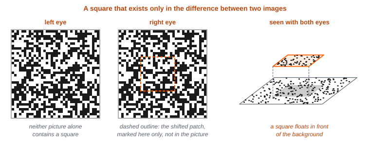
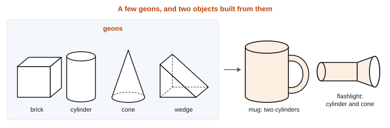
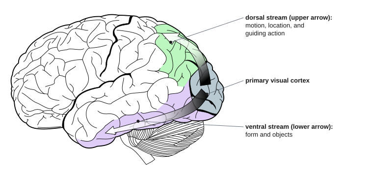
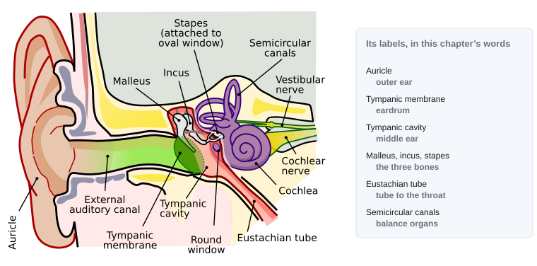
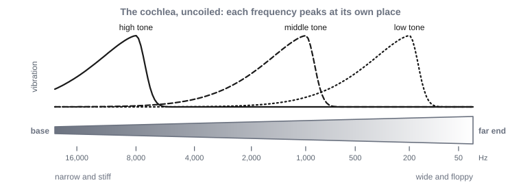
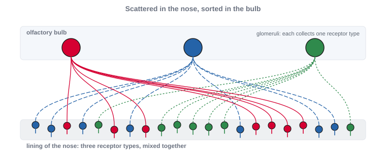

# 8. Perception and Action

This module is about how senses recover a world from physical signals that never fully determine it, and how an animal’s own movement both disturbs its senses and helps them. While reading, look for the beginnings of answers to these questions:

- A flat image fits many scenes, and each ear receives every sound at once, added together. How can a sense recover a world from these signals?
- Vision gets the direction of a thing almost for free. Why does hearing have to compute even that, and how can neurons measure differences of a few millionths of a second?
- How can an object be recognized from an angle never seen before, and what do deep networks reveal about how people do it?
- Why can no one tickle themselves, and why does the world stay still when the eyes jump?
- What changes in the brain when a person puts on prism goggles or new glasses?

By the end, we should be able to say what every sense does for a moving animal, and why perceiving and moving are best understood together.

<!-- pin: t-levels-perception -->

: Marr’s three levels, the question each asks, the discipline that asks it, and this module’s example. {#t-levels-perception}

| Level | The question it asks | Discipline | This module’s example: perceiving from a moving body |
|--------|------------|-------|--------------------|
| Computational | What problem is being solved, and why does solving it matter? | Evolution and ecology | What a moving animal can recover from its senses, when no signal settles its causes and the animal’s own movement keeps changing the signals |
| Algorithmic | What is represented, and by what procedure? | Cognitive psychology and AI | Recovering depth, objects, and sound sources from the signals, and predicting the animal’s own effects on its senses |
| Implementational | By what physical means, and at what cost? | Neuroscience | Receptor sheets and the maps built from them, and the cerebellum and cerebellum-like circuits that learn to predict |

---

A small fish lives in a stream where eels hunt. In Module 7, we followed what happens when the water carries the smell of an eel. The smell arrived as a pattern of activity in the fish’s olfactory bulb. We asked what the fish could do with that pattern. We took the pattern as given. But before there was a pattern, molecules carried by the current had to reach receptor cells in the fish’s nose, and those cells had to turn the molecules into electrical signals. Light, sound, and the push of moving water have to be turned into signals too, by other kinds of cells. And each kind of signal can tell the fish some things about the world, and not others.

We also treated the fish as if it were holding still. But it is not. To follow a smell upstream, the fish swims. Every beat of its tail stirs the water along its sides. That movement of the water is felt by the fish’s lateral line, a line of small sensory organs along each side of its body that works like touch at a distance. Every turn of the fish’s body sweeps the whole scene across its eyes. So at any moment, much of what reaches the fish’s senses was caused by the fish itself. And when the eel does appear, the signals that tell the fish where the eel is are already a little out of date.

This module is about the two things we set aside in Module 7. First, the senses that deliver patterns to the brain. And second, the movement of the animal that has those senses. Much of what is known about how senses work comes from mammals, monkeys, and human beings. So we will focus on where the evidence is, well ahead of where our evolutionary story has reached so far. We will also discuss human sensory systems because they are of interest and, unlike much of what we have discussed so far (how neurons work, how Hebbian learning works, etc.), have changed a lot since the last common ancestor humans share with fish. But the fish stays with us throughout, and we come back to it whenever a point can be made with a fish .

## §8.1 — Computational: The Problems Senses Solve

### §8.1.1 — What a Sense Is For

A sense can help an animal find out about things it is not touching, or cannot see inside. It does this through a physical signal that those things have shaped, and that then makes its way to the animal. An eel reflects light, disturbs the water, and sheds molecules into the current. Each of those signals carries information about the eel. But none of it is direct information. To know what in the world caused a signal, much must be recovered.

Different signals carry different facts, because they travel in different ways. Light moves fast and in straight lines. So it carries the layout of surfaces at a distance, with great precision about direction. But anything in the way blocks it, and in the dark there is none.

Sound bends around obstacles, works in the dark, and arrives from every direction at once. So it is well suited to telling an animal that something is happening, even out of sight. Sound also carries information about the physical makeup of whatever made it. Heavy objects ring at low pitches and tight ones at high pitches. Metal keeps ringing, and wood goes quiet almost at once. A dropped pan and a dropped book sound different because they are different things.

Chemicals move slowly and linger. They drift with the current of the air or water. So they carry information about *what* something is, far better than *where* it is.

Touch is the exception to finding out about things at a distance. It reports only what is in contact with the body, through pressure, vibration, and stretch. The **lateral line**, the line of sensory organs along a fish’s sides, extends something like touch a short way into the water around it. The moving water it detects carries information about movement nearby, within a body length or two.

In Module 4, we introduced *transduction*, the conversion of an event in the world into a change in membrane voltage. There, we described it for touch and for smell. Light and sound are transduced too, by receptor cells specialized for each. We will describe those cells in §8.3. What matters for now is the consequence. A sense can only report what its physical signal carries, and only to the extent its receptors respond to it.

What a sense has to provide also depends on how its owner lives, and vision is the clearest case. Many fish in shallow water can see ultraviolet light, which the human eye filters out before it reaches the receptors. Early mammals were probably small animals active mostly at night, when sensitivity to dim light matters far more than color. A primate picking fruit and insects in daylight needs sharp detail at the center of what it is looking at. We take up in §8.3.3 how these different eyes came about, including which kinds of color receptor were lost along the way and which were reinvented.

So the fish uses each of its senses for a different job. Smell tells it that an eel has been somewhere upstream. The lateral line tells it that something is moving close by. Vision tells it where, exactly, something is. Each of those jobs begins with a receptor cell responding to one physical quantity, and each runs into the same problem, which we turn to next.

### §8.1.2 — Never Enough Information

In Module 1, we saw that vision faces an **ill-posed problem**. A flat image on the retina could have been produced by many different arrangements of objects in the world, and nothing in the image alone settles which arrangement was there. Every sense faces some version of that problem.

Consider hearing. Each ear receives a single pressure wave, the sum of every sound reaching it. A bird calling, a branch creaking, and water running over stones all combine before they arrive. Recovering the separate sources from one summed wave is ill-posed in exactly the same sense. Many different combinations of sources can produce the same wave. And hearing has a difficulty vision does not. In vision, a near object hides the one behind it, so the parts that remain visible are usually intact. In hearing, nothing is hidden, but every source is spread across the whole mixture.

The organs of balance in the human inner ear give a third case. They contain sensors that respond to the pull of gravity and to acceleration. But to any sensor that responds to acceleration, tilting the head and accelerating forward produce the same signal. So these sensors alone cannot tell the two apart. Consider a motion-simulator ride at a theme park or arcade. The seat tilts slowly backward, and a rider feels pressed into it as if speeding forward. The ride is using the ambiguity on purpose.

So what can and what do brains recover, when the information cannot settle the answer? Not everything. They settle for what *can* be deduced from the signal. Measurements of human depth perception show the pattern clearly. People’s judgments are very reliable about which of two points is nearer. They are also reliable about the shape of an object, though they may see it as somewhat deeper or flatter than it really is. They are *not* reliable about exact distances. This is true even in well-lit rooms, with every cue available. In one researcher’s phrase, vision prefers “robustness over precision”.

That is a sensible bargain for an animal. A fish needs to know that the eel is closer than the weed, and which way the eel is moving. It does not need the distance in centimeters. What a sense delivers is shaped by what the animal needs to do next.

### §8.1.3 — The Same Thing, Again

In Module 7, we argued that the hardest form of generalization is recognizing the same thing across variation that changes its inputs completely, like visually recognizing an object from a different angle. We return to that problem here, and show that each sense has its own version of it.

As we just mentioned, an object seen from the front and from the side casts two quite different images. So does the same object near and far, or in shade and in sunlight. And the overall amount of light varies enormously. Daylight can be up to a billion times brighter than starlight.

The color of a surface poses the problem too. The light that reaches the eye from a surface depends on the surface and on the light falling on it, mixed together. The light reaching the eye from a banana changes a great deal between noon and dusk, and between daylight and a lamp. Yet the banana keeps looking yellow. This is *color constancy*, and it is invariance applied to color. Nothing in the light from the banana alone says how much of it is due to the banana, and how much to the lamp. So recovering the color of a surface is ill-posed in the same sense as recovering a scene from a flat image.

Hearing has the same invariance problem. The sound of a phone’s ringtone varies enormously from instance to instance. It can be louder or more quiet. It can sound muffled due to being in a pocket, in a purse, or under a pillow. Even the size and shape of the room it is in change its sound due to the way the sound echoes off the different walls. But a listener recognizes all of them instantly as the same sound.

Recognizing a kind of object, or a kind of sound, is the categorization problem we described in Module 7. We take up in §8.2 how vision and hearing handle their own versions of this problem.

### §8.1.4 — Where Things Are

So far we have focused on how senses can tell an animal about *what* some stimulus is. Just as important is *where* the stimulus is. And here, the senses differ in an instructive way.

The retina gives the animal direction almost for free. An eye forms an image, so light from each direction falls on a different place on the retina. Where the light falls already says which direction it came from, with no further computation. Touch works the same way. Which receptors in the skin are pressed says where on the body the touch fell.

Distance is another matter. It is not laid out anywhere on the retina, so it has to be computed. The information for it lies in differences between views. The two eyes see a scene from slightly different places, and a moving eye sees it from different places over time.

How much information two eyes can provide depends on where they sit. Eyes on the sides of the head together cover a wide view, which is good for watching for predators. Eyes that both face forward give up much of that view. But in exchange, their two fields overlap, so most of a scene is seen twice. Two such views carry the most information about depth at close range, within arm’s reach, which is where a primate’s hands do their work. We take up how differences between views are used in §8.2.

Much more so than vision, hearing has to compute direction. The **cochlea** is the organ of hearing in the inner ear of mammals, a fluid-filled tube that, in most mammals, is coiled like a snail shell. Birds and reptiles have a shorter, uncoiled version. Fish have no cochlea at all, hearing with other organs of the inner ear. The cochlea has a structure like the retina’s, with its receptor cells laid out in a topographic map. But this map is organized by pitch, rather than by physical direction. Which of its receptor cells respond says which frequencies are in a sound, not where the sound came from.

The information about direction lies in the differences between what arrives at the two ears. A sound straight off to one side reaches the far ear only about seven tenths of a millisecond after the near one. Yet people can notice when a sound moves by about one degree, which changes that timing difference by roughly ten millionths of a second.

For mammals, left and right have to come from the difference between the ears. A lizard’s two eardrums are connected through its mouth, so each ear is directional by itself. A mammal’s ears are acoustically isolated from each other, so left and right exist only in the difference between them.

For vision, there is one more complication. Where an image falls on the retina gives its direction relative to the eye, not relative to the world. Every movement of the eye, the head, or the body moves the image across the retina. After one beat of the fish’s tail, the image of the eel falls on different cells, although the eel has not moved . Before the position of the image means anything about the position of the eel, it has to be combined with where the eye was pointing. That is a problem about the animal’s own movement, which we turn to in §8.1.5.

{#f-where-on-the-eye alt="Two side-by-side panels. In each, a fish is drawn from above with one eye enlarged as an inset showing a curved retina. An eel sits in the same spot in both panels. In the first panel a dot on the retina marks the eel's image near the middle. In the second panel the fish's body is turned, and the dot has moved toward one edge of the retina. A caption under the panels reads: same eel, same place, different retinal position."}

### §8.1.5 — Signals of One’s Own Making

In Module 6, we noted that a moving animal has to tell its own doings from the world’s. We left the question of how it does so for this module. The two kinds of sensation have names. Sensation caused by the animal’s own movement is **reafference**. Sensation caused by the world, independent of what the animal is doing, is **exafference**.

The scale of the problem is easy to underestimate. Some fish sense weak electric fields with receptors in their skin, and use them to find prey hidden in mud. In one such fish, an ordinary bend of its own tail changes the electrical input along its body ten to a hundred times more than a small prey animal nearby does. Primate eyes jump to a new position about three times a second, and each jump sweeps the whole image across the retina, a change much bigger than most of those caused by movement in the world. And a voice is loudest in its owner’s own ears. In every one of these cases, the self-caused signal can drown out the signal from the world.

Vertebrates were not the first animals to face the problem of self-caused signals, or the first with ways of handling it. Consider the crayfish, a small freshwater relative of the lobster. A crayfish walking into a rock, and a crayfish touched by a predator, both stimulate the same receptors. Crayfish and flies both have ways of treating their own movement differently from the world’s. In Module 6, we placed the problem’s origin in the Cambrian, when fast animals with jointed bodies and image-forming eyes began producing self-caused signals in floods.

To separate its own doings from the world’s, an animal has two sources of information about its own movement. One is the commands it sends to its muscles. The other is a pair of senses that respond to the movement itself. The **vestibular system**, the organs of balance in the inner ear, senses rotation and acceleration of the head. **Proprioception** is the sense of the body’s own position and movement, from receptors in the muscles, tendons, and joints.

### §8.1.6 — A Slow Body

A body acts on old information. The world can sometimes move faster than the head or eyes. Even more critically, news that the image has slipped across the retina takes about a tenth of a second to turn into a correction. A nervous system that waited for that news would always be correcting an error that had already changed. Engineers know the problem of delayed feedback well. Feedback that arrives late tends to overshoot and oscillate, because each correction responds to a situation that no longer exists. Keeping the eyes steady while the head turns cannot wait for vision.

Some movements are over before any feedback could arrive at all. A **saccade** is a quick jump of the eyes to a new target. A saccade lasts only tens of milliseconds. If the target moves during the jump, it is too late to correct, and a second saccade will be needed.

The body also keeps changing. Heads and eyeballs grow. Muscles tire, and some weaken with age or injury. Glasses change how the world lines up on the retina. So the mapping from a command to its outcome has to keep being relearned.

And the signals arrive in the wrong coordinates. A target appears at some place on the retina. But reaching for it requires a set of angles at the shoulder, elbow, and wrist. One sensory map has to be turned into a different motor map, and the turning depends on where the eyes and head are pointing at the moment.

So, at the level of the whole animal, the fish’s strike at a drifting water flea has to be aimed at where the flea will be. The fish’s signals report only where the flea was. Somewhere in its nervous system, the fish has to turn old, eye-centered signals into a current, body-centered command.

### §8.1.7 — Moving in Order to Perceive

Movement is not only a source of trouble. In Module 6, we noted that an animal can act on the world and observe the effects. Moving changes what reaches the senses in lawful ways. As an animal moves, near things shift across its eyes faster than far ones, and the water flowing past its body changes shape as it passes objects. So movement makes information available that a stationary animal does not have.

There is a further sense in which perception is shaped by action. What an animal can do in a place depends on the place and on the animal’s body together. The same drop is a small step to a large animal, and a cliff to a small one. A gap is passable for one body and not for another. Psychologists call such a fact an **affordance**: an opportunity for action that a place or object offers to a particular body.

Perceiving an affordance is a separate problem from the affordance itself. And perceived affordances can be recalibrated with practice, as when a new wheelchair user learns quickly which gaps are wide enough. The psychologist who introduced the word affordance, James Gibson, also argued that perceiving the world needs no interpretation, because the information in the senses is enough. We do not take that view, because, as we argued in §8.1.2, the signals reaching the senses never fully settle what produced them. But the idea of affordances is useful, even without the more expansive claim.

So the flood of self-caused signals, and the information gained by moving, turn out to be the same fact seen from two sides. A moving animal produces most of what it senses. That is a problem to be solved, and it is also how much of the sensing gets done.

## §8.2 — Algorithmic: Recovering a World from Moving Senses

### §8.2.1 — Depth from Flat Images

If a flat image underdetermines the scene that produced it, how does vision recover depth at all? The answer is that it relies on assumptions that are usually true about the world. Each such assumption gives a **depth cue**: a feature of the signal that, given the assumption, indicates how far away something is.

Some cues are present in a single image. A near object hides part of a far one. Of two objects assumed to be the same size, the one casting the smaller image is farther away. A textured surface, such as a field of grass or a tiled floor, shows its texture growing finer with distance. Parallel lines, such as the edges of a road, converge toward the horizon. And shading shows how a surface curves, given an assumption about where the light comes from. In Module 1, we saw the light-from-above discs, which look like bumps or dents depending on which way their shading runs. Those discs are a case where an assumption shows itself, because turning the picture upside down reverses what a viewer sees.

Other cues come from comparing two images. One comparison is between the two eyes, which see a scene from slightly different places, and we take it up next. The other is between views over time, as the animal moves. When an observer moves while looking at one point, things beyond that point drift along with the observer, and nearer things drift the opposite way. The nearer they are, the faster they drift. This is **motion parallax**, and it is a cue only a moving observer has.

So the cues that compare images need either two sensors or one sensor that moves . Recovering the world and moving through it are not separate problems.

Some animals move in order to sense. An octopus bobs its head up and down to judge how far away something is with one eye, which gives it motion parallax without a second eye. Fish that live in caves without light stir the water as they swim and feel how it flows around objects, and they swim faster past landmarks they have not encountered before. A weakly electric fish goes further, producing an electric field of its own and sensing the distortions that nearby objects produce in it. These are cases of **active sensing**: an animal producing movement, or energy, in order to sense. Even ordinary looking requires movement, because an image held perfectly still on the retina fades from view within seconds.

{#f-depth-cues alt="A drawn landscape with four labeled cues. Occlusion: a tree in front of a house hides part of it. Relative size: two figures of the same height, one drawn small and far, one large and near. Texture gradient: a path of square tiles that become smaller and closer together toward the horizon. Perspective: the two edges of the path meet at a point on the horizon. An inset at the right shows an eye moving rightward and fixating a post in the middle distance, with an arrow showing a near bush moving left and a distant hill moving right."}

### §8.2.2 — Two Eyes, One Matching Problem

Because the two eyes sit a few centimeters apart, they see a scene from slightly different positions. A point at exactly the distance the eyes are pointing at falls on corresponding places in the two retinas. A point nearer or farther than that falls on places that do not quite correspond. The size and direction of that mismatch is **binocular disparity**, and it carries information about depth.

A simple demonstration shows it. Hold a pencil at arm’s length and a finger about halfway between the pencil and the face. Look at the pencil, and the finger appears doubled. Look at the finger, and the pencil appears doubled. Only a thin band of depth around the point being looked at fuses into a single image. Everything else is double, although people rarely notice it.

Stereo vision does not require recognizing any object first. In a *random-dot stereogram*, each eye is shown a field of random dots. In one field, a square patch of dots has been shifted slightly sideways. Neither field, viewed alone, contains a square. But when the two are viewed together, one per eye, a square floats in front of the background . The square exists only in the disparity between the two images.

That demonstration also shows what makes stereo hard. Before disparity can be measured, each point in one eye’s image has to be paired with its partner in the other’s. This is the **correspondence problem**. One way to picture it is sliding one image over the other until the parts line up. In a random-dot field, every dot looks like every other dot, so there are many possible pairings, and most of them are wrong. Repeating patterns make the problem especially hard. Wallpaper with a regular pattern can be fused at the wrong pairing, and then it seems to float at the wrong distance. How the brain solves the correspondence problem is still debated, and the proposed solutions are models rather than known mechanisms.

{#f-random-dot alt="Two square fields of random black and white dots, labeled left eye and right eye. A dashed outline, visible only in this diagram and not in the stimulus, marks a central square region in the right field that is shifted a few dots to the left. To the right of the two fields, a drawing of the percept: a smaller square hovering above a dotted background, with a shadow to show that it is nearer."}

### §8.2.3 — Color from Comparisons

Stereo vision recovers depth by comparing what the two eyes receive. Color also begins with a comparison, this time between kinds of receptor. A receptor that reports only how much light it caught cannot say what wavelength the light had. A dim light of one wavelength and a brighter light of another can produce the same response. So seeing color requires comparing the responses of receptors tuned to different wavelengths. Three kinds of receptor, compared, give human beings their color vision. A digital camera does the same with three kinds of filter over its sensor.

Comparing receptors is not enough for constancy, though. The banana under the lamp still sends the eye different light from the banana at noon. A famous set of demonstrations in the 1950s made the point sharply. A collage of colored papers was lit so that a patch that looked green sent the eye exactly the same light that a brown patch had sent before. The green patch still looked green. So the color of a surface is judged from more than the light coming from that surface.

Two kinds of procedure have been proposed. One compares each surface with the rest of the scene. If the light falling on a whole scene turns reddish, every surface sends back more red, so a surface’s color can be read from how it differs from its surroundings. One early version of this idea computed ratios of light across the whole scene, and it did not work in all circumstances. A camera’s automatic white balance is a cruder version of the same comparison. The other procedure is learned. On this account, the color a surface appears to have reflects what similar light, in similar surroundings, has usually signified in past experience. Neither account is settled.

### §8.2.4 — Parts, Views, and Networks

Color constancy is one case of the invariance problem we described in Module 7: recognizing the same thing across variation that changes its inputs completely. Recognizing an object from any angle is that problem at its hardest. Strictly, what brains achieve is *tolerance*, in the sense we defined in Module 7. Recognition survives a great deal of change in the image, but not all of it. Two broad accounts of how it does so have been proposed.

One account is recognition by parts. The psychologist Irving Biederman proposed that objects are recognized as arrangements of a small set of simple volumes. He called each such volume a **geon**. Geons include bricks, cylinders, cones, and wedges, about three dozen in all . A cup, on this account, is a curved cylinder with a smaller curved cylinder attached to its side. Geons can be told apart by features of their edges that rarely arise by accident of viewpoint. A straight edge in an image almost always comes from a straight edge in the world, and parallel edges from parallel edges. So the features that identify a geon survive most changes of viewpoint, which is what an account of tolerance needs.

The test that made the theory famous removed the same amount of contour from line drawings of objects in two different ways . When the gaps left each part recoverable, people named the objects. When the gaps hid the places where parts join, the remaining lines were arranged to run smoothly across those joints. Then people failed almost completely, even when they had five seconds to look.

The other account is recognition by views. On this account, an object is stored as a set of views, and a new view is recognized by how close it is to the stored ones. People can learn to recognize novel objects, such as twisted wire shapes, from a few views. Afterward, they recognize new views between the learned views quite well, views beyond them less well, and views at right angles to them worst .

Monkeys trained for months on such objects showed the same pattern. When the monkeys were trained on three to five views spread around the object, they recognized it from any angle around the axis on which it had been turned. One proposal is that tolerance is built by combining many units, each tuned to one view, into a single unit that responds to all of them. That is what the pooling we described in Module 7 did for positions. The proposal is a model rather than a finding.

The two accounts are now usually seen as ends of a continuum of tasks. Recognizing which of several similar objects is in view depends heavily on viewpoint. Recognizing a kind of object that differs in its parts from others, such as a mug versus a bucket, depends on it much less.

Deep networks offer a third angle on the question. A *network*, in this book, means an artificial neural network: a model of units and weighted connections, run on a computer. Networks trained only to name objects in photographs turn out to be sensitive to the same accident-proof edge features that the parts account relies on, without being given them. But networks fall short exactly where a parts account makes its prediction. People who learned simple line objects rarely confused them with versions in which one part had moved from above another part to below it. Networks confused those versions easily. And networks trained on photographs show little sign of representing three-dimensional shape or the arrangement of parts.

Networks also bear on the question we left open in Module 7: whether training on altered copies of images is enough to explain tolerance. In one test, a network trained on images sprinkled with one kind of visual noise beat people on that noise, getting 80% correct against their 46%. But on a second kind of noise, which looks similar to a person, the same network scored about 10%, close to the 6% expected by chance. Training on altered copies gave tolerance to the alterations that were trained, and very little beyond them. People handle distortions they have never encountered.

Part of the difference may lie in what each system learns from. A network learns from sharp photographs. A primate eye does not provide them. It gets fine detail only from the **fovea**, a small region at the center of gaze. In a human eye, just six degrees away from the line of sight, the ability to see detail has already fallen by about three quarters. So the eyes keep moving, bringing each part of a scene in turn onto that small region. At any given moment, most of what the eye sees is blurry, with one small sharp window that keeps jumping around.

Networks trained on a mixture of sharp and blurry images came to rely on shape more often, resisted noise better, and matched the responses of early visual cortex better. Self-produced movement also matters for learning to see. Kittens and human infants come to avoid a visible drop only after they have moved around under their own power. Being carried through the same scenes is not enough. Our own inference, which goes beyond these studies, is that a moving animal collects many views of each object, spread out in the ways the world actually varies them. That is the kind of experience that gave the monkeys their recognition from any angle.

Finally, notice what these comparisons do and do not show. A digital clock predicts the time on a mechanical clock perfectly and works nothing like it. So a network that matches human answers, or even human brain activity, is not thereby shown to work the way a brain does. The strongest tests change one thing at a time and check whether the model fails where people fail. Removing contour in two different ways was a test of that kind.

{#f-geons alt="A row of four simple three-dimensional shapes: a rectangular brick, an upright cylinder, a cone, and a wedge. To the right, two objects assembled from these shapes, a mug made from a large cylinder with a small curved cylinder attached to its side as a handle, and a flashlight made from a long cylinder capped with a short cone."}

{#f-recoverable-contour alt="Three line drawings in a row. The first is a complete drawing of a cup with a handle. The second, labeled recoverable, has short gaps in the middle of several edges; the body and the handle are still clearly separate shapes. The third, labeled nonrecoverable, has the same total amount of line removed, but the gaps are at the points where the handle meets the body, and the handle’s outer line runs smoothly into the side of the body, so that the handle and body blur into one outline."}

{#f-view-generalization alt="Left: a twisted wire object at the center of a circle of viewpoints, with two learned views marked as dots on the circle, the arc between them labeled between, the arcs outside them labeled beyond, and a second circle at right angles labeled at right angles. Right: a bar chart of errors on new views, 13 percent between, 22 percent beyond, and 48 percent at right angles."}

### §8.2.5 — Where a Sound Comes From

Vision recovers distance by comparing the slightly different images in the two eyes. Hearing uses the same kind of comparison, between the two ears, to recover direction. It has three main cues. The near ear hears a sound first, which gives an **interaural time difference**. The head casts an acoustic shadow over the far ear, so a sound is slightly quieter there, which gives an **interaural level difference**. The shadow matters mainly for high pitches, because low-pitched sounds bend around the head. So low pitches are located mainly by timing, and high pitches mainly by level .

The third cue comes from the folds of the outer ear, which filter a sound differently depending on where it comes from. Those folds mainly help tell up from down, and front from back, which the two differences between the ears leave ambiguous. Because every person’s ears are shaped differently, the filtering cues have to be learned.

The timing differences involved are tiny. As we saw in §8.1.4, a shift of one degree changes the timing difference by roughly ten millionths of a second. Two kinds of procedure have been proposed for measuring a difference that small.

One procedure turns a difference in time into a place. Signals from the two ears travel toward each other along a row of detectors, and each detector responds only when signals from both sides arrive at the same moment. A sound from straight ahead reaches both ears together, and the signals meet in the middle of the row. A sound from the left gives the left ear’s signal a head start, so it travels farther along the row before it meets the signal from the right ear. So where along the row the signals meet stands for one time difference, and therefore one direction. Because the travel time along the row does the measuring, such an arrangement is called a *delay line*.

The other procedure needs no map. It compares the overall activity of two broad channels, each favoring one side, and reads direction from the balance between them. Which procedure a given animal uses turns on details of its neurons, which we take up in §8.3.5.

Distance, unlike direction, is only partly available to hearing. Loudness signals distance only for sounds whose loudness the listener already knows, just as the size of an image signals distance only for objects whose size is known. Echoes from walls arrive from every direction, yet they rarely confuse a listener about where a sound came from, because the first sound to arrive dominates the judgment.

{#f-itd-delay-line alt="Left: a circle representing a head viewed from above, with a speaker icon to the upper left. Curved wavefronts reach the left ear first. Labels note the time difference and the quieter level at the right ear, which lies in the head's shadow. Right: a horizontal row of seven detectors. A line representing the signal from the left ear runs along the row from left to right, and another from the right ear runs from right to left. The third detector from the right is filled in, marking where signals from the two ears coincide for a sound on the left."}

### §8.2.6 — Pulling Sources Apart

**Auditory scene analysis** is the work of grouping the components of one mixed wave into the sources that made them. Because the problem is ill-posed, it can only be solved by relying on how real sound sources usually behave.

Several such regularities are used. Parts of a sound that start at the same moment usually come from the same source. A single source that vibrates regularly, such as a voice or a bird’s call, produces a set of frequencies that are all whole-number multiples of one lowest frequency. Components related that way are heard as one sound. So two voices at different pitches are easier to separate than two voices at the same pitch. And when one component of a sound starts a little earlier than the rest, it tends to pop out and be heard as a separate tone.

Grouping also works across time. When two tones of different pitch alternate slowly, they are heard as one melody hopping up and down. Speed them up, and they split into two separate streams, one high and one low, each with its own rhythm . Listened to for a while, a galloping pattern of high and low tones can flip between being heard as one stream and as two. Some drawings flip between two readings in the same way.

Location turns out to be a weak cue for grouping sounds heard at the same moment, but a strong one for following one talker over time. Two ears help a great deal in a noisy room, and blocking one ear makes a conversation in a crowd much harder to follow.

Even pitch is constructed. If the lowest frequency is removed from a sound that is otherwise made of its multiples, listeners still hear the pitch of the missing frequency. The pitch is an inference about the source, not a property of any one component.

Vision groups by similar principles. Edges that move together are usually parts of one object, which is the visual version of components that start together. But the difference we noted in §8.1.2 matters here. In vision, the front object is intact and the one behind it needs completing. In hearing, every source is spread through the whole mixture, and each has to be pulled out of all of it. Speech adds a further demand, because the categories that matter are set by a language, and we take speech up in Module 13.

{#f-streaming alt="Two panels with time running left to right and pitch increasing upward. Left panel, labeled slow: short bars alternate high, low, high, with gaps between them, and a single line zigzags through all of them. Right panel, labeled fast: the same pattern with the bars closer together; one line connects only the high bars and a separate line connects only the low bars."}

### §8.2.7 — Same Cause?

An animal usually perceives one world, not one world per sense. So signals from different senses have to be combined, and combining them is two problems.

The first problem is deciding whether two signals share a cause. A flash and a click that come from the same place at the same moment probably do. A flash on the left and a click on the right probably do not. This is the same problem as auditory scene analysis, extended across the senses: deciding what belongs together.

The second problem arises when two signals do share a cause but disagree. In one experiment, people judged the height of a bar that they could both see and feel, and the visual and felt heights were made to disagree slightly. People’s judgments fell between the two, as a weighted average. The weights followed how reliable each sense was. As the visual image was made noisier, vision counted for less. And the combined judgment was more precise than either sense alone . This is **cue combination**: weighting each source of evidence by its reliability.

The ventriloquist’s puppet works the same way. Vision is usually much more precise than hearing about location, so a voice seems to come from the puppet’s moving mouth. When a flash of light is blurred enough, the relation reverses, and a click captures the location of the flash. And when sight and sound are far enough apart, the capture stops, because the two signals no longer seem to share a cause. People combine their senses nearly as well as the best possible weighting would, though not perfectly.

The organs of balance give one more case. We noted in §8.1.2 that the sensors for gravity and acceleration cannot tell a tilt from a forward acceleration. The canals of the inner ear, which sense rotation, settle the question, because tilting the head rotates it and accelerating does not. One sense resolves an ambiguity in another.

{#f-cue-combination alt="Left panel: a horizontal axis labeled height of the bar. A tall narrow curve labeled vision is centered slightly to the left, a shorter wider curve labeled touch is centered slightly to the right, and a third curve labeled combined is narrower than either and centered close to the vision curve. Right panel, labeled blurred vision: the vision curve is now wide and low, and the combined curve has shifted toward the touch curve."}

### §8.2.8 — From Eye to Arm

Where something falls on the retina says where it is relative to the eye, not where it is in the world, as we noted in §8.1.4. Acting on it takes one step more. A target seen at one place on the retina has to be reached with a particular set of joint angles, and the two descriptions share no numbers. A simulated crab makes the point concretely. It describes a target by the angles of its two eyes, and its arm by the angles of two joints. A target at eye angles of 55 and 85 calls for arm angles of 62 and 12. Copying the eye numbers straight across to the arm would send the arm nowhere near the target. So the crab needs a mapping from one set of coordinates to the other.

The mapping can be pictured as a rubber sheet. Draw a grid over the space of eye angles, then stretch and bend the sheet until every point lands on the arm angles that reach it. A table that stored the answer for every point would do the job. A network can learn the same mapping with far fewer stored values, by adjusting its weights, and it can relearn the mapping when the body changes. The prism throwing of §8.2.11 is a mapping of this kind being relearned.

In a real animal, the mapping also changes with every movement of the eyes and head. After a saccade, the same spot on the retina stands for a different direction in the world. So the transformation needs a running record of where the eyes are pointing. Monkeys keep one. When a monkey’s eyes were pushed off course just after a target flashed, the monkey’s next saccade still landed on the flash’s real location. The monkey’s brain combined where the flash had fallen on the retina with where the eyes had since gone. That record of eye position can come from a copy of the eye-movement command or from sensors in the eye muscles. Those are the two sources of information about movement we described in §8.1.5.

The fish striking at a drifting water flea, which we described in §8.1.6, needs all of this at once. The flea’s image is old and eye-centered, the fish’s eyes and body have moved since, and the strike has to be aimed in body coordinates at where the flea will be.

### §8.2.9 — A Copy of the Command

Consider a puzzle. A fly placed inside a drum painted with vertical stripes turns to follow the drum when the drum rotates. But when the fly turns on its own inside a still drum, its eyes receive exactly the same sweep of stripes. Yet the fly does not turn back to follow them. Why not?

There are two possible answers. One is that the response to visual motion is simply switched off whenever the animal moves. The other is that the animal expects the motion its own turn will produce, and subtracts that expectation from what its eyes report. If the two match, nothing is left over, and nothing needs a response.

In 1950, two research groups found a way to tell these answers apart, and both did it by reversing an eye. Erich von Holst and Horst Mittelstaedt rotated the head of a hoverfly half a turn about its long axis, so that its eyes saw left and right reversed. In plain surroundings, the fly walked normally. Inside a still, striped drum, it circled, or turned violently back and forth until it froze. Roger Sperry rotated one eye of a small pufferfish and covered the other eye. The fish swam in tight circles, and turning the eye back to its normal position stopped the circling.

Switching off the response would predict normal behavior, because a switched-off response does not care which way the eye faces. Subtraction predicts what the animals actually did. With the eye reversed, the expected motion and the actual motion no longer cancel. They add. Every turn produces an error signal that calls for more turning, and the animal spins . So a comparison exists between what the animal expects and what it senses, and the experiments showed it without recording a single neuron.

The researchers who ran the fly experiment named the parts. The input caused by the animal’s own movement is reafference, as we described in §8.1.5. A copy of the movement command, kept for the comparison, is an **efference copy**. The researcher who ran the fish experiment, working independently, called the same kind of signal a **corollary discharge**. Today the two terms are used almost interchangeably. The pufferfish circled even after both of its balance organs had been removed, so its expectation could not have come from sensing the movement. That result is what led to the proposal of a copy of the command. In the fly, the expectation could have come from a copy of the command or from sensors in its legs, and the fly experiment left that question open.

A copy of the command can be used in two ways, and the 1950 experiments were designed to separate them. One way is to dim a sense while the animal moves. A fish’s lateral line is turned down while it swims, and a person’s hearing is turned down while they speak. Dimming works well for brief, simple self-caused signals. The other way is to predict a specific sensory consequence and subtract it, which works for self-caused signals that are complex and long-lasting. Alongside either use, an animal can measure its own movement with the vestibular system and proprioception. Real nervous systems use prediction and measurement at once. Prediction and subtraction are our next subject.

{#f-reafference alt="Left panel, labeled normal: a box labeled command sends an arrow to the body, which turns. A dashed arrow carries a copy of the command to a circle labeled compare. The eye sends the actual image motion to the same circle. A label below the circle reads they match and cancel: no error, no further turning. Right panel, labeled eye reversed: the same diagram, but the actual image motion is marked as reversed, the label reads they add: an error that calls for more turning, and an arrow loops back from the circle to the command box. Beside it, a top view of a small fish swimming in a tight circle."}

### §8.2.10 — Predicting One’s Own Sensations

A **forward model** predicts what a movement command will do to the body and to the senses, before the senses report. The difference between the prediction and what actually arrives is information about the world. An **inverse model** runs the other way: from a wanted outcome to the command that will produce it.

The best-known example is that people cannot tickle themselves. In one experiment, people moved a handle with one hand, and a robot arm, following the handle, stroked the palm of their other hand with a piece of foam. Strokes they produced themselves felt much less tickly than the same strokes produced by the robot alone. Then the experimenters introduced a delay between the handle and the stroke. The longer the delay, the ticklier the stroke felt, and with a delay of a fifth of a second, the self-produced stroke felt as tickly as one from outside . The prediction is precise in time, and a stroke that arrives late no longer matches it.

The subtraction has a side effect. In another experiment, two people took turns pressing on each other’s finger, each trying to press exactly as hard as they had just been pressed. The force grew by about 38% with each turn. Each person’s own press felt weaker to them than it was, because its sensory effect was partly subtracted. So each one pressed harder than the press they were returning.

The same prediction keeps the visual world still when the eyes move. Every saccade sweeps the image across the retina, yet the world does not seem to jump. Press gently on the outer corner of one eyelid, with the other eye closed, and the image moves without any command to move the eye. Then the world does seem to jump.

The researchers who ran the fly experiment laid out the full set of cases. If the eye muscles are paralyzed and a person tries to look to the right, the world seems to jump to the right, because a movement was expected and none occurred. If the eye is pushed to the right with no command, the world seems to jump to the left. In an ordinary eye movement, both happen at once, and they cancel. The usual explanation is a corollary discharge, with some help from sensors in the eye muscles. That explanation is well supported rather than settled.

The forward model has a direct parallel in artificial intelligence. A learned model that predicts the consequences of an agent’s own actions is what many machine-learning researchers call a *world model*. In Module 1, we noted that whether current AI systems build genuine internal models of the world is debated. A forward model is one precise version of what such an internal model would be.

A forward model also helps with delay. If the nervous system can predict the consequences of a command, it can estimate where the body is now. That estimate can be more current than the senses’ last report, and the nervous system can steer by it. In one model of eye tracking, steering only by visual feedback a tenth of a second old made the tracking unstable. Adding a loop that used a copy of the command made the same model stable.

A second answer to delay is to use a faster sense. The reflex that keeps the eyes steady while the head turns starts within about 10 to 15 milliseconds of the head movement. That speed comes from the balance organs, which drive the reflex in place of vision.

Some corrections happen too fast for anyone to notice. If a target jumps to a new position during a saccade, people do not see it move, because vision is largely suppressed during the jump. Yet their reaching hand bends toward the target’s new position partway through the reach, and they cannot stop the correction even when asked to.

{#f-tickle alt="A line graph. The horizontal axis is delay in milliseconds, from 0 to 300. The vertical axis is tickliness rating. The line starts low at zero delay and rises steadily to about 200 milliseconds, then levels off. A dashed horizontal line near the top, labeled stroke from outside, marks the level the curve reaches at 200 milliseconds and beyond."}

### §8.2.11 — Learning the Model from Mismatch

A forward model has to be learned, and it has to keep being relearned, because the body keeps changing. The learning signal is the difference between the predicted and the actual sensation. That is the *prediction error* we described in Module 5, and the logic is the delta rule’s: adjust in proportion to how far the prediction was off.

Prisms show the learning clearly. In one study, people threw balls at a target two meters away while wearing goggles with prisms that shifted their view of the world about seventeen degrees to one side. Their first throws missed by about half a meter. With each throw the miss grew smaller. On average, it was cut in half roughly every six throws, though people differed widely in how quickly they adapted. Then the prisms came off. The first throws now missed by most of the original amount, in the opposite direction, before recovering again .

That opposite miss, the **aftereffect**, is the evidence that a stored mapping changed. The throwers had not simply learned to aim off to one side while the prisms were on. Their nervous systems had changed the mapping from what they saw to how they threw, and the changed mapping stayed in place after the reason for it was gone.

The eye has its own version. Magnifying glasses make the image slip across the retina with each turn of the head, because the steadying reflex was set for unmagnified vision. Over hours to days, the reflex grows stronger until the slip disappears. When the glasses come off, the new setting persists for a while, which is the same kind of aftereffect.

These are all things a whole animal or person does. In §8.3.8 and §8.3.9, we come to the cells that learn from the mismatch, and to the circuits in which they sit.

{#f-prism alt="A plot with throw number on the horizontal axis and horizontal error on the vertical axis, with zero error marked by a dashed line. A shaded band labeled prisms on covers the first part of the graph, where points start well below zero, on the side labeled left, and curve up toward it. After the band ends, labeled prisms off, the next point is well above zero, on the side labeled right, and the following points curve back down toward zero."}

## §8.3 — Implementational: Receptor Sheets, Maps, and the Cerebellum

### §8.3.1 — From Receptor Sheet to Cortex

Each sense begins with receptor cells that respond to one kind of physical signal. And in most senses those cells are laid out as a sheet, whose layout carries information before any neuron has computed anything .

<!-- pin: t-senses -->

: The senses compared: what each responds to, how its receptors are laid out, what the layout gives for free, and how its signals reach the cortex. {#t-senses}

| Sense | Physical signal | Receptor cells | How the receptors are laid out | What the layout gives for free | Route to the cortex |
|----------|-------------|-----------------|-------------------|------------|-----------------------------|
| Vision | Light | Rods and cones in the retina | By direction in the visual field | Direction, relative to the eye | Thalamus (lateral geniculate nucleus), then primary visual cortex |
| Hearing | Pressure waves in air or water | Hair cells in the cochlea | By frequency | Pitch, not direction | Several brainstem stations, then thalamus, then auditory cortex |
| Balance | Rotation, gravity, and acceleration of the head | Hair cells in the canals and the gravity sensors of the inner ear | By axis of rotation and direction of tilt | Which way the head is turning or tilted | Brainstem and cerebellum; through the thalamus to several areas, with no single primary area |
| Touch and proprioception | Pressure, vibration, and stretch | Several kinds of receptor in skin, muscles, and joints | By location on the body | Where on the body | Spinal cord and brainstem, then thalamus, then somatosensory cortex |
| Smell | Airborne or waterborne chemicals | Smell receptor neurons in the nose | Scattered, then sorted by receptor type in the olfactory bulb | Nothing about location | Olfactory bulb straight to olfactory cortex, with no first stop in the thalamus |
| Taste | Dissolved chemicals | Receptor cells in taste buds | Across the tongue, with every region sensing every taste | Which of five basic tastes | Brainstem, then thalamus, then taste cortex |
| Lateral line and electric sense (fishes) | Water movement; weak electric fields | Hair cells in small organs along the body; electroreceptors in the skin | Along the body surface | Where along the body | Cerebellum-like structures in the hindbrain, then the midbrain |

Several principles run across the senses in the table. Most receptor sheets keep their layout into the brain, forming *topographic maps* in the sense we defined in Module 6. Vision’s map is laid out by direction, which is **retinotopy**. Hearing’s is laid out by frequency, which is **tonotopy**. Touch’s is laid out by location on the body, which is **somatotopy**.

Maps are not drawn to scale. The center of gaze takes up a large share of the visual map, just as the hands and lips take up a large share of the map of the body. A map’s proportions follow the density of receptors, and how much the animal uses that part of the sheet.

Every sense but smell passes through the thalamus on its way to the cortex. The visual relay in the thalamus is the **lateral geniculate nucleus**. Smell is the exception, as we noted in Module 7, because the olfactory bulb projects straight to the olfactory cortex. And balance is irregular. It has no single primary cortical area, and visual signals join it at its very first stop in the brainstem.

### §8.3.2 — The Retina Computes

The retina is not a camera’s film. It grows out of the developing brain, and it processes the image before any signal leaves the eye.

The retina’s receptor cell is the **photoreceptor**. Each one contains a pigment molecule that changes shape when it absorbs a particle of light. That change sets off a chain of chemical reactions inside the cell, which amplifies the effect of a single absorption many times over. Unlike the touch and smell receptors we described in Module 4, photoreceptors respond to light by releasing *less* transmitter, not more. What matters for the code is not the direction of the change but its consistency.

There are two kinds of photoreceptor. A **rod** is sensitive enough to respond reliably to a single particle of light, and rods handle dim light. A **cone** needs more than a hundred, and cones handle daylight, detail, and color. A human eye has about 90 million rods and about 4.5 million cones. The cones are crowded into the fovea, a pit about 1.2 millimeters across at the center of the retina, and the very center of the fovea has no rods at all. That is why a faint star is easier to see by looking slightly to one side of it.

Rods and cones are wired differently, and the difference is a trade between sensitivity and location . Many rods pool their signals onto a single cell, so that faint signals add up. But once the signals are pooled, the brain can no longer tell which rod caught the light. In the fovea, by contrast, one cone feeds one outgoing cell, which keeps exact location at the expense of sensitivity. It is the same trade we described for pooling in Module 7, which gained tolerance by giving up position.

The cells that carry the retina’s output, the ganglion cells, have center–surround receptive fields, in the sense we defined in Module 7. A ganglion cell responds strongly to a spot of light that differs from its surroundings and weakly to even light across its whole field. That is lateral inhibition at work, in the sense we described in Module 4. Cells that run sideways through the retina are thought to supply the inhibition. Some ganglion cells respond to spots brighter than their surroundings, and others to spots darker than their surroundings.

Ganglion cells also adjust to the overall level of light. Across the billionfold range between starlight and daylight, each ganglion cell responds over only about a tenfold range at any one time. It slides that range up or down to match the scene, much as a camera adjusts its exposure. So the retina sends the brain mostly a report of contrast and change. Contrast is how one spot differs from its neighbors, usually at the edges of things. Change is how the present differs from a moment ago. A doubling of all the light in a scene changes little of that report.

The ganglion cells’ axons form the optic nerve. Where the two optic nerves meet, the fibers from the inner half of each retina cross to the other side. So each half of the brain receives the opposite half of the visual world, from both eyes. Signals pass through the lateral geniculate nucleus to the primary visual cortex. The two eyes’ signals first converge on single neurons in the visual cortex, not before, and that is the first place disparity can be computed.

Overlapping eyes do not guarantee stereo. Many birds with overlapping fields seem to lack the cells that stereo would need. And the circuits for stereo, though probably largely built in, need both eyes working together during development, which is a *critical period* in the sense we described in Module 5.

{#f-retina-convergence alt="A vertical slice through the retina with three layers labeled, from back to front: photoreceptors, bipolar cells, and ganglion cells, with an arrow showing light entering from the front and passing through the layers. On the left side, about a dozen rods converge through two bipolar cells onto one ganglion cell, labeled sensitive but location lost. On the right side, three cones each connect through their own bipolar cell to their own ganglion cell, labeled less sensitive, exact location."}

### §8.3.3 — Eyes Lost and Reinvented

Color requires comparing receptors tuned to different wavelengths, as we described in §8.2.3. In the eye, those receptors are cones. A single cone cannot signal color. It reports only how many particles of light it absorbed, not their wavelength. A cone sensitive mainly to green light gives the same response to a dim green light and a brighter red one. So color requires at least two kinds of cone, and the human eye has three.

The earliest vertebrates already had the genes for four kinds of cone, each with its own pigment. Many bony fish of shallow water, zebrafish and goldfish among them, still use all four, including one sensitive to ultraviolet light. Sharks and rays lack the ultraviolet kind. Mammals lost two of the four, probably one at a time, and most mammals today have only two kinds of cone. Many researchers link the loss to a long period during which early mammals were active mainly at night, when color mattered little. That link is a well-supported hypothesis rather than a settled fact.

In primates, the features of the eye appeared in steps. Forward-facing eyes came first, in primates that were still active at night. A fovea came later, in the ancestors of tarsiers and monkeys. Foveas evolved separately in several other lineages too, including many birds.

Then a third kind of cone appeared in the ancestors of Old World monkeys, apes, and human beings. The gene for one long-wavelength pigment was duplicated, and the two copies drifted apart in the wavelengths they absorb. Most New World monkeys ended up with a different arrangement, in which only some females have three kinds of cone. In howler monkeys, the same gene was duplicated independently. And the human blue cone carries the old ultraviolet pigment of the early vertebrates, retuned to longer wavelengths .

The duplicated genes also have a downside for people. The two long-wavelength pigment genes sit side by side on the X chromosome, so they are easily miscopied. As a result, about 8% of men in the United States have some form of red–green color deficiency.

So vision gives the same lesson as the rest of the vertebrate brain in Module 6: new structures from old parts. Primate color vision did not recover the fish’s. It was rebuilt from a copied gene and a retuned pigment.

{#f-cone-classes alt="A branching tree with labels at the tips: zebrafish, mouse, dog, howler monkey, macaque, human. Beside each tip, a row of colored dots in five labeled columns, ultraviolet, blue, green, red, and red copied, shows the cone pigments present: four dots for the zebrafish, two for the mouse and dog, and three for the howler monkey, macaque, and human. Small squares on the branches mark two pigment genes lost in early mammals and the red gene copied separately in howlers and in Old World primates. A dashed line runs down the ultraviolet column from the zebrafish to the human, whose dot is ringed and labeled as the human blue cone, the old ultraviolet pigment retuned."}

### §8.3.4 — Two Streams, Specialized

Beyond the primary visual cortex lie dozens of further visual areas. They are usually grouped into two broad streams . The ventral stream, which we followed in Module 7, runs into the temporal lobe and is concerned with form and objects. The **dorsal stream** runs into the parietal lobe and is concerned with motion, location, and guiding action.

Some of the evidence comes from monkeys with damage to one stream or the other. Damage in the temporal lobe impairs telling objects apart, and damage in the parietal lobe impairs judging where things are. Some comes from human patients. One woman who lost a region of cortex specialized for motion saw tea as frozen while it poured, and saw cars as far away and then suddenly close.

Color can be lost in a similar way. After damage to particular areas of visual cortex, a person with *achromatopsia* sees the world in dirty shades of gray, although their cones work normally. Such a person still knows that a school bus is yellow, but can no longer see it. In monkeys, an area of the ventral stream called V4 has many neurons that respond to the color of a stimulus regardless of how it moves. But a large recent study of stroke patients found that color deficits did not map neatly onto one area. How cones and the neurons beyond them produce color, including its constancy, is still unclear.

A second account of the streams contrasts vision for perception with vision for action. After carbon monoxide poisoning damaged her visual cortex, a patient known as D.F. could not say, or show with her hand, how a slot was tilted. Yet she could post a card through the same slot about as accurately as the people she was compared with. She could not tell flat shapes of different widths apart by sight, yet her grip opened wider as she reached for the wider ones. When the researchers who studied her first reported these results, in 1991, they did not tie them to the two streams. A year later, they proposed that the ventral stream serves perception and the dorsal stream serves action.

Damage to the parietal lobe can produce a different pattern, called **optic ataxia**. A person with optic ataxia reaches badly for objects away from the center of gaze, while reaching for objects they look at directly is nearly normal.

The evidence is weaker than this first telling suggests. D.F. was tested on objects she looked at directly. Patients with optic ataxia mostly fail with objects off to the side. So the two patterns are not a clean mirror image. Later testing found signs of optic ataxia in D.F. herself. And a famous claim that grasping is not fooled by a size illusion did not hold up. When four laboratories tested 144 people with the same procedure, grasping was fooled by the illusion about as much as judgments of size were. So the two streams are best described as specialized rather than independent, and they exchange signals throughout.

In §8.2.4, we described the views account, in which an object is stored as a set of views and a new view is matched against them. Cells in the ventral stream fit that account. In monkeys trained for months on novel objects, researchers recorded from cells in inferior temporal cortex, at the far end of the ventral stream. Of 773 cells analyzed, 71 responded to particular views of the trained objects. Only 8 responded to the objects across views.

For the dorsal stream, a matching result comes from artificial intelligence. A network trained to estimate its own movement from what it sees predicts responses in the dorsal stream better than a network trained to recognize actions does.

{#f-two-streams alt="A side view of a human brain, front to the left, with its folds drawn in outline. A gray region at the back is labeled primary visual cortex. A shaded arrow curves from it upward and forward through a green region at the top of the back of the brain, labeled dorsal stream: motion, location, and guiding action. A second shaded arrow runs from it forward through a lavender region along the lower side of the brain, labeled ventral stream: form and objects. The cerebellum and brainstem are visible below."}

### §8.3.5 — The Ear

The ear has a long history, and most of its parts began as something else . The inner ear is as old as the vertebrates. Lampreys and hagfishes have one. In an embryo, the inner ear starts as a patch of the head’s surface that folds inward into a pit. The pit then pinches off into a closed, fluid-filled sphere inside the head. In sharks and rays, the pocket never fully closes. Small pores on top of the head still connect the inner ear to the sea. Some species even use grains of sand from their surroundings as the weights in their balance organs.

The inner ear is often said to have evolved from the lateral line. Whether it did is unresolved. The two grow from a shared patch of tissue in the embryo’s head, and in sharks, salmon, and some other fishes they grow from a single thickening. They also use the same kind of receptor cell. So they are best seen as sisters. Fish hear with the balance organs of the inner ear. Because each receptor cell there responds best to motion in one direction, those organs can tell a fish which way the water near a sound source is moving. They cannot tell whether the source is in front or behind.

In land vertebrates, a small patch of receptor cells devoted to hearing evolved from the balance organs. But early land vertebrates had no eardrum. Their stapes, the bone that now carries sound to the inner ear, began in fishes as the hyomandibula, a bone that braced the jaw. Early fishes also had a *spiracle*, an opening behind each eye, which some air-breathing fishes still breathe through. In land vertebrates, the pouch behind that opening became the air-filled middle ear and the tube that links it to the throat. Where the pouch stays sealed off by a thin layer of skin, the result is an eardrum.

An eardrum solves a real problem. Sound traveling in air mostly bounces off water, and the inner ear is filled with fluid. The eardrum and the small bones behind it collect force from the large eardrum and concentrate it onto a much smaller opening into the inner ear. A thumbtack works the same way, concentrating the push of a thumb onto its point. Concentrating the force this way raises the pressure about two hundredfold.

Even so, an eardrum that catches airborne sound evolved late, and separately at least five times, in different groups of land vertebrates during the Triassic period. That was more than 100 million years after vertebrates first came onto land. Before then, land vertebrates heard airborne sound poorly. In mammals, two more bones joined the stapes. The malleus and the incus are bones that once formed the joint of the jaw, and fossils preserve the stages in between.

Directional hearing changed along the way. A fish’s receptor cells give it direction directly. In frogs, lizards, and birds, the two eardrums are connected through the mouth or a canal. As we noted in §8.1.4 for the lizard, that connection makes each ear directional by itself. Mammals lost the connection, so their ears are directional only by comparison.

One proposal links this loss to mammals’ high-frequency hearing. Only high frequencies are shadowed enough by a small head to differ in level between the two ears. Only high frequencies are filtered usefully by the folds of the outer ear, which, as we described in §8.2.5, tell up from down and front from back. So high-frequency hearing gives mammals direction cues that coupled ears had given their ancestors.

The hearing organ also grew. In lizards it stayed a short strip, at most about 2 millimeters long. In birds and crocodiles it reached about 10 millimeters. In mammals it lengthened into the cochlea, and in marsupials and placental mammals it coiled, roughly 120 million years ago. Coiling fits a long tube into a small skull. The egg-laying platypus and echidnas have a curved cochlea that never coiled. A stiff, three-bone middle ear and a stiff cochlea let most mammals hear far higher frequencies than lizards or birds.

The cochlea is a coiled tube of fluid about 3.5 centimeters long, with a membrane running along it. The membrane is stiff at the base and floppy at the far end, so high frequencies vibrate it most near the base and low frequencies near the end. That gives hearing its tonotopic map, and makes the cochlea work like a bank of overlapping filters . The receptor is the **hair cell**, topped with a bundle of stiff projections. Bending the bundle pulls channels in the membrane open directly, with no chemical steps in between, in as little as ten millionths of a second. That speed is what timing-based localization needs. Mammalian hair cells, unlike those of fish and birds, do not regenerate once they are lost.

Signals from the two ears first come together in the brainstem. One group of neurons there compares the timing of the signals from the two ears by coincidence detection. Another compares their levels by a kind of subtraction, excitation from one ear against inhibition from the other, which signals direction whatever the loudness.

Measuring timing is hard for neurons. A single nerve impulse lasts about a thousandth of a second, a hundred times longer than the timing differences that matter. The barn owl, which hunts mice in the dark by sound, has one solution. Axons carrying signals from the two ears run in opposite directions along a row of neurons. Each neuron fires only when impulses from both ears arrive at the same moment, which is *coincidence detection* in the sense we described in Module 5. So the owl’s brain contains a delay line of the kind described in §8.2.5, which turns a difference in time into a place on a map.

Whether mammals locate sounds the same way is debated. Many timing-sensitive neurons in mammals prefer time differences larger than their own heads can produce, and precisely timed inhibition reshapes what they respond to. Mammals may instead use the comparison of two broad channels. A model that fits one species well need not hold in another.

The computed map of sound direction ends up lined up with vision’s map. The **superior colliculus** is the mammalian tectum, the structure that turns the eyes and head toward things. In it, and in the barn owl’s tectum, a map of auditory space sits in register with the map of visual space. Auditory cortex, by contrast, is laid out tonotopically and has no map of space.

Hearing also has machinery for the animal’s own sounds, and it uses both of the strategies we described in §8.2.9: dimming a sense and subtracting a prediction. Some of the machinery dims: tiny muscles in the middle ear contract when a person vocalizes, which damps the sound of their own voice. Some of it subtracts a prediction. Auditory cortex quiets just before and during the animal’s own vocalizing. And a mouse that learned its own lever press would produce a tone came to respond less to that tone than to the same tone played to it at random.

{#f-ear alt="A colored cutaway drawing of a human ear, with labels. On the left, the auricle and the external auditory canal lead to the tympanic membrane. Behind it, in the tympanic cavity, three small connected bones labeled malleus, incus, and stapes, with the stapes attached to the oval window of a coiled, snail-shaped cochlea. The semicircular canals rise above the cochlea, the vestibular and cochlear nerves leave to the right, a round window sits below the stapes, and the Eustachian tube runs down and away. Beside the drawing, a key pairs each anatomical label with the term this chapter uses: auricle, outer ear; tympanic membrane, eardrum; tympanic cavity, middle ear; malleus, incus, and stapes, the three bones; Eustachian tube, tube to the throat; semicircular canals, balance organs."}

{#f-cochlea-tonotopy alt="A long horizontal strip representing the membrane of the uncoiled cochlea, narrow and labeled stiff at the left end near the base, and wider and labeled floppy at the right end. Above the strip, three wave envelopes peak at different points: a high-frequency wave near the left end, a middle-frequency wave in the middle, and a low-frequency wave near the right end. Frequency labels in hertz run from high on the left to low on the right."}

### §8.3.6 — Smell and Touch

In Module 7, we took the activity in the olfactory bulb as given. Here is how it is produced. The receptors for smell were found by Linda Buck and Richard Axel, who in 1991 identified a large family of genes for them in the rat. They argued that smell needs many narrowly tuned receptors, where color vision needs only three. Later work showed what they could only propose.

Each smell neuron in a mammal makes one kind of receptor. Neurons that make the same receptor are scattered across the lining of the nose. But their axons converge on the same few glomeruli in the olfactory bulb . A **glomerulus** is a small spherical cluster of connections between incoming axons and the bulb’s own neurons. In the mouse, about 25,000 axons converge onto a single glomerulus, which feeds about 25 output cells.

So the bulb turns a scattered sheet of receptors into an array sorted by receptor type. A natural odor activates only a small fraction of the glomeruli, which is sparse coding in the sense we defined in Module 7. Whether the arrangement of glomeruli forms an orderly map of odors is not known, and nothing about it carries location. The number of working smell receptor genes varies enormously between species, from a few dozen in a lamprey to about 400 in a human and about 1,000 in a mouse.

Smell’s receptors carry nothing about location, but touch’s receptors carry location above all, because they are laid out across the skin. There are several kinds, and each acts as a different filter, responding best to edges, to slipping, to vibration, or to stretching of the skin. How finely a part of the body can feel depends on how densely packed those receptors are. Two points pressed on a fingertip feel separate when they are only about 2 millimeters apart. On the upper arm, they have to be about 40 millimeters apart.

The somatosensory cortex holds a map of the body, often drawn as a **homunculus**, a distorted figure with huge hands and lips. Other animals’ maps are distorted in their own ways. In rats, the whiskers take up large territories, visible as separate clusters called barrels, one per whisker. In raccoons the paws take up large territories, and in the platypus the bill. These maps also reorganize after the loss of a body part, or after heavy use of one.

{#f-glomeruli alt="At the bottom, a sheet of tissue with small neurons drawn in red, blue, and green, mixed randomly together. Thin lines run upward from each neuron. At the top, three round clusters labeled glomeruli, one red, one blue, one green. Every red line ends in the red cluster, every blue line in the blue cluster, and every green line in the green cluster."}

### §8.3.7 — Motor Cortex Is Not a Mirror

The **motor cortex** lies just in front of the somatosensory cortex, and its output fibers run down to the spinal cord, crossing to the opposite side on the way. Some of those fibers contact the motor neurons of the hand directly, which allows the fingers to move independently of one another. Such direct connections are largest in species with skilled hands or forepaws.

The motor cortex also has a map of the body, with the same broad layout as the sensory map and the same enlarged hands and face. But the motor map is much coarser. A single muscle can be activated from a patch of cortex millimeters wide. A single site activates several muscles. And the zones for different body parts overlap a great deal .

Longer stimulation of motor cortex in monkeys produces whole actions, such as bringing a hand to the mouth, reaching, or raising an arm in defense. So a sensory map keeps the layout of a sheet of receptors, while the motor map is organized around what the body does. The direction of a movement is coded not by single neurons but by a vote across many of them, each preferring a different direction. That is a distributed code of the kind we described in Module 7. A fish has no motor cortex at all. As we described in Module 6, its tectum and brainstem steer it.

Part of the problem we posed in §8.1.6, of turning a place on the retina into a movement, is solved by layout. In the superior colliculus, a map of visual space sits directly above a map of eye movements, and the two are in register. So a target at one point in the visual map can drive a movement of the eyes toward that same point.

Even so, a place on the map has to become something else before the eye moves. The motor neurons that pull on the eye are driven by firing rates, not by places. So the collicular place code has to be converted into a rate code, a conversion that is likely needed wherever a sensory map drives a movement. In §8.2.8, a simulated crab needed a mapping from eye angles to arm angles. Beyond the colliculus, mappings of that kind are thought to be carried by the strengths of many synapses, which learning and development can change. In primates, separate circuits running between parietal and frontal areas handle reaching for an object and shaping the hand to grasp it.

{#f-two-homunculi alt="Two curved strips side by side, each representing a slice of cortex running from the top of the head down the side. Along the left strip, labeled somatosensory map, labeled segments run in order from toes to tongue, each part in its own segment, with the segments for the hand and the lips far longer than the rest. Along the right strip, labeled motor map, the same order runs from leg to face as four translucent gray bands for leg, arm, hand, and face, which overlap where they meet."}

### §8.3.8 — The Cerebellum Calibrates

The **vestibulo-ocular reflex** keeps the eyes steady on a target while the head turns. Its shortest path is only three neurons long, from the balance organs to the eye muscles, and it runs without waiting for vision. Wave a hand quickly in front of a still head, and the fingers blur. Shake the head quickly in front of a still hand, and the fingers stay sharp .

Because the reflex does not check its result as it goes, it has to be recalibrated whenever the eyes, the head, or the optics change. That recalibration needs the cerebellum. Animals without the part of the cerebellum that serves the reflex cannot adapt it to magnifying lenses. The climbing fibers we described in Module 6, each delivering an error to one output cell, carry the slip of the image across the retina as that error. Where the lasting change is stored is debated. The cerebellum is required for the learning, and the lasting change appears to involve both the cerebellum and the brainstem circuits it controls.

Prism throwing tells a similar story in people. People with damage to the inferior olive, the source of the climbing fibers, threw accurately but adapted slowly or not at all. People with other damage to the cerebellum could throw clumsily and still adapt. Learning a mapping and using it are separable. The olive is needed for the learning, though that alone does not show where the change is stored.

Saccades are calibrated the same way. In one experiment, one eye muscle of a monkey was weakened and the other eye was covered. The monkey’s saccades fell short at first, then grew over about five days until they landed on target. When the cover was switched to the weakened eye, the healthy eye overshot, which is an aftereffect again. Damage to the cerebellum abolishes that learning.

At the level of the whole animal, calibrating the eye’s steadying reflex is why a fish swimming through its stream, or a person walking down a street, keeps a steady view. The reflex stays matched to a body that keeps changing, because it is recalibrated from error. The part of the cerebellum that serves the reflex is its oldest part.

The cerebellum may also cancel self-caused signals. Neurons in one of its deep nuclei respond to head movements imposed on an animal, and not to the same movements when the animal makes them itself. An influential idea is that the cerebellum predicts the self-caused part and subtracts it. Whether the cerebellum learns forward models, inverse models, or both remains open. But cancellation of self-caused signals is not confined to the cerebellum. In the pufferfish whose eye was rotated, the circling survived removal of the cerebellum. It depended most likely on the tectum receiving the rotated eye, the map of the space around the animal that we described in Module 6.

{#f-vor alt="A head seen from above, turning left, with both eyes turned right. Beside it, a short three-step pathway is drawn in bold: from a semicircular canal in the inner ear, to a neuron in the brainstem, to the muscles of the eye. A thinner loop branches from the canal signal to a region labeled cerebellum and back into the brainstem. A separate thin arrow labeled image slip enters the cerebellum from the retina."}

### §8.3.9 — The Electric Fish’s Negative Image

The clearest case anywhere of a learned prediction subtracted from a sense comes from electric fish. An elephantnose fish senses the weak electric fields of prey hidden in mud. It does so with a passive electric sense, which only listens. But the fish also produces electric pulses of its own, for a separate active sense, and each pulse floods the passive sense.

In a paralyzed fish, a researcher paired a pulse of sensory input with each of the fish’s commands to discharge. At first, the input excited cells in a hindbrain structure built like a small cerebellum. After two to ten minutes of pairing, the command alone produced the opposite pattern in those cells. That opposite pattern is a **negative image** of the expected input . Added to the real input, it cancels the self-caused part and leaves anything else, such as the faint signal of a prey animal. When the pairing stopped, the negative image faded over minutes. The image has to be learned because the fish’s own pulse feels different in different water, and near different objects.

Later work found the rule. In these fish, an input that arrives just before the cell fires is weakened, and inputs at other times are strengthened. That is Hebb’s rule from Module 5 run in reverse, so it is called an *anti-Hebbian* rule. Because the changes go both ways, anything predictable cancels out, whether it raises the cell’s firing or lowers it. Any signal that reliably predicts the input can serve, including signals about the position of the fish’s body. And when the plasticity is blocked by a drug, the fish become worse at detecting prey-like signals.

Movement is canceled the same way. In a South American knifefish, a similar circuit cancels the electrical effects of bending its own tail, which are ten to a hundred times larger than the signal from prey. Three groups of fish that evolved electric senses separately cancel their own signals with very similar circuits, and skates cancel the effects of their own breathing.

One difference from the cerebellum’s calibration of the eye’s steadying reflex matters. The teaching signal in the electric fish is the cell’s own leftover response, not an error delivered by a climbing fiber. Something predictable that has not yet been canceled keeps adjusting the weights until it is canceled.

The ordinary lateral line is dimmed while a fish swims, by nerves running out to it that inhibit it. Cancellation like the electric fish’s has also been reported for the lateral line of a fish with no electric sense at all, though the evidence for it is thinner. From that report, and from how many kinds of fish have the circuit, we infer that the fish from the beginning of this module very likely has the same machinery. That step is our inference rather than a finding. If it is right, the swimming fish subtracts its own wake, which is how it can feel the eel’s.

{#f-negative-image alt="Four horizontal line traces, one above the other, sharing a time axis. Top trace, labeled self-caused input: a large bump after each tick mark representing a discharge command. Second trace, labeled negative image: the same bumps inverted. Third trace, labeled sum: nearly flat. Bottom trace, labeled with prey present: the flat sum with a small extra bump partway through, labeled prey signal."}

## Close — What Every Sense Does

At the beginning of this module, a fish was swimming upstream after a smell. We can now say what each of its senses does for it, and what the senses of a mammal, a monkey, or a person do too.

Each sense recovers what things are, across the variation that its own physics produces. That is the problem we described in Module 7, posed separately by each sense. An object casts different images from different angles, and the same ringtone arrives loud or soft, muffled or clear. Brains handle that variation with tolerance rather than perfect invariance. For vision, at least, we have suggested that part of that tolerance may come from the many views a moving animal collects of each object.

Each sense also recovers where things are. Some senses get direction from the layout of a receptor sheet. Others compute it, by comparing two sensors: two ears for the direction of a sound, two eyes for the distance of a surface. And where something is on a receptor sheet means nothing about where it is in the world until it is combined with where the sheet was pointing.

And each sense has to separate what the world did from what the animal did. An animal can dim a sense while it moves, or measure its own movement with senses that respond to movement directly. For self-caused signals that are complex and long-lasting, its nervous system can predict what a movement will do to the senses and subtract the prediction. The same prediction lets the animal act on information that would otherwise be too old. And that prediction is learned, continually, from the mismatch between what was expected and what arrived.

None of this amounts to a recording of the world. Perception settles for what its signals constrain well, adds assumptions that are usually true, and corrects itself from its errors. That is how the ill-posed problem we described in Module 1 is handled in practice. It is not solved, but it is managed well enough to act on.

The same signals that let an animal cancel its own movement also let it keep track of where it has gone. That is the beginning of the problem of finding the way, which we take up in Module 9.

## Further Reading

Six places to go next, each one taking up a thread we could only pull on briefly.

**Jan Schnupp, Israel Nelken, and Andrew King, *Auditory Neuroscience: Making Sense of Sound*, MIT Press, 2011.** The fullest account at this level of what we could only sketch in §8.2.5 and §8.2.6: how the two ears are compared, why the barn owl’s solution may not be the mammal’s, and how a mixture of sounds is pulled apart into sources.

**Melvyn A. Goodale and A. David Milner, *Sight Unseen: An Exploration of Conscious and Unconscious Vision*, 2nd edition, Oxford University Press, 2013.** The case for vision for perception and vision for action, told through the patient D.F. by the researchers who studied her. Read it alongside the critiques of the two-stream account mentioned in §8.3.4.

**Jessie J. Peissig and Michael J. Tarr, “Visual object recognition: Do we know more now than we did 20 years ago?”, *Annual Review of Psychology* 58, 2007, pages 75–96.** The debate between recognition by parts and recognition by views, from one of its participants, and why it settled into a continuum.

**Jeffrey S. Bowers and colleagues, “Deep problems with neural network models of human vision”, *Behavioral and Brain Sciences* 46, 2023, e385.** The argument that matching human answers is not enough to show that a network sees as people do. It is printed with dozens of commentaries that argue the question from every side.

**Curtis C. Bell, Victor Han, and Nathaniel B. Sawtell, “Cerebellum-like structures and their implications for cerebellar function”, *Annual Review of Neuroscience* 31, 2008, pages 1–24.** The electric fish’s negative image of §8.3.9, and what circuits like it in other fishes and in mammals suggest about the cerebellum itself.

**Peter Godfrey-Smith, *Metazoa: Animal Life and the Birth of the Mind*, Farrar, Straus and Giroux, 2020.** Chapters 4 and 7 take up self-caused sensation, active sensing, and the lateral line, as part of an argument about where a point of view comes from.

## Glossary

**active sensing** — Producing movement or energy in order to sense, as when an electric fish senses distortions in a field it generates, or an animal moves its eyes to examine a scene.

**affordance** — An opportunity for action that a place or object offers to a particular body, such as a gap that one animal can pass through and another cannot.

**aftereffect** — An error in the opposite direction that follows the removal of a distortion the nervous system has adapted to, which shows that a stored mapping had changed.

**auditory scene analysis** — Grouping the components of a mixed sound wave into the separate sources that produced them.

**binocular disparity** — The difference between the positions of a point’s images in the two eyes, which depends on how much nearer or farther the point is than where the eyes are pointing.

**cochlea** — The fluid-filled organ of hearing in the inner ear of mammals, coiled in most of them, laid out so that different frequencies vibrate different places along it.

**cone** — A photoreceptor that works in bright light and supports detail and color. Comparing the responses of different kinds of cone gives color.

**corollary discharge** — A signal derived from a movement command and sent to sensory areas, so that the sensory effects of the movement can be anticipated. The term is now used almost interchangeably with efference copy.

**correspondence problem** — The problem of pairing each point in one eye’s image with the point in the other eye’s image that comes from the same place in the world, which must be solved before binocular disparity can be measured.

**cue combination** — Combining estimates from several sources of evidence, such as two senses, by weighting each according to how reliable it is.

**depth cue** — A feature of the sensory signal that, given an assumption that is usually true about the world, indicates how far away something is.

**dorsal stream** — The visual pathway that runs from the primary visual cortex into the parietal lobe, concerned with motion, location, and guiding action.

**efference copy** — A copy of a movement command, kept so that the expected sensory consequences of the movement can be compared with what the senses report.

**exafference** — Sensation caused by events in the world, independent of the animal’s own movement.

**forward model** — A process that predicts the effects a movement command will have on the body and the senses, before the senses report them.

**fovea** — A small pit at the center of the retina, densely packed with cones, that provides sharp vision at the center of gaze.

**geon** — In the theory of recognition by parts, one of a small set of simple volumes, such as bricks, cylinders, and cones, from which the shapes of objects are composed.

**glomerulus** — A small spherical cluster in the olfactory bulb where the axons of smell receptor neurons that make the same kind of receptor converge.

**hair cell** — A receptor cell topped with a bundle of stiff projections whose bending opens channels directly. Hair cells are the receptors of hearing, balance, and the lateral line.

**homunculus** — A map of the body across the somatosensory or motor cortex, often drawn as a distorted figure whose parts are sized by how much cortex they occupy.

**ill-posed problem** — A problem for which the available information does not settle a single answer, such as recovering a three-dimensional scene from one flat image.

**interaural level difference** — The difference in loudness of a sound at the two ears, caused by the head shadowing the far ear, which helps indicate where a high-pitched sound comes from.

**interaural time difference** — The difference in the time a sound takes to reach the two ears, which helps indicate where a sound comes from.

**inverse model** — A process that works out the movement command needed to produce a desired outcome.

**lateral geniculate nucleus** — The part of the thalamus that relays signals from the retina to the primary visual cortex.

**lateral line** — A line of small sensory organs along each side of a fish’s body that respond to movements of the surrounding water, working like touch at a distance.

**motion parallax** — The differences in how fast and in which direction objects at different distances seem to move across the field of view when the observer moves.

**motor cortex** — The area of the cerebral cortex just in front of the somatosensory cortex whose output fibers run to the spinal cord and help control voluntary movement.

**negative image** — A learned signal, opposite in shape to an expected self-caused input, that cancels that input when the two are added together.

**optic ataxia** — Inaccurate reaching for objects, especially those away from the center of gaze, after damage to the parietal lobe, with the ability to recognize the objects largely spared.

**photoreceptor** — A receptor cell in the retina that transduces light. Rods and cones are the two main kinds.

**proprioception** — The sense of the body’s own position and movement, from receptors in the muscles, tendons, and joints.

**reafference** — Sensation caused by an animal’s own movement.

**retinotopy** — The arrangement of a visual area so that neighboring points in the visual field are represented by neighboring neurons.

**rod** — A photoreceptor sensitive enough to respond to very dim light, which supports vision at night but not detail or color.

**saccade** — A quick jump of the eyes to a new target.

**somatotopy** — The arrangement of a brain area so that neighboring points on the body are represented by neighboring neurons.

**superior colliculus** — The mammalian tectum, a structure in the midbrain that holds aligned maps of visual and auditory space and turns the eyes and head toward things.

**tonotopy** — The arrangement of the cochlea, and of the areas it feeds, so that neighboring frequencies are represented by neighboring receptors or neurons.

**vestibular system** — The organs of balance in the inner ear, which sense rotation of the head, gravity, and acceleration.

**vestibulo-ocular reflex** — The fast reflex that turns the eyes opposite to a turn of the head, so that the image stays steady on the retina.

## Image Credits

Most of this chapter’s figures were drawn for the course and carry no separate credit. Two come from elsewhere, and are reproduced here under the terms named.

**The human ear** — Lars Chittka and Axel Brockmann, vectorized by Inductiveload, via [Wikimedia Commons](https://commons.wikimedia.org/wiki/File:Anatomy_of_the_Human_Ear.svg), under [CC BY 2.5](https://creativecommons.org/licenses/by/2.5/). Labels in languages other than English were removed, and a key was added beside the drawing.

**The two visual streams** — Selket, adapted from *Gray’s Anatomy*, via [Wikimedia Commons](https://commons.wikimedia.org/wiki/File:Ventral-dorsal_streams.svg), under [CC BY-SA 3.0](https://creativecommons.org/licenses/by-sa/3.0/). Labels were added, and the labeled figure is shared under the same license.
