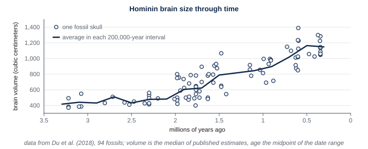

# 12. Planning and Decision-Making

This module is about choosing among futures before living any of them: how animals and the hominins came to act for the future, what procedures could produce planning, and what intelligence is and how it has been measured. While reading, look for the beginnings of answers to these questions:

- What does choosing among futures require, and which animals act now for situations that have not yet arisen?
- How did the hominins come to live the slow, long lives that depend on acting for the future?
- What procedures could produce acting for the future, and what would it take to tell them apart?
- How do people choose under risk and delay, and what does it take to follow a goal against a well-practiced response?
- What is intelligence, what do tests of it measure, and what were the tests used for?
- What in the brain and in the genes is associated with planning and with intelligence, and what can heritability not tell us?

By the end, we should be able to say what planning requires, which procedures could produce it, and what the evidence on intelligence does and does not show.

<!-- pin: t-levels-planning -->

: Marr’s three levels, the question each asks, the discipline that asks it, and this module’s example. {#t-levels-planning}

| Level | The question it asks | Discipline | This module’s example: a chimpanzee’s stones |
|---|---|---|---|
| Computational | What problem is being solved, and why does solving it matter? | Evolution and ecology | In the morning, a chimpanzee at a zoo gathers stones that he throws at visitors hours later. What does choosing among futures require, and what does any account of intelligence have to explain? |
| Algorithmic | What is represented, and by what procedure? | Cognitive psychology and AI | Searching, choosing, and general ability |
| Implementational | By what physical means, and at what cost? | Neuroscience | Brains, genes, and intelligence |

---

At a zoo in Sweden, keepers recorded the behavior of one chimpanzee for about ten years. He was the dominant male of a group that lived on an island. On many mornings, before the zoo opened, he gathered stones from the water, and piled them on the shore that faced the visitors. He was calm while he did this. Hours later, during agitated displays, he threw the stones at visitors. He also broke discs off the island’s concrete rocks, to add to his ammunition piles. The keepers removed hundreds of his piles.

The chimpanzee took actions in the morning for a situation that arose hours later. Other animals from many species have been observed doing the same. When he gathered the stones, no visitors were there to throw them at. Scrub jays, ravens, and other apes also act now for needs that arise later. Human beings do so constantly, and they often choose among several possible futures before any of them has happened.

People differ in how well they choose among futures, and in how well they solve problems in general. That difference is usually called *intelligence*. For more than a century, psychologists have measured intelligence with tests, and they have used the tests to study cognition. Researchers now compare machines with people in the same way. Programs that play chess and Go choose each move by examining possible continuations of the game, and the best of them play better than any person. But they play only their own games, and researchers disagree about whether any machine has become generally intelligent.

Tests of intelligence have also been used for social purposes, sometimes extremely morally questionable ones. In the early twentieth century, intelligence test results were used in arguments for restricting immigration, and for sterilizing people judged to be “feeble-minded”. We examine those uses along with the tests, and we ask how well the tests supported the claims made with them.

We can ask four questions about acting for the future and about intelligence. First, what does choosing among futures require? Second, which animals act for the future, and how did the hominins, the species of the human line, come to depend on it? Third, what is intelligence, and what do tests of it measure? And fourth, what in the brain and in the genes is associated with intelligence ?

---

## §12.1 — Computational: Choosing Among Futures

### §12.1.1 — The Problem and Its Standard

An animal that acts now for an outcome that comes later has to choose among futures that have not happened yet. Three features of that problem make it hard. First, the number of possible futures grows very quickly with each step. Second, the outcomes at the end of them are uncertain. And third, the outcomes arrive after different delays. All three features are true of the problem, however an animal, a person, or a machine goes about solving it.

The number of possible futures multiplies with every step. In a typical situation in a game of chess, a player has about 30 legal moves. So there are about 30 possible sequences of one move, about 900 sequences of two moves, and about 27,000 sequences of three moves. Every further move multiplies the number by about 30 again . Even a small puzzle grows quickly. In the Tower of Hanoi, a stack of disks of different sizes must be moved from one peg to another, one disk at a time, without ever placing a larger disk on a smaller one. With four disks, the puzzle has 81 possible arrangements, and the shortest solution takes 15 moves.

{#f-futures-grow alt="A tree diagram that starts from one dot at the left labeled choice point. Two lines leave the dot, each of those ends splits into two, and each of those splits into two again, giving eight ends at the right. Above each level of the tree a count is written: 2, 4, and 8. A second row of counts beneath the tree, labeled about 30 options per step, reads 30, 900, and 27,000."}

The outcomes are also uncertain, and they arrive after different delays. A forager that is choosing between a patch where food is nearly always found, and a patch where more food is found but only some of the time, is choosing between outcomes with different probabilities. An animal choosing between a small meal now, and a larger one later, is choosing between outcomes at different distances in time. An outcome that arrives later usually counts for less to the chooser than the same outcome now. In Module 5, we called this *discounting*.

To say that one choice is better than another, we need a standard to judge choices by. The standard most often used is **expected value**: the average of an option’s outcomes, each weighted by its probability. Consider a choice between a sure $240, and a 25% chance of $1,000 . The expected value of the uncertain gamble is 0.25 × $1,000 plus 0.75 × $0, which is $250. The sure option’s expected value is $240. So by this standard, the gamble is the better choice, by $10.

Expected value averages the amounts themselves. But what an outcome is worth to the chooser need not follow its amount. In Module 4, we said that value is not a property of a thing in the world, but something a nervous system assigns to it, and the same holds here. $1,000 is worth more to someone with little money than to someone with a great deal of it.

: Two options, their possible outcomes, and the expected value of each (amounts from Tversky and Kahneman, 1981). {#t-choice-outcomes}

| Option | Possible outcomes | Expected value |
|---|---|---|
| Sure gain | $240, with probability 1.00 | 1.00 × $240 = $240 |
| Gamble | $1,000, with probability 0.25; nothing, with probability 0.75 | 0.25 × $1,000 + 0.75 × $0 = $250 |

Expected value is a standard for judging choices. But it is not a description of how choices are made. In Module 7, we used signal detection theory in the same way. We described a decision about whether something is there by its four possible outcomes, and said where the best criterion lies, without saying how any animal sets one. Whether any animal or person actually works out expected values is a question about procedures, and we take it up in §12.2.5.

The standard also has limits. It assumes that the probabilities are known, as they are in a lottery or a game of cards. A choice whose outcome is uncertain, but whose probabilities are known, is said to involve **risk**. Many real choices are not like that. A forager rarely knows the chance of finding food in a patch it has not tried. When the probabilities are not known, expected value cannot be calculated directly, and the chooser has to estimate them or rely on something else.

Expected value is also one reasonable standard, not the only one. A person who prefers a sure amount to a risky gamble with the same expected value is called *risk averse*. And a strong enough preference for certainty can lead a person to turn down a gamble whose expected value is a little higher, like the 25% chance of $1,000. That choice is not necessarily a mistake or irrational. What every standard of consistent choice does rule out is choosing an option that is worse than another in every possible outcome. It also rules out changing a choice when the same options are only described in a different way.

Signal detection theory gives a second way to see why turning down a gamble with a higher expected value need not be a mistake. In Module 7, we said that the best criterion depends on what each outcome gains or loses, and on how common targets are. When a miss would cost far more than a false alarm, the best criterion is a low one, even though a low criterion produces more errors in total. An observer who sets the criterion there is less accurate, but chooses well, because accuracy was not the right measure of how well the observer did. Expected dollars are like accuracy in this respect. They are the obvious measure, but not necessarily a measure of what each outcome is worth to the chooser. If receiving nothing would mean missing a rent payment, the sure $240 is the choice most likely to keep the chooser above that line.

Foraging animals face the same kind of threshold. Consider a small bird on a winter evening that needs a certain amount of food to survive the night. If a sure, smaller meal would be enough, the bird does best to take it. If the sure meal would not be enough, the bird does better to gamble on the larger one, since only the gamble gives it any chance of surviving. So whether caution or a gamble is the better choice depends on what the chooser needs, and not on expected value alone.

### §12.1.2 — Acting for the Future in Other Animals

Taking actions now, for something that happens later, is not limited to human beings, or to their recent ancestors. Many animals change their world now, and act on the changed world later. Squirrels bury nuts in autumn and dig them up in winter. Harvester ants carry seeds into their nests and eat them when food outside is scarce. Birds build nests before they lay their eggs. In each case, the animal’s action in the present creates an **affordance** for later: an opportunity for action that a place or object offers to a particular body. A buried nut is food that can be dug up in winter, and a nest is a place where eggs can be laid and kept warm.

What these cases share is that the first action brings about some change that later actions can take advantage of. Burying a nut puts food under the ground, and digging works well where food lies buried. If the first action regularly brings about the changed world, then it is adaptive to take the first action, and also adaptive to take the later action whenever the changed world occurs. Each action is suited to its own situation on its own terms. That fit comes from the past, from the history of the lineage through selection or from the animal’s own experience, and the sequence need not repeat within one animal’s life. A digger wasp may dig a single burrow, stock it with paralyzed prey, and lay an egg on the prey, once in its whole life. Each step depends on the one before, and evolution can shape organisms to perform actions that, when taken together, lead to good outcomes.

A harder version of the problem arises when there is more than one first action to choose between, and which one is right depends on what will be needed later. Suppose that one action now would bring about one state of the world, and another action would bring about a different state. In the first state, one later action works well, and in the second state, a different one does . Then each first action is valuable only for the affordances it creates for later. Which first action is right, depends on which later action the coming situation will call for. But that situation is not present when the animal acts, and it may differ from what usually follows. An action suited only to what usually follows does not meet this version of the problem.

Only part of this harder version of the problem can be observed. In Module 11, we separated what can be observed about another animal, its behavior, from what cannot, such as what it has seen and what it wants. The same separation holds here. What can be observed is that an animal does something now that suits a particular later situation. Whether it does so because it represents the states the world could be in, and what it could do in each of them, cannot be observed directly.

{#f-two-step alt="A diagram read from left to right. At the left, a dot labeled now has two arrows leaving it, labeled action A and action B. Action A leads to a box labeled state of the world A, and action B leads to a box labeled state of the world B. From each box, two arrows lead to the right, labeled later action X and later action Y. From state A, the arrow for later action X is drawn thick and labeled works well, and the arrow for Y is thin. From state B, the arrow for later action Y is drawn thick and labeled works well, and the arrow for X is thin. A bracket under the boxes reads the coming situation decides which first action is right."}

Caroline Raby, Nicola Clayton, and their colleagues tested scrub jays, which cache food in the wild, to see if they could solve the harder version of the problem. Caching means hiding food and coming back to it later. For six mornings, after a night without food, each jay spent two hours in one of two compartments. Each jay alternated between one where it was given breakfast, and one where it was given nothing. Then, one evening, the jays were given their first chance to cache pine nuts. They cached about three times as many nuts in the compartment where they had gone without breakfast as in the other one . They were mildly hungry while they cached, and in the moment, equally hungry in both compartments. So their hunger cannot explain why they cached more in one compartment than in the other.

![The two scrub jay tests. In the first, one compartment came with breakfast and the other did not, and the jays cached about three times as many pine nuts in the compartment without breakfast. In the second, each compartment came with a different breakfast food. A jay that had linked each compartment with the food it was given there would have cached each food in the compartment where it had been given, as would suit a morning like the ones before. The jays did the opposite, and cached more of the food they had not been given in each compartment, which is the food they would lack there the next morning. The second test separates an action suited to what usually follows from an action suited to the particular morning to come (after Raby et al., 2007).](reading_images/fig-jays-breakfast.svg){#f-jays-breakfast alt="Two panels side by side. The left panel, labeled test one, shows two compartments. The compartment labeled breakfast has a short bar for nuts cached, and the compartment labeled no breakfast has a bar about three times as tall. The right panel, labeled test two, shows two compartments labeled peanut breakfast and kibble breakfast. In each compartment, an arrow points to the food that was not given there for breakfast, labeled cached more."}

Apes and ravens have been observed choosing tools for a particular task later, when the task was not currently possible or visible. Bonobos and orangutans were offered eight objects, two of which would work as a tool for getting a reward out of an apparatus, which they had practiced with before. On many trials, they chose a suitable tool, carried it out of the testing room, and brought it back an hour later, when the apparatus was available again. An orangutan and a bonobo did the same after 14 hours, overnight. Four other apes, rewarded only for bringing back the suitable tool, with no apparatus to use it on, brought it back far less often.

Ravens, which are not habitual tool users, did the same. They chose a tool, or a token that they had learned to exchange with an experimenter for food, and used it 15 minutes or 17 hours later. They usually chose the tool or the token even when a smaller piece of food lay on the same tray. Exchanging tokens is not part of their behavior in the wild either.

All of these results, like the zoo chimpanzee we described at the start of this chapter, only describe behavior. Each shows an animal changing its world now, in a way that suits one particular later situation. These behaviors raise two questions. Does the animal do so because it represents that possible future situation, the actions it needs to take to bring that situation about, and what that situation will afford? And could the same behavior come from what the animals had learned before the tests? In the ape and raven studies, the animals had already been rewarded for using the very tools and tokens they later chose, so the objects themselves may have come to predict food. We take up both questions in §12.2.1, where we draw a contrast like the one we drew in Module 11 between predicting others from their behavior and predicting them from their mental states.

### §12.1.3 — The First Hominins

The human line began when it split from the line leading to chimpanzees and bonobos, sometime between 5 and 9 million years ago, often rounded to about 7. In Module 11, we followed the primate family tree up to that split. A **hominin** is a member of the human line after the split: human beings, and every extinct species more closely related to human beings than to chimpanzees and bonobos . *Hominin* is not to be confused with *hominid*, which means a member of the great ape family as a whole: orangutans, gorillas, chimpanzees, bonobos, and human beings.

![Hominin species on a time axis from 7 million years ago to the present. Each species is drawn as a bar covering the span of its known fossils, and many bars overlap. Marks show the first known stone tools at Lomekwi, about 3.3 million years ago, the first Oldowan tools about 2.6 million years ago, the first Acheulean tools by about 1.7 million years ago, and Levallois tools by about 300,000 years ago. No lines are drawn between species, because which species descended from which is mostly unknown. The earliest bar marks a species that may or may not be a hominin (drawn for this chapter from Almécija et al., 2021, Antón et al., 2014, Du et al., 2018, Fu et al., 2025b, Harmand et al., 2015, Hasty et al., 2022, Hublin et al., 2017, Malafouris, 2013, Scerri et al., 2018, Villa and Roebroeks, 2014, and Villmoare et al., 2015 and 2025).](reading_images/fig-hominin-timeline.svg){#f-hominin-timeline alt="A horizontal time axis runs from 7 million years ago at the left to the present at the right, with a break in the axis so that the last 500,000 years are drawn wider. Bars for early hominins appear near 7, 6, and 4.4 million years ago, the first of them marked with a question mark. Bars for several species of Australopithecus run between about 3.9 and 2 million years ago, overlapping one another. A bar for Paranthropus runs from about 2.7 to 1.4 million years ago. A bar for early Homo starts at 2.8 million years ago, and a bar for Homo erectus starts at about 1.9 million years ago. In the wider part at the right, bars for Neanderthals, from about 350,000 to 40,000 years ago, for Denisovans, for Homo naledi, for Homo floresiensis, and for Homo sapiens, from about 315,000 years ago to the present, overlap one another. Small triangles below the axis mark the first stone tools at 3.3 million years ago, Oldowan tools at 2.6, Acheulean tools at 1.7, and Levallois tools at 0.3."}

For most of the twentieth century, researchers pictured the human line as a single sequence of species, each giving rise to the next, and each a step closer to human beings. The fossils found since then do not fit that picture. For most of hominin history, several kinds of hominin lived at the same time. Between 3.0 and 2.5 million years ago, as many as four hominin lineages lived in eastern Africa. At one site in Ethiopia, early *Homo* and a species of *Australopithecus*, another group of hominins, lived in the same region at the same time. So the hominins formed a branching tree, and most of its branches ended without descendants.

Walking upright came early in the hominin lineage, long before large brains or the first known stone tools. **Bipedalism** is walking habitually on two legs. It can be recognized in the skeleton, by the position of the opening at the base of the skull through which the spinal cord passes, and by the shape of the pelvis, the lower back, and the legs. Hominins from about 6 million and 4.4 million years ago already show some of these features, and footprints left in volcanic ash at Laetoli, in Tanzania, about 3.6 million years ago, were made by hominins walking upright. Yet the australopiths of that time, the hominins of the genus *Australopithecus* and their close relatives, still climbed trees. And their brains were still small. The features of the human body did not all arrive together.

Tool use is extremely old; the oldest known stone tools are older than any known member of *Homo*. At Lomekwi, in Kenya, excavated stone tools have been dated to 3.3 million years ago, about half a million years before the first known *Homo*. Who made them is not known. Tools of the kind called *Oldowan*, sharp flakes struck from a stone core with a hammerstone, appear from about 2.6 million years ago. Cut marks on animal bones are evidence that sharp stone edges were being used to cut meat by about 2.6 million years ago.

The tools and tool use are evidence of behavior: something struck one stone with another to make sharp edges. By about 2.6 million years ago, hominins were also carrying stone away from where they found it, and the earliest Oldowan tool makers chose their stone selectively. So the stone was gathered in one place and used later in another. Carrying a stone to where it will be needed is acting now for a later situation, of the kind we described in §12.1.2. From the stones alone, we cannot tell whether the carrying suited one particular later situation, or only the situation that usually followed.

Each kind of evidence shows some things about these species, and leaves others out. A skull gives the size of a brain, a skeleton gives posture, and teeth give the pace of growth. A tool is evidence of what was done to a stone, but not of who did it, since several species often lived at the same time. And none of them is a record of how the making of a tool was organized, or what its maker was thinking.

### §12.1.4 — *Homo erectus*, Stone, and Fire

*Homo erectus*, which appears in Africa about 1.9 million years ago, had a larger body than earlier hominins. Its adults weighed around 52 to 55 kilograms (about 115 to 120 pounds), against about 40 kilograms (about 90 pounds) for australopiths. Its thigh bones were longer and stronger. *H. erectus* is also the first hominin whose fossils are found outside Africa. By 1.85 million years ago, *H. erectus* was in Georgia (the country in the Caucasus, south of Russia, on the Black Sea), and by 1.66 million years ago it was on Java, in Southeast Asia. It was probably the first hominin to leave Africa.

Hominin brains grew gradually, over about two million years. Australopiths had brains of about 460 to 480 cubic centimeters on average, early *H. erectus* about 800 to 860. The brains of people today are about 1,350 to 1,400 cubic centimeters, roughly three times the australopith size . Relative to body size, the increase is smaller, about two to two and a half times. Most of the growth happened within lineages, rather than through larger-brained species replacing smaller-brained ones. And most of the growth beyond what body size predicts came late, between about 800,000 and 200,000 years ago. That growth was growth in one of the body’s most expensive organs. In Module 3, we noted that the human brain uses something like 20 to 25 percent of the body’s daily energy, against 8 to 10 percent in other primates.

{#f-brain-size-time alt="A scatter plot with age in millions of years on the horizontal axis, running from about 3.2 at the left to 0.5 at the right, and brain volume in cubic centimeters on the vertical axis. The points start low at the left, mostly between 400 and 550, and rise toward the right. A line through the points rises gently at first and more steeply toward the right."}

The stone tools changed as well. *Acheulean* tools are large cutting tools, including hand axes shaped on both faces, made from about 1.7 million years ago, and the later ones are often symmetrical. By about 300,000 years ago, hominins were using the *Levallois* method, in which a stone core is prepared so that the shape and thickness of the flake struck from it can be controlled .

The later tools were harder to make and took longer to learn to make. One archaeologist counted how deeply the steps of making each kind of tool are nested inside one another, from 6 levels for Oldowan flaking, to 10 levels for shaping a late Acheulean hand axe. The clearest difference between the tools is in how long they take to learn to produce. Oldowan flaking takes more than a few hours of practice, and by one experienced stone worker’s estimate, late Acheulean shaping may take hundreds of hours. In one living tradition of stone-tool making, apprenticeships can last 10 years or more. The same archaeologist argued that planning a hand axe in advance, to the full depth of its nested steps, is “unnecessary and unlikely”. So the sequence of tools is a sequence of tasks that are more deeply structured and harder to learn, not a direct record of planning.

{#f-tool-sequence alt="Four drawings in a row, each labeled with a name and a date. The first, labeled Lomekwian, 3.3 million years ago, shows a large, roughly broken stone with a few flake scars and a thick flake beside it. The second, labeled Oldowan, 2.6 million years ago, shows a rounded stone with several flake scars at one end and a small sharp flake. The third, labeled Acheulean, 1.7 million years ago, shows a teardrop-shaped hand axe, flaked over both faces, with a pointed tip. The fourth, labeled Levallois, 300,000 years ago, shows a flattened core with scars around its edge and a thin, oval flake lifted away from its top surface."}

Not every archaeologist interprets the same stones this way. One argues that a stone worker’s intention is formed partly by the stone itself, as each strike changes what the next strike can do. On this view, early stone working involved “little deliberate planning”, though a great deal of guessing about how the stone would break. He grants that composite tools may show forethought by 70,000 years ago or earlier, and that late Acheulean stone working involved thinking about the work itself. Both sides agree that the shaping of a tool proceeds a strike at a time and is guided by how the stone responds. They disagree about where the goal of the shaping is represented, a question we do not try to settle.

Part of the disagreement may be about the level of detail. Making a hand axe at all, from a stone chosen and carried for the purpose, may be organized toward a later goal at a general level, even if the shape of each flake is worked out one strike at a time. The stones are evidence of what was made. How its making was organized, and at what level of detail, is an inference.

Diet also changed in the time of *H. erectus*, though exactly how and when it changed are disputed. Cooking requires controlled fire. The use of fire is widely accepted to have been happening by about 400,000 years ago, with some evidence placing it as far back as 1 million years ago. A speculative *cooking hypothesis* places cooking much earlier, near 1.9 million years ago, because of several features of *H. erectus*, among them smaller teeth and jaws than earlier hominins. A rival account notes that, on a diet one third meat, slicing the meat and pounding the tubers with stone tools would have let early *Homo* chew 17% less often and 26% less forcefully, so the smaller teeth and jaws did not require cooking.

### §12.1.5 — Slow Lives and Grandmothers

Human life history is unusual among the apes. **Life history** is the timing of growth, maturity, reproduction, and death across a lifetime, in a species. In Module 11, we described how slowly human young grow up. Mothers in foraging societies give birth every three to four years, and their children cannot feed themselves for years. What is most unusual about a human life is how long women live after they stop having children. As one team put it, “Postmenopausal longevity, not early termination of fertility, appears to be the derived characteristic of our species”.

One explanation of that long life is the **grandmother hypothesis**: the proposal that older women who gathered food for their daughters’ young allowed their daughters to wean earlier and give birth again sooner, so that women who lived long after menopause left more descendants. Kristen Hawkes and her colleagues built the hypothesis from work among the Hadza, foragers in Tanzania. Hadza women in their sixties and early seventies work long hours in all seasons. When a new baby is born, the weight of its older brothers and sisters rises or falls with how hard a related older woman, usually their grandmother, works at gathering food. Members of the same team later placed the start of this pattern with *H. erectus*.

The hypothesis has limits. The Hadza are one group, and older Hadza women produce less food than Hadza men. And *H. erectus* still grew up at about the pace of a living great ape, with the slow growth of human children appearing only later. So when the pattern began remains uncertain.

A rival account, from Hillard Kaplan and his colleagues, centers on hunting . On this account, foods that are hard to obtain take years to learn to find and prepare. A long childhood is the time for that learning, and a long adult life gains more from that long period of learning. Under this hypothesis, men’s hunting supplies much of the surplus food that children need. Its authors also acknowledged two weaknesses in their own account. They wrote that “too much emphasis has been placed on hunting large game”. And they said that whether men hunt mainly to provide for their children, as their account requires, or to attract mates, “awaits further data”.

: Two accounts of the unusual human life (after Hawkes et al., 1998, O’Connell et al., 1999, and Kaplan et al., 2000). {#t-grandmothers-hunting}

| | Grandmother hypothesis | Hunting account |
|---|---|---|
| What is unusual | Long life after childbearing ends | Long life, long childhood, and a large brain together |
| Who supplies the extra food | Older women, gathering for their daughters’ young | Mainly men, through hunting, with others contributing |
| Why childhood is long | A side effect of a long life | Time to learn hard foraging skills |
| Main evidence | Hadza grandmothers’ work and grandchildren’s weight | Food production by age and sex across foraging societies |

For decades, accounts of human evolution, mostly coming from men, highlighted the importance of men hunting. In those accounts, as one anthropologist put it, “women past childbearing age were deemed irrelevant and of no theoretical interest”. The assumptions that researchers start from shape which questions they ask, and these assumptions left a question unasked: what older women contributed. The grandmother hypothesis was one challenge to that framing, and the debate is still open.

Another challenge asks how often *women* hunted. A 2023 study found records of women hunting in 50 of 63 societies coded as foragers. A 2024 reanalysis of the same societies found women hunting sometimes or frequently in 35 of them (56%). But the reanalysis found that women regularly hunted large game in only 9 (14%). Its authors cautioned that these figures are not representative of women’s hunting in foraging societies, because the 63 societies were not chosen to represent foragers in general. The authors of the reanalysis agreed that “hunting and men’s labor have been over-emphasized”. What has held up is the critique of accounts that centered human evolution on men hunting, not a claim that women hunted as much as men.

### §12.1.6 — *Homo sapiens* and Its Relatives

*Homo sapiens* did not appear all at once, in one place, or alone. The oldest fossils that some assign to *H. sapiens* come from Jebel Irhoud, in Morocco, and are about 315,000 years old. They have a modern face but a braincase that is longer and less rounded than that of people today, so the features of a modern human skull did not arrive together either. *H. sapiens* probably arose across Africa, in populations that were connected to one another, rather than in a single place. And it was not the only human species in Africa. About 300,000 years ago, at least three human species lived there: *H. sapiens*, *Homo naledi*, and the species represented by a skull from Kabwe, in Zambia, often called *Homo heidelbergensis*. So the branching pattern we described earlier, with several kinds of hominin alive at the same time, continued into the time of *H. sapiens*.

*Homo sapiens* had close relatives outside Africa. Neanderthals (*Homo neanderthalensis*) lived in Europe and western Asia from about 350,000 years ago until they disappeared from the record about 40,000 years ago. Genetic estimates place the split between the ancestors of Neanderthals and of *H. sapiens* several hundred thousand years ago, from about 270,000 to 700,000 years ago depending on the study. Denisovans have no agreed species name, though some researchers have named the best skull assigned to them a separate species, *Homo longi*. They lived in Asia, and are known from fossils dated between about 200,000 and 50,000 years ago. Denisovans and Neanderthals were each other’s closest relatives, and their lines shared ancestors until about 400,000 years ago.

Genetic evidence shows that *Homo sapiens* populations interbred with the Neanderthals and Denisovans. People whose ancestors lived outside Africa carry about 2% Neanderthal DNA, from interbreeding most likely around 50,000 years ago. And Denisovan DNA is found especially in people of Melanesia and some groups in the Philippines. So part of the DNA of these relatives is still present in some people living today.

How did Neanderthals differ from *H. sapiens* in what they could do? For a long time, a common answer was that Neanderthals were less capable. Their disappearance was routinely explained by the “superiority” of modern humans, who were said to have had more complex cultural traditions and greater cognitive capacities, shown in their innovation, symbols, language, hunting, weapons, and planning. Researchers reached that answer by judging Neanderthals against what later *H. sapiens* left behind in Europe. In one review’s words, that later record “has become almost like a yardstick for modern human behavior”. Another review describes how “demonstrating the Neandertals’ putative inferiority became a research programme”, in which contrary evidence “was considered suspect by default”, and in which it was assumed that “a difference in morphology necessarily implies a difference in cognition and behaviour”.

The first review went through the archaeological claims of Neanderthal inferiority that it examined, one by one, and found that none was supported by adequate archaeological data. Among the evidence it cites is pitch, a glue that does not occur in nature. From about 200,000 years ago, Neanderthals in Europe used fire to make it from bark, heating the bark without air at 340 to 400 °C. At one site in Italy, two stone flakes were found coated in pitch made from birch bark, used to fix them to handles. None of this is evidence that Neanderthals and *H. sapiens* thought alike. What the review found is that the claimed differences were not supported by the evidence cited for them, and that expectations shaped how that evidence was read.

### §12.1.7 — What Is Intelligence?

Researchers broadly agree that the later hominins changed in what they could do. Their tools took longer to learn to make, their brains grew larger, and their lives became slower and longer. Many people would describe those changes with one word: the hominins were becoming more intelligent. But what exactly was changing, and what does the word *intelligence* mean?

The word is used in two senses. In one sense, intelligence describes what an agent can achieve. By **agent**, we mean any entity that acts toward goals: a person, another animal, or a machine. In the other sense, intelligence names the capacities and procedures that produce those achievements. What does an agent represent, and how does it use what it represents to solve problems? So **intelligence** often has two meanings: how well an agent achieves its goals across a wide range of problems and environments, and the capacities that produce that achievement. The first sense can be measured from behavior. The second has to be inferred.

Which of the two meanings the word *should* name is contested. For example, researchers who build AI systems disagree about it. One influential team asks others to “focus on capabilities, not processes”, while other cognitive scientists argue that how a system reaches its answers is what matters. Much of the confusion about intelligence comes from moving between the two senses without saying so.

The two senses of “intelligence” can come apart, because the same achievement can come from different procedures. AI language models are a clear current example. They answer standard questions about what the characters in a story believe about as well as adults do, as we described in Module 11. And they solve many problems that were once thought to require planning. Whether they do so by representing other minds, or by planning, is a separate and open question, which we return to in Modules 13 and 14. But one surprise of these systems is how much can be achieved, at least at moderate levels of performance, by procedures that may not be the ones people assumed were needed.

The two senses also matter morally. A score on a test of intelligence measures what a person achieves on particular problems, at one time, compared with a particular group of other people. By itself, a score does not say how the person achieves it, what the person could achieve in other circumstances, where a difference between people comes from, or the moral significance of their performance. For more than a century, scores were often read as if they said all four, and in §12.1.10 and §12.1.11 we describe what that interpretation was used to justify.

In the achievements sense of intelligence, performance on different problems does go together, a pattern first reported in 1904. A British psychologist collected the results of about 33 boys at one English school on school examinations and tests of musical ability. Every one of the scores correlated positively with every other, from a lowest correlation of 0.40 to a highest of 0.83 . The same pattern has been found again and again since, in many tests and many samples. It is called the **positive manifold**: the observation that people who score well on one kind of mental test tend to score well on the others.

The psychologist who first reported the positive manifold read it as evidence of a common function behind every test, whose nature he left open. But the positive manifold is a pattern in a table of correlations, and nothing more. As one major review put it, the pattern “is consistent with, but does not prove, the hypothesis that a common factor such as g underlies those correlations”. So reading the pattern as one general ability is a claim about a cause, and we take it up in §12.2.9. The question we asked in Module 0, whether intelligence is a single thing or a bundle of many different abilities, therefore has two versions. Achievements on different problems do go together, but whether a single capacity lies behind them is a question for §12.2 and §12.3.

{#f-spearman-matrix alt="A six-by-six grid with the same six labels along the top and down the left side: classics, French, English, mathematics, pitch discrimination, and musical talent. Each cell holds a number between 0.40 and 0.83 and is shaded, with darker cells for larger numbers. The darkest cells are near the top left, where classics meets French at 0.83 and classics meets English at 0.78. The lightest are near the bottom right, where pitch discrimination meets musical talent at 0.40. The cells along the diagonal from top left to bottom right are outlined in a different style, with values from 0.84 to 0.89 for the four examinations and blanks for the other two."}

### §12.1.8 — IQ Scores and What They Predict

Because of the positive manifold, the tests usually called intelligence tests combine a person’s scores on many kinds of problems into one overall score, typically called IQ. An **IQ** is a score on a standardized test of mental abilities, scaled so that the average in a reference sample is 100, and about two thirds of people fall between 85 and 115. An IQ score is a rank, not an amount. It says only where a person stands relative to the people in the reference sample. As one review put it, “A six-year-old with an IQ score of 100 is at the mean of six-year-olds”. So the same performance earns a lower score when it is compared with a newer reference sample that scores higher.

IQ scores predict a range of outcomes measured later in life. **Predictive validity** is how well a score predicts an outcome measured later. IQ scores correlate with school grades at about 0.50. In the best studies, which measured IQ scores before age 19 and the outcome after age 29, scores correlated with years of education at about 0.56 and with income at about 0.23. Scores also correlate with performance at work, at about 0.31 by a recent estimate, revised down from the 0.5 that was standardly cited for decades. Squaring a correlation gives the share of the differences among people that the correlation accounts for. So a correlation of 0.3 means that the score accounts for about a tenth of the differences among people in the outcome.

It is important to remember, these are correlations. They do *not* show that the scores *cause* the outcomes. Take the correlation between IQ scores and years of education. People who score higher may go on to stay in school longer. But staying in school longer also raises scores, by about 1 to 5 points for each extra year, depending on how the study was designed. Both can be true at once, and the correlation alone cannot tell us how much of each is happening.

Schooling may also explain part of the correlation between scores and other outcomes. Income, for example, is related to how long a person stayed in school, so part of the correlation between IQ scores and income may run through schooling, rather than from the scores to the income. The social and economic standing of a person’s parents raises the same problem, because it predicts both the scores and the outcomes. As one major review put it, “the causal links between psychometric ability and social outcomes may be indirect”.

Average scores on intelligence tests rose steadily in the United States and many other countries through the twentieth century. The **Flynn effect** is the name given to this rise in average scores across the twentieth century, about 3 points per decade in the United States. Because an IQ score is a rank within a reference sample, the rise is measured by scoring later test takers against an earlier reference sample that is held fixed. The Flynn effect was faster on tests of reasoning with new problems, than on tests of knowledge, about 4.1 points a decade for reasoning versus 2.1 for knowledge. This means the Flynn effect is not due purely to more recent test takers “knowing more things” .

{#f-flynn-gains alt="A bar chart with four bars, one for each kind of test, showing points gained per decade. The bar for reasoning with new problems is tallest, at about 4.1. The bar for spatial tests is about 3.0. The bar for full tests is about 2.8. The bar for tests of knowledge is shortest, at about 2.1."}

Any account of intelligence therefore has to explain at least three observations. One is the positive manifold. A second is that scores predict grades, schooling, income, and performance at work, though far from perfectly. And a third is that average scores rose by a large amount within a few generations, which is faster than the genes of a population can change.

### §12.1.9 — The Beginnings of IQ Testing

Modern intelligence tests began with a practical problem in the schools of Paris. In 1905, the psychologist Alfred Binet and a colleague published a scale for identifying the children who needed special schooling. The scale placed each child by comparing the child’s performance with the typical performance of children at each age. In their words, “a child of eight years has the intelligence of a child of seven or of nine years”. Binet was cautious about what such a placement meant. It described the child at the moment of testing. Binet was explicit that, about the child’s future, “the prognosis is reserved”. Children who did poorly needed teaching suited to them, because they “must learn how to learn”.

Binet held that the scale ranked children, rather than measuring them, but that “for the necessities of practice this classification is equivalent to a measure”. He also wrote that he and his colleague were “aiming at nothing less than the measure of the intelligence”. He proposed uses for the scale beyond the schools, in the courts and in examining army recruits. So the ambition to measure intelligence, and to use the measurement to make decisions about people, was present from the start.

Binet was cautious about what his scale could show, but many of the people who took it up were not, and much of what followed is a disturbing history. Intelligence tests were used to label people as “feeble-minded”, to argue for keeping immigrants out of the United States, and to justify sterilizing tens of thousands of people without their consent. Some of the language we quote from this history is offensive, and some of the cases are painful to read about. We include them because the lessons they teach are central to this course. They show how a measurement can be mistaken for the thing it was meant to measure, and how scientists’ expectations can shape what they measure and how they read it. They also show what can happen when claims about whose mind counts are used to decide how people are treated.

The next two sections tell this history, and ask what it means for science now. In §12.1.10, we follow Binet’s scale to the United States, where psychologists who believed that low intelligence was inherited used tests to label families, to rank immigrants, and to support laws on immigration and sterilization. In §12.1.11, we turn to the longer history of scientific racism, from skull measurements in the nineteenth century to the present. We then ask what the evidence now shows about differences between groups, and why the answers do not and would not justify how the tests were used.

### §12.1.10 — Heredity, Immigration, and Sterilization

In the United States, intelligence scales were taken up by psychologists who believed that low intelligence was inherited. Henry Goddard brought Binet’s scale to the United States. In *The Kallikak Family* (1912), Goddard traced the descendants of one man through two lines, one “good” and one “bad”. His field worker, Elizabeth Kite, labeled people in the “bad” line as “feeble-minded”, the term then used for low intelligence. And she labeled some of them who were long dead from what their neighbors remembered about them. Goddard concluded that “Feeble-mindedness is hereditary and transmitted as surely as any other character”. The book began to be used by some as an argument for **eugenics**: the program of improving a population’s quality by controlling who has children.

Goddard also tested immigrants. In 1913, his workers at Ellis Island tested fewer than 200 immigrants, a small sample that was not chosen in a way that was representative of immigrants as a whole. They reported that between 79% and 87% of four groups of immigrants were “feeble-minded”. Goddard himself called the results “so surprising and difficult of acceptance that they can hardly stand by themselves as valid”. He published them anyway, in 1917.

The IQ test became standard with the Stanford psychologist Lewis Terman’s revision of Binet’s scale, published in 1916. That revision scored IQ as “the ratio of mental age to chronological age”. Terman predicted that testing would reveal “enormously significant racial differences in general intelligence, differences which cannot be wiped out by any scheme of mental culture”. This new IQ test was introduced together with an expectation about what it would show about race.

During the First World War, the tests were given on a much larger scale. In 1917 and 1918, about 1.75 million army recruits took an intelligence test specifically designed for army recruits. In 1923, the psychologist Carl Brigham, who analyzed the army data, published *A Study of American Intelligence*. He ranked immigrant groups by their scores and concluded that immigration “should not only be restrictive but highly selective”.

Notably, his own data allowed a different reading. Among white draftees, immigrants who had lived in the United States longer scored higher, and those who had lived there more than twenty years scored about as well as white men born in the United States . One of his own captions described the pattern as “Apparently increasing average intelligence with increasing years of residence”. Later in the book, he interpreted the same pattern as “The decline of intelligence with each succeeding period of immigration”. On the first reading, living in the country, and learning its language and customs, raised scores. On the second, each later group of immigrants was less intelligent than the one before. In 1930, he withdrew the study as “without foundation”, on the ground that the tests could not support its comparisons, without mentioning immigration law.

{#f-brigham-residence alt="A line graph. The horizontal axis shows five groups of foreign-born white recruits by years lived in the United States: 0 to 5, 6 to 10, 11 to 15, 16 to 20, and more than 20. The vertical axis shows average score. The points rise from left to right: 11.41, 11.74, 12.47, 13.55, and 13.82. A dashed horizontal line at 13.77 is labeled white recruits born in the United States. Two labels sit above the line. One reads increasing with years of residence. The other, with an arrow pointing in the opposite direction, reads declining with each later period of arrival."}

The testers’ claims were used to support restricting immigration. In 1924, Congress passed an immigration law whose quotas favored immigrants from northern Europe. Brigham’s book was presented to a Senate committee, and the House committee’s adviser on eugenics, Harry Laughlin, included tables of army test results in his 1924 report. But some psychologists had already rejected Brigham’s conclusions, and the prejudice used to justify the law was widespread without the tests. Even a leading critic of the testers conceded that “a racist immigration law would have been passed in 1924 had no IQ tester ever been born”. So the testers did not create the law. But they gave the appearance of scientific support to a prejudice that was already there.

For a long time, U.S. states also used the label “feeble-minded” to decide who could be sterilized without their consent, and more than 60,000 people in more than thirty states were sterilized under such laws. The best-known case is that of Carrie Buck. In *Buck v. Bell* (1927), the Supreme Court upheld Virginia’s sterilization law. Virginia had defined feeble-mindedness by the Binet–Simon scale since 1916. The Court’s opinion said, “Three generations of imbeciles are enough”, meaning Carrie Buck, her mother, and her infant daughter, Vivian. The laws fell heavily on women. The first people sterilized at Virginia’s institution were almost all women. In California, which carried out about a third of all the sterilizations, Latina women were recommended for sterilization at higher rates than other women.

### §12.1.11 — Scientific Racism and Research on Group Differences

Scientists ranked groups of people long before intelligence tests existed. Work that presents claims of racial superiority as findings of science is often called **scientific racism**, and much of it began with measurements of the body. In the 1830s and 1840s, the Philadelphia physician Samuel George Morton measured the capacity of hundreds of human skulls, by filling them with seeds or lead shot. He then ranked human groups by the average amount that their skulls could hold. His tables put the group he called “Caucasians” first, and the groups he called “Ethiopians” and “Americans” (Native Americans) near the bottom.

Later reanalyses concluded that Morton’s choices about which skulls to include shaped those averages. Skull size varies with body size, so a group’s average depends on how many small people are in the sample. Morton included the small skulls of Inca Peruvians in his Native American average, but left the small skulls of Hindus out of his Caucasian average. Each choice moved the averages toward the ranking Morton expected. The biologist Stephen Jay Gould, who first made this charge in 1978, was later found to have made choices of the same kind in his own reanalysis. So expectations can enter how data are selected and analyzed, and not only how results are interpreted.

The cases we have described were not isolated. For more than a century, psychologists and other scientists built theories on the assumption that some groups of people were born less intelligent than others. Some of these theories rested on data that were later found to be biased, through unrepresentative samples or selective analysis. Some rested on data that were later judged to have been invented. The British psychologist Cyril Burt’s studies of twins, cited for decades as evidence that intelligence is inherited, are widely judged to contain fabricated data. And some rested on no data at all. Terman predicted racial differences before any such testing had been done, and Morton described the mental character of each race without measuring character at all. In each case, the conclusions reflected what the researchers expected more than what their evidence showed.

In 2021, the American Psychological Association apologized for psychology’s part in racism against people of color. It acknowledged that psychologists had “created and promoted the widespread application of psychological tests and instruments that have been used to disadvantage many communities of color”. The apology does not mention the sterilization laws.

The history we have described rests on two scientific claims that are still argued over. The first is that groups differ in their average scores on intelligence tests, and the second is that genes cause those differences. The first is about an observation and the second about causes, so they need different kinds of evidence.

In the United States, average scores have differed between groups defined by race, but what that difference shows is limited. When a major review was written in 1996, the average score of Black Americans was about 15 points below that of white Americans. A later review reported that the difference had narrowed by about 5 points between 1972 and 2002, though others have disputed that estimate. The difference is not explained by bias in prediction. Black students do not do better in school than their scores predict. A difference in scores is an observation about scores. Whether it reflects a difference in the capacities behind the scores, the second sense of intelligence, is a separate question. So is whether categories of race correspond to biological groups, which many have argued they do not.

The second claim, that genes cause these differences, is a claim about causes, and we describe this debate in §12.3. Two major reviews, in 1996 and 2012, found that the direct evidence on the question did not support a genetic explanation, and the 1996 review concluded, “At present, no one knows what causes this differential”.

The answers to these two claims matter for science, but they would not settle how people should be treated. The uses of intelligence tests that we have described would have been wrong even if every claim the testers made had been true. The wrong done to Carrie Buck, for example, did not depend on whether she was “feeble-minded”.

Whether research on differences between groups should be done at all is itself disputed. Some researchers argue that the history of how such findings were used should not stand in the way of scientific inquiry. Writing about genetic research on intelligence in general, two leading behavior geneticists put it this way: “research does not lead directly to any policy recommendations. We must be careful not to blame the scientists or entire disciplines when their findings are used wrongly”. In principle, whether groups differ, and why, are questions about what is true, like any other questions in science. But the history of these questions gives three reasons for unusual caution and care in asking and answering them.

The first reason is the stakes. Claims about differences between groups have been used to justify sterilization and exclusion. So a mistaken claim can do unusual harm, and the harm will tend to fall on people other than those making the claim. Due to this, such claims should need stronger evidence than usual before they are reported. The second reason is the record we have described, in which researchers, often ones who said openly what policies they wanted, repeatedly reached conclusions that their evidence did not support. So readers have good reason to examine such claims more carefully than usual before believing them. The third reason is that the question is very hard to answer with current methods. Groups defined by race differ in their environments in many ways, and, as we will describe in §12.3, genetic tools built in people of one ancestry predict poorly in people of other ancestries.

Researchers who study differences between groups also have a responsibility to say what they think their findings imply. Claims of this kind are still cited by people who argue that some groups are inferior. A researcher who reports a difference between groups and says nothing about what it means leaves its meaning to others, including people who have misused such findings before. Some researchers do state their view. One behavior geneticist, Kathryn Paige Harden, argues for “anti-eugenic” uses of genetics, “rather than using genetics to justify racist or classist ideas about innate superiority”. Critics reply that good intentions are not enough. Overstating what the findings show invites misuse, whatever the researcher intends. So the question is less whether such research may be done, than what it takes to do it, report it, and believe it responsibly.

## §12.2 — Algorithmic: Searching, Choosing, and General Ability

### §12.2.1 — What It Would Take to Plan

In §12.1.2, we described an animal acting now, in a way that suits one particular later situation. This kind of behavior can come from at least three different procedures . The procedures differ in how much of the problem the animal represents. So asking which procedure an animal uses, is asking what it represents.

{#f-two-step-rungs alt="Three panels side by side, labeled adapted actions, learned value, and planning. In the first panel, action A sits in one box and later action X in another, each labeled when the situation occurs, and no line joins them. In the second panel, action A has a number beside it labeled learned value, with an arrow from a reward back to action A, and the boxes for states of the world are drawn faintly, labeled not represented. In the third panel, arrows lead from now through action A to state A and through action B to state B, later X is labeled suits state A and later Y is labeled suits state B, and a bracket joining the two paths is labeled compare before acting."}

In the simplest procedure, an animal is adapted to take the first action, and adapted to take the later action whenever the changed world occurs, with nothing linking the two. The digger wasp that we described in §12.1.2, which digs one burrow, stocks it with paralyzed prey, and lays an egg on the prey, once in its life, might use this procedure. Selection could have favored each step in the situation that the step before brings about, without the wasp representing the larva that will need the food. Each action suits its own situation, because the pairing reliably benefited ancestors in the past. So the animal acts for the future without representing the future, and its actions suit only the situation that usually follows.

In a second procedure, the animal learns that the first action has value, because reward has followed it. But it can do this without representing the state of the world that the action brings about. Choosing by values learned in this way is called a **model-free** choice. In Module 5, we described learning rules of this kind, which pass value back along a chain of steps to an early action. One computer program that learns in this way reproduced the main results of the ape and raven studies. Those animals had already been rewarded for using the tools and tokens they later chose, and were rewarded for correct choices throughout the studies. But a learned value reflects rewards and punishments that followed an action in the past. So a choice made from it cannot change with a coming situation that differs from the past.

In the third procedure, the animal predicts which state of the world each first action brings about. It also predicts which later action suits each state. And it compares the paths before choosing an action. This is **model-based** choice, as we defined it in Module 5, where the model is the animal’s own representation of what leads to what. When it works through a sequence of actions, it is **planning**: choosing a sequence of actions by working through their predicted consequences before acting. Only planning represents the coming states of the world and the affordances each one offers. So only planning meets the harder version of the problem, when the coming situation differs from what usually follows.

The contrast between the first two procedures and planning parallels one we drew in Module 11. There, we set predicting another’s behavior from categories of behavior, however learned, against representing another’s mental states. In both cases, the richer procedure represents something that cannot be observed, another animal’s mental state, or a future state of the world. And so, the richer procedure lets an agent act appropriately when the situation differs from the ones that shaped the simpler procedures.

All three procedures can produce the same behavior in a familiar situation, so telling them apart takes a test that the first two would fail. Such a test asks an animal to act for a need that will arise later, with nothing present that it has been rewarded for choosing. Of the studies we described in §12.1.2, only in the jays’ study did the researchers vary the need that would arise later, and where. The jays also had no history of caching in either compartment, and their result lies beyond what that learning program covers. Critics have asked whether a learning adaptation that is specific to food caching could produce the same result. So the jays’ result comes closest to such a test, though it does not settle which procedure produced it.

### §12.2.2 — Problems as Spaces to Search

Herbert Simon and a colleague described solving a problem as moving through a space of states. A **problem space** is the set of states a problem can be in, as the solver represents them, with a starting state, a goal, and moves that lead from one state to another. The 81 arrangements of the four-disk Tower of Hanoi that we described in §12.1.1 are the states of one such space. **Search** is trying sequences of moves in a problem space to find transitions that go from the start state to the goal. So the growth in possible futures that we described in §12.1.1 is growth in the number of paths a searcher could try.

On any but the smallest problems, people cannot try every path. People thinking aloud while solving a problem work through something like ten states a minute, and at that rate, visiting the 27,000 positions reached by three chess moves would take about 45 hours. So search has to be selective, guided by a **heuristic**: a rule of thumb that directs search toward small, promising parts of a problem space, so that the rest can be ignored.

One heuristic chooses each move by the difference between the current state and the goal. In **means–ends analysis**, a searcher finds a move that would reduce the most important difference. If that move cannot be made yet, the searcher makes the conditions for it a subgoal, and pursues the subgoal in the same way. So means–ends analysis turns one problem into goals nested within goals.

A problem with few states can still be hard, and the procedures that solve it can differ in what they require . Even the four-disk Tower of Hanoi, with only 81 arrangements, is not trivial for adults. Simon described several strategies that could solve it. One strategy breaks the goal into smaller subgoals, and the number of subgoals to be remembered grows with the number of disks. Another strategy repeats a memorized pattern of moves, and needs to remember almost nothing. But for many kinds of problems, patterns that solve a simple version don’t generalize. In the Tower of Hanoi, a memorized set of patterns that succeeds with four disks, fails for five. So the size of a problem space does not determine how hard a problem is for a person, or which procedure solves it.

{#f-hanoi-states alt="At the left, one arrangement is drawn large, with the pegs labeled left, middle, and right and all three disks on the left peg, labeled the start. At the right, a triangle made of 27 small boxes, each a drawing of three pegs with disks on them, joined by short lines to the dots one move away. The boxes are grouped into three smaller triangles of nine, and each of those into three triangles of three. At the top corner, all three disks are on the left peg, labeled start. At the bottom right corner, all three disks are on the right peg, labeled goal. The seven moves along the right side of the triangle, from start to goal, are drawn in a heavier line and labeled shortest solution, 7 moves."}

### §12.2.3 — Search in Machines and on Maps

Game-playing AI programs choose moves by searching ahead, guided by estimates they have learned. In Module 5, we described AlphaZero, the AI that learned to play games like chess. AlphaZero has both an actor (that learns to take good moves) and a critic (that learns which states are good states to get to).

AlphaZero learned to play games by playing against other copies of itself. At each move, it uses its actor’s suggestions and its critic’s estimates to decide which continuations to look at. It scores the position at the end of each continuation with its critic, rather than playing the game to its end. In chess, it examined about 60,000 positions a second, against about 60 million for a conventional program, Stockfish. In 1,000 games against Stockfish, it won 155, lost 6, and drew the rest. Its values are learned from experience, as in model-free choice, while its search runs through positions predicted from the rules, as in model-based choice. A later program, MuZero, searched through its own learned representation of how the game responds to moves, rather than through the rules, though it was still told which moves were legal in the position it searched from. MuZero played chess as well as AlphaZero. So learned estimates can guide a program’s search much as heuristics guide a person’s, and the representation of the world that a planner searches through can itself be learned, rather than given.

Choosing a route by searching a map is search in a problem space whose states are places, and whose moves are steps between them. The cognitive map that we described in Module 9 relates places to one another, so that a route never taken can be found. In one experiment, people acting as travel agents planned routes through a map of connected cities, trying to keep the total price of the hotels along the way low. So the same vocabulary of states and moves applies to puzzles, games, and routes.

### §12.2.4 — Limiting Search

People cut their search short along a branch that begins with a large loss, even when doing so loses them money. In one task, people planned sequences of moves in which each move won or lost money. A large loss roughly doubled the chance that a person stopped looking further down that branch, even when a larger gain lay beyond it. So pruning a search makes it smaller, and can make it miss the best sequence.

People also choose how far to search, and when to stop, much as a resource-rational account predicts. On such an account, a searcher weighs what further thinking would gain against the time or points that each step of thinking uses up. In one series of experiments, people uncovered the values of possible moves by clicking, and each click deducted points. Their choices about where to look came close to the account’s predictions, and their choices about when to stop went in the predicted direction. So stopping a search early can be a sensible choice, and not only a limit on what a searcher can do.

Whether to plan at all, rather than act from what usually works, is a further choice, and only part of it has been tested. In Module 6, we left open how an agent chooses between working a problem out step by step and falling back on what usually works, which are model-based and model-free choice. In the clicking experiments, the only alternative to thinking further was acting on the current plan, so they did not test that choice. So how an agent chooses between planning and habit remains open.

### §12.2.5 — Choosing Under Risk

Whether people choose by working out expected values is a question about procedures, and Herbert Simon argued that they do not. He proposed that there is “a complete lack of evidence” that people perform the computations of the classical rules of choice in real situations of any complexity. Instead, he proposed, a chooser with limited knowledge and time looks for an option that is good enough. **Bounded rationality** is the later name for this view: that choices are made by procedures suited to a chooser’s limited knowledge, time, and ability to compute. So the question becomes which procedures people do use, and the evidence comes from how their choices depart from the standard.

When people choose between gambles, their attitude toward risk reverses between gains and losses. Daniel Kahneman and Amos Tversky asked people to choose, hypothetically, between a sure gain of 3,000 Israeli pounds, or an 80% chance of gaining 4,000, and 80% took the sure gain, a choice like the one we described in §12.1.1. But offered a sure loss of 3,000, or an 80% chance of losing 4,000, 92% took the gamble, though its expected loss is larger. In a replication with 4,098 people in 19 countries, the same reversal appeared, though most of the effects were smaller than in the original. This reversal of attitudes toward risk, when the same choices are put as losses rather than gains, is called the **reflection effect**.

In *prospect theory*, Kahneman and Tversky described these choices with a “value function”, measured from a reference point, such as what the chooser has now . The curve flattens as gains grow and as losses grow, and that shape, together with how people weight probabilities, helps produce the reversal. The curve is also steeper for losses than for gains, because “losses loom larger than gains”. **Loss aversion**, the later name for this asymmetry, is the tendency for a loss to count for more than a gain of the same size.

{#f-value-function alt="A graph with a horizontal axis labeled losses to the left of center and gains to the right, and a vertical axis labeled value. The two axes cross at a point labeled reference point. To the right, a curve rises steeply at first and then more and more slowly. To the left, the curve falls steeply at first and then more and more slowly, and it falls further below the axis than the right side rises above it, so a loss of a given size has a larger effect than a gain of the same size. Dotted lines mark a gain and a loss of the same size, and show that the loss’s value lies further from the axis."}

Choices also change when the same options are described differently, which, as we said in §12.1.1, every standard of consistent choice rules out. In the disease problem, when a choice about 600 people expected to die was described as lives saved, 72% of people chose to save 200 for certain, rather than take a one-in-three chance of saving all 600. When the same options were described as deaths, only 22% chose the program under which 400 people would die for certain. A change in choice when the same options are described differently is a **framing effect**. Since the outcomes and their expected values are the same under both descriptions, the change violates the rule that a choice should not depend on how the options are described.

Researchers read these departures in two ways. On the *heuristics-and-biases* reading, the departures are evidence of the shortcuts people use, and of the errors that follow, as when people’s estimates of a quantity moved toward an irrelevant number from a wheel of fortune. On the *fast-and-frugal* reading, simple rules that ignore most information can do as well as complex ones, in the environments they suit. In judging which of two cities has the larger population, a rule that used only the best cue that told the cities apart matched a statistical method that combined every cue. So a shortcut can be read as a source of error, or as a rule suited to its environment, and the two readings rest on different tasks.

### §12.2.6 — Waiting

Delay changes choices, as risk does. **Delay discounting** is the tendency for a reward to count for less the longer one must wait for it, measured by offering a smaller reward sooner against a larger reward later. So waiting for a larger reward means choosing it, even though the wait lowers its value to the chooser.

In the marshmallow test, in which a preschooler could have one treat at any time or two by waiting, how long children waited depended partly on what they did while they waited. Waiting is a test of **self-control**: acting for a later or larger outcome against a present temptation. Children waited more than 11 minutes on average when the treats were out of sight, and less than 6 minutes when they could see them. The children who waited longest sang, talked to themselves, or invented games. So waiting was partly something a child did, and not only a fixed trait.

Waiting time correlates with later outcomes, but much of the correlation goes with family background and early abilities. In a large and varied sample, the correlation between waiting time and achievement at age 15 was 0.24. It fell to 0.08 once family background, early abilities, and the home environment were taken into account. So a child’s waiting time adds little to what family background and early abilities already predict about later achievement.

How long a child waits also depends on whether the child expects the larger reward to arrive. Celeste Kidd and colleagues first had an experimenter twice promise children better art supplies, and then either bring them or return empty-handed. In the marshmallow test that followed, children whose experimenter had broken her promises waited about 3 minutes on average, against about 12 minutes for children whose experimenter had kept them. The original researchers had listed the expectation that a delayed reward will arrive as one influence on waiting. So a waiting time can measure, in part, what a child believes about the world.

Chimpanzees and bonobos also wait for larger rewards. Offered one piece of food now, or three pieces after one or two minutes, they chose to wait on about half to nearly two thirds of trials. In another study, three of four language-trained chimpanzees, already familiar with the task, waited longer for accumulating candies when they had toys to play with. So waiting for a larger reward, and occupying oneself while waiting, are not specific to human beings.

### §12.2.7 — Executive Function

Some situations need processes that control other mental processes, because the most obvious response would not reach the goal. **Executive function** is the set of processes that control other mental processes in the service of a goal, needed when a habit or the most obvious response would not work. The term has no agreed formal definition. So executive function is identified by the situations that need it, and what it consists of is a question for the evidence.

The Stroop task sets a goal against a strongly practiced response . In the original experiments of 1935, naming the ink colors of 100 color words, each printed in an ink of a color other than the one it names, took about 110 seconds, against about 63 seconds for 100 colored squares. Conflicting ink colors slowed the reading of the words very little. The experimenter explained the difference by practice: people have far more practice reading words than naming colors. So naming the colors requires not giving the response that comes most readily, which is reading the word.

{#f-stroop alt="Two rows of items. The first row, labeled name the ink color, shows five color words in capital letters: RED printed in blue ink, GREEN printed in purple ink, BROWN printed in red ink, BLUE printed in brown ink, and PURPLE printed in green ink. The second row, labeled name the color, shows five solid squares, colored blue, purple, red, brown, and green. To the right of the rows, the times for 100 items are given: about 110 seconds for the words and about 63 seconds for the squares."}

The proposed components of executive function are partly one ability and partly several. Researchers commonly name three: *inhibition*, not giving a dominant response; *shifting*, switching between tasks or rules; and *updating*, revising what is in **working memory**, which is memory for what a task needs while the task is being done. Naomi Friedman and colleagues gave the same people several tasks of each kind. Performance was best described by one component common to all the tasks, plus components specific to updating and to shifting, but none specific to inhibition. They proposed that the common component reflects the ability to maintain goals and use them to bias other processing. So, on their account, what inhibition tasks such as the Stroop task demand is the common part of executive function, keeping a goal active, rather than a separate ability to inhibit.

The components of executive function develop over different spans of childhood. A child of three can sort cards by color or by shape, but when the rule changes, the child keeps sorting by the old rule, while knowing the new one. Most children can switch rules by about age 5, but switch flexibly from one trial to the next only at about 7 to 9, and inhibition is still improving in adolescence. So knowing a rule and acting on it can come apart, most clearly in young children when the rule changes.

### §12.2.8 — Reasoning About Causes

Knowing what causes what lets an agent predict the results of its own actions, which knowing only what goes with what does not. A barometer’s reading predicts the weather, but setting the barometer’s needle to a new reading does not change the weather. An **intervention** sets the value of one thing from outside, so that whatever usually causes it no longer does. Predicting the results of interventions is what an agent needs in order to choose actions that reach a goal. So causal knowledge is part of what planning requires: a prediction of the state that the agent’s own action will bring about.

A causal graph is a standard for correct causal reasoning, in the way that expected value is a standard for choice. In a causal graph, nodes stand for things that vary, and arrows for which causes which. An intervention removes the arrows into the thing it sets, so the graph gives the effect of each intervention . The researchers who applied such graphs to children’s learning said that they were not proposing that children have “little graphs in their heads”. So the question is whether children and other animals reason as the standard requires.

{#f-observe-intervene alt="Two panels side by side. In the left panel, labeled observing, a circle labeled light has two arrows leaving it, one to a circle labeled tone and one to a circle labeled food. A note under the panel reads: tone heard, so light probably came on, so expect food. In the right panel, labeled intervening, the same three circles appear, and a fourth, labeled lever press, has an arrow to tone. The arrow from light to tone is drawn dashed and crossed out. A note under the panel reads: tone produced, so no information about light or food."}

Young children treat an intervention differently from an observation. Alison Gopnik and colleagues showed 3- and 4-year-olds a machine that lit up when certain blocks were placed on it. The children saw one block do nothing, saw a second block make the machine go, and then saw the first block put back beside the second. Asked to make the machine stop, though they had never seen a block removed to stop it, 75% of the children took off only the second block. So young children reasoned as the standard requires of a correct learner, though the researchers cautioned that this result fits several learning procedures.

Rats may also treat their own action differently from a cue they observe, though the result is disputed. Rats that had learned that a light came before both a tone and food checked the food cup less often after producing the tone themselves, by pressing a new lever, than after only hearing it, though critics have proposed a simpler account. Even so, the rats predicted the result of an intervention they were given, and no animal has yet been shown to design a new intervention from what it learned by watching, as the children did. So, as with acting for the future, the behavior does not yet settle what animals represent.

### §12.2.9 — What Produces the Positive Manifold

That a general factor can be extracted from the positive manifold is not, by itself, evidence about what causes the manifold. A *factor* is a quantity, computed from a table of correlations, that accounts for part of the differences among people on many tests at once. Any table of correlations that are all positive yields a first factor on which every test has a positive weight, as a matter of mathematics. How large that factor is, is an empirical finding: in human test batteries, it accounts for about 40% to 50% of the differences. So a factor drawn from the correlations is not, by itself, evidence of what produces them.

At least three different causes could produce the same table of correlations . On one account, **general intelligence**, or *g*, is a single ability that contributes to performance on every mental test. On **process overlap theory**, each test draws on several processes, and executive processes like those we described in §12.2.7 are shared by most tests, so the tests correlate because the processes they draw on overlap. On **mutualism**, separate abilities help one another grow during development, so that they end up correlated. In simulations, mutualism produces tables that a single factor fits well, and statisticians have concluded that accounts like process overlap theory cannot be distinguished statistically from a single cause. So the three cannot be told apart from the table alone.

{#f-manifold-accounts alt="Three small diagrams in a row, each above an identical small grid of shaded cells labeled all correlations positive. The first diagram, labeled one general ability, has a circle labeled g with arrows to four boxes labeled test 1 to test 4. The second, labeled process overlap, shows four boxes for tests, each containing several small dots for processes, with one long oval, labeled executive, running across three of the four boxes. The third, labeled mutualism, shows four circles for abilities with two-way arrows between neighboring circles, labeled help one another grow."}

Telling them apart takes evidence from outside the table, and training is one test. If working memory were the single ability behind the manifold, as has been proposed, training it should raise scores on tests that were not trained. But a major review judged the evidence for such benefits “inadequate”, as mutualism had predicted. So the training results count against working memory as the single cause, without deciding between mutualism and process overlap theory.

The question we asked in Module 0, whether intelligence is a single thing or a bundle of many abilities, can be answered only part of the way. Proposals that intelligence consists of many separate kinds have little support as usually stated. One critical review found no published studies that offer evidence of the validity of multiple intelligences, and emotional intelligence, measured as an ability, correlates about 0.30 with general intelligence. So the abilities are correlated, and whether one ability or several overlapping ones produce the correlation is still open.

### §12.2.10 — General Intelligence in Other Animals, Hominins, and Machines

Positive correlations among tests appear in other species too, but researchers disagree about what they mean for the difference between human beings and other apes. Judith Burkart and colleagues argue that general intelligence evolved in many species, since in mice and in rhesus macaques, a first factor accounts for about a third to a half of the differences among individuals. Esther Herrmann and colleagues gave the same problems to children of about two and a half, to chimpanzees, and to orangutans. The children and the chimpanzees did about equally well on problems about the physical world, but on problems about other individuals, the children got about 74% right, and the apes about 35%. On the **cultural intelligence hypothesis**, in Herrmann and colleagues’ version, human beings differ from other apes mainly in specialized skills of social cognition. So on Herrmann and colleagues’ results, the human difference at that age lies in social problems, while on Burkart and colleagues’ account, many species have a general ability, and social learning helps explain why some have more of it.

A general factor within one species does not place species on a single scale. Burkart and colleagues do report a factor that ranks primate species, but only related species given comparable tasks. What counts as doing well differs with each species’ problems, or, as one commentary put it, “a smart elephant makes a lousy bat”. So a general factor within a species does not conflict with what we said in Module 2, that there is no ladder of intelligence.

One hypothesis about later hominins concerns working memory, and it can be tested only through what they made. An archaeologist and a psychologist proposed that Neanderthals relied on expert routines learned over long practice, such as the prepared cores we described in §12.1.4, while later *Homo sapiens* had more working memory, which allowed new combinations. Among the findings that they said would refute their hypothesis were long-range social networks, and rapid, directional change in technology. The first review we described in §12.1.6 later reported that the distances over which Neanderthals moved stone did not differ significantly from those of contemporary *H. sapiens*, and that their technology changed through time much as the African record did. So the later evidence bears on two of the authors’ own criteria, and on neither does it show the difference that they predicted.

The scores of AI language models on benchmarks, which are fixed sets of test items used to compare AI systems, also correlate. In one analysis of hundreds of language models, a general factor accounted for about two thirds of the differences among them. Its authors declined to call it general intelligence, partly because the benchmarks were more alike than the tests in human batteries. Another analysis found three correlated factors, and a third found signs that the first factor’s share may have fallen in recent language models. So, in machines as in people and other animals, a factor in a table is not by itself evidence of what produces it.

## §12.3 — Implementational: Brains, Genes, and Intelligence

### §12.3.1 — The Prefrontal Cortex and Control

Research on control and on value has concentrated on three regions in and beside the **prefrontal cortex**, the cortex at the front of the frontal lobe, ahead of the areas that control movement . The **dorsolateral prefrontal cortex** is the upper part of the prefrontal cortex on the outer side of each hemisphere. The **orbitofrontal cortex** is its underside, just above the eyes. And the **anterior cingulate cortex** lies on the inner surface of each hemisphere, curving around the front of the corpus callosum, the band of fibers that joins the two hemispheres. Each part is defined by where it is, so what it contributes has to be shown by damage and by recordings.

{#f-prefrontal-regions alt="Two outline drawings of a human brain side by side. The left drawing is a side view with the front of the brain at the left. A shaded region on the upper front part of the outer surface is labeled dorsolateral prefrontal cortex, and a shaded region along the underside of the front, above where the eyes would be, is labeled orbitofrontal cortex. The right drawing shows the inner surface of the other hemisphere, with an arched band, the corpus callosum, in the middle. A shaded region curving around the front of that band is labeled anterior cingulate cortex, and the orbitofrontal region is shaded again along the underside of the front."}

Damage to the dorsolateral prefrontal cortex can leave a person unable to change the rule they follow, without lowering their IQ more than damage elsewhere. Brenda Milner gave a card-sorting test, in which the rule for sorting changes without warning, to patients who had parts of the cortex removed to treat epilepsy. None of the 25 patients with dorsolateral removals got past the third sorting rule, against 51 of 69 patients with removals elsewhere, and they kept sorting by the old rule. Their IQ scores fell no more after surgery than the other patients’ did, and removals from the underside of the frontal lobes caused no such loss. Some patients could say, as they placed each card, whether the sort was right or wrong, and still did not change how they sorted. So after dorsolateral damage, knowing and doing can come apart, as they do in the three-year-old we described in §12.2.7, and an IQ score does not detect the loss.

One proposal for what the prefrontal cortex does is that it maintains the goal and the rules of a task, and uses them to bias processing elsewhere. In an artificial neural network that performs the Stroop task, units representing the goal of naming the color add input to the color pathway, so that it wins its competition with the stronger word pathway. On this proposal, prefrontal neurons play the part of those units. In Module 10, we described one view on which prefrontal firing reflects control over representations elsewhere, and this proposal is an account of what that control is. When people were told before each Stroop trial which task to do, a dorsolateral region was more active while they prepared to name a color, and the anterior cingulate cortex was more active on trials where the word and the ink conflicted. So the goal units that the network needs have a candidate location, in dorsolateral prefrontal activity.

On the same account, the prefrontal cortex biases processing elsewhere, rather than performing the task itself. The well-practiced response loses a competition in the regions that the prefrontal cortex biases, rather than being inhibited by the prefrontal cortex itself. And once a task is well practiced, the prefrontal cortex is no longer needed for it. So control, on this account, is a bias on competitions that other regions resolve, needed only until practice makes the goal’s response the stronger one.

### §12.3.2 — Frontal Patients Who Choose Badly

A patient known as EVR scored well above average on IQ tests after frontal damage, and still decided badly in daily life. At 35, he had a large tumor removed that had been pressing on both frontal lobes, and the surgery removed parts of his frontal cortex. Years later, he scored 129 and 135 on the verbal and performance parts of an IQ test, in the top few percent. Yet he was fired from job after job for lateness and disorganization, lost his savings in a partnership that his family warned him against, and could take hours to decide where to eat. Because his scores were so high, he was judged to be faking, and his Social Security benefits were restored only after the researchers who studied him testified that brain damage explained his difficulties. So his test scores gave no sign of what the damage had done to his decisions.

Patients with frontal damage and high IQs also made far more errors than other people when they had to organize several errands over time. Three patients with frontal head injuries, and IQs of 121 to 130, were sent to an unfamiliar shopping street with a list of errands and rules. They made 12, 23, and 17 errors, against an average of fewer than 5 for people of similar age and IQ. So their difficulty was in organizing several goals over time, not in any one task.

From these cases, we can see what a test of intelligence leaves out. On a test, a person solves short, well-defined problems one at a time, and the examiner says when to start and what counts as success. Decisions in life require setting one’s own goals, organizing them over time, and bringing choices to an end. So a test score can miss abilities that these patients lost, which fits the modest correlations between scores and outcomes, such as the 0.31 for performance at work that we described in §12.1.8.

### §12.3.3 — Value in the Brain

Many neurons in the orbitofrontal cortex fire in proportion to the value of an option, as measured from the animal’s own choices. In one study, monkeys chose between offers of two juices in varying amounts, and from their choices the researchers measured how much each juice was worth to them. Many orbitofrontal neurons fired with the value of the offers, or in proportion to the value of the juice the monkey went on to choose, and fewer than 5% of 931 cells depended on where the offers appeared or on which eye movement chose one. When a monkey’s preference between two juices changed from day to day, the firing of the cells that coded the chosen value changed with it. So the value a chooser assigns, measured from its choices, is correlated with the firing of single neurons, separately from the movement that expresses the choice.

The expected value of §12.1.1 and the **value** of Module 5, an estimate of how well things will go from a given situation onward, are two routes to the same kind of quantity, one stated in terms of outcomes and their probabilities, and the other learned from experience. So the orbitofrontal neurons are a candidate for representing value in either sense.

The orbitofrontal finding locates one step of a decision. One division of a decision based on value has five steps: representing the options, assigning each a value, selecting an action, evaluating the outcome, and learning. The orbitofrontal value cells correspond to the assigning step. The selecting step may correspond to the action selection in the basal ganglia that we described in Module 6, though little is known about how the brain selects an action. The learning step corresponds to the reward prediction errors that we described in Module 5. So the brain’s valuation of options has a candidate location, while whether the brain compares the values of outcomes before choosing an action, or compares the values of actions themselves, is still open.

### §12.3.4 — Intelligence in the Brain

The **multiple-demand network** is a set of regions in the frontal and parietal lobes of both hemispheres that become more active as many different kinds of task become harder . Evelina Fedorenko and colleagues first found these regions in each person’s brain, and then measured their responses to harder and easier versions of seven tasks, from arithmetic to remembering locations in a grid. Most of the regions responded more to the harder version of all seven tasks, or of six of the seven. Nearby regions that respond to language responded weakly or not at all, which we return to in Module 13. So the same regions are engaged by difficulty across many kinds of task, which fits the shared processes that some accounts of the positive manifold propose.

{#f-md-network alt="Two outline drawings of a human brain side by side. The left drawing is a side view with the front at the left. Shaded patches lie along a groove in the frontal lobe, labeled inferior frontal sulcus; at the front tip, labeled frontal pole; just in front of the strip that controls movement, labeled premotor cortex; at the boundary between the frontal and temporal lobes, labeled anterior insula; and along a groove in the parietal lobe toward the back, labeled intraparietal sulcus. The right drawing shows the inner surface, with a shaded patch on the upper middle part of the frontal lobe, extending down onto the upper edge of the front of the cingulate, labeled pre-SMA and dorsal cingulate. A note reads: the same regions respond more to the harder version of many different tasks."}

Damage inside these regions predicts a loss on tests of reasoning with new problems, though a study with a broader score found a different network. In one study of 80 patients, the amount of damage inside the multiple-demand regions predicted how far their scores on such tests had fallen, and the amount of damage elsewhere did not. Among the 44 patients with frontal damage, the same volume of damage went with about eight times as large a loss on one of the tests when it lay inside the regions as when it lay outside them. But a study of 182 veterans with head injuries, which used a broader IQ score, found a network weighted to the left hemisphere that included language regions. So which regions a study of damage implicates may depend on which score it measures.

Within human beings, brain size accounts for only a small share of the differences in IQ. In Module 11, we said that brain size stands in for cognition only if cognition varies along one general dimension. Across many studies, brain volume correlates with IQ at about 0.24, so it accounts for about 6% of the differences among people. Men’s brains are larger on average, yet men and women differ little or not at all in average IQ. And a correlation is not evidence of which way causation runs, since practice and experience can enlarge particular brain areas. So even within one species, where a positive manifold exists, brain size cannot be read as a measure of a person’s intelligence.

### §12.3.5 — Heritability

Heritability is a statistic about a population, not about a person. **Heritability** is the proportion of the variation in a trait, in a particular population and set of environments, that is associated with genetic variation among its members. So a heritability of one half does not mean that half of anyone’s intelligence comes from genes, and for one person, heritability makes no sense. When only women wore earrings, wearing one was highly heritable, because it followed a chromosomal difference. So a high heritability is not, by itself, evidence of how, or even whether, genes act on a trait.

Twin studies put the heritability of IQ at about one half, higher in adults than in children. A **twin study** compares how similar identical twins are with how similar fraternal twins are, on the assumption that the two kinds of twins share the environments that matter for the trait to the same degree. Across fifty years of twin studies of higher cognitive functions, the correlations were about 0.71 for identical twins and 0.44 for fraternal twins. Twice the difference between them, a standard estimate, gives a heritability of about 0.54. For IQ, the estimate is usually reported to rise from childhood to adulthood, though some critics dispute the rise. But the estimate is only as good as the assumption that both kinds of twins share their environments equally.

The twin method’s assumptions are disputed. Identical twins are treated more alike than fraternal twins. Studies of twins raised apart have been criticized for how separate the twins’ environments really were, and the best-known early studies of this kind, by Cyril Burt, are the ones we described in §12.1.11 as widely judged to contain fabricated data. One test of the equal-environments assumption, in a sample with no cognitive test, judged it likely “not strictly valid”, with the resulting bias “likely modest”. So the twin estimates may be somewhat too high, by an amount that is not well measured for IQ.

The heritability of IQ also differs between environments. In one sample of young twins in the United States, heritability was close to zero in poor families and high in affluent ones. Across many studies, the pattern appears in the United States, but not in Western Europe or Australia, a difference that the researchers suggest may reflect national policies, though they did not test that. So heritability is not a fixed property of a trait, which is why its definition names a particular population and set of environments.

### §12.3.6 — Genes, Groups, and Beliefs

Studies of measured genetic variants find many variants associated with test scores, but together the variants account for much less of the differences than twin studies do. A **genome-wide association study** tests millions of common genetic variants, in very many people, for association with a trait. A **polygenic score** is the sum of a person’s variants, each weighted by its association in such a study. In one of the largest studies of intelligence, of 269,867 people of European ancestry, the common variants measured accounted for about a fifth of the differences in scores, and a polygenic score built from them predicted up to about 5%. Such scores predict much less in people of other ancestries: one score built for years of education was only 11% to 15% as accurate in people of African ancestry. So the estimates fall in steps, from about one half from twins, to about a fifth from measured variants, to about 5% from a score, and the gap between the twin estimates and what measured variants account for is called **missing heritability**.

Part of what a population study finds comes from families and their circumstances, rather than from a person’s own genes. Variants that a parent did not pass on to a child still predict how long the child stays in school, at about 30% of the strength of the variants the parent did pass on. Comparing siblings, who share their parents and their home but differ in their genes by chance, separates the two kinds of effect. In one such study, the estimated effects of variants on cognitive test scores shrank by about a fifth within families, on years of education by about half, and on height by about a tenth. So population studies overstate the effects of a person’s own genes, by more for schooling than for test scores.

How heritable a trait is within groups gives no evidence about what causes a difference between groups. Richard Lewontin showed why with corn . Two genetically uniform lines grown in the same soil have a heritability of zero within each line, yet the difference between the lines is entirely genetic. And seed from a genetically varied stock, grown in two batches, one in a complete nutrient solution and one with half the nitrates and no zinc, has a heritability of 1.0 within each batch, yet the difference between the batches is entirely environmental. If a chemist restored the nitrates and the difference remained, it would still be wrong to conclude that it was genetic, since the missing zinc was “the real culprit”. Of a 1969 claim that a difference between groups in average IQ was probably genetic because IQ is heritable within groups, Lewontin wrote, “It is neither likely nor unlikely. There is no evidence”. So the argument from heritability within groups to genetic causes of a difference between them does not follow, whatever the size of the heritability.

{#f-lewontin-seeds alt="Two trays of corn plants side by side, both labeled seed from the same varied stock. The plants in the left tray, labeled complete nutrients, are tall but differ from one another in height. The plants in the right tray, labeled half the nitrates and no zinc, are shorter overall and also differ from one another in height. A dashed line marks each tray’s average height. A bracket within each tray reads differences within a tray: genetic. A bracket between the trays reads difference between trays: environmental."}

The Flynn effect, which we described in §12.1.8, is an observed case of a large difference in average scores that arose from the environment. In many countries, average scores rose by about a standard deviation within a few generations, faster, as we said there, than genes can change. Here the two groups are the same population at two times. So a difference in averages of that size can arise from the environment.

The direct evidence on whether genes cause the Black–white difference in average scores has not supported a genetic explanation, as the reviews we described in §12.1.11 concluded. If the difference were genetic, Black Americans with more European ancestry would be expected to score higher, and one of the 2012 review’s authors has argued that, in almost all the studies, they do not. In one adoption study, Black and mixed-race children scored about the same, and children adopted by white families scored about 13 points higher than those adopted by Black families. In Germany after the Second World War, the children of Black and of white American soldiers scored about the same. Researchers who conclude that the difference is substantially genetic argue that indirect evidence, such as reaction time and brain size, is telling. The authors of the 2012 review reply that a correlation within groups does not establish the origin of a difference between groups. They add that the difference in brain size between men and women is much greater than the difference between races, yet men and women have the same average IQ. So neither the logic nor the direct evidence supports the claim that the difference is genetic.

The authors of *The Bell Curve* (1994) stated Lewontin’s principle, but then reasoned against it. They argued that a wholly environmental explanation of the Black–white difference was implausible, yet they accepted that the Flynn effect, a shift of about the same size, came more from the environment than from genes. So its authors accepted, for one population over time, the kind of environmental difference that its argument about groups treated as implausible.

Claims about inherited differences have repeatedly been used to make existing social hierarchies look natural, from the eugenics we described in §12.1.10 onward. In Module 11, we said that an explanation that happens to fit its proposers’ own culture should be checked with particular care. Evolutionary psychology is about what all members of a species share, behavior genetics is about how individuals differ, and researchers in both fields stress the difference. The charge made against each of the two fields differs with what that field studies. So the charge against hereditarian claims about intelligence has concerned race, while the charge against evolutionary psychology has concerned gender roles.

Researchers in these fields and their critics answer the charge differently, but both separate whether a finding is true from what follows from it. Defenders of the fields stress that genetic does not mean fixed: in the words of Harden, whom we quoted in §12.1.11, “Genetic determinism is false”. Critics stress, as we said there, that overstating what findings show invites misuse. Both sides reject the inference from what is inherited or evolved to what is good, an error philosophers call the *naturalistic fallacy*. Both also reject the inference from inherited to inevitable, and both accept that a finding’s unwelcome uses do not make it false. So, as Harden and two of her critics agree, people’s equal claims on society do not depend on how genes act.

## Close — Thinking Ahead

At the start of this module, a chimpanzee gathered stones in the morning and threw them at visitors hours later. We can now say what behavior like that might require, and what we still cannot tell from it.

Acting for the future is a problem in which possible futures multiply, and their outcomes are uncertain and delayed. Many animals act now for later situations, and the hominins came to live slow, long lives. The same behavior could come from adapted actions, from learned value, or from planning, and only a test that the simpler procedures would fail can tell them apart. For the chimpanzee, no such test was run.

People plan by searching selectively, and so do programs that play games. People’s choices depart from the standards of expected value and consistent choice in ways that can be read as errors, or as rules suited to their environments, and how long they wait for a reward depends on what they expect. In the brain, the prefrontal cortex may bias processing elsewhere, patients with frontal damage can score well on tests and still decide badly, and single orbitofrontal neurons fire with the value of what an animal chooses.

Scores on many kinds of test are correlated, but whether one ability or several produce the correlation is still open, and heritability within a group is not evidence about the causes of differences between groups. In the history of intelligence testing, measurements were used to exclude people and to sterilize them, and researchers’ expectations shaped what they measured and how they read it.

Several questions remain for later modules. In Module 13, we take up *Homo sapiens* as a user of language, and how language models work. In Module 14, we take up symbols and reasoning, and whether language models plan. And in Module 15, we take up culture, and how human beings think together.

## Further Reading

Eight books to read next. Several of their authors disagree with one another.

**Leila Zenderland, *Measuring Minds: Henry Herbert Goddard and the Origins of American Intelligence Testing*, Cambridge University Press, 1998.** A careful history of the psychologist who brought Binet’s scale to the United States, including the Kallikak study and the testing at Ellis Island.

**Paul A. Lombardo, *Three Generations, No Imbeciles: Eugenics, the Supreme Court, and Buck v. Bell*, Johns Hopkins University Press, 2008.** The story of Carrie Buck’s case, from the records of the people who brought it, and of the Virginia sterilization law it upheld.

**Angela Saini, *Superior: The Return of Race Science*, Beacon Press, 2019.** A science journalist’s history of scientific racism, from the nineteenth century to current research on genes and ancestry.

**Kathryn Paige Harden, *The Genetic Lottery: Why DNA Matters for Social Equality*, Princeton University Press, 2021.** A behavior geneticist’s case that genetic research on differences between people is compatible with a commitment to equality. Read it with the criticisms of the book in mind, since its argument is contested.

**Daniel Kahneman, *Thinking, Fast and Slow*, Farrar, Straus and Giroux, 2011.** The heuristics-and-biases program, told by one of its founders, from anchoring and framing to prospect theory. Read it beside the next book, whose author interprets the same kinds of shortcut differently.

**Gerd Gigerenzer, *Gut Feelings: The Intelligence of the Unconscious*, Viking, 2007.** The case that simple rules of thumb often do as well as complex calculation, when they suit the environment they are used in.

**Alison Gopnik, *The Philosophical Baby: What Children’s Minds Tell Us About Truth, Love, and the Meaning of Life*, Farrar, Straus and Giroux, 2009.** How young children learn what causes what, and imagine possibilities, from a researcher whose experiments with children we described in §12.2.8.

**Melanie Mitchell, *Artificial Intelligence: A Guide for Thinking Humans*, Farrar, Straus and Giroux, 2019.** A computer scientist’s account of what game-playing programs and other AI systems can and cannot do, and of why claims about general intelligence in machines are hard to test.

## Glossary

**affordance** — An opportunity for action that a place or object offers to a particular body, such as a gap that one animal can pass through and another cannot.

**agent** — Any entity that acts toward goals: a person, another animal, or a machine.

**anterior cingulate cortex** — A region on the inner surface of each hemisphere, curving around the front of the corpus callosum.

**bipedalism** — Walking habitually on two legs.

**bounded rationality** — The view that choices are made by procedures suited to a chooser’s limited knowledge, time, and ability to compute, rather than by working out the best option.

**cultural intelligence hypothesis** — In one version, the proposal that human beings differ from other apes mainly in specialized skills of social cognition, rather than in a uniform advantage across all kinds of problem.

**delay discounting** — The tendency for a reward to count for less the longer one must wait for it, measured by offering a smaller reward sooner against a larger reward later.

**dorsolateral prefrontal cortex** — The upper part of the prefrontal cortex on the outer side of each hemisphere.

**eugenics** — The program of improving a population’s quality by controlling who has children. In the United States, it led to laws under which people were sterilized without their consent.

**executive function** — The set of processes that control other mental processes in the service of a goal, needed when a habit or the most obvious response would not work.

**expected value** — The average of an option’s outcomes, each weighted by its probability. It is a standard for judging choices, not a description of how choices are made.

**Flynn effect** — The rise in average scores on intelligence tests across the twentieth century, about 3 points per decade in the United States, measured by scoring later test takers against an earlier reference sample.

**framing effect** — A change in choice when the same options are described differently, for instance as lives saved rather than as lives lost.

**general intelligence** — A proposed single ability, often called *g*, that contributes to performance on every mental test, offered as one explanation of the positive manifold.

**genome-wide association study** — A study that tests millions of common genetic variants, in very many people, for association with a trait.

**grandmother hypothesis** — The proposal that older women who gathered food for their daughters’ young allowed their daughters to wean earlier and give birth again sooner, so that women who lived long after menopause left more descendants.

**heritability** — The proportion of the variation in a trait, in a particular population and set of environments, that is associated with genetic variation among its members. It is a statistic about a population, not about a person.

**heuristic** — A rule of thumb that directs search toward small, promising parts of a problem space, so that the rest can be ignored.

**hominin** — A member of the human line after it split from the line leading to chimpanzees and bonobos: human beings, and every extinct species more closely related to human beings than to chimpanzees and bonobos.

**intelligence** — How well an agent achieves its goals across a wide range of problems and environments, or the capacities and procedures that produce that achievement. Which of the two the word should name is contested.

**intervention** — Setting the value of one thing from outside, so that whatever usually causes it no longer does.

**IQ** — A score on a standardized test of mental abilities, scaled so that the average in a reference sample is 100, and about two thirds of people fall between 85 and 115. It is a rank within that sample, not an amount.

**life history** — The timing of growth, maturity, reproduction, and death across a lifetime, in a species.

**loss aversion** — The tendency for a loss to count for more than a gain of the same size.

**means–ends analysis** — A heuristic that chooses each move by the difference between the current state and the goal, and makes the conditions for a move that cannot yet be made into a subgoal.

**missing heritability** — The gap between the heritability of a trait estimated from twin studies and the share of its variation that measured genetic variants account for.

**model-based** — Choosing an action by running a model of what leads to what, and selecting on the basis of where the model ends up.

**model-free** — Choosing an action by repeating what has worked in that situation before, with no model of what the action leads to.

**multiple-demand network** — A set of regions in the frontal and parietal lobes of both hemispheres that become more active as many different kinds of task become harder.

**mutualism** — The proposal that separate abilities help one another grow during development, so that they end up correlated, offered as one explanation of the positive manifold.

**orbitofrontal cortex** — The underside of the prefrontal cortex, just above the eyes.

**planning** — Choosing a sequence of actions by working through their predicted consequences before acting.

**polygenic score** — The sum of a person’s genetic variants, each weighted by its association with a trait in a genome-wide association study.

**positive manifold** — The observation that people who score well on one kind of mental test tend to score well on the others. It is a pattern of correlations, not a cause.

**predictive validity** — How well a score predicts an outcome measured later.

**prefrontal cortex** — The cortex at the front of the frontal lobe, ahead of the areas that control movement.

**problem space** — The set of states a problem can be in, as the solver represents them, with a starting state, a goal, and moves that lead from one state to another.

**process overlap theory** — The proposal that each mental test draws on several processes, with executive processes shared by most tests, so that tests correlate because the processes they draw on overlap.

**reflection effect** — The reversal of attitudes toward risk when the same choices are put as losses rather than gains, so that people tend to avoid risk for gains and to seek it for losses.

**risk** — A property of a choice whose outcome is uncertain but whose probabilities are known, as in a lottery or a game of cards.

**scientific racism** — Work that presents claims of racial superiority as findings of science.

**search** — Trying sequences of moves in a problem space to find one that reaches the goal.

**self-control** — Acting for a later or larger outcome against a present temptation.

**twin study** — A study that compares how similar identical twins are with how similar fraternal twins are, on the assumption that the two kinds of twins share the environments that matter for a trait to the same degree.

**value** — An estimate of how well things will go from a given situation onward.

**working memory** — Memory for what a task needs while the task is being done, lasting seconds to minutes in people. In research with animals, the term is also used for memory that lasts for one occasion, such as one test on a maze.
