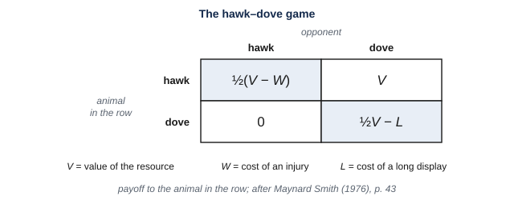
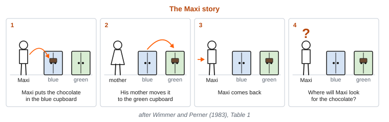
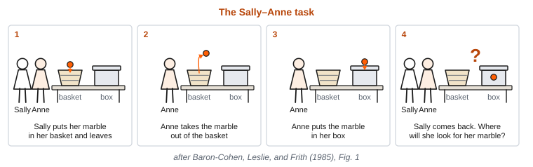

# 11. Social Cognition

This module is about what living in a lasting group asks of an animal, and how animals, people, and machines predict others and learn from them. While reading, look for the beginnings of answers to these questions:

- What problems does living in a lasting group pose, and how can helping others spread by natural selection?
- What does it take to predict what another will do, from what it is trying to do, from what it has seen, and from what it believes?
- How do animals and people learn from one another, and how well have evolutionary explanations of human behavior held up when tested one at a time?
- What is a stereotype, and how did scientists’ own beliefs shape how evidence about males and females was read?
- What in the brain is associated with thinking about others, and why did primate brains become larger?
- What does it show when a machine gives the right answer to a question about what someone believes?

By the end, we should be able to say what life among others requires, which proposed solutions are well supported, and which are still contested.

<!-- pin: t-levels-social -->

: Marr’s three levels, the question each asks, the discipline that asks it, and this module’s example. {#t-levels-social}

| Level | The question it asks | Discipline | This module’s example: a morning in a baboon group |
|---|---|---|---|
| Computational | What problem is being solved, and why does solving it matter? | Evolution and ecology | What each baboon gets depends on what the others do next, and what they do depends on what they have seen and are trying to get. What problems does living in a lasting group pose, and what does predicting others whose behavior responds to one’s own require? |
| Algorithmic | What is represented, and by what procedure? | Cognitive psychology and AI | Predicting others and learning from them |
| Implementational | By what physical means, and at what cost? | Neuroscience | Social brains |

---

A group of baboons lives on the savanna in southern Kenya. Researchers have followed the baboons there for many years. They can tell each animal apart, and they record what each one does.

On a typical morning, the group comes down from the trees and begins to feed. One adult female carries her infant, which will depend on her for most of its first year. The mother sits with her own mother and her sister, and they take turns grooming one another. Suddenly, a higher-ranking female walks toward the fig tree where the three are feeding. The infant’s mother moves away before the higher-ranking female arrives. Later, a young male threatens her sister. Their mother and other relatives move toward him, and he leaves.

Almost everything the female baboon does has an effect that depends on what the other baboons do. Whether she keeps her place at the fig tree depends on who else is approaching it, and on which of them moves away first. Whether her sister is left alone depends on who is nearby. And what any baboon does next depends on what *and who* it has seen, what it is trying to get, and what has happened between it and the others before. None of those facts can be observed directly. A baboon’s most important surroundings are the other members of its group. Each baboon’s behavior depends on which other baboons are present, what they are doing, and how they will respond to what each baboon does.

Living in a large, lasting group is very different from living alone or in a small family. In a large group, an animal deals every day with many others, and many of them are not its relatives. That changes the problems the animal faces. In such a group, an animal that can predict the others, and learn from them, is better off than one that cannot. Life in a large group raises three questions. What problems does life in a lasting group pose for an animal? How does one animal predict what another will do, and learn from what another does? And what in the brain is associated with living this way ?

Baboons are monkeys and primates, and their way of life is typical of other primates. The earliest primates may not have lived this way. How they lived together is still disputed. And a way of life like the baboons’ is not limited to primates. Human beings are the primate whose predictions about others have been studied most, because people can be asked what they think another person believes. Machines are a third point of comparison. Language models now answer written questions about what the characters in a story believe. Researchers ask of those answers the same question they ask about apes. Does giving the right answer mean predicting the way people do?

---

## §11.1 — Computational: Living in Lasting Groups

### §11.1.1 — A New Kind of Animal

Baboons, lemurs, chimpanzees, and human beings are all primates. Yet no single trait marks an animal as a primate. Classic lists of primate features include grasping hands and feet, nails instead of claws, forward-facing eyes, a large brain, and a long period during which the young depend on adults. But each feature is a tendency, and some primates lack some of them. Primates are defined by descent, as the descendants of the last common ancestor of the living primates. That ancestor may have been hard to tell apart from the other small mammals of its time.

When the primate line began is uncertain. Some estimates from DNA put the beginning of the line before the end of the age of dinosaurs, perhaps 80 million years ago. The oldest fossils that may be primates come from the Paleocene, the epoch that began when the non-bird dinosaurs died out, about 66 million years ago. The first fossils that researchers universally accept as primates appear suddenly at the start of the next epoch, the Eocene, about 56 million years ago .

The Paleocene fossils are of small animals sometimes called archaic primates. Most of their fingers and toes had claws, their brains were small compared to modern primates, and their eyes faced to the side. One of them, *Carpolestes*, climbed slowly through the smallest branches of trees. Its big toe could grasp and had a flat nail, but its eyes still faced to the side. Whether the archaic primates were primates at all is still debated. And *Carpolestes* lived too late to be the ancestor of later primates.

At the start of the Eocene, the world was warm, and rainforest extended far toward the poles. Two groups of primates appear in the fossil record then. Both had nails and grasping hands and feet. Both also had forward-facing eyes, each surrounded by a ring of bone. But the two groups lived in different ways. The adapoids were mainly active by day and ate plants, and some weighed as much as an adult beagle. The omomyoids were smaller, about the size of small squirrels. They were mainly active at night, and ate insects and fruit. The dominant but disputed view is that the common ancestor of all primates was only active at night. But what is less disputed is that the earliest primates known from fossils include species active by night *and* species active by day, inferred from properties like eye socket size and the size of the opening for the optic nerve.

What adaptive pressures led to the evolution of primates is also an open question. Proposals include life in the trees, catching insects by sight at close range, and feeding on the fruit and flowers of flowering plants. Several of these may have contributed, and no single one may be enough.

Early on, the primates split into three lines. One led to the strepsirrhines, which are the lemurs, lorises, and galagos. One led to the tarsiers. And one led to the **anthropoids**, the monkeys and apes, including human beings. All three lines have been evolving for equally long, so a living lemur is not an earlier stage on the way to a monkey. At the end of the Eocene, about 34 million years ago, the climate cooled and became drier. Primates died out on the northern continents, and the survivors closer to the equator gave rise to the groups still alive today.

The richest early anthropoid fossils come from the Fayum, in Egypt, from the end of the Eocene and the start of the Oligocene, around 34 million years ago. Sometime in the Eocene, anthropoids reached South America from Africa. South America was then an island, and they most probably drifted across the ocean on rafts of vegetation torn loose by storms. Their descendants are the New World monkeys. The anthropoids that remained in Africa gave rise to the Old World monkeys and the apes.

The apes arose in Africa. Their line split from the line leading to the Old World monkeys about 25 to 30 million years ago. Early in the Miocene, which began about 23 million years ago, Africa had many more kinds of ape than are alive today, and Old World monkeys were rare by comparison. About 16 million years ago, apes spread from Africa into Europe and Asia. Gibbons likely branched off from human ancestors 20–24 million years ago, followed by orangutans 16–19 million years ago, and gorillas about 10 million years ago. Roughly 7 million years ago, that line split again, into the line leading to chimpanzees and bonobos and the line leading to human beings. Today, gibbons and orangutans live only in Asia, and gorillas, chimpanzees, and bonobos live only in Africa.

### §11.1.2 — Monkeys and Apes

Anthropoids have a number of features that distinguish them from other primates and mammals. They are active by day. And in keeping with their use of visual information in daylight, they have a *fovea*, the small region at the center of gaze where the cones are crowded together. No other mammal that is active by day sees as sharply as anthropoids. Other features of anthropoids arose in other lineages as well. As we described in Module 8, Old World monkeys and apes have three kinds of cone receptors in the retina. Howler monkeys in South America evolved the same arrangement independently. Both New World and Old World monkeys have larger bodies than their common ancestor. The average ratio of brain size to body size also grew in both New World and Old World monkeys after the lineages separated. And a few anthropoids, such as the owl monkeys, later returned to life at night.

The great majority of primates live in permanent groups of both sexes with three or more adults. This is unusual among mammals. Among the primates that live mainly alone, all except the orangutan are active at night. And living alone is not the same as being unsocial. Primates that forage alone still have social relationships with others.

How the earliest primates lived together is disputed. Some researchers suggest that females lived alone in their own ranges, with each male’s range overlapping those of several females. Others suggest that animals foraged alone within wider social networks, or that they lived in pairs. For currently living species, lasting groups are typical of monkeys and apes.

As already mentioned, primate brains also became larger. Across primates, body size accounts for about three quarters of the differences in brain size. But for their body size, the brains of lemurs and lorises are about as large as most mammals’ brains, while the brains of monkeys and apes are about twice as large. In general, apes’ brains are not larger than monkeys’ for their body size, but are bigger in absolute terms since apes tend to be bigger. But humans are an exception. The human brain is three to four times the size of a chimpanzee’s, although the two species differ much less in body size. Gorillas are larger than human beings, yet their brains are about a third the size of a human brain. In Module 3, we described the human brain as a primate brain with a great many neurons, and expensive to run because of its size. We take up the debate about why primate brains became larger in §11.3.

Primates are notable for, but not unique in, living in large social groups. Lasting groups and complex social lives also arose separately in other lineages, among them dolphins, elephants, hyenas, and crows and their relatives, an example of what we called *convergent evolution*. And some of these species behave in ways once thought special to apes. New Caledonian crows choose the right tool for a task, ravens follow another’s gaze around a barrier, and scrub jays treat a competitor that watched them hide food differently from one that did not.

![The primate family tree from its origin to the split between the line leading to chimpanzees and bonobos and the line leading to human beings, drawn on a time axis in millions of years. Dashed lines mark the origin estimated from DNA and branchings that are uncertain. Marks along the branches show where grasping feet, nails, forward-facing eyes, the fovea, life by day, three kinds of cone, and larger brains for body size appear. The last two are marked more than once, because they arose separately in different lines. The line that led to human beings is shown only as a short stub (drawn for this chapter from Perry and Canington, 2019, Ankel-Simons and Rasmussen, 2008, and published estimates from DNA).](reading_images/fig-primate-tree.svg){#f-primate-tree alt="A horizontal tree with time running from about 80 million years ago at the left to the present at the right. Shaded bands across the background mark four epochs: the Paleocene from 66 to 56 million years ago, the Eocene from 56 to 34, the Oligocene from 34 to 23, and the Miocene from 23 to 5. A dashed stem starts near 80 million years ago. A short side branch runs through the late Paleocene and is labeled archaic primates, with Carpolestes near its end and a mark for a grasping foot with a nail. Just before 56 million years ago, the main stem divides into three lines, labeled strepsirrhines (lemurs, lorises, and galagos), tarsiers, and anthropoids, with marks for nails, grasping hands and feet, and forward-facing eyes at the point of division. A vertical line at 34 million years ago is labeled end-Eocene cooling. The anthropoid line carries marks for life by day and a fovea, and then divides into New World monkeys, labeled as crossing to South America, and a line that divides into Old World monkeys and apes. The ape line divides into gibbons and great apes between 24 and 20 million years ago. The great ape line then divides into orangutans, between 19 and 16 million years ago, and the African apes. The African ape line divides into gorillas, about 10 million years ago, and a line that divides about 7 million years ago into chimpanzees and bonobos and a short stub labeled hominins, Module 12. A mark for three kinds of cone sits on the Old World monkey and ape line and again on a twig for howler monkeys. A mark for larger brains for body size appears once on the New World monkey branch and once on the Old World line."}

### §11.1.3 — A Slow Life and a Long Dependence

Compared with other mammals of the same body size, primates live slowly. They grow more slowly, mature later, rear fewer young each year, and live longer. Primates also use less energy than other mammals. In a day, a primate spends only about half the energy expected for a mammal of its size. In Module 3, we described how much energy a brain uses. It has been proposed, tentatively, that primates live slowly because their brains take energy that would otherwise go to growth. But measurements of daily energy use are consistent instead with a smaller energy budget for the whole body.

The **life history** of a species is the timing of growth, maturity, reproduction, and death across a lifetime. A slow life history goes with a long dependence. Ape mothers give birth about once every six to eight years. They nurse each infant for four to seven years, weaning their young at about a third of adult weight. Primate infants grow slowly, so they take longer to reach that weight. Human children take the longest to reach that weight. But they are weaned well before it, earlier than ape infants are. Young chimpanzees do not produce as much food as they eat until about age 7.

In Module 10, we compared how long the young of several species depend on a parent for food, and human young depended the longest. But human young depend on more than their parents. In foraging societies, people other than the mother hold an infant from birth. Among the !Kung of southern Africa, others hold an infant about a quarter of the time. Among the Efe of central Africa, others hold infants for more than half of the daylight hours. An individual other than a parent that cares for the young is called an **alloparent**. Human children are also fed by others for years. The anthropologist Sarah Blaffer Hrdy has written that “no other immatures depend on others to provision them for years the way that human children do”. Raising a child to the point where it feeds itself takes on the order of 13 million calories. Yet mothers in foraging societies give birth every three to four years, more often than ape mothers do. Hrdy argues that such frequent births are possible only because others help.

A long dependence goes with a large brain. The human newborn’s brain is large for the size of the mother’s body, and for about a year after birth it keeps growing at the rate at which it grew before birth. And in Module 10, we described how a long youth, heavy parental care, and a large brain, tend to occur together across birds and mammals.

### §11.1.4 — Caring for the Young

The division of parental care between mothers, fathers, and alloparents varies among animal groups. These differences depend partly on how animals reproduce and feed their young. Female mammals produce milk for their young, as we described in Module 10, and most also carry the developing young inside their bodies. Mothers provide most of the care in most mammal species, and no mammal species has exclusively paternal care. In birds, both parents usually provide care. Among fish species that provide parental care, care by the father alone is the most common arrangement.

Primate species differ in how much care infants receive from individuals other than their mothers. In roughly half of primate species, mothers allow others to hold and carry their infants. In about a fifth of species, individuals other than the parents also provide food, usually in small amounts. Fathers provide substantial care in some species. Titi monkey fathers, for example, carry their infants for most of the day, and young titi monkeys show greater distress when separated from their fathers than from their mothers. In **cooperative breeding**, individuals other than the parents regularly help care for and feed the young. Among primates, marmosets, tamarins, and humans are generally classified as cooperative breeders.

Sex differences in mate competition are associated with patterns of parental care. Both males and females choose mates and compete for them. Which sex is more selective, and which competes more, varies among species and with conditions, such as the ratio of available males to females, and food availability. In an analysis of 66 animal species, researchers found that having more mates was associated with a greater increase in offspring number for males than for females, on average. This difference was greatest in species with care by females alone. No significant difference was detected in species with care by males alone. In the pipefish *Syngnathus typhle*, males carry developing eggs in a pouch, and females compete for males.

Competition among males and females can include killing the offspring of other males and females. In many mammals, including many primates, a male that has newly joined a group sometimes kills infants fathered by other males. A mother whose infant dies stops nursing and can breed again sooner. In some of the best-documented primate populations, such killings account for 30 to 50 percent or more of infant deaths. But this is not an exclusively male activity. Dominant female marmosets sometimes kill the infants of subordinate females. The authors of one review concluded that infanticide by females is probably more frequent among mammals than infanticide by males.

Sex differences in body size also vary among mammal species. In an analysis of body mass, researchers estimated that males are heavier on average in about 45% of mammal species, females are heavier in about 16%, and about 39% show no statistically detectable difference between the sexes. Among primates overall, and in the great apes, males are usually larger, but in most lemurs, lorises, and galagos, males and females are similar in size.

### §11.1.5 — Why Live in a Group?

Living in a group makes some parts of life easier. A group has many eyes and ears, so a predator is more likely to be detected before it strikes. And when a predator does attack, any one member of a large group is less likely to be the one it catches. Group members can also defend food or a place to sleep against outsiders. Mates are close at hand. And in some species, as we described above, members of the group help care for one another’s young.

But living among other members of one’s own species also makes life harder, because they need the same things. Every animal in a group eats the same kinds of food, so a patch of fruit is shared among more animals, and the animals that reach it first, or outrank the others, take more. Group members compete for mates, for safe places to sleep, and for rank. They threaten and injure one another, and some kill one another’s infants. Infections also spread more easily among animals that live close together. So the other members of an animal’s group are both its main source of help and its main competitors.

Life among competitors raises a puzzle. Natural selection favors genes that lead to more copies of themselves in later generations. A gene that leads an animal to give food, protection, or care to another animal, at some loss to itself, seems to do the opposite. Under the simplest models of natural selection, animals should be expected to cooperate only to mate and to raise their own young. Yet animals in groups often help one another in many different kinds of circumstances. They groom one another, share food, call out when a predator appears, and join one another’s fights. From a genetic point of view, why would an animal ever do anything unselfish? Genes for altruism would seem to be at a disadvantage to genes for selfishness. In the next three subsections, we describe two answers to how (apparent) altruism could evolve, and a way of describing what happens when animals’ interests conflict.

### §11.1.6 — Helping Relatives

A baboon mother that moves to support her daughter against a threat, as we described above, is helping a relative. In 1964, the biologist William Hamilton worked out how help of this kind can spread by natural selection, even when it costs the helper. Genes that lead an organism to help a relative might lower the direct adaptive fitness of the organism carrying those genes. But if those genes are shared by the relatives being helped, the net effect can lead to more copies of the genes in the next generation. Hamilton put the result this way. In a world of model animals whose behavior is set by their genes, none would give up its life to save one relative, but each would do so to save “more than two brothers, or four half-brothers, or eight first cousins”.

The numbers in Hamilton’s sentence come from **relatedness**, the probability that two individuals share a gene through descent from a common ancestor. Relatedness is one half for full siblings, one quarter for half-siblings, and one eighth for first cousins. Help to a sibling is genetically adaptive only if their gain is more than twice the helper’s loss. And help to a cousin is adaptive only if the cousin’s gain is more than eight times the loss.

Selection on a trait through its effects on relatives that share the trait is called **kin selection**. Later writers summarized the condition as *rb* > *c*, in which the benefit *b* to the relative, multiplied by the relatedness *r*, must exceed the cost *c* to the helper. A helping trait does not have to direct all of its help to relatives. A trait that leads an animal to help eight cousins and eight unrelated animals can still spread, as long as the gain to the cousins, weighted by relatedness, outweighs everything the helper gives up. Across many species, costly help is given mostly to relatives, as kin selection predicts.

Genes that lead to more helping behavior spread under kin selection only when that help goes to relatives often enough. But for the vast majority of animals, how closely two animals are related cannot be observed directly. Instead, where animals live, and whom they grow up with, are correlated with kinship, since relatives often share a place and grow up together. And kinship is uneven across primate groups. In all three African apes (chimpanzees, bonobos, and gorillas), females usually leave the group they were born in. So the adult females living together are mostly unrelated. Among the resident females of a chimpanzee community, average relatedness is below 0.01. Among female meerkats, which are cooperative breeders, it is 0.42. Even in yellow baboons, where females stay in the group they were born in, female relatedness averages only 0.09. So kin selection explains some of the help seen in primate groups, but not all of it.

### §11.1.7 — Games Without Minds

Kin selection explains help between relatives, but could evolution ever lead to behavior that is helpful to non-relatives? When animals that are not related compete, as group members do for food, how much food each one gets often depends on what the other does. In Module 7, we described a small fish deciding whether an eel was present, and we set out the four outcomes of its decision in a table: a hit, a miss, a false alarm, and a correct rejection. When discussing behavior of two interacting organisms, there is a similar table we can create. A **payoff matrix** is a table for a situation whose outcome depends on what two individuals do. Its rows are what the first animal can do, and its columns are what the second animal can do. Each cell contains what each animal gains or loses from that combination. The study of such situations is called **game theory**.

The best-known “game” studied in game theory is the **prisoner’s dilemma**. Many games describe a situation where two players can choose to either *cooperate* with each other, or *defect* (not cooperate). The prisoner’s dilemma is a special case of this situation where the best outcome for each player is to defect while the other cooperates. The worst outcome for a player is to cooperate while the other player defects. A decent outcome for both players is where they both cooperate. And a bad outcome, but not the worst, is if they both defect. For example, a player might get 5 points for defecting while the other cooperates, 3 when both cooperate, 1 when both defect, and 0 for cooperating while the other defects .

<!-- pin: t-prisoners-dilemma -->

: The prisoner’s dilemma with example points. Each cell gives the points for player A first and for player B second (points from Axelrod and Hamilton, 1981). {#t-prisoners-dilemma}

| | B cooperates | B defects |
|---|---|---|
| A cooperates | 3, 3 | 0, 5 |
| A defects | 5, 0 | 1, 1 |

The prisoner’s dilemma game is representative of many situations in the world where cooperating with someone else is good, but even more good comes from taking advantage of others. This leads to the scenario where the “best” choice would seem to be for both players to defect. But that leads to the quite suboptimal defect-defect outcome. It would be better if both players cooperated! But it would be worse to cooperate but get defected on. This paradox helps explain why selfish behavior can persist, even when cooperating would seem better. As soon as one player cooperates, the other player has an opportunity to defect.

A second game is a model of a contest over a resource, such as food or a place to sit. The biologist who devised the *hawk–dove game* defined its two strategies this way. A *hawk* will escalate, and continue to do so, until injured or until the opponent retreats. A *dove* will display and will not escalate. And a dove will retreat if the opponent escalates, before they get injured. In game theory, a **strategy** is a specification of what an individual does in each situation the game can present, whatever produces that behavior. Models of the hawk–dove game assume that each animal’s strategy is inherited, and that no animal chooses it. As the game’s inventor put it, “A genotype determines the strategy”.

Against a dove, a hawk takes the resource, and the dove retreats unhurt. Two doves display, and on average each gets half the resource, less the cost of a long display. Two hawks fight until one is injured . When an injury costs more than the resource is worth, neither strategy wins outright. If hawks are common, a dove does better, because it avoids injury. If doves are common, a hawk does better, because it takes the resource without a fight. So the population settles at a stable mix of the two . A strategy that, once it is common, cannot be bettered by any rare alternative, is called an **evolutionarily stable strategy**. The stable mix of hawks and doves is one. Selection reaches it with no animal choosing anything, and it need not be what a reasoning player would choose.

Game theory can even be used to explain competition between organisms that, by most definitions, are not making choices at all. Trees have no brains, yet their strategies for how tall to grow fit the same description. A tree that stopped growing while its neighbors kept growing would be shaded by them. So there is a benefit to growing taller than the other trees. But this can lead to an arms race, where the height of all the trees gets larger and larger, which takes more and more energy. It is a prisoner’s dilemma situation where growing taller is defecting, and every tree would be better off if all of them stayed shorter. So in models of forest growth, the stable height is greater than the height that would let the forest as a whole produce the most. In such a forest, each tree is tall because the trees around it are tall.

Many animals also fight without injuring each other. Some snakes wrestle with each other, and some antelope kneel down to fight. In the models, holding back benefits an individual only when an escalated attack is answered by escalation in return. Fighting that is all display, and never backed by attack, is not stable.

{#f-payoff-matrices alt="A two-by-two grid titled hawk–dove. Its rows and columns are labeled hawk and dove. The cells read one half of V minus W for hawk against hawk; V for hawk against dove; zero for dove against hawk; and one half of V minus L for dove against dove."}

{#f-hawk-dove-mix alt="A graph with the share of hawks in the population on the horizontal axis, from zero to one, and average payoff on the vertical axis, from minus 20 to plus 60. A line for hawks falls steeply from 60 at the left to minus 20 at the right. A line for doves falls gently from 20 at the left to zero at the right. The lines cross at two thirds on the horizontal axis, where a vertical dashed line is labeled stable mix."}

### §11.1.8 — Repeated Encounters

In a single round of the prisoner’s dilemma, defecting is the best performing strategy. But animals in a lasting group encounter the same partners again and again. When the same two animals play the game many times, what each gains over all those encounters depends on how each responds to what the other did before. Repetition changes the game. For example, an animal might cooperate only with partners that cooperated with it the last time. Help that is given by one participant now, and returned by the other participant later, is called **reciprocal altruism**. Help that is reciprocated is a second answer to the puzzle of unselfish behavior. The biologist who coined the term reciprocal altruism proposed that it is most likely to evolve when animals have many chances to help one another, when each interacts repeatedly with the same small set of others, and when help can be given in both directions.

The evidence for reciprocal altruism outside human beings is thinner than is often claimed. The best-known case is vampire bats. A vampire bat that fails to find a blood meal is often fed by a roostmate, which regurgitates blood for it. In the wild, most of this sharing is by mothers feeding their own young, and the rest goes mainly to relatives and to bats that roost together often. But in captive groups of wild-caught bats, whether one bat had fed another earlier predicted whom it fed far better than relatedness did. These relationships built up gradually, starting with grooming. The exchanges within a pair are only loosely matched, though, and no study has tested how bats respond to a partner that fails to feed them in return. So researchers still disagree about whether to call the bats’ food sharing reciprocity, largely over how strictly to define the word.

### §11.1.9 — Life in a Primate Group

Researchers studying primate social systems often describe them in terms of four properties. There is the size and makeup of the group, the relationships among its members, who mates with whom, and who cares for the young . We have already discussed the size and makeup of primate groups in §11.1.2, and who mates with whom, and who cares for the young, in §11.1.4. What do we know about the relationships among members of primate groups?

<!-- pin: t-social-system -->

: Four parts of a social system, and the question each answers (after Kappeler, 2019, Fig. 1). {#t-social-system}

| Part | The question it answers |
|---|---|
| Social organization | How large is the group, and which ages and sexes does it contain? |
| Social structure | What relationships do the members have with one another? |
| Mating system | Who mates with whom, and who reproduces? |
| Care system | Who cares for the young? |

Relationships within different primate species vary, but some patterns recur. In many species, one sex stays for life in the group it was born in, and the other leaves when it matures. In many Old World monkeys, such as baboons and macaques, females stay and males leave. In some other monkeys and in all three African apes, females usually leave. Adult males usually outrank adult females, although in most lemurs females outrank males. Across many species, some pairs form strong, lasting bonds. They groom each other, stay near each other, and support each other in fights. Such bonds are more common in the sex that stays. Many bonds are between relatives, but not all. In one wild chimpanzee community, 22 of 28 males formed their closest bond with an unrelated animal. Much of what is known, though, comes from a few species, mainly Old World monkeys such as baboons and macaques, and chimpanzees. Primates that live high in forests, or are active at night, have been studied less.

Baboons are among the most closely studied primates. Researchers have followed groups at Amboseli, in Kenya, since 1971. Female baboons stay for life in the group they were born in, and males leave when they mature. The females form a **dominance hierarchy**, a stable ordering of who gives way to whom in contests. A daughter takes a rank just below her mother’s, so the members of a family occupy neighboring ranks. The strongest bonds, measured by how often two animals groom each other and stay near each other, are between mothers and daughters and between sisters. Baboons form alliances in fights. Adult males and females also form lasting associations, which are thought to protect infants from being killed by males that have recently joined the group. After a fight, a baboon may threaten a relative of its opponent. And friendly contact after a fight can come from a relative of the opponent rather than from the opponent itself.

Chimpanzees live differently from baboons. A chimpanzee community, of about 20 to 150 animals, rarely gathers in one place. Its members split into smaller parties that come together and separate again. Males stay for life in the community they were born in, and females usually leave when they are about 11 years old. So most of the adult females in a community are not related to one another. Males form alliances and lasting bonds with one another, and they rank in a dominance hierarchy. Lower-ranking animals give way to higher-ranking ones over food. In experiments in which a subordinate and a dominant chimpanzee compete for pieces of food, the subordinate goes for food that a barrier hides from the dominant’s view, and leaves alone food that the dominant has a clear view of. Chimpanzee communities also differ from *one another* in what they do. Researchers at seven long-term field sites compared their records. They found 39 behaviors, including ways of using tools and of grooming, that were common in some communities and absent in others, in ways that differences in habitat could not explain.

### §11.1.10 — Why Predicting Others Is Hard

Life in a lasting group poses a problem for every animal in it. What an animal gains from almost any action depends on what the others in its group do next. What another animal does next depends on what it has seen, what it is trying to get, and what has happened between the two of them before. None of these can be observed directly. What can be observed is another animal’s behavior, where it is looking, and what happened on earlier occasions.

The problem grows with the size of the group. In a group of *n* animals, each animal has *n* − 1 others to deal with. But the number of pairs among the members is *n*(*n* − 1)/2, which grows roughly with the square of the group’s size. A group of 10 contains 45 pairs, and a group of 50 contains 1,225. And the pairs affect one another. When one baboon threatens another, the relatives of each may join in, as the sisters’ mother and other relatives did in the Opening.

Two further facts are part of the problem. Which family an animal belongs to predicts some of what it will do, such as whom it will support in a fight. And what other animals do provides information about the world. Where another animal feeds, and what it runs from, indicates where food is and what is dangerous. In §11.2, we turn to how animals, people, and machines predict others and learn from them.

---

## §11.2 — Algorithmic: Predicting Others and Learning from Them

### §11.2.1 — Playing a Repeated Game

In §11.1.8, we described how repetition changes the prisoner’s dilemma. When two players play many rounds, what each gains depends on how each responds to what the other did before. Which way of playing does best over many rounds? One political scientist asked researchers to send in computer programs that would play the repeated game, and ran every program against every other in a tournament. The simplest program won. It played a strategy called **tit-for-tat**: cooperate on the first move, and then do whatever the partner did on the previous move. Tit-for-tat won a second, larger round as well. In an “evolutionary” simulation, where more successful programs were copied to become more common, and less successful programs eliminated, tit-for-tat replaced all the others.

Tit-for-tat has three properties that help explain its success. It never defects first. It defects in return after a partner defects. And it goes back to cooperating as soon as the partner does, after only one defection of its own. Against another tit-for-tat player, it cooperates on every move. Against a player that always defects, it loses only on the first move.

Tit-for-tat requires very little of a player. The player must be able to tell its partners apart, and it must respond to one move, the partner’s last. The game must also be likely to continue, since a player that will not play the same partner again gains nothing by cooperating. The authors of a paper on the tournament wrote that “An organism does not need a brain to employ a strategy”. Telling partners apart can even be replaced by something simpler, such as staying with one partner, or encountering specific partners only at one fixed place. So tit-for-tat makes no prediction about what a partner thinks or wants. It responds only to what the partner did.

Real animals do not seem to play move by move. The vampire bats we described in §11.1.8 feed partners with whom they have built up a long relationship, starting with grooming, rather than answering each meal with a meal. And many animals, people included, predict one another in more complex ways than tit-for-tat. We turn to those ways now.

### §11.2.2 — Goals, Gaze, and Moving Shapes

One animal can predict another from several kinds of information, using gradually more and more context. It can use what it has learned about what that animal usually does in a particular situation. When the other animal is acting hungry, and it looks at food, it usually tries to grab the food. It can go a step further, and try to predict the animal’s behavior based on what that animal believes. Predictions based on past behavior, and based on internal mental states, are not the same. And some animals have one capacity and not the other. The ability to predict another’s behavior from what it believes does not seem to be common across species, and young human children do not show it in standard tests until about age 4.

The ability to attribute states such as goals, perceptions, and beliefs to others, and to predict behavior from them, is called **theory of mind**. Two researchers studying a chimpanzee introduced the term in 1978. They called it a “theory” because such internal states cannot be observed directly, and because the attributions can be used to predict behavior. They also predicted that understanding what others want would come before understanding what others know, in development and across species.

Human infants treat actions as aimed at goals well before they understand beliefs. In one synthesis of the infant research, the authors describe three steps. At about 6 months, infants respond to people as animate beings that act on objects. At about 9 months, they understand people as pursuing goals, and can tell someone who is *unwilling* to help from someone who is *unable*. At about 14 months, they understand people as choosing among ways to reach a goal. From about 9 months, infants also follow another person’s gaze to what the person is looking at, and look back at the person. Sharing attention to an object in this way is called **joint attention**.

Adults will assume the existence of goals based on very little evidence. In 1944, two psychologists showed a short film of two triangles and a disc moving in and around a box with a door . Nearly every viewer described characters with motives, and all agreed that the proper description of the events involving the triangles was a “fight” and a “chase”. When viewers were told to see the shapes as people, 97% described the large triangle as aggressive or a bully. This does not mean that the viewers believed the triangles were living, thinking beings. But it does show how readily people describe even simple motion in terms of goals and motives.

A number of different precise procedures can infer goals from motion. One such algorithm is called *inverse planning*, where an observer assumes that an agent takes efficient paths toward its goal. It then asks, assuming efficient paths are being taken, which goal would make the path it *has* seen an efficient one? Researchers tested this procedure against adults who watched a dot move through mazes and judged where it was heading. The procedure’s judgments matched people’s very closely, with a correlation of 0.97. But a much simpler rule matched almost as well, with a correlation of 0.96. That rule takes the goal to be whatever the dot last moved toward. The two differed only on paths whose last steps were ambiguous. On those paths, people used the whole path, as inverse planning does. Inverse planning infers goals, not beliefs. And its authors note that it could be read in two ways, as a theory of how agents behave, or as the observer running its own planning in reverse.

{#f-heider-simmel alt="A simple line drawing. A rectangle with one short side partly open, like a door, represents a house. A large triangle stands in the doorway. Outside the house, a smaller triangle and a small circle are drawn close together, with short curved lines behind them suggesting that they are moving away from the house."}

### §11.2.3 — What Others Can See

Some animals act on what another animal can see. In §11.1.9, we described a subordinate chimpanzee that goes for food that is hidden from a dominant’s view by a barrier. The subordinate leaves food alone if the dominant chimpanzee can see it . That behavior has several possible explanations. If the chimpanzee was basing its behavior on knowledge of what the other animal could see, that would be a pretty complex and impressive capacity. As such, according to **Morgan’s Canon** (a behavior should not be explained by a higher mental process if a simpler one accounts for it), which we introduced in Module 2, it is important to rule out the simpler explanations first.

Researchers performed a number of tests to try to rule out a range of simpler explanations. In the first test, the food behind the barrier was also slightly farther from the dominant. So the subordinate might simply have been going for whichever food the dominant would reach last, not the food it could not see. To test this, they did an experiment where both animals were in the same space, and both pieces were equally easy to reach. This meant the choice could not have depended on which piece the dominant animal could reach first. In another test, the solid barrier obstructing the dominant’s view of the food was replaced by a clear barrier. In this situation, the subordinate no longer preferred the food behind the barrier. So the subordinates were not simply choosing food near barriers. Other tests ruled out further explanations, such as the subordinate following the dominant’s movements . In another study, subordinates went for food more often when the dominant had not watched it being hidden, or had watched, and then missed it being moved. They also went for it more often when the dominant that had watched was replaced by one that had not. So their choices tracked what one particular dominant had seen, not only what it could see at that moment.

In 2008, two researchers behind many of the studies about chimpanzee theory of mind reviewed the evidence. They concluded that there is strong evidence that chimpanzees understand others’ goals and intentions, and what others see and know. But they found no evidence that chimpanzees understand when another’s belief is wrong. The scrub jays we described in §11.1.2, which treat a competitor that watched them hide food differently from one that did not, show the same kind of behavior. The authors of one review used Marr’s levels to describe the comparison. On their account, the crow family, which includes scrub jays, and apes may solve the same computational problem with different procedures, and with very different brains.

<!-- pin: t-canon-chain -->

: The chain of tests behind the chimpanzee food-competition result. Each row gives what subordinates did, the simpler explanation that the test ruled out, and what it left open (after Hare et al., 2000 and 2001, and Povinelli and Vonk, 2003). {#t-canon-chain}

| Test | What subordinates did | Simpler explanation ruled out | What it left open |
|---|---|---|---|
| Food in the open and behind a barrier, dominant watching from its own cage | Took mostly the food that the dominant could not see | Taking food only when no dominant is present | The hidden food was slightly farther from the dominant |
| Both animals in one cage, food inside or behind a tire | Took the hidden food | Reaching only what the dominant cannot reach | Following the dominant’s movements |
| Subordinate released first | Set out for the hidden food before the dominant moved | Following the dominant’s movements | Avoiding whatever the dominant was looking at |
| Dominant’s door kept shut | Still preferred the hidden food | Avoiding whatever the dominant was looking at | Preferring food near barriers |
| Subordinate alone, or a clear barrier | No preference | A built-in preference for food near barriers | Whether what was tracked is seeing or behavior |
| Dominant did not watch the hiding, or missed a move | Took more food than when the dominant watched | Responding only to what the dominant can see now | The same question |

{#f-food-competition alt="A top view of three connected rooms in a row. The left room is labeled subordinate and the right room is labeled dominant, each with a door opening onto the central room. In the central room are two small circles for food. One sits in the open. The other sits just behind a short wall on the subordinate’s side. Dashed lines run from the dominant’s door to each piece of food. The line to the piece behind the wall is blocked by the wall, and the line to the piece in the open is not."}

### §11.2.4 — False Belief

Tracking what another has seen is not the same as tracking what another believes. When another’s belief is true, predicting from the belief and predicting from the world give the same answer. So a viewer who predicts that someone will search where an object really is might be following the object, not the person. Several philosophers commenting on the 1978 chimpanzee study proposed a stronger test. They asked whether a viewer predicts behavior from a belief that is *wrong*. A belief that does not match the way the world is, such as a belief that an object is where it was left after it was moved, is called a **false belief**.

Josef Perner and a colleague turned that proposal into the first experiment with children . In their story, a boy named Maxi puts some chocolate in a blue cupboard and goes out to play. While he is away, his mother uses some of the chocolate and puts the rest in a green cupboard. Then Maxi comes back, hungry. Where will Maxi look for the chocolate? For four- and five-year-olds, only 4 of 12 children answered correctly on both stories they heard. For six- and seven-year-olds, 11 of 12 children answered correctly. In both age groups, every wrong answer pointed to the green cupboard, where the chocolate really was.

Later studies placed the change somewhat earlier. Across 178 studies of more than 4,000 children, the change from failing to passing false-belief tests happened mainly between 3 and 4½ years of age . Children were correct about half the time at 44 months. Before about 41 months, they mostly gave the wrong answer, and from about 48 months they mostly gave the right one. Some changes to the task, such as giving a character a reason to deceive, helped children of every age. But none of them lifted the youngest children above chance. Children from a wide diversity of countries and cultures followed the same course, at somewhat different speeds.

Language abilities were a strong correlate of passing false-belief tests. Earlier language ability predicted later false-belief performance more strongly than the reverse. These studies are correlational, though, and every task in them was itself verbal.

{#f-maxi alt="Four panels in a row, drawn as simple cartoons. In the first, a boy places a bar of chocolate in a blue cupboard. In the second, the boy is gone, and a woman moves the chocolate from the blue cupboard to a green cupboard. In the third, the boy comes back into the room. In the fourth, a question mark hangs over the boy between the two cupboards."}

{#f-false-belief-age alt="A line graph with age in months on the horizontal axis, from 30 to 60, and percent correct on the vertical axis, from 0 to 100. A dashed horizontal line marks 50 percent, labeled chance. A smooth S-shaped curve starts below 20 percent at 30 months, crosses the dashed line at 44 months, and rises above 75 percent by about 56 months. A shaded band between about 41 and 48 months is labeled no different from chance."}

### §11.2.5 — Autism, and Misunderstanding in Both Directions

In 1985, three researchers acted out a false-belief story with two dolls, Sally and Anne . Sally puts a marble in her basket and leaves. Anne moves the marble to her own box. When Sally comes back, where will she look? The researchers gave the task to 20 autistic children, 14 children with Down syndrome, and 27 younger, typically developing children. Most of the children with Down syndrome, and most of the younger children, pointed to the basket. Most of the autistic children pointed to the box, where the marble really was. Four of the 20 pointed to the basket. This study and others like it formed the basis of an early view that one property of autism was a lack of theory of mind.

But with additional analysis and interpretation, it is common now to interpret that result more narrowly. In Module 2, we wrote that an autistic person is not a neurotypical person with pieces missing. In the 1985 study, researchers recorded what most of 20 autistic children did during one doll task in a laboratory. The groups also differed in language. The autistic children’s language age lagged their nonverbal age by about four years. In 2019, Morton Ann Gernsbacher and a colleague reviewed the research that followed. Several later studies have failed to repeat the result. Many autistic children and adults pass false-belief tasks. And in several studies, a person’s vocabulary predicted their performance better than whether they were autistic.

Misunderstanding between autistic and non-autistic people also runs in both directions. The **double empathy problem** is the proposal that difficulties in understanding between autistic and non-autistic people are mutual, rather than located in one person. In one experiment, a story was passed along chains of eight people, each retelling it to the next. Chains of autistic people passed on as many details as chains of non-autistic people did. Chains that alternated between autistic and non-autistic people passed on fewer, and most of the extra loss came at the first handoff. The study was small, and its finding needs to be repeated. But the implication is that a misunderstanding between two people may lie in the match between them, not in either one alone.

{#f-sally-anne alt="Four panels in a row. Two dolls, labeled Sally and Anne, stand at a table with a basket and a box. In the first panel, Sally puts a marble into the basket. In the second, Sally is gone and Anne takes the marble out of the basket. In the third, Anne puts the marble into the box. In the fourth, Sally is back, and a question mark hangs between the basket and the box."}

### §11.2.6 — Belief Without Words?

In standard false-belief tasks, words are used to ask children questions, which they are supposed to answer. Some researchers have argued that younger children *can* understand false beliefs, but cannot yet *show* it by answering questions. So they tested infants without asking them anything. Renée Baillargeon and a colleague showed 15-month-olds an actor who hid a toy in one of two boxes. The toy then moved to the other box, either while the actor watched or while her view was blocked. When the actor reached into a box, infants looked longer if she reached where she could not have believed the toy was. Longer looking was taken as a sign that an event was unexpected. Apes tested with eye-trackers also looked first toward the place where a human who had been fooled would search, in one of two experiments and in the two combined. Those researchers noted that a simpler rule could produce the same result: agents search where they last saw something.

These results have proved hard to repeat. Studies that measured where infants look before an agent acts have mostly failed to replicate. That includes a two-lab replication that two of the original authors helped carry out. Studies that measured how long infants look after an agent acts have had mixed results. In a large study run across many labs, ManyBabies 2, researchers found that toddlers did not distinguish an agent who knew where an object was from one who did not, although adults did. That test was easier than a false-belief test, and its full report has not yet passed peer review. Defenders of the early findings argue that differences in procedure explain the failures. So whether infants and apes represent false beliefs remains an open question.

### §11.2.7 — Five Accounts of Predicting Others

Five explanations have been proposed to explain how one individual predicts the behaviors of another . They differ in what each says the predictor represents.

On the **theory account**, the predictor represents another’s unobserved mental states, and reasons from them, much as a scientist reasons from a theory. In one proposed procedure for doing so, a mechanism copies a representation of the world, and marks the copy as someone’s belief or pretense rather than as true. Then the predictor can reason from within that marked copy. This way, the predictor never confuses what another believes with what the predictor takes to be true itself. On another version of this theory account, children revise a theory of mind as evidence comes in, just as a scientist revises one.

On the **simulation account**, the predictor needs no theory. Instead, the predictor runs a mental simulation of what it would be like from the other person’s perspective, with their situation as input. The predictor then takes the outcome of that simulation as its prediction of what the other will do. That is one use of simulation, which we defined in Module 10 as using stored knowledge, without acting, to predict what would happen. Inverse planning, which we described in §11.2.2, sits between the theory and simulation accounts, and its authors note that it could be interpreted as either.

On the **behavior-reading** account, the predictor predicts another’s behavior from categories of behavior, however abstract and however learned, without representing mental states. One way to acquire those regularities is statistical learning of which behaviors tend to follow which. For example, an animal that has often seen others look at food and then go for it, could learn that a look toward food predicts a grab, without representing what the other sees or wants.

A fourth explanation was proposed by psychologist Cecilia Heyes. She argued that some results that *look* like representing others’ mental states might come from processes that are not about minds at all. **Submentalizing** is her name for behavior that looks as if it is controlled by thinking about mental states, but is not. In one task, people judge how many dots they can see on the walls of a room, while an avatar in the room faces one wall. People were slower when the avatar faced a wall with a different number of dots than they could see. But an arrow in place of the avatar produced an effect of about the same size. On Heyes’s account, the cause is attention drawn in the direction that the avatar or arrow points.

On the **two-systems account**, people track others in two ways. A fast, limited system tracks where another last encountered an object. In many false-belief tasks about location, that gives the same answer as tracking a belief. In the Maxi story, for example, Maxi last saw the chocolate in the blue cupboard, so tracking where he last saw it predicts where he will look. But a system like that should fail when a belief is about what an object is, rather than where it is. In one study, researchers found success with an object’s location and failure with its identity, as the two-systems account predicts, though that result has also been explained in other ways. A slow, flexible system reasons about beliefs of any content, and depends on language and effort. Each system should show characteristic limits.

Simplicity does not decide among these accounts. Researchers debate which of them is actually the simpler explanation. Researchers have turned instead to specific tests to try to distinguish which mechanisms different people and animals use. These include limitations in abilities that would occur if one explanation, but not the others, is true. For example, if a predictor succeeds only with behaviors it has often seen, and fails with similar behaviors it has rarely seen, it is more likely to be reading behavior than minds. And if replacing a person with an arrow produces the same effect, as in the dots task, the effect is more likely to come from where attention is drawn than from thinking about another’s mind.

A sixth possibility that we propose is that a learner trained to predict behavior from enough examples might come to generalize to new situations, as a theory does. If so, the boundary between behavior-reading and theory would itself become an open question.

<!-- pin: t-mindreading-accounts -->

: Five accounts of predicting others, what each says the predictor represents, and a test that could tell it apart from the others (our arrangement of positions taken in the sources). {#t-mindreading-accounts}

| Account | What the predictor represents | A test that could tell it apart |
|---|---|---|
| Theory | Others’ unobserved mental states, and rules for reasoning from them | Correct predictions in new situations, without a long history of observing similar ones |
| Simulation | No theory; its own decision-making, run offline with the other’s situation as input | Whether its predictions of others match how it would itself act in the same situation |
| Behavior-reading | Regularities in behavior, and no mental states | Success only with behaviors seen often, and no confusion between what it sees and what another sees |
| Submentalizing | Nothing about minds; attention and other general processes produce the effect | Inanimate controls, such as an arrow in place of an avatar, produce the same effect |
| Two systems | A fast tracker of what another last encountered, beside slow reasoning about beliefs | Fast success on where an object is, but failure on more complex contents of a belief |

### §11.2.8 — Machines on Theory-of-Mind Tests

Language models are a new kind of subject for the same tests. Since about 2023, the largest language models have answered standard written false-belief questions about as well as adults do. In one study, human adults and the models tested in 2023, including GPT-4, all answered nearly every false-belief question correctly, including questions about newly written stories. In another study, a June 2023 version of GPT-4 solved 75% of 40 new false-belief tasks. To count as solving a task, it had to answer every version of the story correctly, including versions in which the character’s belief was true.

The same models often failed when a story was changed in ways that should not matter to anyone tracking a belief. Suppose a bag labeled “chocolate” is full of popcorn, but the bag is transparent. A character who looks at the bag can see the popcorn, so the character should not be fooled by the label. In one test, GPT-4 answered 97.5% of standard false-belief items about a moved object correctly, and none of the items in which a container was made transparent. What such failures mean is disputed. Some adults also fail some of the altered stories, though less often than the models did. And an altered story can add demands that have nothing to do with beliefs, such as reasoning about what can be seen through what. Early studies of the newer “reasoning” models, from 2025 and 2026 and not yet peer reviewed, find them more robust on many altered stories but not on all of them.

Passing a test means that a system gives the same answers that someone representing the mental states of others would give. It does not mean that the system reaches those answers by representing others’ mental states.

One group of researchers put the difference as two separate questions: does the system give the same output, and does it use the same computation ? Researchers applying Morgan’s Canon ask the same question about apes. In the two cases, researchers have different alternatives to rule out. The ape evidence is nonverbal, from where apes look and which food they take. The machine evidence is entirely written question answering. Predicting a partner is also different from responding well to one. In a 2025 study of repeated games, including the prisoner’s dilemma, several openly available models released between 2023 and 2025 predicted simple partners’ moves well, but did not choose the moves that would have gained the most against those partners.

{#f-same-answer alt="A diagram with a short story in a box at the left: a character puts an object in a bag and leaves, and someone else moves it. Two arrows lead from the story, one to a drawing of a person and one to a box labeled language model. Each produces the same speech bubble, naming the place the character will look. A solid outline around the two answers is labeled same output. A dashed outline around the person and the model is labeled same computation, with a question mark."}

### §11.2.9 — Learning from Others

Another advantage to social living is that animals can learn from one another. In Module 5, we wrote that nervous systems are usually not supplied with a teacher. But another animal can be one. Learning that is influenced by watching, or interacting with, another animal is called **social learning**.

Social learning comes in several kinds, which differ in how much of another animal’s behavior the learner reproduces. In **stimulus enhancement**, another animal draws the learner to a place or an object, and the learner then learns about it on its own. In **observational conditioning**, a learner comes to respond to something the way it saw another animal respond. Laboratory-reared rhesus monkeys that watched a wild-born monkey behave fearfully toward a snake came to fear snakes themselves. This is the classical conditioning we described in Module 5, in which one thing comes to be treated as a sign of another, with the snake as the sign of the other monkey’s fear. In **emulation**, a learner reproduces the result that another animal achieved, by its own means. In **imitation**, a learner copies the form of the actions themselves.

Researchers can tell these kinds apart with experiments. In one experiment, an adult showed young chimpanzees, from age 2 to 6, how to get food out of a box. Some of the actions did nothing, such as poking a stick into a hole at the top that led only to a barrier . Chimpanzees that were given the opaque box first, so that they could not see what each action did, tended to copy the useless actions. Chimpanzees that were given the clear box first, which showed that the top hole led nowhere, mostly skipped it. Three- and four-year-old human children copied the useless actions whether the box was opaque or clear. Copying actions that are plainly unnecessary is called **overimitation**. In later experiments, children kept copying the unnecessary actions even after practice at spotting such actions. They also kept copying when they were left alone with the object, and when they were warned that the adult might do something “silly”. Whether children take such actions to be causally necessary, or are following a social convention, is disputed.

Some animals change their own behavior in ways that help others learn. In its broadest sense, **teaching** is defined by what the teacher does. One animal changes its behavior in the presence of a naive one, at some cost or with no immediate gain to itself, and the naive one learns faster as a result. Meerkat helpers give young pups dead or disabled prey, such as scorpions with the sting removed, and give older pups more intact prey. Under a stronger definition, the teacher must also represent what the learner does not yet know, which ties teaching to the accounts of predicting others we described in §11.2.7.

Animals do not copy at random. Copying when uncertain, and copying older or more successful individuals, are among the patterns researchers have found in children, chimpanzees, and other animals. Social learning is also not limited to primates. Meerkats teach, and the dogs we described in Module 10, which reproduced an owner’s action on command, imitated in the strict sense. Social learning is the usual explanation for the differences between chimpanzee communities that we described in §11.1.9. A behavior that spreads by social learning within a group, and so differs between groups, is called a *tradition*. We take up culture, and the way human culture builds on itself, in Module 15.

![The two puzzle boxes used to compare young chimpanzees with children. A demonstrator first poked a stick into a hole on top, which led only to a barrier, and then opened a door at the front to reach the food. Chimpanzees given the opaque box first put a median of about 59% of their stick insertions into the useless top hole, and about 6% when the same chimpanzees were then given the clear box (chimpanzees given the clear box first put none there). Children put about 70 to 80% of theirs into the top hole with either box (after Horner and Whiten, 2005, Fig. 1 and pp. 169–176).](reading_images/fig-puzzle-box.svg){#f-puzzle-box alt="Two boxes side by side, one dark and opaque and one transparent. Each has a hole on top and a small door at the front. In the transparent box, a cutaway shows a barrier under the top hole and a tube behind the front door leading to a wrapped piece of food. Below the boxes, a bar chart with four bars compares the share of stick insertions into the top hole: chimpanzees with the opaque box, seen first, a bar near 59 percent; the same chimpanzees with the clear box, seen second, a short bar near 6 percent; children with the opaque box, a bar near 70 percent; and children with the clear box, a bar near 80 percent."}

### §11.2.10 — Evolutionary Psychology: The Program

Learning from others is one way an animal’s behavior comes to fit its world. Evolution is another. That evolution has shaped some human behavior and cognition is not in doubt, and we have followed that theme through the whole course. But each specific proposal about how evolution shaped a behavior is a hypothesis, tested one at a time. In Module 1, we wrote that an adaptive why “is a hypothesis to be tested, not a story to be assumed”. And in Module 2, we asked of any adaptive explanation whether it would have accommodated the opposite result just as comfortably.

**Evolutionary psychology** is a specific research program for testing such proposals about human beings. In its founders’ framing, the human mind contains many mechanisms, each specialized for a particular problem that human ancestors faced, in an ancestral environment that researchers have to reconstruct. The founders summarized the program in five principles, and these principles vary in how widely they are accepted by other scientists.

The first principle common to evolutionary psychologists is that the brain functions like a computer. This is close to the perspective that has been used in this book, and to Marr’s levels, describing the mind in terms of algorithms and data structures.

The second principle is that the brain’s circuits were shaped by natural selection to solve problems that human ancestors faced. Few deny that evolution shaped the brain. But whether a particular circuit was shaped for a particular ancestral problem is the part that needs testing, one proposal at a time.

The third principle is that most of what goes on in the mind is hidden from consciousness. This principle is uncontroversial in this course. Most of the processes we have described in earlier modules take place without our being aware of them.

The fourth principle is that different circuits are specialized for different problems. This is also consistent with our course in general. But it is also a principle we have argued needs to be applied carefully and conservatively. Each specific claim needs checking. In Module 6, we treated modularity as a matter of degree.

The fifth principle is that “Our modern skulls house a stone age mind”. On this view, the mind’s circuits were shaped for the environments of human ancestors, which differ from the environments people live in now. This principle is the most tenuous of the five. A mind that learns from its present environment is less likely to be stranded in an ancestral one.

Critics often describe the program of evolutionary psychology as claiming that behavior is hard-wired. The founders deny it. They describe their mechanisms as “specialized learning mechanisms”. A better description of the dispute is whether learners are specialized for particular kinds of content, or are general learners shaped by development and culture. Evolution can produce a good general learner. Assuming a learner specialized for one kind of content, where a general learner would serve as well, is itself a claim that needs evidence.

### §11.2.11 — Tests, Critics, and Initial Skepticism

Some proposals have been supported by tests. In §11.1.6, we noted that how closely two animals are related cannot be observed directly. Kin detection is a proposed solution for human beings. In 1992, the program’s founders suggested that people might treat as siblings the children they saw their mother care for as newborns, and the children they grew up with. In 2007, both cues predicted how much people helped a sibling and how strongly they objected to incest between siblings. The prediction came before the data, which makes the test a strong one. The evidence also has limits. It is correlational and self-reported, its effects are moderate, and the result about incest rests on judgments about other people.

Other proposals have weaker support than first reported. One was that women prefer more masculine men’s faces near ovulation. Studies gave conflicting results, and the authors of two meta-analyses reached opposite conclusions. Then researchers, some of whom had reported the effect, ran a large study. They tested hundreds of women repeatedly, with hormone measures, and found no support for it.

Sex differences in what people want in a partner are a second case. Men and women differ in the partners they say they want. In one of the program’s best-known studies, more than 10,000 people, in 37 samples from 33 countries, rated how important various traits would be in choosing a partner. In every sample, women rated good financial prospects more highly than men did, and men rated good looks more highly than women did. The difference for financial prospects was significant in 36 of the samples, and the difference for looks in 34. And in all 37 samples, men preferred a spouse younger than themselves, while women preferred one older. But in studies of partners whom people had met face to face, attractiveness and earning prospects predicted romantic interest about equally for men and women.

Critics raise general problems with the program. The ancestral environment cannot be observed, so matching a present mechanism to an ancestral problem is hard to test. Whether the mind is built from many specialized parts is itself disputed. And explanations are sometimes proposed after the data they explain. Cecilia Heyes offers a rival origin story. On her account, theory of mind and imitation are learned through culture, as reading is, rather than inherited as specialized mechanisms. Sarah Blaffer Hrdy proposes a third origin story. Where several adults cared for the young, infants that were better at predicting what others intended drew more care, and so were more likely to survive.

From these cases and others like them, we can draw some patterns for setting an initial level of skepticism. They are tendencies, not rules. Claims tested across many species have held up better than claims about one species, reconstructed from an imagined past. Claims that evolution produced a bias in what is learned have fared better than claims that it produced a fixed response. Claims of sex differences in preference have tended to shrink when real choices replace stated ideals. And an explanation that happens to fit its proposers’ own culture should be checked with particular care.

### §11.2.12 — How Bateman Was Read

Scientists’ own beliefs can shape how evidence is read. In 1948, Angus Bateman placed small groups of fruit flies together, each fly carrying a different inherited marker, and counted offspring to infer who had mated with whom. He concluded that males with more mates had more offspring, and that females did not. A team of researchers later repeated his method and found it biased. Offspring that inherited markers from both parents died more often than expected, so matings were undercounted. Flies that had mated were counted as unmated, males about twice as often as females. And more offspring appeared to have fathers than mothers, which is impossible. So his method cannot be used to test his claim.

How the result was reported mattered too. Bateman’s paper contained two graphs . Yet in the one based on most of his data, both sexes had more offspring when they had more mates. Later textbooks mostly reproduced the other graph, in which females did not. Later authors also described courtship of unmated females that Bateman never recorded. One biologist who traced this history argues that those authors “already ‘knew’” the pattern of eager males and reluctant females before they described the evidence.

The history of Bateman’s study is not evidence that the sexes are the same. As we described in §11.1.4, across 66 species an extra mate adds more offspring for males than for females on average, and the difference tracks which sex cares for the young. The history is a record of how the evidence was read, reported, and taught. Even researchers who defend the idea of sex roles write that “The perception of sex roles also varies as a function of research experience and cultural background”. If scientists’ beliefs about males and females can shape how they read evidence, it is worth asking what such beliefs are.

{#f-bateman-graphs alt="Two small line graphs side by side, each with number of mates on the horizontal axis, from zero to four on the left and zero to three on the right, and relative fertility on the vertical axis. Each has a solid line for males and a dashed line for females. In the left graph, labeled series 1 to 4, both lines climb, the male line peaking at three mates. In the right graph, labeled series 5 and 6, the male line climbs and the female line is nearly level after one mate."}

### §11.2.13 — Stereotypes as Categories

A **stereotype** is a set of beliefs about the typical members of a social group, applied to an individual because of the group the individual belongs to. Stereotypes work like the categories we described in Module 7. Knowing that something belongs to a category lets an animal or a person predict features of it that have not been observed. Knowing that a person belongs to a social group does the same.

Applying a category to people is useful in some cases and misleading in others. Group membership does predict some behavior, as membership in a family predicts whom a baboon supports in a fight. The risk lies in applying a category where it does not fit. Stereotypes typically exaggerate differences between groups and underestimate the variation within them. A group’s average can also match no actual member, much as a prototype can. In one study, ratings of a broad social group fell between the ratings of two of its subgroups, and matched neither.

Researchers have found that people judge groups on two main dimensions. One is warmth, which is what members of the group are believed to intend toward the person judging them. The other is competence, which is whether they can act on those intentions. The combinations predict emotions toward the group . Groups judged warm but not competent tend to draw pity, and groups judged competent but not warm tend to draw envy.

<!-- pin: t-warmth-competence -->

: Warmth and competence, the two dimensions on which people judge social groups, and the emotion each combination tends to draw. The examples are groups the original authors gave for each combination (after Fiske, Cuddy, Glick, and Xu, 2002, Table 1). {#t-warmth-competence}

| | Judged low in competence | Judged high in competence |
|---|---|---|
| Judged high in warmth | Pity (for example, elderly people, housewives) | Admiration (for example, the judge’s own group, close allies) |
| Judged low in warmth | Contempt (for example, poor people, welfare recipients) | Envy (for example, rich people, feminists) |

Stereotypes about gender exaggerate measured differences. Across 46 meta-analyses of psychological measures, 78% of the differences between men and women were small or close to zero. The exceptions included some motor behaviors, such as throwing, some aspects of sexuality, and aggression.

Children take up such stereotypes early. Asked to pick which of several unfamiliar adults was “really, really smart”, 5-year-old girls and boys both tended to pick their own gender. By ages 6 and 7, girls no longer favored their own gender, while boys still did. Girls of that age were also less interested than boys in a game described as being for children who are “really, really smart”, though not in one for children who “try really, really hard”.

Beliefs about who is brilliant may also shape academic fields. Sarah-Jane Leslie and colleagues asked academics in 30 fields how much success in their field depends on raw brilliance. The more a field’s members believed it did, the fewer of its PhDs went to women, in the sciences and the humanities alike . The correlation was strong, −0.60, but it is a correlation across fields. The researchers compared it with rival explanations, such as working hours, rather than ruling those out. In a later comment, other researchers argued that a field’s mathematical content explains the pattern instead. The authors replied that the comment’s models were distorted by overlapping measures, and that beliefs about brilliance still predicted women’s share in every model without that problem. That exchange is unresolved.

Machines learn stereotypes too. In Module 10, we described an image generator that, asked for a person cleaning, produced only faces with stereotypically feminine features. A generator learns the categories in its training data, stereotypes included.

{#f-brilliance alt="Two scatter plots side by side, one labeled science and technology fields and one labeled social sciences and humanities. In each, the horizontal axis is the field’s emphasis on brilliance, from low to high, and the vertical axis is the percentage of PhDs earned by women. Each dot is one field. In both plots, the dots slope downward from upper left to lower right, with a fitted line falling across them. A few dots are labeled: molecular biology, mathematics, and physics in the first plot, and psychology, philosophy, and music composition in the second."}

---

## §11.3 — Implementational: Social Brains

### §11.3.1 — The Primate Brain and the Prefrontal Cortex

Primate brains differ from other mammals’ brains in their parts as well as in their size. In §11.1.2, we described how primate brains became larger for their bodies. In Module 3, we described the human brain as a primate brain with a great many neurons, expensive to run because of its size. Primate cortex also packs its neurons more densely than rodent cortex does, with smaller cells. And several areas of cortex are probably new with primates. They include a set of visual areas, an enlarged region at the back of the parietal lobe with zones for reaching, grasping, and defense, and an area of the premotor cortex.

One part of the cortex, at the front of the brain, changed in a particular way in primates. The **prefrontal cortex** is the cortex at the front of the frontal lobe, ahead of the areas that control movement. Some prefrontal areas have a distinct middle layer of small cells, called layer 4, and are called *granular*. Others lack that layer and are called *agranular*.

The parts of the prefrontal cortex differ in age. The agranular areas on the inner, medial surface of the frontal lobe are shared with rodents, and they probably go back to early mammals. The first granular areas appeared with primates, or perhaps just before them. They include the frontal eye field and the granular areas on the underside of the frontal lobe. Most of the remaining granular areas, on the side of the frontal lobe, on its upper medial surface, and probably at its front tip, appeared with monkeys and apes . In general, new areas were added toward the front. In Module 9, we described the frontmost part of the prefrontal cortex as found only in primates. On this account, it is one of the later additions.

The granular prefrontal areas also differ from other mammals’ in their connections. They are linked with the association areas of the rest of the cortex, areas that combine information of different kinds rather than serving a single sense or controlling movement directly. No other mammal studied so far has been found to share this system of connections.

The medial prefrontal cortex, which we return to in §11.3.4, spans both kinds of cortex. Its back part is agranular and shared with rodents, and its front part is granular and appeared with monkeys and apes. So the medial prefrontal cortex as a whole is not a primate innovation. Human beings have several times as much prefrontal cortex as any other primate, and the expansion is greatest in the areas on the side and at the front tip. Whether the human prefrontal cortex is larger than expected for a primate brain of human size is disputed. We take up the part the prefrontal cortex plays in planning in Module 12.

{#f-prefrontal-layers alt="Two panels. On the left, a tree with three labeled branch points, early mammals at the base, then primates, then monkeys and apes. Beside early mammals is the label agranular medial and orbital areas. Beside primates is the label frontal eye field and granular orbital areas. Beside monkeys and apes is the label granular lateral, dorsomedial, and frontopolar areas. On the right, side and inner views of a macaque frontal lobe. The inner surface toward the back is shaded light gray for agranular areas. The underside toward the front and a strip in front of the motor areas are shaded medium gray for granular areas new with primates. The side surface, the upper inner surface, and the front tip are shaded dark gray for granular areas new with monkeys and apes."}

### §11.3.2 — Why Did Primate Brains Become Larger?

Why primate brains became larger is a question about evolution, and its answers can be judged by the standard we applied to evolutionary psychology in §11.2. A good hypothesis makes a prediction that could fail, and researchers can test that prediction across many species. The idea that social life shaped primate minds is older than any test of it. In 1966, a primatologist who studied lemurs in Madagascar noticed that lemurs live in troops much like monkeys’ troops, yet do poorly on the problems with objects that monkeys solve. She argued that primate social life came first and “determined the nature of” primate intelligence, with the two reinforcing each other “in an ever-increasing spiral”. She wrote about intelligence, not brain size, and she credited the first great advance in intelligence to competition between species. Later researchers stressed competition and manipulation within groups, under the name “Machiavellian intelligence”.

The **social brain hypothesis** is the proposal that primates living in larger or more complex groups evolved larger brains, because larger brains helped individuals manage life in such groups. It is a claim about cause. In §11.1, we described the problems that life in a lasting group poses. Those problems are real however brains came to be large, but their existence is not, by itself, evidence that they made brains grow. Robin Dunbar tested the hypothesis by setting it against ecological rivals. Across anthropoid primates, the size of the neocortex relative to the rest of the brain tracked the average size of the group closely, and did not track how much fruit the species ate . That test was based on 24 species, from one older collection of brains.

In studies with larger samples, the result for group size has not been repeated . Across 140 primate species, with body size taken into account, group size added nothing to the prediction of brain size, and fruit-eaters had about 25% more brain tissue than leaf-eaters of the same body size. But a model with body size alone fitted slightly better by another measure. In a second study, researchers found both results unstable across two datasets for the same species, and found the group-size effect mainly in the older set of species that the original test of the hypothesis used. In a third, researchers found that the answer depended on which branch of the primate tree was analyzed, and the support they found for social measures came from mating systems rather than group size. Other proposals have been tested too. Across primates, species with more forward-facing eyes have larger visual structures and larger brains for their bodies, which is consistent with fine vision for handling food accounting for part of the increase. And the authors of one review of intelligence in crows and apes weighed six hypotheses for great ape intelligence, from foraging and tool use to competition, cooperation, and social learning, and found none wholly supported or refuted.

<!-- pin: t-brain-size-answers -->

: The same question, four answers. Each study asked what predicts primate brain size (from Dunbar, 1998; DeCasien, Williams, and Higham, 2017; Powell, Isler, and Barton, 2017; and Grabowski and colleagues, 2023). {#t-brain-size-answers}

| Study | Species | Brain measure | Group size | Diet or ranging |
|---|---|---|---|---|
| Dunbar, 1998 | 24 anthropoids | Neocortex relative to the rest of the brain | Tracked neocortex size closely | No relation |
| DeCasien and colleagues, 2017 | About 140 primates | Whole brain, body size taken into account | No effect | Fruit-eaters larger, a weak effect |
| Powell and colleagues, 2017 | 104 and 144 primates, in two datasets | Whole brain, body size taken into account | Not robust | Home range most consistent; diet in one dataset |
| Grabowski and colleagues, 2023 | 128 primates | Whole brain, in a model that lets adaptation lag | Small negative effect | Leaf-eating lowers; mating system raises |

Part of the difficulty lies in what is measured. Total brain size, the size of the neocortex relative to the rest of the brain, and brain size relative to body size can give different answers. Each stands in for cognition only if cognition varies along one general dimension. Group size is also only one measure of social life, and other measures, such as the mating system, give different results.

Animals outside primates give mixed results too. In some mammals, such as carnivores, dolphins, and bats that live in stable groups, group size goes with brain size. In birds, there is no clear relation with group size, and the largest brains for body size are found in species that form long-term pairs or breed cooperatively.

So the group-size version of the hypothesis is not supported by the larger samples, and broader social measures and diet each have mixed support that depends on the branch of the tree. In Module 2, we asked of an adaptive explanation whether it would have fit the opposite result just as well. The original version of the hypothesis allowed a different baseline for each branch of the tree, and a hypothesis that allows that can accommodate results in either direction. And even a settled answer about brain size would leave open how particular abilities, such as tracking what another believes, came about.

Within a single lifetime, the social environment can also change the brain. Macaques housed in groups of one to seven had more gray matter in parts of the temporal and prefrontal cortex the more animals they lived with. That result is evidence of a change within individual brains. It is not a test of why brains grew across species, and group size in the study also went with time spent interacting with others.

![Two scatter plots of anthropoid primate genera, each with the size of the neocortex relative to the rest of the brain on the horizontal axis. Left, the percentage of fruit in the diet shows no relation to that ratio. Right, the average size of the group rises steadily with it. In a later study of about 140 species, with body size taken into account, group size added nothing to the prediction of brain size, and fruit-eaters had about 25% more brain tissue than leaf-eaters (redrawn from Dunbar, 1998, Fig. 2; the later result from DeCasien, Williams, and Higham, 2017).](reading_images/fig-social-brain.svg){#f-social-brain alt="Two side-by-side scatter plots with the horizontal axes on a logarithmic scale; the left plot’s vertical axis is linear and the right plot’s is logarithmic. In both, the horizontal axis is the ratio of neocortex volume to the volume of the rest of the brain. In the left plot, the vertical axis is the percentage of fruit in the diet, and the points form a shapeless cloud. In the right plot, the vertical axis is mean group size, and the points rise in a narrow band from small groups at low ratios to large groups at high ratios."}

### §11.3.3 — Faces

Some brain regions respond to particular kinds of social information, and faces are the best-studied case. An animal that lives among the same individuals for years needs to tell them apart, since what it can expect from another depends on who that other is. In Module 2, we used faces to illustrate converging operations. Turning a face upside down makes it much harder to recognize, a patch on the underside of the temporal lobe responds far more to faces than to other objects, and people with damage there can have prosopagnosia, an inability to recognize faces.

Recordings from single cells add another level. In macaques, researchers using brain imaging found several patches of cortex along the temporal lobe that respond more to faces than to other objects, called *face patches*. Researchers then recorded from cells in one of these patches in two monkeys. Of the cells that responded to visual images, 97% responded selectively to faces. Before that study, at most 20 to 30% of the cells in any region recorded had been face selective. The few objects other than faces that drove the cells were round, such as a clock and an apple. From the activity of the cells, a computer program could identify which of several individual faces a monkey was seeing about three quarters of the time. Information about whether an image was a face peaked earlier in the cells’ activity than information about which face it was.

The result is a striking fact about one patch in two monkeys. It is not by itself evidence of an inborn face module. The researchers did not test whether the cells’ preference for faces was inherited or learned. In Module 6, we described modularity as a matter of degree. The face patches are evidence that one region can be specialized to a high degree, whatever the origin of that specialization.

### §11.3.4 — Thinking About Other Minds, and About Groups

A different set of regions is more active when people think about what others believe. Rebecca Saxe and a colleague asked people in a scanner to read short stories and answer questions about them. Some stories were about a person’s false belief, such as a man who told a woman that he had a Porsche when his car was actually a Ford. Others were about an out-of-date photograph, such as a photograph of an apple on a branch, taken before the wind blew the apple to the ground. Other stories described a physical process, such as water coming to a boil. A region where the temporal and parietal lobes meet, the **temporoparietal junction**, responded more to the belief stories than to the stories about physical processes in one experiment, and more than to the photograph stories in a second, on both sides of the brain. The same region responded to stories about what people wanted, but not to stories about people that mentioned no thoughts or wants.

Since then, researchers have run many imaging studies in which people think about others in different ways. In one analysis, researchers combined 73 studies in six families of tasks. The tasks included false-belief stories, judging people’s traits, playing a prisoner’s dilemma against a person rather than a computer, watching moving shapes like the ones we described in §11.2.2, and judging what a person feels or thinks from photographs of the person’s eyes. Three regions were active across the tasks: the medial prefrontal cortex and the temporoparietal junction on both sides. The precuneus, on the inner surface of the parietal lobe, and the front of the temporal lobes were active in some tasks and not others. The **mentalizing network** is the set of regions consistently active when people think about others’ mental states, at its core the medial prefrontal cortex and the temporoparietal junction on both sides .

These regions overlap the default mode network that we described in Module 10, regions more active when a person is not engaged by the outside world than during demanding tasks. That network is active in many tasks, from remembering to language to judging other people. So a region’s activity during one task is not evidence that the region does only that task. Imaging results are also correlations. One person with large damage to the medial prefrontal cortex on both sides still passed standard tests of understanding what others believe. And in monkeys, damage to parts of the medial frontal cortex reduced the time animals spent near other monkeys.

Knowledge about social groups has been studied in the same way. In one study, people decided which of two categories was more likely to have a feature. Some pairs were social groups, such as men and women with the feature “watch romantic comedies”. Others were objects, such as guitars and violins with the feature “have six strings”. Judging objects engaged regions of the left frontal and lower temporal lobes associated with knowledge about objects, and those regions did not respond above baseline when people judged social groups. Judging social groups engaged the medial prefrontal cortex and the temporoparietal junction instead, with activity extending toward the front of the temporal lobes.

The authors concluded that judging social groups has more in common with thinking about minds than with knowing about objects. But the features about people were mostly preferences, which are mental states themselves. And the front of the temporal lobes is where, on one account we described in Module 10, a *semantic hub* links what is known about a concept from every kind of information. So whether knowledge about social groups is represented like other category knowledge is still open.

{#f-mentalizing-network alt="Two outline drawings of a human brain, a side view and a view of the inner surface. On the side view, a dark patch sits where the temporal and parietal lobes meet, labeled temporoparietal junction, and a lighter patch sits at the front of the temporal lobe, labeled anterior temporal lobe. On the inner view, a dark patch on the front of the frontal lobe is labeled medial prefrontal cortex, and a lighter patch on the inner parietal lobe is labeled precuneus. A key explains that dark patches mark the core regions and lighter patches mark regions active in some tasks."}

### §11.3.5 — Mirror Neurons

Some cells in the brain’s motor regions respond both when an animal acts and when it watches another act. In 1992, Giacomo Rizzolatti’s group reported cells in a premotor area of the macaque frontal lobe. Premotor areas lie just ahead of the areas that directly control movement. The cells fired both when a monkey grasped or handled an object and when it watched a person or another monkey do something similar. The cells did not fire at the sight of the object alone, or of an action mimed without an object. A **mirror neuron** is a cell that fires both when an animal performs an action and when it observes a similar action. The name was given in 1996. Mirror neurons were a minority of the cells recorded, fewer than 10% in the first study and 17% in another. Similar cells were later found in parietal cortex and in other motor areas.

Recording from single cells in human beings is possible only during medical treatment. In 21 people being treated for epilepsy, researchers recording from single cells found cells with mirror properties in the supplementary motor area, on the inner surface of the frontal lobe, and in the medial temporal lobe. These are not the regions where mirror neurons were found in monkeys. Those regions were not recorded, because the electrodes were placed only where treatment required.

Mirror neurons were soon proposed to explain much of social cognition, including understanding others’ intentions, empathy, the evolution of language, and autism. Researchers reviewing the evidence have found little support for these proposals. They find little evidence that mirror neurons let an observer infer another’s goals or intentions. They find no compelling evidence that autism involves a failure of mirror neurons, and autistic people sometimes show stronger mirror responses and imitate as well as others do. Claims about empathy and the evolution of language remain speculative and largely untested, and the cells’ discoverers described their own proposal about language as the more speculative part of their account. The best-supported roles are modest: telling observed actions apart, and imitation, which we described in §11.2.9 as copying the form of another’s actions.

Where the mirror property comes from is also debated. On the associative account, argued mainly by Cecilia Heyes and her colleagues, the cells acquire their properties through ordinary learning. Seeing an action while doing it links the two, so a cell that fires for doing comes to fire for seeing. In adults, about 90 minutes of training to make one finger movement while watching the opposite movement reversed the usual mirror response, measured in the muscles. Many researchers accept this account, while the cells’ discoverers argue for a broader mirror mechanism in understanding others. On the associative account, mirror properties built by learning are one way that imitation could be implemented in neurons.

---

## Close — What It Takes to Live Among Others

At the beginning of this module, a baboon mother moved away from a fig tree before a higher-ranking female arrived. Later, when a young male threatened her sister, their mother and other relatives moved toward him, and he left. We can now say what a morning like that requires.

Life in a lasting group poses problems that animals living alone do not face. Primates live slowly, and their young depend on adults for years, so someone has to care for them. In some species, including human beings, much of that care comes from individuals other than the parents. Group members help one another, and they also compete with one another for food, mates, and rank. Kin selection explains how help can spread by natural selection when it goes to relatives. Repeated encounters can favor help between animals that are not related, though the evidence for this outside human beings is thinner than is often claimed. Game theory is a way of describing these situations without assuming any mind at all, as in the examples of hawks, doves, and trees. And in a primate group, what an animal gains depends on what the others will do next, which depends on what they have seen and what they are trying to get.

The solutions are procedures, and they come in steps. Tit-for-tat responds only to a partner’s last move. Infants and apes track what others are trying to do, and chimpanzees act on what a competitor has seen. Children pass tests of false belief by about age 4, but whether infants and apes represent false beliefs is still unsettled. Five accounts still compete to explain how one individual predicts another.

Animals also learn from one another, in kinds that range from being drawn to a place to copying the form of an action, and some animals teach. Evolutionary psychologists propose that many such abilities are specialized products of evolution, and their proposals have fared differently when tested one at a time. And people sort one another into categories. A stereotype works like a category applied to people. It is useful where group membership predicts behavior, and misleading where it does not, and scientists’ own stereotypes appear to have shaped how one study of fruit flies was read.

What is known about social brains is mostly description rather than explanation. Primate brains became larger, but the claim that larger groups drove the increase has not been supported by larger samples, and diet and other measures have mixed support. Regions such as the medial prefrontal cortex and the temporoparietal junction are consistently active when people think about others. Mirror neurons exist, and their best-supported roles are more modest than first claimed.

Machines now give, on standard written tests, the answers that someone representing others’ mental states would give, though not on every altered version of the stories. Whether they reach those answers the way people do is the question researchers ask about apes, and it is still open.

Several questions remain for later modules. In Module 12, we take up the hominins, how animals plan and choose among options, the part the prefrontal cortex plays in planning, and evolutionary explanations of intelligence. In Module 13, we take up *Homo sapiens*, language, and how language models work. And in Module 15, we take up culture, and the way human culture builds on itself.

## Further Reading

Eight places to go next, several of which argue with one another.

**Sarah Blaffer Hrdy, *Mothers and Others: The Evolutionary Origins of Mutual Understanding*, Belknap Press, 2009.** Why human young are cared for by many adults, and why that might matter for how people come to read one another. Read it for its comparisons with other primates, and treat its argument about human evolution as the hypothesis it is.

**Dorothy L. Cheney and Robert M. Seyfarth, *Baboon Metaphysics: The Evolution of a Social Mind*, University of Chicago Press, 2007.** Two field researchers on what the baboons of the Okavango Delta, in Botswana, seem to know about one another, from years of observation and from experiments that played recorded calls to the baboons.

**Frans de Waal, *Chimpanzee Politics: Power and Sex among Apes*, Harper and Row, 1982.** A classic account of rank, alliances, and reconciliation in a colony of chimpanzees, written for general readers. Read it for the behavior it describes, and weigh its readings of the chimpanzees’ intentions against the tests in §11.2.3.

**Robert Wright, *The Moral Animal: Evolutionary Psychology and Everyday Life*, Pantheon, 1994.** The case for evolutionary psychology, made for general readers, from friendship and family to marriage and morality. Read it beside the next entry, which argues the other side.

**Hilary Rose and Steven Rose, editors, *Alas, Poor Darwin: Arguments Against Evolutionary Psychology*, Jonathan Cape, 2000.** Essays by biologists, philosophers, and social scientists arguing that evolutionary psychology’s explanations of human behavior go beyond its evidence.

**Cecilia Heyes, *Cognitive Gadgets: The Cultural Evolution of Thinking*, Belknap Press, 2018.** The argument that theory of mind and imitation are learned through culture, as reading is, rather than inherited as specialized mechanisms.

**Michael Tomasello, *Becoming Human: A Theory of Ontogeny*, Belknap Press, 2019.** How children come to share attention, goals, and ways of doing things with others, from a researcher who has compared children with apes for decades. Its view of what is distinctive about human beings is one side of a continuing debate.

**Zuleyma Tang-Martínez, “Rethinking Bateman’s principles: Challenging persistent myths of sexually reluctant females and promiscuous males”, *The Journal of Sex Research* 53, 2016, pages 532–559.** The history behind §11.2.12, from a biologist who traced how one fruit-fly study was read, reported, and taught.

## Glossary

**alloparent** — An individual other than a parent that cares for the young.

**anthropoids** — The primate group made up of the monkeys and apes, including human beings.

**behavior-reading** — Predicting another’s behavior from categories of behavior, however abstract and however learned, without representing mental states.

**cooperative breeding** — Breeding in which individuals other than the parents regularly help care for and feed the young.

**dominance hierarchy** — A stable ordering of who gives way to whom in contests within a group.

**double empathy problem** — The proposal that difficulties in understanding between autistic and non-autistic people are mutual, rather than located in one person.

**emulation** — Social learning in which a learner reproduces the result that another animal achieved, by its own means.

**evolutionarily stable strategy** — A strategy that, once it is common in a population, cannot be bettered by any rare alternative. Selection can reach it with no animal choosing anything.

**evolutionary psychology** — A research program for testing proposals that features of the human mind are mechanisms, each specialized for a particular problem that human ancestors faced, in an ancestral environment that researchers have to reconstruct.

**false belief** — A belief that does not match the way the world is, such as a belief that an object is where it was left after it was moved.

**game theory** — The study of situations in which what each individual gains depends on what others do.

**imitation** — Social learning in which a learner copies the form of another’s actions.

**joint attention** — Sharing attention to an object with another individual, by following its gaze to what it is looking at and looking back at it.

**kin selection** — Selection on a trait through its effects on relatives that share the trait.

**life history** — The timing of growth, maturity, reproduction, and death across a lifetime, in a species.

**mentalizing network** — The set of brain regions consistently active when people think about others’ mental states, at its core the medial prefrontal cortex and the temporoparietal junction on both sides.

**mirror neuron** — A cell that fires both when an animal performs an action and when it observes a similar action.

**Morgan’s Canon** — C. Lloyd Morgan’s 1894 principle that a behavior should not be explained by a higher mental process if a simpler one accounts for it. A guard against anthropomorphism, though one that has to be applied with care, since refusing a system a capacity it has earned is its own error.

**observational conditioning** — Social learning in which a learner comes to respond to something the way it saw another animal respond, as when a monkey that watched another fear a snake comes to fear snakes.

**overimitation** — Copying actions that are plainly unnecessary for reaching a goal.

**payoff matrix** — A table for a situation whose outcome depends on what two individuals do, with what one can do in its rows, what the other can do in its columns, and what each gains or loses in each cell.

**prefrontal cortex** — The cortex at the front of the frontal lobe, ahead of the areas that control movement.

**prisoner’s dilemma** — A game in which each of two players does best by defecting while the other cooperates and worst by cooperating while the other defects, yet both do worse if both defect than if both cooperate.

**reciprocal altruism** — Help given by one individual now and returned by another later, between individuals that need not be related.

**relatedness** — The probability that two individuals share a gene through descent from a common ancestor.

**simulation account** — The proposal that a predictor needs no theory of mind, but runs a mental simulation of the other’s situation from the other’s perspective, and takes the outcome as its prediction of what the other will do.

**social brain hypothesis** — The proposal that primates living in larger or more complex groups evolved larger brains, because larger brains helped individuals manage life in such groups.

**social learning** — Learning that is influenced by watching, or interacting with, another animal.

**stereotype** — A set of beliefs about the typical members of a social group, applied to an individual because of the group the individual belongs to.

**stimulus enhancement** — Social learning in which another animal draws the learner to a place or an object, and the learner then learns about it on its own.

**strategy** — In game theory, a specification of what an individual does in each situation that a game can present, whatever produces that behavior.

**submentalizing** — Behavior that looks as if it is controlled by thinking about mental states, but is produced by processes that are not about minds, such as attention drawn in the direction something points.

**teaching** — In its broadest sense, a change in one animal’s behavior in the presence of a naive one, at some cost or with no immediate gain to itself, that helps the naive one learn faster.

**temporoparietal junction** — The region where the temporal and parietal lobes meet, on each side of the brain.

**theory account** — The proposal that a predictor represents another’s unobserved mental states and reasons from them, much as a scientist reasons from a theory.

**theory of mind** — The ability to attribute states such as goals, perceptions, and beliefs to others, and to predict behavior from them.

**tit-for-tat** — A strategy for a repeated game: cooperate on the first move, and then do whatever the partner did on the previous move.

**two-systems account** — The proposal that people track others in two ways: with a fast, limited system that tracks where another last encountered an object, and with a slow, flexible system that reasons about beliefs of any content.
