# 9. Spatial Cognition

<!-- PLACEHOLDER: opening block (one framing sentence, four to six guiding questions, one closing line). Authored last, in the final pass. -->

<!-- pin: t-levels-spatial -->

: Marr’s three levels, the question each asks, the discipline that asks it, and this module’s example. {#t-levels-spatial}

| Level | The question it asks | Discipline | This module’s example: finding the way |
|---|---|---|---|
| Computational | What problem is being solved, and why does solving it matter? | Evolution and ecology | How can an animal reach a place it cannot sense, and when should it look for new ones? |
| Algorithmic | What is represented, and by what procedure? | Cognitive psychology and AI | Keeping track, making maps, and exploring |
| Implementational | By what physical means, and at what cost? | Neuroscience | The hippocampus and its neighbors |

---

A small animal, about the size of a large mouse, leaves its nest after dark. Its body is warm. Keeping it warm takes a great deal of food. It hunts insects among roots and fallen leaves. It finds beetles by smell and by the touch of its whiskers. It listens for movement in the leaves that litter the ground. Each beetle it finds draws it a little farther from its nest. Within an hour, it is well out of sight, smell, and hearing of its home. Before daylight, it has to be back.

Getting back home is not a problem that steering can solve. In Module 4, we described steering as moving forward, turning, and letting what the front end detects affect the decision of which way to turn. Steering works while the goal can be sensed, as when a worm follows a smell that grows stronger as it turns toward the source. But nothing at the nest reaches the animal where it is now. No smell carries that far. No sound comes from it. With no signal from the goal, there is nothing to steer by.

What the animal still has is information of other kinds. In Module 8, we described the vestibular system, which senses turns and accelerations of the head, and proprioception, which reports how the body has moved. Together they provide information about how far, and in which direction, the animal has gone. It also has whatever it learned about this ground on earlier nights: a fallen log, a slope down to a stream, a spot where beetles were plentiful. From these, somehow, it has to work out where the nest is and which way to go.

The same problem appears at far larger scales. In Module 0, we described the Arctic tern, which flies from pole to pole and back, finding its way to feeding grounds it has never seen. We also described the honeybee, whose dance tells the rest of the hive which way to fly to a patch of flowers, and how far. Like the small animal rooting around for beetles, the tern and the bee act on information about a place they cannot sense from where they are.

The animal we focus on in this module is an early mammal. The fish of Modules 7 and 8 is not its ancestor but a distant cousin. The fish’s living relatives help show what the ancestor shared by fish and mammals could already do. Most of what is known about the brain cells involved in finding the way to food and back home again comes from rats and mice. They too are small animals that, probably like their distant ancestors, forage at night and return to a nest. So they serve as good models for what early mammals may have been like .

## §9.1 — Computational: Finding the Way, and Deciding Where to Look

### §9.1.1 — A Small Warm Animal in the Dark

Mammals appeared more than 200 million years ago. For well over 100 million years after that, they lived alongside the dinosaurs. Nearly all of them were small insect-eaters, ranging from the size of a shrew to the size of a badger. One close relative of the first mammals weighed about 2 grams, about a tenth the weight of a house mouse, and had a brain of about 0.045 cubic centimeters. Mammals became much larger only after the dinosaurs other than birds died out, about 66 million years ago.

A mammal makes its own body heat, and that heat has an energy cost. A mammal’s cells burn fuel five to seven times faster than those of a reptile of the same size. Over a whole day, a mammal uses roughly ten times as much energy as a lizard. The brain is among the most energy-hungry of its tissues, and it cannot go without fuel even for a short time. So a small, warm animal has to find a lot of food, and find it often. For an eater of insects, that means covering a lot of ground.

Early mammals probably did much of this at night. A long-standing hypothesis holds that they were active mainly at night, or in dim light, through the age of the dinosaurs. We don’t know this for sure, since we were not around to observe. We have to infer it from the indirect evidence we do have.

And there is a lot of converging evidence that early mammals were nocturnal. Most *living* lineages of mammals are active at night. In Module 8, we described how mammals lost two of the four kinds of cone that the earliest vertebrates had, and mammals have eyes suited to dim light. Along with those eyes came a keener sense of smell, hearing of high-pitched sounds, and whiskers. These are all features that would be adaptive for a nocturnal lifestyle.

But the hypothesis that early mammals were nocturnal has weak points. Cold-blooded animals have to be active by day to stay warm, which would have left the night safer for an animal that could keep itself warm. But some dinosaurs were probably partly warm-blooded. And we know that predatory dinosaurs with eyes suited to the dark appeared later in the age of the dinosaurs. So the night was not entirely safe either. And the lost cone pigments fit a long period of dim light as well as they fit full darkness. So “probably active at night, or in dim light” is as far as the evidence goes.

The early mammals probably also had a “home” to return to, whenever they were not foraging. Small mammals living today forage outward from a nest or burrow and come back to it. In the wild, mammals keep a home site that they return to after exploring their range. Rats put on a bare platform in a laboratory settle on a home base of their own within minutes, even with nothing there to hide in. That the earliest mammals did the same is also a reasonable guess. One researcher, reviewing how the hippocampus evolved, has suggested that early mammals active at night relied on remembered places, and on keeping track of their own movement, to find food they could not see. That too is a hypothesis rather than a known fact. What we know about early mammals, we know from bones, genes, and comparisons to living animals that share those genes and which have similar physical bodies.

The inference that early mammals foraged at night, and returned home to a nest during the day, is our best reconstruction of the life of early mammals, the problems they faced, and which traits those conditions favored. And one of the main problems early mammals faced, as we reconstruct it, was to cover a lot of ground in poor light, and to get back home again.

### §9.1.2 — What Has to Be Known

Why do places matter to an animal? One reason is that many valuable things stay where they are. Shelter stays put. So do patches of food found before, stores of food hidden away, and young left in a nest. To reach such a place when it is out of reach of its senses, an animal needs to know four things. It needs to know which place is worth going to now. It needs to know where *it* is now. It needs to know where that place is. And it needs to know which way to go.

Which place is worth going to depends on the animal’s state, as well as on what it knows. In Module 4, we described internal states such as hunger, which change what a stimulus is worth to an animal. Hunger or thirst sets which remembered place is a worthy goal right now. In one study, rats ran a Y-shaped maze, with food at the end of one branch and water at the end of the other, while they were neither hungry nor thirsty. Then some of the rats were made hungry and some thirsty. On their first test, the hungry rats went to the food side more often than to the water side, and the thirsty rats did the reverse. The rats had learned where things were, and which place they went to depended on what they needed now. In Module 5, we described goal-directed choice, in which changing what an outcome is worth changes the choice immediately. The rats’ first choices were goal-directed in exactly that sense.

The other three things (where it is, where the goal is, and how to get to the goal) can be known in different ways. The different ways of knowing these things have varying degrees of detail and accuracy. What matters for the problem is what each kind of knowledge lets an animal do, and from where. There are six kinds of knowledge, which can be ranked by how far from the goal, and from how new a starting point, each one still works .

The two lowest levels of knowledge work only from where the animal can sense the goal, or something beside it. At the lowest, the animal can reach the goal only while it can sense the goal itself. If the goal is far away, then it can be sensed only weakly, or not at all. At the second level, the animal knows of something at or beside the goal that can be sensed from farther away. A lighthouse marks a harbor that sailors cannot see. For the early mammal, the smell of its own nest might serve the same purpose, once the animal comes close enough to smell it. Such a marker is called a **beacon**. To use a beacon, an animal only needs to know that the beacon is near the goal. But a beacon helps only from where it can be sensed.

A third kind of knowledge lets the animal recognize the goal’s surroundings once it is close, even when nothing at the goal itself can be sensed from afar. A person returning to a large parking lot may not be able to see the car. But they may recognize the corner of the lot where it was left. Knowing what the goal’s surroundings look like helps only near the goal, where the surroundings still look much as they did.

A fourth kind of knowledge lets the animal reach a goal from far away, but only along a path it already knows. This is like having or getting directions: go past the church, turn left at the gas station, and stop at the third house. Directions like these can lead much farther than any beacon can be seen, heard, or smelled. But they only work along their own path. Someone who misses the turn has nothing in the directions to get back on course.

A fifth kind of knowledge lets the animal get back to where it started from anywhere, without following a path. A hiker who has wandered through a forest for an hour, and knows that the trailhead is about a mile back to the east, can head straight for it. But knowing the way back to one place gives no information about how to get from where the hiker is, to a third place, like a lake a mile to the north.

At the highest level is a kind of knowledge that lets the animal get from anywhere to any place it knows, including by a route it has never taken. That requires knowing where places lie relative to one another, so that the way between any two of them can be worked out. A person who knows a town this well can find a detour when the usual road is closed, or cut across a park to reach a shop by a way never walked before. Of the six kinds of knowledge, only this last one can lead an animal from a new starting point to any place it knows.

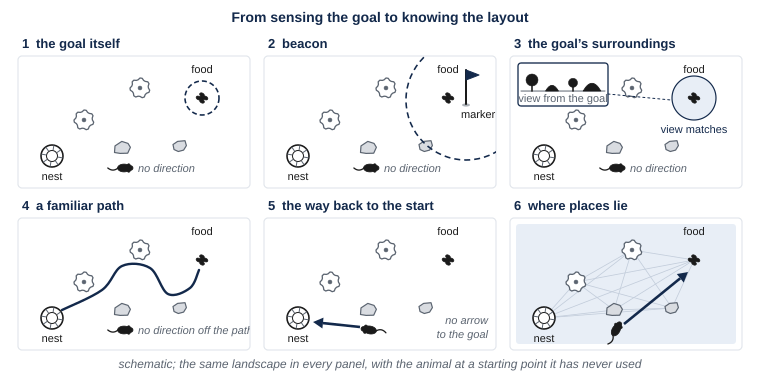{#f-what-is-carried alt="Six panels in a row, each showing the same small landscape from above, with a nest, a goal marked by food, a few large rocks and trees, and an animal at a new starting point. Panel one, labeled the goal itself: a small dashed circle around the food shows how far the food itself can be sensed, and the animal, outside the circle, has no direction. Panel two, labeled beacon: a tall marker stands beside the goal, a much larger dashed circle around it shows how far the marker can be sensed, and the animal, outside even this circle, has no direction. Panel three, labeled the goal’s surroundings: an inset shows the scene as seen from the goal, and only a small circle around the goal is shaded as the region where the view can be matched. Panel four, labeled a familiar path: a winding line runs from the nest past three of the rocks and trees to the goal, and the animal, off the line, has no direction until it reaches it. Panel five, labeled the way back to the start: a straight arrow points from the animal back to the nest, and no arrow points to the goal. Panel six, labeled where places lie: the nest, the goal, and the rocks and trees lie on one plan, and a straight arrow runs from the new starting point directly to the goal."}

These six kinds of knowledge are ranked by what each lets an animal do. They are not stages that an animal passes through as it learns, or that a lineage passed through as it evolved. Researchers once proposed that people first learn what particular spots look like, then the paths between them, and only later where places lie relative to one another. There is little evidence for that order. Many people learn all three on their first visit to a new place. And an animal can carry several kinds of knowledge at once.

### §9.1.3 — What the World Offers, and How Each Cue Fails

The six kinds of knowledge in section 9.1.2 are things an animal has learned and remembers. The animal learns them, and keeps them up to date, from cues. A cue is something in the world, or in the animal’s own movement, that its senses can detect as it moves. A smell, a tree, or the sun is a cue, not knowledge. The knowledge is what the animal has learned about how a cue relates to its goal. The world offers an animal several cues that it can use to find its way, and each cue has a shortcoming. The shortcomings matter, because each one is a problem that some procedure has to solve.

The animal’s own movement is one cue for finding the way. From each step and each turn, the animal can sense how far, and which way, it has gone. But every small estimate of a turn or a step has some error. Any estimate of position built from these signals inherits all of those errors, and nothing in the signals shows how far the estimate has drifted. An error in heading does particular harm, because it becomes a growing error in position as the path goes on. An animal that is swept along or carried has moved without stepping, which its own steps cannot register. And even an accurate sense of how far, and which way, the animal has come points back to one place, the start. It gives no information about the way between two other places.

The sun is a second cue for finding the way. It can give a direction, but it moves through the day, and its path across the sky changes with the season. Under cover, and at night, there is no sun to use.

Landmarks are a third cue for finding the way. A **landmark** is a recognizable feature of the surroundings, such as a large tree, a rock, or a building. A landmark can move, change with the seasons, or look like another one. How useful a landmark is depends on its distance. A nearby object changes its appearance with every step, so it pins down position closely, but only nearby. A distant one barely changes as the animal moves, so it gives a direction but indicates little about position. And a landmark seen from a new place looks different from the way it looked before. In Module 7, we described the problem of recognizing a thing across changes in the way it reaches the senses. A landmark seen from a new angle is one more case of that problem.

The shape of the surroundings is a fourth cue for finding the way. Walls, banks, and the edges of a clearing stay the same from season to season, while colors and plants change. But a symmetric space gives two equally good answers. In a rectangular room, a corner and the corner diagonally opposite it look the same by shape alone. And an open plain has no shape to use.

A fifth cue for finding the way is a gradient, such as a smell that grows stronger toward its source. A gradient leads to the source only as far as the gradient reaches, and then it runs out. That is the limit of an animal that can only steer.

Two further problems remain, even for an animal with several cues. When the cues disagree, the animal has to decide whether they point to the same place at all, and how far to trust each one. And an animal that has lost its heading, after a fright or a tumble, has to recover which way it is facing before anything else it knows can be used .

: Cues for finding the way, what each gives an animal, and how each fails when used alone. {#t-clues}

| Cue | What it gives the animal | How it fails on its own |
|---|---|---|
| The animal’s own movement | How far, and in which direction, it has gone | Small errors add up, and nothing shows how large the error has grown; being carried or swept along registers as no movement; it points back only to the start |
| The sun | A direction | It moves through the day, its path changes with the season, and at night or under cover there is none |
| A nearby landmark | Where the animal is, closely, when it is near the landmark | Its appearance changes with every step; it may move, change with the seasons, or look like another landmark |
| A distant landmark | A direction | It barely changes as the animal moves, so it indicates little about position |
| The shape of the surroundings | Which way the animal is facing, from walls and edges that stay the same across seasons | A symmetric space gives two equally good answers; open ground has no shape to use |
| A gradient, such as a smell | The way toward its source | It reaches only so far, and then runs out |

Which of these cues does the early mammal have on a dark night? We infer, from what we know of its senses, that it has its own movement, smell, touch, and nearby landmarks, and few distant landmarks that it can see. That inference needs one caution. Land animals see much farther at night than fish do by day, so the early mammal was not blind.

### §9.1.4 — What Animals Manage

For all these shortcomings, animals find their way remarkably well. Desert ants forage over flat ground with almost no landmarks, on outward paths that wind back and forth. When they find food, they run home in a straight line rather than retracing the winding path. Orchid bees visit flowers in a fixed order, along routes of more than 10 kilometers. Wild rats living in a large outdoor pen built a set of trails between their nest boxes and their food, and kept to the trails even under snow. Goldfish trained to swim to one place in a tank head for it from starting points they have never used. And London taxi drivers train for three to four years, learning a city of about 25,000 streets, until they can plan a route between any two places in it from memory.

Each of these animals reaches a place it cannot sense from where it starts. Whether they all know the same kind of thing when they do it is a question that experiments on behavior turned out to be poor at answering.

### §9.1.5 — Places or Responses?

Consider a rat that has learned the way through a maze to food. What exactly has it learned? It might have learned a sequence of moves: left, then right, then right again. Or it might have learned where the food is. On the familiar path, the two kinds of knowledge produce the same behavior. They come apart only when something changes.

The first clue came from rats that were given nothing to learn for. In Module 5, we described rats that wandered a maze with no food in it and seemed to learn little, until food appeared at the end. Then they reached it about as efficiently as rats that had been rewarded from the start. Learning that does not show in behavior when it happens, and appears later, once there is a reason to use it, is called **latent learning**. Blodgett ran the first experiment, published in 1929, and coined the term.

Tolman proposed that rats learn something that works like a map of their surroundings, which he called a **cognitive map**. A cognitive map relates places to one another, so that an animal can reach a goal by a route it has never taken. A narrow, “strip” map from start to goal and a broad, “comprehensive” one produce the same behavior on the trained route. They differ only when the start or the route changes. Tolman’s laboratory had already turned this into a definition. To say that a rat expects food at a place, they wrote, is to say that when its trained path is blocked, it takes a path pointing straight at the place. That is still the test of a map: a route never taken, such as a shortcut, a detour, or the way home from somewhere new.

The best-known attempt at that test was run in Tolman’s laboratory. Rats ran five times along a roundabout route to food. Then the route was blocked, and a fan of paths was offered instead. Of 53 rats, 19, or 36%, took the path that ended nearest where the food box had been, and the rest spread over the other paths . The room’s only light was a small desk lamp just behind the old food box, and it stayed there during the test. So heading for the light and heading for the goal were nearly the same thing, and the lamp could have served as a beacon. The authors raised that problem themselves, and argued against it. A researcher reviewing the field decades later reported that two studies could not repeat the result. The reviewer also pointed out that a rat taking a path beside the blocked one, to rejoin its old route farther on, would have been acting just as sensibly.

{#f-radiating-paths alt="Three panels. Panel one, labeled training: seen from above, a short start path leads to a round table, then through a walled alley, and on by a path that turns left, right, and right again to a food box. A lamp is drawn just behind the food box, shining back along the last stretch of path. Panel two, labeled test: the same start path and table, the alley blocked, and twelve long paths fanning out from the table, numbered 1 to 12, plus six short paths on the other side. Path 6 ends just beside the spot where the food box had been, and the lamp is still in place. Panel three: a bar chart of the number of rats choosing each long path. Path 6 has 19 rats; path 1 has 9; path 2 has 5; paths 8 and 10 have 4 each; path 7 has 3; paths 4, 5, and 11 have 2 each; paths 3, 9, and 12 have 1 each."}

Tolman’s laboratory ran a more direct test the same year, on a plus-shaped maze. One path ran between two food boxes, and the rats were started on alternate trials from either side of it. One group of rats was rewarded for always turning right, which took them to different places. The other group was rewarded for always going to the same food box, which took different turns. Learning to go to a location, whatever movements it takes, is **place learning**. Learning to repeat a movement, whatever location it leads to, is **response learning**. All 8 place learners learned the task within 8 trials. Only 3 of 8 turn learners learned it within 72, and the rest kept going to one end of the room. But the room was large, lit only by three overhead lamps, with a rack of the rats’ home cages behind one food box. The authors limited their conclusion to rooms with “marked” cues outside the maze.

Later repetitions sometimes found the reverse, or no difference. In 1957, a researcher gathered the experiments in a review. Of ten that compared how fast rats learned each task, seven found place learning faster and two found response learning faster. The difference lay in the room, not in the rat. Where the surroundings beyond the two arms looked very different, with a rack of cages, a window, or a well-lit room full of objects, rats went to the place. Inside a plain cloth enclosure, or in a plain, dim room, they repeated the turn. Both tendencies were present every time, and one was stronger. The reviewer concluded that “there is nothing in the nature of a rat which makes it a ‘place’ or ‘response’ learner”. Later work added that with long training, rats shift from going to the place to repeating the turn.

So do animals learn places or responses? Either, depending on the cues the setting offers. And that answer left open the question Tolman had asked. A rat that goes to the place might know where places lie relative to one another, or it might know something narrower that happens to get it there. Researchers could not settle which from behavior alone, and whether animals have cognitive maps is still argued. What moved the field was evidence from the brain itself.

### §9.1.6 — Whether to Keep Exploring

A map has to be built before it can be used, and building one means going where the animal has not been. That raises a problem we described in Module 5. **Exploration versus exploitation** is the trade-off between taking an option already known to be decent and sampling one that might be better and might be worse.

For an animal with a home range, the trade-off takes two forms. One is leaving a patch that is running down. Food often comes in patches. The longer an animal stays in one, the more slowly it finds more, and moving to another patch takes time. So the animal has to decide when to leave the patch it is in. The other form is going somewhere it has never been. The two problems differ. Leaving a patch means comparing what the animal is finding now with what patches in its surroundings yield on average. Going somewhere new means choosing without knowing what is there at all.

In both forms, exploring is worth doing only because of the future. Sampling an unknown option usually yields less now. Its value lies in what it teaches, and that value is real only if there will be time to use what is learned. Information about a world that will soon change is worth less, because the change will make it out of date.

What exploring gives up is a known meal. For the early mammal, we suggest, the unknown also held predators, and every step outward made the trip home longer. Those two points are our own framing of the animal’s version of the problem, and are not drawn from research on exploring. No general best answer to the trade-off can be computed in a realistic world, where options are many and much is unknown. So every animal, and every machine, has to settle for rules of thumb.

Exploring is also how a map gets built. The rats that wandered a maze with no food in it, and later reached the food quickly, had been learning its layout as they wandered. Researchers who study curiosity have long counted latent learning among the signs of it.

### §9.1.7 — Wanting to Know

Animals also seek information that no reward depends on. Rats with nothing to do prefer the unfamiliar parts of a maze. Monkeys offered a gamble will give up about a quarter of a reward’s value to learn early whether the reward is coming, though learning early changes nothing about what they get. Pigeons choose an option that averages two food pellets over one that averages three, if the first comes with a signal that predicts what they will get. Why would an animal accept less in exchange for information it cannot use?

Part of the puzzle is that not knowing comes in two kinds. A driver waiting at a traffic light knows exactly which signal will settle when to go. A person who first sees sparks fly from two stones struck together does not know what is even worth asking about them. The first kind of not knowing has a known answer to look for. The second is open-ended. Reward cannot guide the search, because no reward is yet in view, and much time may go into learning before anyone can tell whether it will lead anywhere. An animal venturing past the edge of the ground it knows faces something closer to the second kind.

### §9.1.8 — What the Ancestors Already Had

How much of all this was new for the early mammal? Less than we might expect. Goldfish learn to swim to a place defined by cues around a room, and they reach it from starting points they have never used. Turtles do the same in a dry maze. Fish, chicks, and pigeons all recover their heading from the shape of a space. And reptiles find their way home. Of 25 small geckos, each living in a single tree, that were carried to nearby trees, 11 walked almost straight back to their own tree by the next night. Whether they used their counterpart of the hippocampus to do it has not been tested.

The goldfish, the turtle, and the gecko are not ancestors of mammals. They are living cousins. The line leading to mammals and the line leading to reptiles and birds parted about 320 million years ago, from a common ancestor that was an early four-legged animal. The line leading to goldfish had parted from both earlier still, before vertebrates moved onto land nearly 400 million years ago. Turtles and lizards stand in for the ancestor that mammals share with reptiles, but their brains have kept changing too. In Module 2, we described **homology**, a resemblance between two species that both inherited from a common ancestor. When goldfish, turtles, and rats share a capacity, homology is the simplest reading: their common ancestor very probably had it.

Insects also reach places they cannot sense, keeping a vector home and following views and routes. But their abilities arose separately from those of vertebrates, by convergent evolution, the same problem solved twice from different starting points. They are not an inheritance the early mammal shares.

So what was new for the early mammal was, first of all, the problem. Its warm body needed a great deal of food, found in poor light with smell and touch as the leading senses, and brought home. What changed in its brain is a separate question.

## §9.2 — Algorithmic: Keeping Track, Making Maps, and Exploring

### §9.2.1 — Beacons, Snapshots, and Routes

The simplest procedures work close to the goal. An animal that can sense a beacon can reach the goal by steering toward it. In Module 4, we described steering as moving forward, turning, and letting what the front end detects decide which way to turn. Steering toward a beacon needs nothing else about the goal’s surroundings. But it works only where the beacon can be sensed.

Where nothing at the goal can be sensed from afar, an animal can use what the goal’s surroundings look like. A **snapshot** is a stored view of what the surroundings look like from the goal. A person who parks in a large lot sees a particular scene around the car. They see a lamp post here, a storefront there. Coming back later, the person can find the car by moving until the scene looks like that remembered picture again. The match gets better the closer they get. A snapshot works the same way. But it can be matched only near the goal, where the surroundings still look much as they did.

Insects use snapshots. When a ring of pinecones around a digger wasp’s nest was moved a short distance, the returning wasp searched in the middle of the ring rather than at its nest. Bees trained to find food in the middle of a triangle of landmarks were tested with the triangle enlarged. They searched where the directions to the landmarks matched the directions they had seen from the food. Desert ants searched sharply in an enlarged array only when the landmarks themselves were enlarged too, so that the whole picture matched . Matching is easier for an animal that faces a fixed compass direction while it compares, because it never has to turn the remembered picture to fit the current one. And robot engineers use the same rule: keep going while the mismatch shrinks, and change direction when it grows.

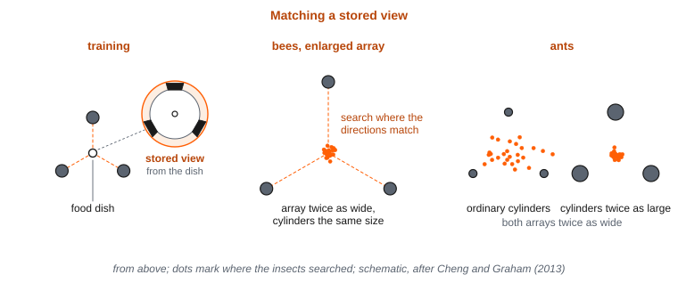{#f-snapshot alt="Three panels seen from above. Panel one, labeled training: three cylinders form a triangle around a small food dish, and a circular inset shows the stored view from the dish, three dark shapes at particular directions and sizes around the horizon. Panel two, labeled bees, enlarged array: the triangle is twice as wide, the cylinders are the same size, and a cluster of dots marking where bees searched sits at the point where the directions to the three cylinders match the stored view. Panel three, labeled ants: two small versions of the enlarged triangle. In the first, with ordinary cylinders, the ants’ search dots are scattered widely. In the second, with cylinders twice as large, the dots are tightly clustered at the center."}

A route takes an animal much farther. A **route** is a fixed sequence of moves, or of landmarks, leading from one place to another. The directions one person gives another, past the church and left at the gas station, are a route. A route can lead an animal much farther from the goal than a beacon or a snapshot can, but only along its own path. Someone who misses the turn at the gas station has nothing in the directions to get back on course.

Following a route needs little. At each point along it, the animal needs only a sensible direction, as if it were walking a corridor with signposts. Desert ants keep a familiar landmark on the same side as in training. And separate routes are kept separate. Desert ants that were picked up while heading home, and set down on their own familiar outward route, behaved as if they were lost. For the early mammal, trails between its nest and its best feeding spots would be routes of this kind, like the trails the wild rats kept to even under snow.

### §9.2.2 — A Running Sum

The animal’s own movement carries information about how far, and in which direction, it has gone. **Path integration** is keeping a running estimate of the straight-line distance and direction back to the start, from a heading and a distance traveled. The result is a home vector. A **home vector** is the straight-line distance and direction from wherever the animal is back to where it started. Unlike a route, a home vector is not tied to a path at all. The hiker who knows that the trailhead lies about a mile to the east has one. A home vector points to one place, the start, from anywhere. But it gives no information about the way to anywhere else.

Desert ants are the best-studied path integrators. An ant leaves its nest and searches for food along a winding path. When it finds food, it runs home in a straight line. The ant’s heading comes from the sun, and its distance from its legs. Ants judge distance correctly in darkness, or with the lower halves of their eyes covered, so vision is not what measures it.

One experiment showed the role of the legs directly . Ants were trained to walk 10 meters along a channel to a feeder. At the feeder, some had bristles glued to their legs, which lengthened them, and some had their legs shortened. Then they were released in a parallel channel to head home. Normal ants began searching for the nest after 10.2 meters. Ants on stilts walked past it, to 15.3 meters, and ants on stumps stopped short, at 5.75 meters. There were 25 ants in each group. The same ants, after walking out and back on their altered legs, searched at about the right distance, 10.55 and 10.25 meters. So something tracks strides, although the researchers write that the ants “most probably do not literally count”. The experiment also rules out a timer. The ants on stilts walked slightly more slowly than normal ants, which would have sent an ant using a timer less far, not farther.

{#f-stilts alt="Two bar charts side by side, with a dashed horizontal line at 10 meters marking the nest. Left chart, labeled test 1, legs altered at the feeder: normal ants 10.2 meters, stilts 15.3 meters, stumps 5.75 meters. Right chart, labeled test 2, legs altered for the whole trip: normal 10.2, stilts 10.55, stumps 10.25 meters. Small drawings of an ant leg, normal, lengthened, and shortened, label the three bars in each chart."}

Path integration has the weaknesses we described in §9.1.3. Every small error in heading or distance stays in the sum, and the home vector points home, not between other places. For the early mammal, its sense of how far and which way it had come would be a running sum of this kind, and it would grow less accurate the farther the animal wandered.

### §9.2.3 — Correcting the Sum

A drifting sum can be corrected in three ways. The first is averaging. In Module 8, we described **cue combination**: combining several estimates, each weighted by how reliable it is. Adults walking back to a starting point, with both landmarks and their own movement to go on, combine the two close to this ideal on average. They give landmarks more weight when landmarks are plentiful and stable. Individuals are less tidy, and most give the more reliable source less weight than it deserves.

The second is resetting. A recognized landmark can replace a drifting estimate outright, especially an estimate of heading. The third is following one source. When two sources disagree by a lot, people stop averaging and follow one of them .

All three rest on one principle. A landmark is worth using to correct the sum only if it stays where it is. For the early mammal, a fallen log passed every night could reset its sense of where it was, while a beetle seen in the same spot last week could not. Children follow one source or the other, rather than combining them. Combining landmarks and self-motion has not been shown in navigation before about age 11.

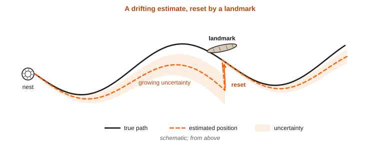{#f-drift-reset alt="A winding solid line marks an animal’s true outward path from a nest. A dashed line, the animal’s estimate of where it is, starts on the true path and gradually drifts away from it, with a widening shaded band around it showing growing uncertainty. Where the true path passes a fallen log, labeled landmark, an arrow shows the dashed line jumping back onto the true path and the shaded band shrinking."}

### §9.2.4 — Keeping a Heading

Heading matters most, because an error in heading becomes a growing error in position. One procedure for keeping a heading is a **ring attractor**. Picture a set of units arranged on a circle, each standing for one direction. Each unit excites its near neighbors, and all of them feed a shared inhibition that holds every unit down. Such a circle settles into a single patch of activity, a bump, at one place on the ring. When nothing pushes the bump, it stays where it is. That is the stored heading. A signal for turning, delivered to one side of the bump, slides it around the ring, faster for faster turns. That is the update. And a recognized landmark adds input at its own place on the ring, which pulls a drifted bump back. That is the correction .

So a ring attractor does for direction alone what the running sum and its corrections do for position. For an animal turning in the dark, the bump would turn with it. Nothing in this description depends on neurons, and robot navigation systems have been built on the same principle.

{#f-ring-attractor alt="A circle of twelve small units, labeled with compass directions. Three neighboring units near the top right are shaded dark, forming a bump. Short arrows between neighboring units show excitation, and lines from every unit to a central disc labeled shared inhibition show that all units feed it. An arrow labeled turn signal enters the bump from one side and points around the ring. A second arrow, labeled landmark, enters at a different unit and pulls toward it."}

### §9.2.5 — From the Animal’s Directions to the World’s

In Module 8, we described a problem with direction on the eye. Where something falls on the eye says nothing about where it is in the world until it is combined with where the eye was pointing. Finding the way raises the same problem one step further. An **egocentric** location is given relative to the animal itself: ahead, or to the left. An **allocentric** location is given relative to things in the world: north of the boulder, or beside the stream. Each is stated in a **frame of reference**, the origin and directions against which a location is measured. An egocentric code stays useful while the animal moves only if it is updated for every step and turn. An allocentric code does not depend on where the animal now stands.

Converting between the two is vector addition . The animal can see the vector from itself to a landmark. It has stored the vector from that landmark to the goal. Added together, the two give the vector from the animal to the goal. Gerbils trained to find food at a fixed distance and direction from landmarks searched as this procedure predicts, and a gerbil that had set off toward the goal kept going when the lights went out. Converting needs one more thing, the animal’s current heading, because the seen vector is egocentric and the stored one is not. A ring attractor can supply it.

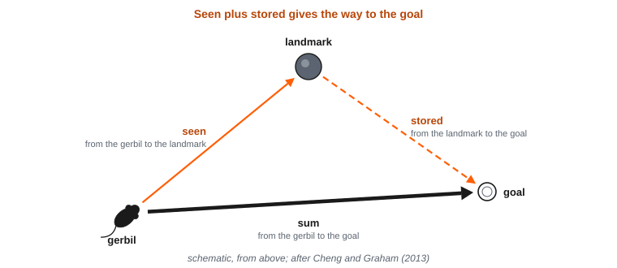{#f-vector-sum alt="Seen from above, a gerbil at the lower left, a cylinder labeled landmark at the top, and a small dish labeled goal at the right. A solid arrow labeled seen runs from the gerbil to the landmark. A dashed arrow labeled stored runs from the landmark to the goal. A thick arrow labeled sum runs straight from the gerbil to the goal, completing the triangle."}

### §9.2.6 — Reorienting by Shape

An animal that has lost its heading has to recover it before anything else it knows can be used. **Reorientation** is recovering which way one is facing, and where one is, after becoming disoriented. The shape of the surroundings can help, but not completely. In a rectangular room, a target corner and the corner diagonally opposite it look the same by shape alone. Choosing that twin is called a rotational error .

Rats looking for food in a rectangular box, with a distinct panel in each corner, chose the correct corner 44% of the time and its twin 25% of the time. Toddlers in a small room ignored a blue wall and searched the correct corner and its twin about equally. In a room twice as large, they used the wall. Fish, chicks, pigeons, rats, monkeys, and people all use the shape of a space to reorient.

Researchers once proposed that a dedicated process matches the shape of the surroundings and ignores everything else. That proposal has lost ground. Many species use features such as colors and objects as well as shape. And mice raised in round enclosures fail to use shape at all, so experience shapes which cue an animal relies on. On the current view, animals choose which cue to trust, weighted by how reliable and noticeable it has proved. In reorientation, people seem to select the most useful cue rather than average several.

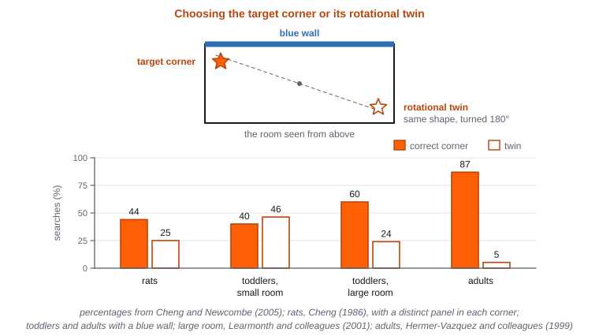{#f-rotational-error alt="Top: a rectangle with one long wall colored blue. The target corner is marked with a star, and the diagonally opposite corner, labeled rotational twin, with an open star. Bottom: a bar chart with paired bars for correct corner and twin. Rats, 44 and 25 percent. Toddlers in a small room, about equal bars for the two corners. Toddlers in a large room, a clearly taller bar for the correct corner. Adults, a much taller bar for the correct corner."}

### §9.2.7 — What a Map Holds

The most informative kind of knowledge is knowledge of where places lie relative to one another, so that the way between any two of them can be worked out. Researchers who study human navigation call this **survey knowledge**, the kind of knowledge that “would support detouring and shortcutting”. A person who knows a town this way can find a detour when the usual road is closed. A map, in the sense we use here, is what holds survey knowledge. It is the only kind of knowledge that can lead an animal from a new starting point to any place it knows.

A map can hold more or less. A **metric map** holds distances and directions between places, like a sailor’s chart. A **topological map** holds only which places connect to which, like a subway map. Human geography is neither perfectly metric nor merely topological. People judge Reno to be east of San Diego, because Nevada is east of California, although Reno is in fact to the west. And remembered positions drift toward the centers of the regions they belong to.

A map also has to keep track of where the animal is on it. One proposal uses codes that repeat across space. Imagine a pattern that repeats across the floor, like tiles, and slides along as the animal moves, driven by a signal for speed and direction. On its own, such a pattern fixes the animal’s position only within one repeat, much as a clock’s minute hand gives the minute but not the hour. But several patterns of different sizes, read together, pin down a single place. Whether brains use codes like these, we take up in §9.3.3.

With the animal’s position and the goal’s in one code, the direction and distance to the goal can be computed directly, even across ground the animal has never crossed. One artificial agent did exactly this, as we describe in §9.2.11. How a route is chosen by searching a map, we leave for Module 12.

### §9.2.8 — Using the Map, and Choosing Which One

A map is useful because choices can be made from it. In Module 5, we described model-based choice: choosing an action by running a model of what leads to what. In finding the way, the map is the model. A remembered chain of turns that once led to food does not help an animal escape a predator from somewhere new. A map of the area does. But a map is more complicated, and early in learning, while it is still wrong, following it can do worse than habit.

Researchers have proposed a third procedure, between choosing by values remembered from experience and choosing by running a model, both of which we described in Module 5. For each place, store an expectation of which places will follow it, and how soon, given the way the animal usually moves. Combined with where food is now, these expectations give every place a value, with no search. Researchers call this a *predictive map*. When food turns up somewhere new, the values change at once. But the expectations were built from the routes the animal has been taking. So when the best route changes, the expectations lag behind. The procedure is quick, and only partly flexible. To give our own illustration, an early mammal whose insects swarm at a new spot along its usual circuit could value the route there at once, but a spot reached only by a route it rarely takes is where the procedure would lag. The predictive map is a proposal for what the hippocampus does, and it has been tested in simulations in which the way the simulated animal moved was supplied, not learned.

An animal that knows many places faces one more choice: which map it is on. A familiar place seen in new light has to be matched to its stored map. A new place that resembles an old one has to get a map of its own. In Module 7, we described the choice between generalizing, treating similar inputs alike, and discriminating, telling them apart. Here the same choice is made for whole places. Old rats sometimes swim straight to a platform hidden under the water of a familiar pool, and sometimes seem lost, as if they had called up the wrong map. As one group of researchers put it, “Proper navigation requires not only locating oneself correctly but also locating oneself on the correct map”.

### §9.2.9 — Ways to Explore

In §9.1.6, we described two exploring problems: going somewhere never visited, and leaving a patch that is running down. Each has its own procedures.

For the unknown, there are three. **Random exploration** is choosing the better-looking option most of the time and another option some of the time, with a setting for how often. **Directed exploration** is adding a bonus to options that are less known, so that uncertainty itself makes an option attractive. And a **novelty bonus** values a thing more simply for being new. A novelty bonus fades with seeing an option. A bonus for uncertainty fades only with sampling it.

People use both random and directed exploration. In one study, people played a game with two options, after a few forced choices that showed them one option more often than the other . When six choices were still ahead, they chose the less-sampled option half the time even when it had looked 8 points worse. Their choices were also noisier than when only one choice was ahead. Both effects held in most individuals, 25 and 28 of 30 people. In monkeys and people facing options they had never seen, the value of what could still be learned about an option predicted their choices better than a fixed bonus for being new.

{#f-horizon alt="A graph with the difference in average points between the two options on the horizontal axis and the probability of choosing the less-known option on the vertical axis. Two S-shaped curves. The one labeled one choice ahead is steep and crosses one half near zero difference. The one labeled six choices ahead is shifted toward the side where the less-known option looked worse, crossing one half at a difference of about 8 points, and it is visibly flatter."}

For a patch that is running down, a rule from the study of foraging gives the best time to leave. Leave when the rate of finding food in the patch has fallen to the average rate for the habitat as a whole, counting the time spent traveling between patches . The rule is stated as a rate of energy gained, and travel time is part of the average, so a richer habitat means leaving sooner. The rule concerns when leaving is best, not how an animal arrives at it. In an early test, chickadees searching blocks of wood for mealworms waited about the same time after their last find before leaving, whatever the patch, and left sooner where food was plentiful, as the rule predicts.

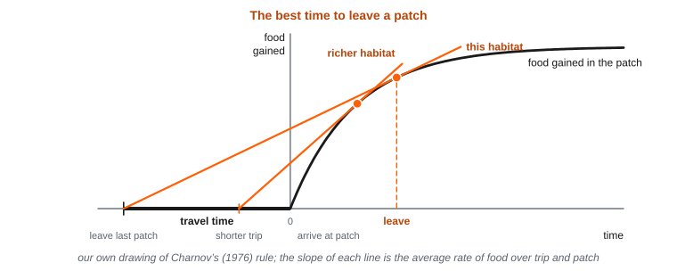{#f-patch-leaving alt="A graph with time on the horizontal axis and food gained on the vertical axis. To the left of zero, a flat stretch labeled travel time. From zero, a curve rises steeply and then levels off. A straight line starts at the beginning of the travel stretch and just touches the curve; a dashed vertical line at the touching point is labeled leave. A second, steeper line labeled richer habitat touches the curve earlier."}

Rats explore an unfamiliar place from a home base. In §9.1.1, we described rats put on a bare platform that settle on a home base within minutes. The spot is usually at an edge or corner, and it is where they stay longest, groom most, and return most often. Their trips out from that spot are slower and have more stops than their trips back . One proposal for why this happens is the argument of this chapter. A running sum drifts, and each return to a known place lets it start again. Landmarks encountered along the way can then be tied to positions measured from home. Researchers have also proposed that a mismatch between where the running sum says the animal is and what its senses report is the signal to explore further. For the early mammal, the nightly trips out from the nest would have been exploring and foraging at once.

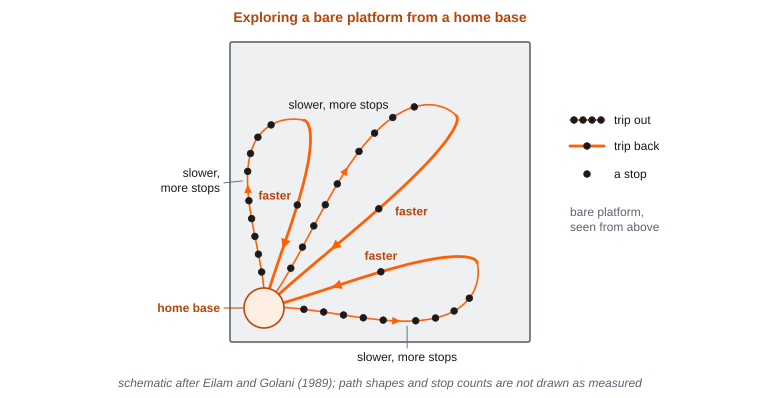{#f-home-base-trips alt="A square platform seen from above, with a shaded spot in one corner labeled home base. Three loops leave the base and return to it. On each loop, the outward half is drawn with many small dots marking stops and labeled slower, more stops; the return half has few dots and is labeled faster."}

### §9.2.10 — Curiosity, and Who Explores Most

In §9.1.7, we asked why an animal would accept less in exchange for information it cannot use. **Curiosity** is a drive to gain information for its own sake, and there are two proposed answers to what it rewards. One is that information is a reward in itself. On this account, curiosity is highest when one knows a little, but not enough. Plotted against confidence, curiosity rises and then falls, in an inverted U.

The other answer is that progress is the reward. An agent that rewards itself for getting better at predicting drops what it already predicts well, and also drops what it cannot learn. It works on whatever it is learning now, and so produces its own curriculum. Adults choosing freely among games of different difficulty settled on games where they were right 70 to 80% of the time. Rewarding progress also avoids a trap. A program rewarded simply for errors in predicting the results of its own moves was held by whatever it could never learn to predict, such as a screen whose channel changed at random, or a doorway where a random outcome sent it back and forth between two rooms. Such a screen slowed the program’s learning badly, though it was not a permanent trap. A reward for progress would have dropped the screen, since nothing about it could be learned. Learning by rewarding progress has been shown in simulated robots. Whether brains do it is open.

Children explore more than adults, and partly in a directed way. But tuning how much to explore to how much time remains matures late, at about 11 or 12. In many species, juveniles are less wary of new things than adults. One proposal is that a long, protected childhood is a period of broad search before narrowing, like a method of searching for solutions that starts out making large, random jumps and settles down over time. The evidence for that proposal is mixed. Our own extension of it is that a young mammal, fed and protected while it explores, has such a period too.

### §9.2.11 — Machines That Map and Explore

Robots face the problem of finding the way too. A robot needs a map to know where it is, and it needs to know where it is to add what it sees to the map. Doing both at once is called **simultaneous localization and mapping (SLAM)**. A robot keeps a running estimate of its position from its own wheels, which drifts. When it recognizes a place it has been before, it pulls the whole loop of its path back into line, which is called loop closure . The parallel to correcting a running sum with a landmark is direct.

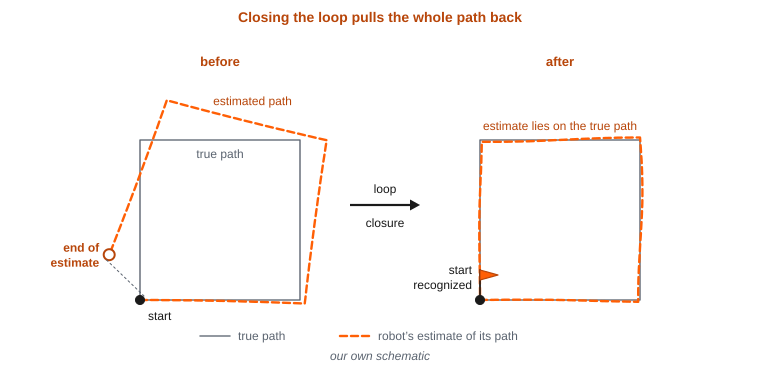{#f-loop-closure alt="Two panels. Left, labeled before: a square true path drawn as a thin gray line, and the robot’s estimated path as a dashed line that starts on the square and drifts outward, so that its end lands well away from the start. Right, labeled after: the robot recognizes the start, marked with a small flag, and the estimated path now lies almost exactly on the true square."}

Machines need help to explore, too. In one study, a program was trained to play Montezuma’s Revenge, a video game of many rooms in which a player taking random actions finds even the first reward, a key in the first room, only about once every few hundred thousand steps. The program was given an extra reward measured by how unlike the screens it had already seen the current screen was, a reward that shrank as similar screens recurred. Without the extra reward, its average score was 2,497. With it, the average was 8,152, against 4,753 for an average human player. It often reached 22 of the 24 rooms of the game’s first level, and occasionally completed the level. Even with no game score at all, the extra reward alone took it through more than half the rooms. But the extra reward helped only with what lay just ahead, not with choices whose reward came much later, such as saving keys for the last doors.

Networks trained to keep track of their own position are a second line of work. In one study, a network trained to keep track of its position from its own movement developed some units that fired in repeating triangular patterns, like the repeating codes we described in §9.2.7. An agent using that network took shortcuts through passages newly opened in a maze. Later researchers tested the claim on more than 11,000 networks trained the same way. Almost all of them came to keep track of position. But units with repeating triangular patterns appeared only when the training targets were coded in a particular way, one chosen with the brain’s grid cells already in mind. So the result shows that such a code can serve an artificial agent. It does not show that training on self-motion produces the code, or that brains have it for that reason.

A third study gives evidence of a different kind. An agent was given nothing but its own change of position and heading, with no vision and no touch, and it was rewarded only for progress toward goals. In houses it had never been in, it reached the goal on 95.1% of trials, along paths that followed the walls. A layout of the free space, including walls the agent had not passed, could be decoded from its memory. And a second agent, given that memory, repeated the trip by a more direct route. No spatial training target was used, which is what makes the result different from the repeating patterns. But three cautions travel with it. The layout was read out by a decoder trained to find it, and shown in examples. The more direct route was the second agent’s, and it mostly cut out the first agent’s detours rather than crossing new ground. And the agent was given its change of position and heading rather than computing it from its movements.

None of these programs shows how brains explore or find the way. They show what a procedure can do in a machine. In Module 8, we called a forward model one precise version of an internal model of the world. A map is a second version, and a much older one.

## §9.3 — Implementational: The Hippocampus and Its Neighbors

### §9.3.1 — A Compass in the Brain

A **head-direction cell** fires when the animal’s head points in one direction, whatever the animal is doing and wherever it is. Different cells prefer different directions, and together they cover the whole circle . Head-direction cells were found in rats in the 1980s and first described in 1990. They lie along a chain of structures running from the brainstem, through the thalamus, to the cortex beside the hippocampus. Damage low in the chain abolishes the signal in the structures above it.

The input that keeps the signal going comes from turning. In Module 8, we described the vestibular system, the organs of balance in the inner ear. Its semicircular canals sense rotation of the head, not where the head points, so a heading has to be added up from turns. When the vestibular organs were destroyed in rats, head-direction cells in the thalamus stopped signaling direction within a day. They kept firing, but not for any one heading, and the direction signal never came back, even though a familiar card on the wall stayed in view. Without the turn signal, there was no heading for a landmark to correct. The rats themselves still moved about and found food.

In the dark, the head-direction signal keeps going, but it drifts within minutes. A familiar landmark pulls it back. When a familiar card on the wall is rotated, every cell’s preferred direction rotates with it, all together. A card takes control of the cells after about 8 minutes in a new room, not after 1. And a card loses control if the animal has seen it move. So turns update one heading signal, and stable landmarks correct it. That is the behavior of a ring attractor. But in the rat, the cells are not laid out in a circle. The ring is a way of arranging them on paper, by the direction each one prefers, and the cells behave as such a ring would.

In the fruit fly, the ring can be seen in the tissue . Neurons tile a doughnut-shaped structure in the middle of the fly’s brain. They carry a single bump of activity. As a fly walking on a ball turns, the bump turns with a landmark the fly can see. In darkness, the bump follows the fly’s turns, drifting slowly. When the fly stands still, the bump holds still too, sometimes for more than 30 seconds. The researchers called the activity “suggestive of ring attractors”, and the wiring of the fly’s ring has since been traced.

In a vertebrate, too, the ring can be seen . In larval zebrafish, about 50 to 100 inhibitory neurons in the front of the hindbrain carry one patch of activity. The patch slides as the larva swims left or right, holds for tens of seconds when the larva rests, and tracks its summed turns for minutes, drifting slowly. The larvae were held still during recording, and vision made no difference. So the heading is kept from copies of the larva’s own swim commands, the efference copy we described in Module 8. Each neuron’s output crosses the ring to inhibit neurons tuned to the opposite direction, which is the wiring a ring attractor needs. This network lies far from the hippocampus, and resembles the lowest stage of the mammalian heading pathway. Its wiring has been traced in one larva, it has not been tested by perturbing it, and whether landmarks can set its direction is not yet known. The fly and the fish solve the problem with a similar arrangement. The researchers read this as shared principles of circuit design, not as shared ancestry. We take a heading signal arising separately in insects and vertebrates to be a likely case of convergent evolution.

{#f-fly-compass alt="Left: a small fly tethered above a floating ball, facing a curved screen with a vertical stripe. Right: three rows, each showing a ring drawn as a doughnut with one bright patch. Row one, labeled stripe: as the fly turns, the patch moves around the ring by the same angle. Row two, labeled stripe jumps: the stripe is moved suddenly and the patch jumps to a new position. Row three, labeled darkness: the stripe is gone, and the patch still moves with the fly’s turns, with a small arrow showing slow drift."}

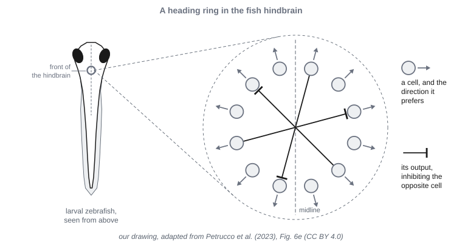{#f-two-rings alt="A circle of small cell bodies, each labeled with an arrow showing its preferred direction. From one cell, a line crosses the middle of the circle and ends with a flat bar on the cell opposite it, marking inhibition. Two more such crossing lines are drawn from other cells. A small sketch of a larval fish at the side marks where in the hindbrain the ring lies."}

### §9.3.2 — Place Cells, and What Happens Without Them

In Module 6, we located the **hippocampus** as an old part of the pallium. In 1971, John O’Keefe, looking for cells involved in memory, recorded from the rat hippocampus and found something else. A **place cell** fires when the animal is in one part of its surroundings, whichever way it is facing. That part of the surroundings is the cell’s **place field**. Together, the place cells cover the whole space .

Place cells do not simply respond to what the animal senses. Their fields survive the removal of landmarks and changes in the lighting. On a track, they at first fire by the distance run from the start, before landmarks correct them, which is the running sum corrected by landmarks. Walls matter most. When a box is stretched, the fields stretch by about half as much, a compromise between the walls and the distance run. A single small object barely moves them. Place fields also depend on how the animal moves. In rats trained to run one way along a track, fields stretched backward, against the direction of travel. And when a barrier was put across a familiar maze, fields near the barrier changed while distant ones did not. The predictive map proposed for the hippocampus reproduces both results, though it does not reproduce the size of fields near a goal.

Place cells are found in rats and mice, in bats, where some fields are up to 32 meters across, in monkeys, and in people. In people with electrodes placed in the brain to treat epilepsy, some cells fired at particular places in a virtual town.

What is the hippocampus needed for? Rats with damage to the hippocampus still swim to a platform they can see, but cannot find a hidden one whose position is defined only by the room around the pool. Rats with damage to the striatum, part of the basal ganglia we described in Module 6, show the reverse. In a plus-shaped maze, rats first learn where the food is, and with more training learn a turn. Silencing the hippocampus with a drug removes the first, and silencing the striatum removes the second. So the answer to whether rats learn places or responses is both, held in different structures. That is the answer that experiments on behavior had reached.

{#f-firing-maps alt="Four panels in a row. Panel one, labeled head-direction cell: a circular polar plot with one lobe pointing up and to the right. Panels two to four each show a square box from above, shaded where the cell fires. Panel two, labeled place cell: one bright patch near one corner. Panel three, labeled grid cell: many evenly spaced bright patches at the corners of equilateral triangles covering the whole floor. Panel four, labeled border cell: a bright band along one wall."}

### §9.3.3 — Grid Cells and Border Cells

Next to the hippocampus, and feeding it, lies the **entorhinal cortex**. In its medial part, a **grid cell** fires at many places, laid out at the corners of equilateral triangles across the whole floor. Grid cells were found in 2005, in the laboratory of May-Britt and Edvard Moser, who shared the 2014 Nobel Prize with John O’Keefe. A grid is described by its spacing, its orientation, and its offset. Neighboring grid cells share spacing and orientation. Spacing grows from the top of the entorhinal cortex to the bottom, up to about 3 meters. The growth comes in steps. Within one rat, grid cells fall into a few groups (called modules), four or five in the most thoroughly recorded animals. Each group has its own spacing and orientation, and each spacing is about 1.4 times the one before. When a familiar box was made shorter, cells in the larger groups stretched their grids to fit, and cells in the smallest group barely changed, so the groups can respond independently. Grids appear within the first minutes in a new place, and survive the removal of landmarks.

The leading hypothesis is that grids are the repeating codes we described in §9.2.7, and that grid cells may keep the running sum of position. There is evidence against a simple version of that hypothesis. Grids stretch when a box is stretched, distort in oddly shaped rooms, and break up when travel is interrupted. And the developmental evidence we describe in §9.3.8 counts against grid cells being the only route to place cells.

Other cells mark the edges of a space. A **border cell** fires along a wall. Related boundary cells fire when a wall lies at a particular distance and direction from the animal. Boundary cells were predicted by a model in 2000 and found in 2009. Touching a wall corrects drift in grid cells. And some entorhinal cells combine head direction, speed, and grid firing, which are the inputs that models of the running sum need. In people, brain scans show a sixfold pattern in entorhinal activity during navigation in a virtual space, as expected if many grid cells share an orientation. That is an indirect signal, not a recording of grid cells.

### §9.3.4 — The Circuit

The parts of the hippocampus form a loop with the entorhinal cortex . The entorhinal cortex sends its input from its outer layers. Its axons reach the **dentate gyrus** and **CA3**. Each dentate cell sends very large synapses onto only about fourteen CA3 cells. CA3 cells also excite one another, each contacting about 5% of the rest. CA3 sends its output to **CA1**, which the entorhinal cortex also reaches directly. CA1 and a neighboring region, the subiculum, send the result back to the deep layers of the entorhinal cortex.

The numbers are lopsided. In the rat, about 200,000 entorhinal cells feed about a million dentate cells. These feed about 300,000 CA3 cells and 400,000 CA1 cells. Dentate cells also fire more sparsely than the rest. So the step from the entorhinal cortex to the dentate gyrus expands the input into many more cells, few of them active at a time. That is the same arrangement as the insect mushroom body we described in Module 7, where a small number of input channels fan out onto many more cells, few of them active at a time.

Two streams of input arrive. A more spatial one comes through the medial entorhinal cortex, and one carrying information about objects and context comes through the lateral entorhinal cortex.

This loop is the mammalian form. Reptiles and birds have a hippocampus in the same place, connected to the thalamus, to the septum below it, and to the cortex above it. But its two or three parts are connected back and forth, rather than mostly one way, and no part of it has been agreed to match the dentate gyrus.

{#f-hippocampal-circuit alt="Four boxes arranged in a loop, sized by cell number: entorhinal cortex, about 200 thousand cells; dentate gyrus, about one million and the largest box; CA3, about 300 thousand; CA1, about 400 thousand. Arrows run from the entorhinal cortex to the dentate gyrus and to CA3, from the dentate gyrus to CA3, from CA3 to CA1, and from CA1 back to the entorhinal cortex. Thinner arrows show the entorhinal cortex also reaching CA1 directly, and a looping arrow on CA3 shows its cells exciting one another. Two arrows entering the entorhinal box from the left are labeled medial, spatial, and lateral, objects and context."}

### §9.3.5 — Many Maps from One Set of Cells

Move a rat to a new room, and its place cells reorganize all at once. Some fire in new places, and others fall silent. This is **remapping**. One rat kept separate maps for eleven rooms.

In Module 7, we described **pattern separation**, making overlapping inputs less alike, so that a later stage can tell them apart. The dentate gyrus is thought to separate places in this way. Dentate cells respond to small changes in the shape of a box that CA3 cells ignore. Damage to the dentate gyrus impairs telling apart places that differ only slightly. And CA3 needs input from the dentate gyrus to keep maps separate, but not to recall a map it already has. Whether the sparse firing of dentate cells is what does the separating is still a model, not a finding.

The choice between maps that we described in §9.2.8 can be seen in place cells. In one experiment, a square box was changed step by step toward a circle. The place cells kept the square’s map for a while, and then switched all at once to the circle’s map . That is how a set of cells with a few stable states would behave. In the other direction, CA3 keeps place fields intact when some landmarks are removed, which is pattern completion, recovering a whole stored pattern from part of it, applied to a place.

Remapping is not only separation. When place cells remap, grid cells and head-direction cells shift together into a new alignment, and silencing input from the entorhinal cortex causes remapping. And remapping keeps something . In rats moved between two boxes with different cues, and in mice moved between a real box and a virtual one, the place cells remapped and the grids shifted. Yet a place cell tended to fire where the same grid cell was active in both rooms. The relation was modest: a correlation of 0.322 across 115 pairs of cells in seven rats, and 0.273 across 64 pairs in four mice, with each pair recorded in the same animal. One model had predicted this result. In it, entorhinal cells carry a code for layout shared by all rooms, and hippocampal cells tie that code to what is sensed in each room.

Only stable landmarks anchor these maps. Cues that a rat has seen move have little control over its place fields. For the animal in a changed room, this is the procedure of choosing a map, carried out by cells.

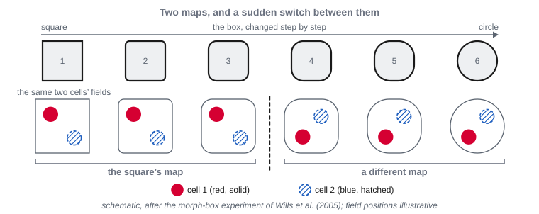{#f-morph-remapping alt="A row of six outlines changing from a square, through rounded squares, to a circle. Beneath each outline, the firing fields of the same two cells, one red and one blue. In the first three shapes, the red field sits in the upper left and the blue field in the lower right. From the fourth shape on, both fields jump to new positions and stay there through the circle."}

{#f-remap-grid-phase alt="Two square boxes side by side, labeled room A and room B. In each, a triangular lattice of faint circles marks where one grid cell fires; the lattice in room B is shifted relative to room A. In each box, one solid patch marks the place cell’s field. In room A it sits near the upper left, on one of the lattice circles. In room B it sits near the lower right, again on one of the lattice circles."}

### §9.3.6 — Which Thing Was Where, and What Is New

A structure that keeps a map can keep more than places. The hippocampus carries little information about objects in themselves, and much about the place and the context an object was in. Damage to it spares a sense of familiarity, and impairs learning where objects are. In rats that learned which object was rewarded in which room, hippocampal activity coded the room first, then the position, then the object. Rats explore a familiar object longer when it turns up in a different familiar setting, and damage to an input of the entorhinal cortex removes that preference while sparing ordinary recognition . People with damage to the hippocampus have trouble remembering where several objects were in a room. And in one recent study of food-caching chickadees, each hidden seed was marked by activity in its own group of hippocampal cells, and the same activity returned when the bird came back for it.

There are three views of what the hippocampus is for. On the first, it served first as a map, and memory for what happened where grew out of that. On the second, memory came first, and space is one relation among many. On the third, the same circuit suits both equally. The comparative evidence we describe in §9.3.7 gives the first view its weight. But that evidence is partly a matter of what was tested, since nearly all comparative work has looked at memory for places.

The hippocampus also takes part in exploring. Researchers proposed that a mismatch between where self-motion says the animal is and what its senses report is the signal to explore. A rat given a shock moments after entering a box learns little fear of the box. A rat that explored the box first learns a lot, and silencing its hippocampus during the exploration removes that head start. That is the latent-learning finding from Module 5, now located in tissue.

Novelty also releases dopamine in the hippocampus, from two sources. One is the *ventral tegmental area*, a source of dopamine in the midbrain. The other is the *locus coeruleus*, the main source of norepinephrine, whose axons release dopamine as well. Neurons in both become more active when an animal encounters something new. In mice, stimulating either input while the animal learns a new maze makes its new place map steadier. And silencing the locus coeruleus input to CA3 blocks the memory of a new setting. These results concern maps and memory, not whether the animal explores. How the brain detects that a place is new is less settled, and why the hippocampus has two dopamine inputs is not known.

The value of exploring has been recorded in monkeys, in the amygdala and the ventral striatum, structures that every vertebrate has. Dopamine neurons in monkeys are reported to respond to the chance of early information and to novelty, a response that fades as things become familiar. That extends the prediction error we described in Module 5. In people, the frontmost part of the prefrontal cortex is engaged in directed exploration. That region is found only in primates, so it says more about human exploring than about the early mammal’s.

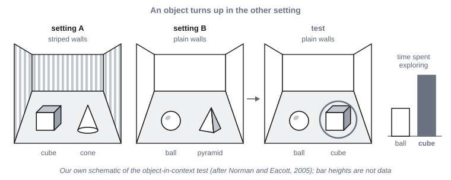{#f-object-in-place alt="Three panels. Panel one, labeled setting A: a box with striped walls holding a cube and a cone. Panel two, labeled setting B: a box with plain walls holding a ball and a pyramid. Panel three, labeled test: the plain-walled box of setting B, now holding a ball and a cube. The cube is circled, with a bar beside it showing longer exploration than for the ball."}

### §9.3.7 — Older Than Mammals

The same split between place and cue appears in animals far from mammals . Goldfish trained in a maze chose the rewarded place about 85% of the time. After damage to one region of the forebrain, they fell to about 60–65%, and from new starting points to about chance. Yet they learned a goal marked by a visible cue as well as before. In a grid of feeders, damaged fish did as well as intact ones until the cues near the goal were removed, which shows they had been steering to a nearby cue. Turtles with damage to the corresponding region chose the rewarded place about 32% of the time, against 74% for intact turtles, and still learned a marked goal. With more training, they relearned the place, but only while they could see the part of the room behind the goal, as if matching a snapshot. Birds show the same split. Chickadees and zebra finches with damage to the hippocampus cannot find a place by its position, but can when a color marks it. In lizards, the one lesion study is unclear.

In each case, damage removes the place strategy and spares cue-following, as in rats. That is evidence that these regions are homologs, inherited from a common ancestor, doing the same job. In goldfish, the region sits on the side of the forebrain, not at its inner edge. In ray-finned fish, the forebrain develops by folding outward instead of inward, which moves the counterpart of the hippocampus to the lateral part of the pallium .

{#f-goldfish-place-cue alt="A bar chart with three groups of bars, each comparing intact fish with fish whose lateral pallium was damaged. Place task: intact about 85 percent correct, damaged about 60 to 65 percent. Cue task: both about 85 to 90 percent. New starting points: intact about 60 to 78 percent, damaged near the chance line. A dashed line marks chance."}

{#f-eversion alt="Two rows of cross-sections through an embryonic forebrain. Top row, labeled mammal: a tube whose walls curve inward and down, with a colored region at the inner top edge labeled hippocampal region. Bottom row, labeled ray-finned fish: the same tube whose walls fold outward and down, so that the colored region ends up on the outer side, labeled lateral pallium."}

Caching birds show the same link between place and hippocampus. Chickadees with damage to the hippocampus hide food normally but rarely find it again. Nutcrackers with damage find seeds hidden 15 minutes earlier, but not ones hidden hours earlier. Families of birds that store food have a larger hippocampus for the size of their forebrain. A correlation cannot by itself tell cause from consequence, but young tits allowed to store seeds grow a larger hippocampus than young tits that are not.

The cells match the lesions, with differences . In freely swimming goldfish, cells in the lateral pallium fire by head direction (31 of 132 cells), near the walls of the tank whichever wall it is (11 of 132), or with swimming speed (43 of 132). None had a place field or a grid. In quails, about one hippocampal cell in eight is a head-direction cell, more broadly tuned than a rat’s. In tufted titmice, food-storing songbirds, most excitatory hippocampal cells are place cells, much as in rats. Zebra finches, which do not store food, have fewer, 48 of 179 cells against 321 of 538 in titmice, and the researchers offer the link to storing food only as speculation. No spatial cells had been reported in reptiles as of 2017, which is an absence of evidence. Grid cells have so far been found only in mammals: rats, mice, bats, monkeys, and people. So place cells are not what mammals added.

What did mammals elaborate? As far as the evidence goes, mammals have a dentate gyrus, with no agreed counterpart in reptiles or birds. The mammalian hippocampus has more parts, several with more than one layer of cells, and signals pass through them mostly one way. Beside them lies an entorhinal cortex, with its grid system. And the mammalian hippocampus has stronger ties to the neocortex and weaker ones to the septum below it. Nocturnal mammals also have larger smell structures. The region is agreed to be the same region across these animals, but which part matches which is argued. One reviewer suggests that birds and mammals reached memory for many places partly in parallel.

{#f-vertebrate-map-tree alt="A branching tree with six tips: goldfish, amphibians, turtles, lizards, birds, mammals. A marker on the branch point between mammals and the reptile-and-bird line reads about 320 million years ago. Beside each tip, a label for lesion evidence: impaired by lesion for goldfish, turtles, birds, and mammals; unclear for lizards; untested for amphibians. A second label lists cells recorded: goldfish, head-direction, wall, and speed cells, no place or grid cells found; birds, head-direction cells in quail and place cells in titmice; mammals, head-direction, place, grid, and border cells; turtles, lizards, and amphibians, none reported."}

### §9.3.8 — Growing and Changing a Map

The spatial cells appear in rat pups in a particular order . Head-direction cells are adultlike at about two weeks old, around the time the eyes open, and they act together as one ring even before single cells settle. Border cells are present by about 17 days. Place cells are present at 16 to 17 days, but are the slowest to mature, into the sixth week. Grid cells appear last, at about 20 to 21 days, and mature almost at once. Pups find their way home by path integration, and their place cells track distance traveled, before grid cells appear. That counts against grid cells being the only route to place cells.

A map can also change in adulthood. London taxi drivers train for three to four years to learn the city’s streets. One study followed 79 men through that training. The 39 who qualified gained gray matter in the back part of the hippocampus. Those who failed, and a control group, did not. The qualifiers also got worse at recalling a complex drawing. The study followed the same people over time, but they were not randomly assigned to train. The qualifiers also trained more hours a week, and a predisposition cannot be ruled out.

Navigation also changes in later life. In aging, path integration is particularly vulnerable, and strategies that use a map decline more than those that use the body’s own frame.

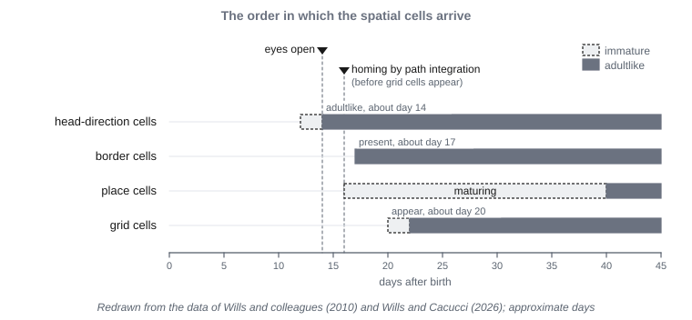{#f-pup-timeline alt="A horizontal timeline from day 0 to day 45 after birth, with four rows. Head-direction cells: a bar starting at about day 14, adultlike from about day 16. Border cells: present from about day 17. Place cells: present from about day 16, with a long lighter stretch to about day 40 marked maturing. Grid cells: appear at about day 20, maturing almost at once. Above the rows, markers note eyes open at about day 14 and homing by path integration before grid cells appear."}

<!-- PLACEHOLDER: Close, An Old Map in a New Animal, then Further Reading. Final pass. -->

## Glossary

**allocentric** — Given relative to things in the world, independent of where the animal is or which way it faces.

**beacon** — Something sensed at or beside a goal, which an animal can approach directly without knowing where the goal lies relative to anything else.

**border cell** — A cell in the entorhinal cortex that fires when the animal is along a wall or other edge of its surroundings.

**CA1** — The region of the hippocampus that receives the output of CA3, as well as direct input from the entorhinal cortex, and sends the result back toward the entorhinal cortex.

**CA3** — The region of the hippocampus that receives input from the dentate gyrus and the entorhinal cortex, and whose cells excite one another as well as sending output to CA1.

**cognitive map** — Tolman’s term for knowledge of the surroundings that works like a map, relating places to one another so that an animal can reach a goal by a route it has never taken.

**cue combination** — Combining estimates from several sources of evidence, such as two senses, by weighting each according to how reliable it is.

**curiosity** — A drive to gain information for its own sake, even when no reward depends on it.

**dentate gyrus** — The region of the hippocampus that receives input from the entorhinal cortex and passes it on to CA3, spread across many more cells that fire sparsely. It is thought to keep similar places apart.

**directed exploration** — Adding a bonus to the value of options that are less known, so that uncertainty itself makes an option attractive.

**egocentric** — Given relative to the animal itself, such as ahead or to the left.

**entorhinal cortex** — The cortex beside the hippocampus that supplies most of its input and receives its output. Its medial part holds grid cells.

**exploration versus exploitation** — The trade-off between taking an option already known to be decent and sampling one that might be better and might be worse.

**frame of reference** — The origin and directions against which a location is measured, such as the animal’s own body or fixed things in the world.

**grid cell** — A cell in the medial entorhinal cortex that fires at many places, laid out at the corners of equilateral triangles across the animal’s surroundings.

**head-direction cell** — A cell that fires when the animal’s head points in one direction, whatever the animal is doing and wherever it is.

**hippocampus** — An old part of the pallium, with counterparts in fish, reptiles, and birds, whose cells in mammals include place cells, and which is needed for finding places defined by their surroundings.

**home vector** — The straight-line distance and direction from where an animal is back to its starting point. It points to one place from anywhere, but gives no information about the way between other places.

**homology** — A resemblance between two species that both inherited from a common ancestor. The counterpart of analogy, and the answer that attributes a similarity to a shared origin rather than a shared problem.

**landmark** — A recognizable feature of the surroundings, whose position relative to a goal or a route an animal can learn.

**latent learning** — Learning that does not show in behavior when it happens, and appears later, once there is a reason to use it.

**metric map** — A map that holds distances and directions between places.

**novelty bonus** — Extra value given to an option simply for being new, which fades as the option is seen.

**path integration** — Keeping a running estimate of the straight-line distance and direction back to the starting point, from the heading and the distance traveled.

**pattern separation** — Making overlapping inputs less alike, so that a later stage can tell them apart.

**place cell** — A cell in the hippocampus that fires when the animal is in one part of its surroundings, whichever way it is facing.

**place field** — The part of the surroundings in which a place cell fires.

**place learning** — Learning to go to a location, whatever movements it takes to get there from the starting point.

**random exploration** — Choosing the better-looking option most of the time and another option some of the time, with a setting for how often.

**remapping** — The reorganization of place cells when an animal moves to a different environment, with some cells firing in new places and others falling silent.

**reorientation** — Recovering which way one is facing, and where one is, after becoming disoriented.

**response learning** — Learning to repeat a movement, such as a turn, whatever location it leads to.

**ring attractor** — A circle of units, each standing for one direction, that excite their neighbors and share inhibition, so that a single bump of activity holds a heading, slides when the animal turns, and is pulled back by recognized landmarks.

**route** — A fixed sequence of moves, or of landmarks, leading from one place to another, which works only along its own path.

**simultaneous localization and mapping (SLAM)** — Building a map of the surroundings while keeping track of one’s own position on it, when each depends on the other.

**snapshot** — A stored view of what the surroundings look like from a goal, which an animal can match only near the goal.

**survey knowledge** — Knowledge of a layout in which places are related to one another all at once, as if seen from above, so that shortcuts and detours can be worked out.

**topological map** — A map that holds only which places connect to which, like a subway map.
